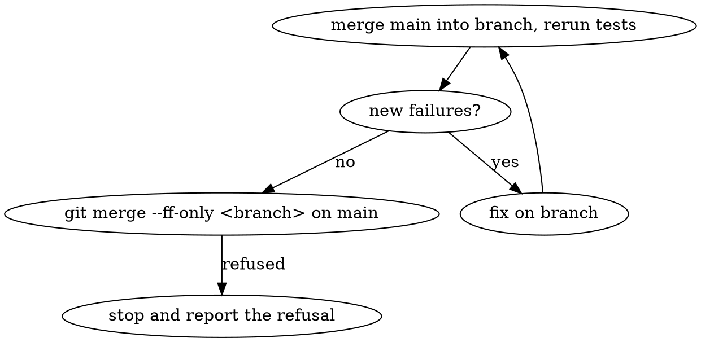

# Landing work on local main in a shared checkout

## Overview

The full record is `docs/reference/shared-checkout.md` section 「같이 하는 깃」.
`AGENTS.md` section 「같이 하는 깃」 is the safety summary every session reads; it points here and there.
This file repeats the commands. A rule change edits `docs/reference/shared-checkout.md`, and the summary in `AGENTS.md` only when its wording changes.
The repo is the `rosy-platform` folder under that umbrella; the drive differs per machine. One `.git/index` serves the
shared `main` checkout. A path you did not write belongs to another session.

## Before you start

First apply the operating budget in `docs/reference/shared-checkout.md` section 「워크트리 한도와 슬롯 운영」:
at most 15 total worktrees including main (the gateway refuses at 14 under `.worktrees/`, D-886). Count locked, waiting and orphan worktrees too; free a slot before starting another task.
The gateway's 14-directory refusal below is a mechanical backstop, not permission to exceed that operating budget.

```bash
cd <umbrella>/rosy-platform        # the shared main checkout
git status --short --branch; git worktree list
python tools/worktrees.py new <short-name> <type>/<topic>     # not a bare `git worktree add`
python tools/worktrees.py status                              # every worktree with a verdict
```

- `new` (D-761, Proposed) checks `<type>` (`feat`, `fix`, `refactor`, `docs`, `uiux`) and removes nothing:
  it reports how many finished worktrees `python tools/worktrees.py prune --apply` would remove (any owner's:
  clean, merged into `main`, not locked, no ignored data, idle 1 h when its branch landed a commit of its own
  and 72 h otherwise (D-790), so nothing is left to lose; your own landed worktree needs no wait; orphan directories
  idle 1 h, their files zipped to `$ROSY_SCRATCH/worktree-orphans/` and verified first);
  `new --prune` applies that first. It refuses at 14 directories under `.worktrees/` (15 with main, D-886) and names each worktree
  removable now and by whom; `status` shows each row's owner (`unknown` when none; `new --owner "<who>"` sets it)
  and whether you may remove it. `landed-dirty` = the branch is in `main` but files are uncommitted: move the
  work to a new worktree. `stale-history` = a pre-rewrite branch: never merge or land it (`new --from` refuses it). `prune --snapshot` keeps uncommitted work under `refs/wip/<date>/<name>` and
  removes dirty or unmerged worktrees too, the caller's own unless `--all`: only a person or the dispatcher runs it.
  `--force-over-cap "<reason>"` is the incident escape hatch. `git worktree lock` keeps a worktree.

- One landable concern and one module family per branch. Over ~15 changed files, or `land.py --dry-run` says FULL
  (30-90 min per round): split first. Land FULL-trigger (`tools/harness/**`, `contracts/foundation/**`) and `shared/web`
  parts on their own branch first; land the split of a D-766 unit at >=95% of its limit before adding to it.
- `.worktrees/` is gitignored; do not create worktrees elsewhere. Scratch files go to `$ROSY_SCRATCH` (unset: the system temp directory).
- Check `ListAgents` (when available) for peers and what they own.
- Background executors: commit after every step, and the dispatcher runs a commit monitor
  — 40 minutes without a new commit on the branch is a warning to check on the executor.

## Committing

- `git add <path> ...` with **only** paths you created or changed, taken from `git status --short`.
  Never `git add -A`, `git add .`, or a directory. One wrong path aborts the whole `git add`,
  so check the exit code before committing.
- Before a pathspec-less commit: `git diff --cached --name-only` must equal your list. If a
  peer staged something in a shared index, commit with `git commit --only <your paths>` —
  only for files that are wholly yours, because `--only` records their working-tree content.
- Never `--amend`, `rebase`, `reset --hard`, or `stash` in the shared checkout: HEAD may be
  a peer's commit by then. Never `git commit -- <shared file>` (it takes the working tree,
  sweeping in a peer's rows).
- Append-only shared files (`docs/reference/ROSY ADR Log.md`, `docs/logs.md`) may hold a
  peer's uncommitted rows: stage only your line (`git apply --cached --unidiff-zero my-row.patch`),
  then verify `git diff --cached -- <file>` shows only yours.
- Docs that name a branch use the exact `git branch` name (`feat/rosy-skills`), never a paraphrase.

## Tests: yours or pre-existing?

Run the relevant suites in your worktree, then compare against the list of failures that
already exist on main:

```bash
python -m pytest <paths> -q -rfE -p no:cacheprovider > "${ROSY_SCRATCH:-${TMPDIR:-/tmp}}/<name>/run.txt"
python test/known_failures.py "${ROSY_SCRATCH:-${TMPDIR:-/tmp}}/<name>/run.txt"     # exit 1 = a NEW failure
```

A `NEW` line is yours until proven otherwise (check it on a clean `main` worktree). If
your change fixes a listed failure, delete its line from `test/known_failures.txt` in the
same commit. Never add a line to hide a failure your branch introduced.

## ADR numbers

Reserve **right before writing** — peers take numbers minutes apart (D-510):

```bash
python tools/harness/adr_reserve.py next "<topic>"                    # prints D-nnn; use it
python tools/harness/adr_reserve.py list                                # local refs/adr reservations
python tools/harness/adr_reserve.py release D-nnn --reason "<topic>"   # give back an unused number
```

The tool scans `docs/adr`, Log rows and gaps on every branch, remote-tracking ref and
worktree plus `refs/adr/D-*`, then creates `refs/adr/D-nnn` create-only; only one session
can win a number. The ref is local — CI never sees it, and lint only warns about it. If the
ADR will not land with this branch, add `D-nnn reason` to `tools/harness/adr_gaps.txt`
before push. Commit the ADR file **and** its Log row together (the Log is UTF-8 with BOM and
**CRLF** — keep both), then `python tools/harness/rosy_harness.py lint`. A number lost to a
collision also goes into `tools/harness/adr_gaps.txt`.
API reference versions work the same way: `python tools/harness/api_reserve.py next "<topic>"`
prints and claims `v1.NNN` (`refs/api`), and `api_reserve.py bump v1.NNN` moves every live-version
pin (reference header, tests, `app.py`) in one command; rename your own `### v1.NNN` row by hand.
The ADR Log and `adr_gaps.txt` merge with `merge=union`; if that leaves two rows for one
number, keep the row with the newer Status. `logs.md` still conflicts: keep both entry
blocks whole, one after the other. Regenerate `index.md` conflicts with
`python tools/harness/rosy_harness.py generate`.

## Landing

착지 도구: from the topic worktree run `python tools/land.py --tests auto` (`--dry-run` first to see the plan).
It loops merge main -> auto-resolve ADR Log/logs.md/index.md conflicts -> D-436 affected tests + lint
-> `known_failures` -> `--ff-only`, stops on any NEW failure or other conflict, and never pushes.
It first takes a ticket in the landing queue (`<git-common-dir>/rosy-land-queue/`, D-803) and waits, printing its
position and who is ahead, until the landings ahead have finished; past `--queue-timeout` minutes (default 180) it
stops without merging or testing. First in line, it merges main once and tests. The ticket is released on every
exit (errors and Ctrl-C included); a dead holder's ticket (PID gone on this host, or not refreshed for 3 h) is
removed by the next session. `--no-queue` is for incidents only. After a green FULL tier, a moved main costs only
main's delta selection, also in a fresh `land.py` run after an interrupted one, as long as the branch added nothing
but merges of main (`<git-common-dir>/rosy-land-full/`); a new commit of its own means FULL again.
The manual steps below are what it does.

테스트는 시험 PC에서만 돈다(D-584): 닿는 PC가 없으면 10분 기다린 뒤 실패하고 착지하지 않는다. 노트북 로컬 실행(`--local`, `ROSY_TEST_LOCAL`)은 없다. 못 돌린 시험은 "확인 못 함"으로 보고한다.



1. In the worktree: `git merge main`, rerun the relevant tests, compare with `known_failures`.
2. In the main checkout: `git merge --ff-only <branch>`. If main has new commits, repeat step 1
   and try `--ff-only` again. There is no `--no-ff` landing.
3. If git refuses because a peer's uncommitted file would be overwritten: leave that file.
   Report the refusal. Do not stash, checkout, or delete it, and do not clean the file and retry.
4. `tools/land.py` only reports finished worktrees when it starts (`--prune` removes them, `--no-prune`
   is silent). Remove your landed worktree after leaving it, in the main checkout, with one command:
   `python tools/worktrees.py prune --apply` (your own landed worktree goes at once, others' landed ones after 1 h).
   Do not keep working in a landed worktree. `land.py` refuses a `stale-history` branch, checks D-766 sizes
   before any remote test (`python tools/harness/size_range.py main HEAD` shows it first), and reruns 1-5 NEW ids
   alone once: all pass -> `LOAD-FLAKY`, landing continues, ids go to `<git-common-dir>/rosy-flaky-candidates.txt`
   for a person to review (never auto-quarantined); any fails again -> stop. A stop reruns its NEW ids once on main:
   red there too -> `MAIN-RED` (main is broken; fix main in a small `fix/` branch first, after checking no peer is). A branch
   you hold back stays as long as it is committed; `git worktree lock` keeps its worktree too.
5. Push only when the task says to push, in the D-868 order: land on local main first; if `origin/main`
   is not an ancestor, `git merge origin/main` in a worktree and land it; push local main's tip as
   `publish/main-<YYYYMMDD>`, open a PR, merge it with `gh pr merge <PR> --merge --match-head-commit <SHA>`
   once `ci-result` is green, then sync back: `git merge origin/main` in a worktree off main and land it
   with `tools/land.py` (not `--ff-only`: main has usually moved past the published SHA). Never squash, rebase-merge
   or force-push. Local main ahead of `origin/main` has no CI evidence.

## Red flags — stop

- "I'll just `git add -A`, the other files are probably fine."
- "The failing test is unrelated" — without running `test/known_failures.py`.
- "D-26x looked free ten minutes ago."
- "I'll stash their change and put it back after the merge."
- "Amend is quicker than a new commit."

Background: `docs/solutions/workflow-issues/adr-numbers-collide-between-concurrent-sessions-2026-09-25.md`.
