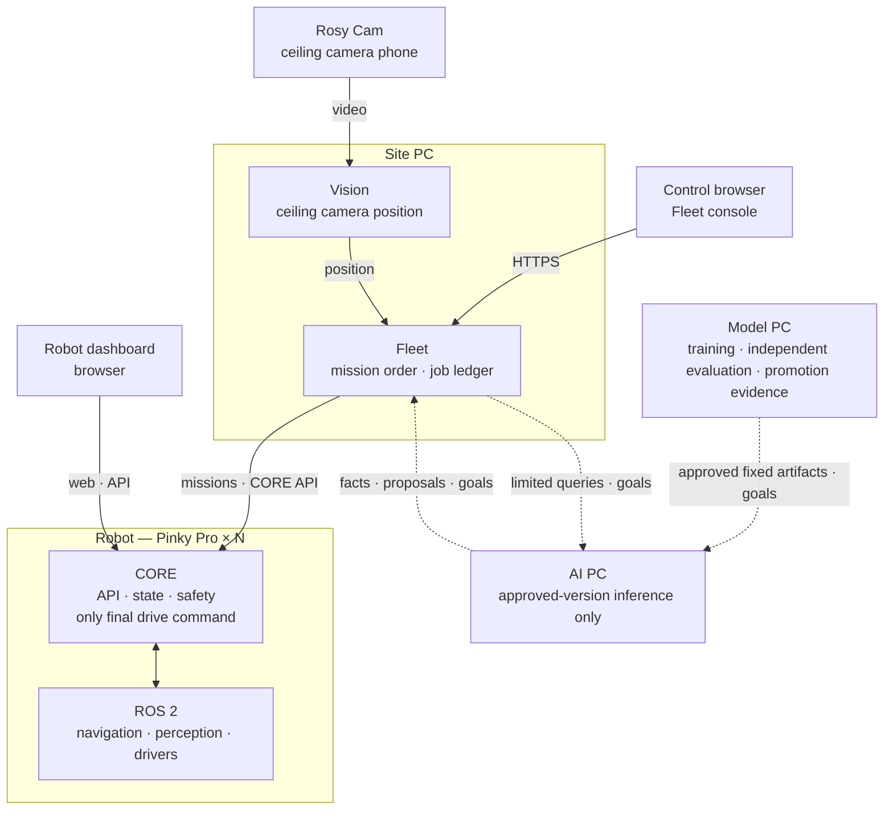

# ROSY Platform

한국어: [README.md](README.md)

ROSY Platform connects observed world state, site mission coordination, safe robot execution, and offline learning · evaluation. The first hardware is the Raspberry Pi 5 based **Pinky Pro** driving robot, which started from the [pinky_pro](https://github.com/pinklab-kr/pinky_pro) fork. Alongside it, the **OMX** arm cell (S · A · B) handles palletizing tasks. The cell keeps its cameras and coordinates through a [calibration system](docs/reference/calibration-system.en.md) that ties measurement, verdicts, and human approval into one path, and imitation-learning data travels from teleop recordings through LeRobot export and an HF round trip back into cell model verification ([learning-data video records](docs/reference/video-records-learning.en.md)). Real and sim demos are kept as video records with evidence tags ([real · sim demo video records](docs/reference/video-records-demo.en.md)).

Existing vehicles and new support candidates are separated in [robot compatibility and verification status](docs/reference/robot-compatibility.md). RaspTank Metal / Pi 4 is a support candidate with an unpowered source profile prepared; it has no device drivers, integration image, or real-hardware acceptance yet.

The goal is a general execution platform where business apps assign tasks to robots without changing the platform, and the first applied case is the port app Harbor. [PRODUCT.md "Product Purpose"](PRODUCT.md#product-purpose) is the source of truth for the completion conditions.

## Getting started

| I am | Start here |
|---|---|
| New team member | [Handoff](docs/reference/handoff.md): what we build and how far we got → [Team guide](docs/reference/team-guide.md): from accepting the invite to your first PR |
| Person · agent on the lab shared checkout | [Working on shared git](docs/reference/shared-checkout.md): work location and stop conditions |
| PR author · reviewer · publisher | [Working with git](docs/reference/git-workflow.md): branch · commit · PR · push rules · [PR pipeline](docs/reference/pr-pipeline.md) · [Contributing](.github/CONTRIBUTING.md) |
| Concurrent work · shift owner | [Task split and handoff](docs/reference/team-guide.md#36-동시-작업과-인수인계) · [Task · bug issue forms](https://github.com/robotics-team-1213/rosy-platform/issues/new/choose) |
| Build · sim · test · deploy | [Developer guide](docs/reference/developer-guide.md) |
| Product app developer | [Applications](applications/README.md): where to develop per product · [Fleet app](applications/fleet/README.md): screens and app entry points |
| Current implementation · verification status | [STATUS.md](STATUS.md): gates per module |

Changes reach `main` through PRs from topic branches. Review, CI, and merge conditions follow the [PR pipeline](docs/reference/pr-pipeline.md), and documentation follows [D-777](docs/adr/D-777-concise-human-agent-documentation.md).

## At a glance

User-facing apps and internal services are separated in [app names and roles](docs/reference/app-names-and-roles.md). Palette loading (Cell) is Fleet's palletizing job preparation screen, and the robot face and Pilot connection lobby are sub-features of each app. Account · Monitoring · Media and shared code used by several apps live in the [common services catalog](docs/reference/common-services.md).

Control console R and cell control are logical units, and CORE · OMX owners own final device execution. The execution PC and the operations browser are separate. The figure below summarizes role connections and does not mean everything runs on one PC. Current and target hosts are in the [control unit placement table](docs/deployment/control-units.md#현장-배치표); implementation vs acceptance status and remaining structural work are in [D-995](docs/adr/D-995-control-structure-authority-and-evidence-status.md).

| Component | Runs where | What it does |
|---|---|---|
| **CORE** | Each robot | The only window that talks to the outside. Guards state · safety and issues the final drive command alone |
| **Fleet** | Site PC | Splits missions across robots and owns the job ledger. It reads and writes the current pose through World directly and does not move robot motors itself |
| **Vision** | Site PC | Creates map-position observations from the ceiling camera. Used for display and monitoring; CORE issues the final drive command |
| **Perception · navigation** | Each robot | Lane · obstacle observation and paths. Detailed ownership is in [Perception and judgment](docs/reference/developer-guide.md#인지와-판단) |
| **Learning · evaluation** | Model PC | Trains and evaluates models from data and human answers, and builds promotion evidence for fixed artifacts |
| **AI inference** | AI PC | Produces only identity facts or Mission/Task candidates from approved model versions. No Fleet ledger or device command authority. Currently at the offline connection-test stage |

Dashed lines are target connections. The current implementation vs proposal split and per-test-PC responsibilities are in the [developer guide](docs/reference/developer-guide.md#인지와-판단).

## Document map

| Category | Documents |
|---|---|
| Product | [PRODUCT.md](PRODUCT.md) who is this for · [CONCEPTS.md](CONCEPTS.md) shared terms · [DESIGN.md](DESIGN.md) screen rules |
| Requirements · contracts | [CORE SRS](docs/spec/ROSY%20CORE%20SRS.md) · [FLEET SRS](docs/spec/ROSY%20FLEET%20SRS.md) · [API & Protocol Reference](docs/reference/ROSY%20API%20&%20Protocol%20Reference.md) |
| Decisions | [ADR Log](docs/reference/ROSY%20ADR%20Log.md) · [individual ADRs](docs/adr/) |
| Design | [Target architecture](docs/architecture/) · [Perception and judgment](README.md#인지와-판단) · [Decision pipeline](docs/plans/2026-10-08-decision-model-pipeline-design.md) |
| Current structure | [Folder responsibilities](docs/reference/platform-folder-responsibilities.md) · [CORE · Drive responsibilities](docs/reference/core-drive-responsibilities.md) |
| Control rules | [Fleet rulebook](docs/reference/fleet-rulebook.md) — law · rule · AI candidates · execution permission · result check |
| Business app contract | [Application contract support](docs/reference/application-contract-support.md) — HTTP paths · permissions · evidence boundaries used by external business apps |
| Deployment | [Robot deployment](docs/deployment/) · [Site PC deployment](deploy/site/README.md) |
| Calibration system | [Calibration system](docs/reference/calibration-system.en.md) — code · screens · procedures · history |
| Video records | [Learning-data videos](docs/reference/video-records-learning.en.md) · [real · sim demo videos](docs/reference/video-records-demo.en.md) |
| Collaboration | [Handoff](docs/reference/handoff.md) · [Working with git](docs/reference/git-workflow.md) · [Held branches](docs/reference/held-branches.md) |
| Records | [Solved records](docs/solutions/) · [docs module index](docs/index.md) |

When documents disagree, **SRS · API reference · ADR** win.

## Core contracts

The invariants below hold across code and documents. To change one, read the matching SRS · API reference · ADR first.

- **CORE is the single gateway** — external clients do not use ROS directly and speak only through the CORE API (CORE SRS §1.3). `core` (`middleware/core/gateway`) is the only external contact point.
- **The only `cmd_vel` publisher** — only the Command Manager (`core_features.command`) issues the final drive command (D-2). The legacy final publisher in `control` (`middleware/perception`) does not run beside CORE.
- **World owns the current pose only** — `operations/world` owns the current pose from received observations · odom. Fleet imports `rosy.world.state.projections.map_pose` directly, and there is no old Fleet alias (D-752). Services · ledger · admission · dispatch stay in Fleet. `source=bridged` is dead reckoning since the last observation and not a condition-dependent future prediction (D-630). World does not issue the final `/cmd_vel` and does not overwrite execution facts with model explanations (architecture v0.2 §3.1).
- **Single process** — CORE runs one process with the main thread rclpy `MultiThreadedExecutor` and a worker thread uvicorn+FastAPI (D-1). The entry point is `ros2 run core core`.
- **Folders classify roles** — a directory path does not decide writer authority, host placement, or image closure (D-315). Check actual package consumption and install bundles in `deploy/` and each `package.xml`.
- **Public repository boundary** — this repository is public. Real device addresses · accounts · filled device config go in the gitignored `private/`, and public documents use the `<robot-ip>` notation (D-226). Test PC and robot SSH targets are in `private/lab-hosts.json`; copy the shape from `tools/remote/hosts.example.json`. Dated evidence goes in `docs/validation/<topic>-<YYYY-MM-DD>/`, and module guides go in the module's one `docs/`.

The rest of this README — perception status, robot runtime, license — is in the Korean [README.md](README.md).
