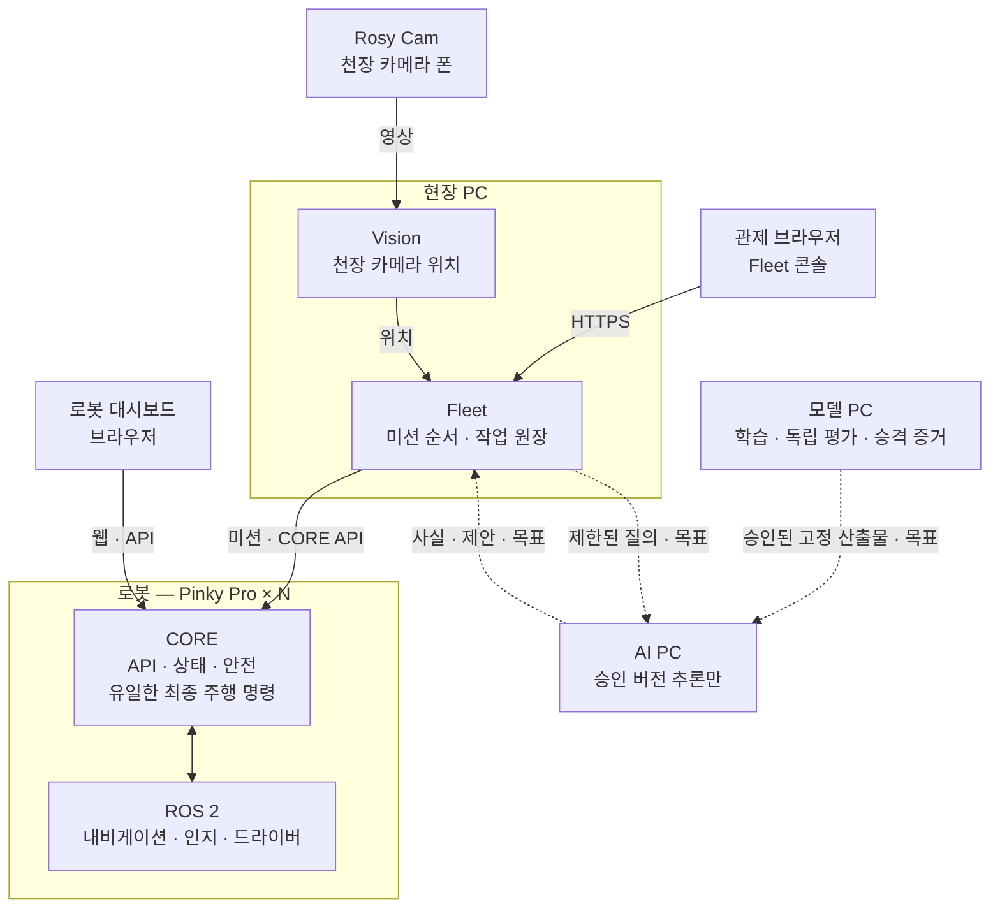

# ROSY Platform

[](https://github.com/robotics-team-1213/rosy-platform/actions/workflows/ci.yml)
[](LICENSE)


ROSY Platform은 관측한 세계 상태, 현장 미션 조정, 로봇의 안전한 실행, 오프라인 학습·평가를 연결한다. 첫 하드웨어는 Raspberry Pi 5 기반 **Pinky Pro**이며, [pinky_pro](https://github.com/pinklab-kr/pinky_pro) 포크에서 출발했다.

## 시작하기

| 나는 | 여기부터 |
|---|---|
| 새 팀원, 개인 클론 사용자 | [팀 가이드](docs/reference/team-guide.md): 초대 수락부터 첫 PR까지 |
| 실험실 공유 체크아웃의 사람·에이전트 | [같이 하는 깃](docs/reference/shared-checkout.md): 작업 위치와 중단 조건 |
| PR 작성·검토·게시 담당 | [PR 파이프라인](docs/reference/pr-pipeline.md) · [기여 안내](.github/CONTRIBUTING.md) |
| 동시 작업·교대 담당 | [작업 분담과 인수인계](docs/reference/team-guide.md#36-동시-작업과-인수인계) · [작업·버그 이슈 양식](https://github.com/robotics-team-1213/rosy-platform/issues/new/choose) |
| 빌드·시뮬·테스트·배포 담당 | [개발 가이드](docs/reference/developer-guide.md) |
| 현재 구현·검증 상태 확인 | [STATUS.md](STATUS.md): 모듈별 게이트 |

`main` 반영은 주제 브랜치의 PR을 통해 한다. 검토·CI·병합 조건은 [PR 파이프라인](docs/reference/pr-pipeline.md), 문서 작성 기준은 [D-777](docs/adr/D-777-concise-human-agent-documentation.md)을 따른다.

## 한눈에 보기

사용자가 여는 앱과 내부 서비스는 [앱 이름과 역할](docs/reference/app-names-and-roles.md)에서 구분한다. Cell은 Fleet의 팔레타이징 작업 준비 화면이며, 계정·로봇 얼굴·Pilot 연결 로비는 각 앱의 하위 기능이다.



| 구성 | 어디서 도나 | 하는 일 |
|---|---|---|
| **CORE** | 각 로봇 | 외부와 말하는 유일한 창구. 상태·안전을 지키고 최종 주행 명령을 혼자 낸다 |
| **Fleet** | 현장 PC | 여러 로봇에 미션을 나누고 작업 원장을 소유한다. 현재 자세는 World를 직접 읽어 쓰고, 로봇 모터는 직접 움직이지 않는다 |
| **Vision** | 현장 PC | 천장 카메라로 지도 위 위치 관측을 만든다. 표시와 감시에 쓰고, 최종 주행 명령은 CORE가 낸다 |
| **인지·내비게이션** | 각 로봇 | 차선·장애물 관측과 경로. 상세 책임은 [인지와 판단](docs/reference/developer-guide.md#인지와-판단) |
| **학습·평가** | 모델 PC | 데이터·사람 정답으로 모델을 학습·평가하고 고정 산출물의 승격 증거를 만든다 |
| **AI 추론** | AI PC | 승인된 모델 버전으로 정체 사실 또는 Mission/Task 후보만 낸다. Fleet 원장·장치 명령 권한은 없다. 현재는 오프라인 연결 시험 단계 |

점선은 목표 연결이다. 현재 구현·제안의 구분과 시험 PC별 책임은 [개발 가이드](docs/reference/developer-guide.md#인지와-판단)를 본다.

## 인지와 판단

현재 구현과 제안된 구조, World·Decision의 책임은 [개발 가이드](docs/reference/developer-guide.md#인지와-판단)에서 확인한다.

## 문서 지도

| 분류 | 문서 |
|---|---|
| 제품 | [PRODUCT.md](PRODUCT.md) 누구를 위한 제품인가 · [CONCEPTS.md](CONCEPTS.md) 공통 용어 · [DESIGN.md](DESIGN.md) 화면 규칙 |
| 요구사항·계약 | [CORE SRS](docs/spec/ROSY%20CORE%20SRS.md) · [FLEET SRS](docs/spec/ROSY%20FLEET%20SRS.md) · [API & Protocol Reference](docs/reference/ROSY%20API%20&%20Protocol%20Reference.md) |
| 결정 | [ADR Log](docs/reference/ROSY%20ADR%20Log.md) · [개별 ADR](docs/adr/) |
| 설계 | [목표 아키텍처](docs/architecture/) · [인지와 판단](#인지와-판단) · [Decision 파이프라인](docs/plans/2026-10-08-decision-model-pipeline-design.md) |
| 현재 구조 | [전체 폴더 책임](docs/reference/platform-folder-responsibilities.md) · [CORE·Drive 책임](docs/reference/core-drive-responsibilities.md) |
| 관제 규칙 | [Fleet 통합 규칙집](docs/reference/fleet-rulebook.md) — law · rule · AI 후보 · 실행 허가 · 결과 확인 |
| 업무 앱 계약 | [업무 앱의 지원 계약](docs/reference/application-contract-support.md) — 외부 업무 앱이 쓰는 HTTP 경로·권한·근거 경계 |
| 배포 | [로봇 배포](docs/deployment/) · [현장 PC 배포](deploy/site/README.md) |
| 기록 | [해결 기록](docs/solutions/) · [전체 색인](docs/index.md) |

문서끼리 다르면 **SRS · API reference · ADR**이 이긴다.

## 핵심 계약

아래 불변식은 코드와 문서 전체에서 성립한다. 변경하려면 대응 SRS·API reference·ADR를
먼저 읽는다.

- **CORE 단일 게이트웨이** — 외부 클라이언트는 ROS를 직접 쓰지 않고 CORE API로만
  말한다(CORE SRS §1.3). `core`(`middleware/core/gateway`)가 유일한 외부 접점이다.
- **유일한 `cmd_vel` publisher** — Command Manager(`core_features.command`)만 최종
  주행 명령을 발행한다(D-2). `control`(`middleware/perception`)의 legacy 최종
  publisher는 CORE와 병행하지 않는다.
- **World는 현재 자세만** — `operations/world`가 받은 관측·odom의 현재 자세를
  소유한다. Fleet은 `rosy.world.state.projections.map_pose`를 직접 import하고,
  옛 Fleet alias는 없다(D-752). 서비스·원장·admission·dispatch는 Fleet에 남긴다.
  `source=bridged`는 마지막 관측 이후의 dead reckoning이고, 행동 조건부 미래
  예측이 아니다(D-630). World는 최종 `/cmd_vel`을 내지 않고, 모델 설명으로
  실행 사실을 덮어쓰지 않는다(아키텍처 v0.2 §3.1).
- **단일 프로세스** — CORE는 한 프로세스에서 메인 스레드 rclpy `MultiThreadedExecutor`,
  워커 스레드 uvicorn+FastAPI로 돈다(D-1). 진입점은 `ros2 run core core`.
- **폴더는 역할 분류** — 디렉터리 경로가 writer 권한·호스트 배치·이미지 closure를
  결정하지 않는다(D-315). 실제 패키지 소비와 설치 묶음은 `deploy/`와 각
  `package.xml`로 확인한다.
- **공개 저장소 경계** — 이 저장소는 공개다. 실제 장치 주소·계정·채워진 장치 설정은
  gitignored `private/`에 두고 공개 문서에는 `<robot-ip>` 표기를 쓴다(D-226).
  시험 PC와 로봇 SSH 대상은 `private/lab-hosts.json`이다. 모양은
  `tools/remote/hosts.example.json`을 복사한다.
  날짜 증거는 `docs/validation/<topic>-<YYYY-MM-DD>/`, 모듈 안내은 해당 모듈의
  `docs/` 하나에 둔다.

## 로봇 실행

**로봇은 네이티브로 돈다.** 제품 런타임은 Docker가 아니라 Ubuntu Server 24.04 arm64 위의 ROS 2 Jazzy + systemd다 (D-161). Docker/Compose는 개발·CI 전용이다. 장치마다 컨테이너를 켜고 끄는 옵션은 없다 (D-197, D-246).

```bash
cd deploy/robot/pinky_pro
sudo ROSY_ROBOT_NUMBER=1 bash ./install-pi.sh   # 신원은 로봇 번호 하나에서 (D-33)
sudo ./runtime-mode.sh up
```

SD 카드·Wi-Fi 첫 설정은 [`docs/deployment/raspberry-pi-wifi-image.md`](docs/deployment/raspberry-pi-wifi-image.md), 슬라이스·대시보드·모터 경계는 [개발 가이드 「Raspberry Pi 5 런타임」](docs/reference/developer-guide.md#raspberry-pi-5-런타임).

## 라이선스

[Apache-2.0](LICENSE). [pinky_pro](https://github.com/pinklab-kr/pinky_pro) 포크에서 전면 리네임(D-16)으로 파생되었다.
