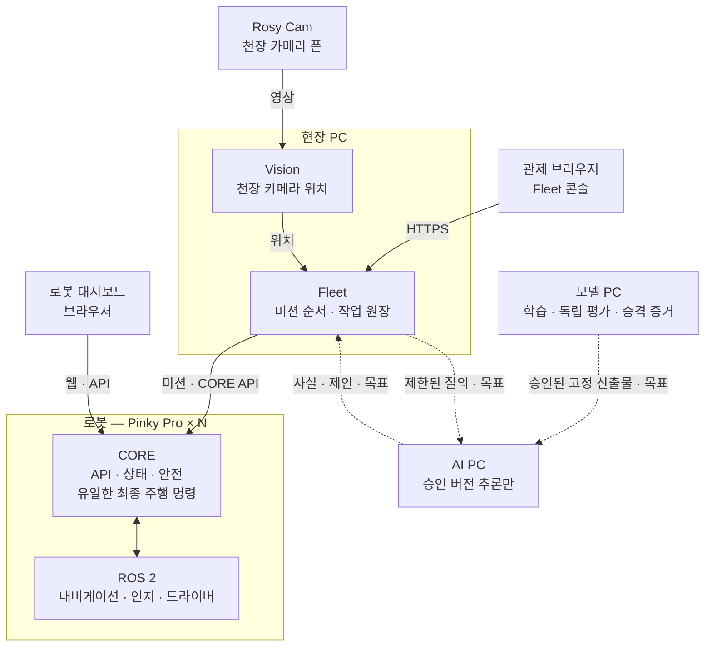
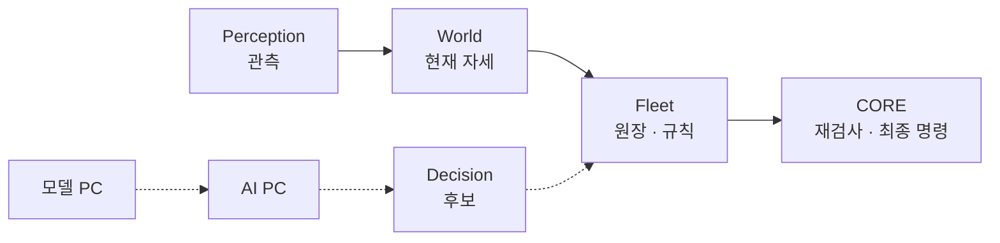

# ROSY Platform

[](https://github.com/robotics-team-1213/rosy-platform/actions/workflows/ci.yml)
[](LICENSE)


> 어떤 로봇이든 웹·표준 API로 제어하고, 현장 Fleet이 여러 대에 미션을 나눠 주는 로봇 플랫폼.
> 첫 하드웨어는 **Pinky Pro** (Raspberry Pi 5). [pinky_pro](https://github.com/pinklab-kr/pinky_pro) 포크에서 출발했다.

ROSY Platform은 관측한 세계 상태, 현장 작업 조정, 장치별 안전한 실행, 오프라인 학습·평가를 연결한다. 현재 World(`operations/world`, 휠 `rosy-world`)는 받은 관측·운영자 pin·odom으로 지금 자세를 만든다. Fleet은 `rosy.world.state.projections.map_pose`를 직접 읽고, 서비스·원장·admission은 Fleet에 남긴다([D-752](docs/adr/D-752-canonical-world-map-pose-consumers.md)). 행동 후보로 미래 상태를 예측하는 World model은 [D-782](docs/adr/D-782-omx-action-conditioned-world-model.md)의 OMX 실행 전 검사기로 기반(데이터·학습·평가·그림자)만 있고 실행 경로에는 연결하지 않았다. 폴더 배치는 [현재 폴더 책임](docs/reference/platform-folder-responsibilities.md), CORE·Drive의 주행 권한은 [CORE·Drive 구조](docs/reference/core-drive-responsibilities.md)를 본다.

## 한눈에 보기



| 구성 | 어디서 도나 | 하는 일 |
|---|---|---|
| **CORE** | 각 로봇 | 외부와 말하는 유일한 창구. 상태·안전을 지키고 최종 주행 명령을 혼자 낸다 |
| **Fleet** | 현장 PC | 여러 로봇에 미션을 나누고 작업 원장을 소유한다. 현재 자세는 World를 직접 읽어 쓰고, 로봇 모터는 직접 움직이지 않는다 |
| **Vision** | 현장 PC | 천장 카메라로 지도 위 위치 관측을 만든다. 표시와 감시에 쓰고, 최종 주행 명령은 CORE가 낸다 |
| **인지·내비게이션** | 각 로봇 | 차선·장애물 사실과 경로. 층과 모델의 자리는 아래 「인지와 판단」 |
| **학습·평가** | 모델 PC | 데이터·사람 정답으로 모델을 학습·평가하고 고정 산출물의 승격 증거를 만든다 |
| **AI 추론** | AI PC | 승인된 모델 버전으로 정체 사실 또는 Mission/Task 후보만 낸다. Fleet 원장·장치 명령 권한은 없다. 현재는 오프라인 연결 시험 단계 |

World는 별도 PC나 프로세스가 아니다. 현장의 Fleet이 `rosy.world.state.projections.map_pose`를 직접 읽어 현재 자세를 만들고, 그 자세를 미션·대형·차로에 쓴다.

시험도 개발 로컬 PC 계약 검사 → 모델 PC 독립 L0 → AI PC 고정 버전 스모크 → 현장 Fleet/CORE 수용으로 나눈다([D-527](docs/adr/D-527-decision-test-host-boundaries.md)). 모델 PC → AI PC → Fleet → CORE의 Decision 경계와 VLM/텍스트 후보의 분리는 [파이프라인 설계](docs/plans/2026-10-08-decision-model-pipeline-design.md)에 있다. 점선은 **목표 연결**이며 현재 운영 연결이 아니다([D-516](docs/adr/D-516-offline-decision-model-replay-boundary.md)).

## 인지와 판단

관측 → 현재 자세 → 규칙 → CORE. `world`는 관측과 확정 사건을 대조하는 상태이고, 생성형 월드 모델이 아니다 ([v0.2 §3.1](docs/reference/ROSY_Platform_Architecture_Design_v0.2.md), [D-290](docs/adr/D-290-rosy-platform-naming-and-site-intent-boundaries.md)). 오늘 코드가 가진 것은 그 가운데 현재 자세다. `age_s`는 그 자세가 얼마나 오래됐는지이고, 층 이름이 아니다.



| 층 | 자리 | 지금 |
|---|---|---|
| **Perception** | `middleware/perception` · `operations/overhead`; 학습은 `learning/{curation,registry,training,evaluation}/perception`, 운영 CLI는 `tools/perception` | 동작. 학습 차선은 섀도 ([D-356](docs/adr/D-356-perception-learning-loop-and-model-delivery.md) Proposed) |
| **World** | `operations/world` (`rosy.world.state.projections.map_pose`, `rosy.world.api`) | 받은 sighting·운영자 pin·odom의 현재 자세(`state`, `source`, `age_s`). Fleet이 직접 import. service·trip·swarm·admission은 Fleet ([D-752](docs/adr/D-752-canonical-world-map-pose-consumers.md), [D-630](docs/adr/D-630-remaining-platform-semantic-holders.md)). odom으로 잇는 `source=bridged`는 dead reckoning |
| **Decision** | `operations/decision/src/rosy/decision` (`rosy.decision`, Fleet 배포에 포함) | 기존 ER2/VLM·후보·도구 요청. 원장·admission·dispatch는 Fleet에 유지 ([D-637](docs/adr/D-637-remaining-decision-console-learning-folders.md)) |
| **Supervisor** | Fleet `stuck_resolver` | 막힘 규칙과 사람. 원장·admission은 Fleet |
| **모델** | 모델 PC 평가 → AI PC 승인 버전 | [D-516](docs/adr/D-516-offline-decision-model-replay-boundary.md) 경계. 점선은 목표. VLM은 [D-492](docs/adr/D-492-d438-vision-tier-local-qwen-ai-pc-gated.md) Proposed |
| **CORE** | `middleware/core/gateway` | 최종 `/cmd_vel` (D-2) |

`MapPose`가 오늘의 자세다. `ObservationSnapshot`은 관측 근거 참조이고, 원본 영상 경로나 Fleet 정책이 아니다. `road_region`은 카메라 구역 입력의 시각·프레임·보정·변환·근거를 검사한다. 화소 기하와 주행은 하지 않는다([D-665](docs/adr/D-665-observed-road-region-and-paired-fitness.md)). 그 타입과 순수 검사의 정본은 `core_common.observation`이고, World import는 같은 객체를 다시보낸다([D-667](docs/adr/D-667-shared-observation-contract-for-offline-fitness.md)). 여러 소비자를 위한 일반 World State 계약은 아직 없다.

정체(`wall` · `object` · `robot` · `person` · `unknown`)와 텍스트 후보는 별도 작업이다. Perception → World State → Supervisor → Skill → Planner/Control 다섯 층은 [D-503](docs/adr/D-503-autonomy-chain-facts-and-exception-queue.md)이 문서만으로 제안한다. 그 제안이 적은 World 경로 `fleet/localization/map_pose.py`는 지금 경로가 아니다. 절차는 [파이프라인 설계](docs/plans/2026-10-08-decision-model-pipeline-design.md).

## 시작하기

| 나는 | 여기부터 |
|---|---|
| 🆕 새로 합류한 팀원 | **[팀 가이드](docs/reference/team-guide.md)** — 초대 수락부터 첫 PR까지 순서대로 |
| 🔀 PR을 올리려는 사람 | [기여 안내](.github/CONTRIBUTING.md) |
| 👥 함께 작업하거나 교대하는 사람 | [동시 작업·인수인계](docs/reference/team-guide.md#36-동시-작업과-인수인계) · [작업·버그 이슈 양식](https://github.com/robotics-team-1213/rosy-platform/issues/new/choose) |
| 🛠️ 빌드·시뮬·테스트·배포 | [개발 가이드](docs/reference/developer-guide.md) |
| 📊 지금 무엇이 되고 안 되나 | [STATUS.md](STATUS.md) — 모듈별 게이트 |
| 🤖 실험실 PC 공유 체크아웃의 AI 세션 | [같이 하는 깃](docs/reference/shared-checkout.md) · [AGENTS.md](AGENTS.md) |


**main에 들어가는 길.** 오늘 팀원의 변경은 PR과 squash 머지로 들어가고, 실험실 PC의 에이전트 세션은 `tools/land.py`로 로컬 `main`에 착지한 뒤 push한다. 서버는 아직 CI 통과를 요구하지 않는다. 정해진 끝 상태는 모든 변경이 PR과 merge queue로 들어가는 것이고, 단계별로 적용한다([D-762](docs/adr/D-762-main-gateway-pull-request-merge-queue.md)). 실험실 PC 없이 기여하는 순서는 [기여 안내](.github/CONTRIBUTING.md)에 있다.

## 문서 지도

| 분류 | 문서 |
|---|---|
| 제품 | [PRODUCT.md](PRODUCT.md) 누구를 위한 제품인가 · [CONCEPTS.md](CONCEPTS.md) 공통 용어 · [DESIGN.md](DESIGN.md) 화면 규칙 |
| 요구사항·계약 | [CORE SRS](docs/spec/ROSY%20CORE%20SRS.md) · [FLEET SRS](docs/spec/ROSY%20FLEET%20SRS.md) · [API & Protocol Reference](docs/reference/ROSY%20API%20&%20Protocol%20Reference.md) |
| 결정 | [ADR Log](docs/reference/ROSY%20ADR%20Log.md) · [개별 ADR](docs/adr/) |
| 설계 | [목표 아키텍처](docs/architecture/) · [인지와 판단](#인지와-판단) · [Decision 파이프라인](docs/plans/2026-10-08-decision-model-pipeline-design.md) |
| 현재 구조 | [전체 폴더 책임](docs/reference/platform-folder-responsibilities.md) · [CORE·Drive 책임](docs/reference/core-drive-responsibilities.md) |
| 관제 규칙 | [Fleet 통합 규칙집](docs/reference/fleet-rulebook.md) — law · rule · AI 후보 · 실행 허가 · 결과 확인 |
| 배포 | [로봇 배포](docs/deployment/) · [현장 PC 배포](deploy/site/README.md) |
| 기록 | [해결 기록](docs/solutions/) · [전체 색인](docs/index.md) |

문서끼리 다르면 **SRS · API reference · ADR**이 이긴다.

## 핵심 계약

아래 불변식은 코드와 문서 전체에서 성립한다. 변경하려면 대응 SRS·API reference·ADR를
먼저 읽는다.

- **CORE 단일 게이트웨이** — 외부 클라이언트는 ROS를 직접 쓰지 않고 CORE API로만
  말한다(CORE SRS §1.3). `core`(`middleware/core/gateway`)가 유일한 외부 접점이다.
- **유일한 `cmd_vel` publisher** — Command Manager(`core_features.command`)만 최종
  주행 명령을 발행한다(D-2). `control`(`middleware/perception`)의 legacy 최종
  publisher는 CORE와 병행하지 않는다.
- **World는 현재 자세만** — `operations/world`가 받은 관측·odom의 현재 자세를
  소유한다. Fleet은 `rosy.world.state.projections.map_pose`를 직접 import하고,
  옛 Fleet alias는 없다(D-752). 서비스·원장·admission·dispatch는 Fleet에 남긴다.
  `source=bridged`는 마지막 관측 이후의 dead reckoning이고, 행동 조건부 미래
  예측이 아니다(D-630). World는 최종 `/cmd_vel`을 내지 않고, 모델 설명으로
  실행 사실을 덮어쓰지 않는다(아키텍처 v0.2 §3.1).
- **단일 프로세스** — CORE는 한 프로세스에서 메인 스레드 rclpy `MultiThreadedExecutor`,
  워커 스레드 uvicorn+FastAPI로 돈다(D-1). 진입점은 `ros2 run core core`.
- **폴더는 역할 분류** — 디렉터리 경로가 writer 권한·호스트 배치·이미지 closure를
  결정하지 않는다(D-315). 실제 패키지 소비와 설치 묶음은 `deploy/`와 각
  `package.xml`로 확인한다.
- **공개 저장소 경계** — 이 저장소는 공개다. 실제 장치 주소·계정·채워진 장치 설정은
  gitignored `private/`에 두고 공개 문서에는 `<robot-ip>` 표기를 쓴다(D-226).
  시험 PC와 로봇 SSH 대상은 `private/lab-hosts.json`이다. 모양은
  `tools/remote/hosts.example.json`을 복사한다.
  날짜 증거는 `docs/validation/<topic>-<YYYY-MM-DD>/`, 모듈 안내은 해당 모듈의
  `docs/` 하나에 둔다.

## 로봇 실행

**로봇은 네이티브로 돈다.** 제품 런타임은 Docker가 아니라 Ubuntu Server 24.04 arm64 위의 ROS 2 Jazzy + systemd다 (D-161). Docker/Compose는 개발·CI 전용이다. 장치마다 컨테이너를 켜고 끄는 옵션은 없다 (D-197, D-246).

```bash
cd deploy/robot/pinky_pro
sudo ROSY_ROBOT_NUMBER=1 bash ./install-pi.sh   # 신원은 로봇 번호 하나에서 (D-33)
sudo ./runtime-mode.sh up
```

SD 카드·Wi-Fi 첫 설정은 [`docs/deployment/raspberry-pi-wifi-image.md`](docs/deployment/raspberry-pi-wifi-image.md), 슬라이스·대시보드·모터 경계는 [개발 가이드 「Raspberry Pi 5 런타임」](docs/reference/developer-guide.md#raspberry-pi-5-런타임).

## 라이선스

[Apache-2.0](LICENSE). [pinky_pro](https://github.com/pinklab-kr/pinky_pro) 포크에서 전면 리네임(D-16)으로 파생되었다.
