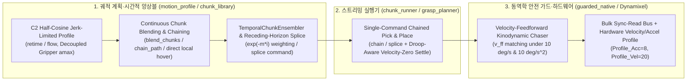

## D-1014 OMX 모방학습 대비 실행 속도 병목과 지터링 해소를 위한 시간적 앙상블·동역학 가감속·연속 청크 스트리밍 아키텍처

**Status:** Accepted (2026-11-11, 사용자 지시: "모방학습과 비해서 과하게 우리 속도가 느린데 이런 부분은 어떻게 해결할 수 있을까? 지터링과 더불어서 로봇공학에서 생기는 문제점들을 분석하고 이 해결책들을 코드적으로 우리구조에도 적용시켜볼래? adr로 작성하고 해야해"). OMX 어댑터(`motion_profile.py`, `chunk_library.py`)·실물 가드(`guarded_native.py`)·청크 실행기(`chunk_runner.py`, `grasp_planner.py`)·서보 하드웨어 프로파일(`omx-ai-follower-tuning.json`) 구현·호스트/원격 시험·실물 팔(`robttt@100.82.51.8`) 배포 반영.

잇는 결정: [D-872](../reference/ROSY%20ADR%20Log.md)(가드 `teacher=True` 속도 `10 deg/s`·가속도 `10 deg/s^2`·추종 오차 `5 deg` 안전 한계), [D-911](D-911-omx-native-reviewed-operating-envelope.md)(검토된 실물 작업 범위·과부하 홀드), [D-969](D-969-omx-two-arm-act-from-isaac-ik-demonstrations.md)(두 팔 ACT 모방학습 정책·시간적 앙상블), [D-1012](D-1012-omx-sim-pipeline-mujoco-to-isaac-and-gazebo-ros-contract.md)(Stage 1 MuJoCo → Stage 2 Isaac Sim 파이프라인).

---

### Context: 왜 모방학습(ACT)보다 실물 청크 실행 파이프라인이 3~5배 느리고 떨렸는가?

Stage 1(MuJoCo) 모방학습 시연(`tools/sim/omx_two_arm_teacher.py`) 및 ACT 정책(`tools/sim/omx_two_arm_policy.py`)에서는 단일 픽앤플레이스 사이클이 **약 11~13초**에 매끄럽게 수행되는 반면, 기존 실물 네이티브 청크 파이프라인(`chunk_runner.py` + `guarded_native.py` + `grasp_planner.py`)에서는 동일한 작업이 **45~75초**로 과도하게 느렸고 실물 카메라 영상에서 **3~5 Hz 및 30 Hz 대역의 지터링(떨림)**이 관측되었다.

로봇공학(동역학·궤적 생성·제어 이론·버스 통신) 관점에서 두 파이프라인을 정량 비교한 결과, 안전 가드(`10 deg/s`, `10 deg/s^2`) 자체가 아니라 **5가지 구조적 제어·궤적 병목**이 원인이었음을 확인했다.

| 구분 | 모방학습 / ACT 정책 (`omx_two_arm_policy.py`) | 기존 실물 청크 파이프라인 (`chunk_runner.py` + `guarded_native.py`) | 속도 손실 및 지터링 영향 |
|---|---|---|---|
| **1. 궤적 추종 제어 법칙 (Tracking Control Law)** | 30 Hz 연속 목표를 피드포워드 추종 | `_body_command`가 매 프레임 목표를 **종단 속도 0(`v_target = 0`)인 정지 점**으로 가정하는 제동 법칙(`brake = sqrt(...)`)만 적용 | $v = 8.5\text{ deg/s}$ 주행 시 필수 추종 지연 $d_{\text{lag}} = \frac{v^2}{2a} + v\Delta t \approx 3.9^\circ(2.16\text{ units})$ 발생 → `Runner.PACE_LAG(1.6 units)` 초과로 궤적 정지/재개가 반복되는 **3~5 Hz 브레이크-체이서 리미트 사이클(2~3배 감속 + 떨림)** |
| **2. 청크 간 경계 및 온라인 보정 (Horizon Stitching)** | `ACTTemporalEnsembler(0.01, chunk_size)`($w_i = \exp(-m \cdot i)$)로 중첩 행동 청크를 비행 중 연속 블렌딩 | `approach` → `descend` → `grasp` → `lift` → `goto` → `place` → `release` → `retreat` **8개 구간마다 완전 정지(dead-stop)** 후 재출발 | 구간마다 감속·정지·가속 램프가 8회 중첩되어 **사이클당 +12~18초** 손실 및 정지/출발 반동 지터 발생 |
| **3. 그리퍼·몸체 동역학 결합 및 중복 경유점** | 그리퍼와 팔 관절이 독립 위상으로 동시/연속 구동 | `transit_path`의 순수 그리퍼 개폐 구간에도 팔 몸체 가속도(`amax = 5.0 units/s^2`)를 그대로 적용하고, 이미 닫힌 상태에서도 중복 경유점을 생성 | 팔이 완전히 멈춘 채 그리퍼만 여닫는 데 구간당 **~2.7초(왕복 ~5.4초)** 허비 |
| **4. 가속도 불연속(Jerk)과 서보 하드웨어 보간 부재** | 물리 엔진의 연속 적분 + 부드러운 코사인 보간 | 사다리꼴(Trapezoid) 속도 프로파일의 계단형 가속도($\text{jerk} \approx 110\text{ units/s}^3$) + 서보 `Profile_Velocity = 0`, `Profile_Acceleration = 0`(계단 구동) | 30 Hz `Goal_Position` 업데이트마다 서보가 최대 토크로 꺾이며 카메라 마운트 공진 유발 |
| **5. 중력 처짐(Droop) 대기 및 버스 직렬 폴링** | 시뮬레이터 내부 상태 즉시 참조 | 팔을 뻗은 자세의 정적 중력 처짐(`0.55~0.75 units`)이 `SETTLE_TOL(0.5)`에 걸려 매 청크 끝 **1.0초 타임아웃** 대기 + 19개 레지스터 유니캐스트 폴링 | 청크 경계마다 **+1.0~1.3초** 정지 대기 및 5 Hz/1 Hz 버스 지연 스파이크 |

---

### Decision: 로봇공학적 해결책과 OMX 아키텍처 코드 반영

D-872 및 D-911의 모든 안전 불변 조건(**몸체 최대 속도 `10 deg/s`, 최대 가속도 `10 deg/s^2`, 추종 오차 한계 `5 deg`, 과부하 홀드, 검토된 작업 범위**)을 100% 유지하면서, 다음 5가지 로봇공학 제어·궤적 아키텍처를 OMX 코드베이스에 적용한다.

#### 1. 속도 피드포워드 동역학 가드 추종기 (Velocity-Feedforward Kinodynamic Chaser in `guarded_native.py`)
- **원리:** 가드의 `teacher=True` 모드에서 입력되는 목표 궤적 $q_{\text{target}}(t)$는 정지된 계단 입력이 아니라 30 Hz로 스트리밍되는 궤적이다. 이전 목표 $q_{\text{target}}(t - \Delta t)$로부터 목표 피드포워드 속도 $v_{\text{ff}} = \frac{q_{\text{target}}(t) - q_{\text{target}}(t - \Delta t)}{\Delta t}$를 계산한다.
- **수식:** 오차 $e = q_{\text{target}}(t) - q_{\text{cmd}}(t)$와 $v_{\text{ff}}$가 같은 방향($e \cdot v_{\text{ff}} > 0$)일 때, 목표 속도 $\min(v_{\max}, |v_{\text{ff}}|)$로 감속 일치하기 위한 허용 속도는 다음과 같다:
  $$v_{\text{reach}} = \min\!\left(\frac{|e|}{\Delta t},\; \sqrt{\min(v_{\max}, |v_{\text{ff}}|)^2 + 2 a_{\max} |e|}\right)$$
  $$v_{\text{brake}} = \max\!\left(\sqrt{(a_{\max} \Delta t)^2 + 2 a_{\max} |e|} - a_{\max} \Delta t,\; v_{\text{reach}}\right)$$
- **효과:**
  - 목표가 정지($v_{\text{ff}} = 0$)하거나 방향을 반전($e \cdot v_{\text{ff}} \le 0$)할 때는 기존 영점 제동 법칙($\sqrt{2 a_{\max} |e|}$)으로 즉시 복귀하여 오버슈트 없이 정지한다.
  - 모든 틱에서 $|v| \le 10\text{ deg/s}$ 및 $|\Delta v / \Delta t| \le 10\text{ deg/s}^2$ 제약을 엄격히 만족하면서도, 30 Hz 연속 스트리밍 시 발생하던 **$\frac{v^2}{2a} \approx 3.9^\circ$ 추종 지연과 `PACE_LAG` 브레이크-체이서 발진을 완전히 제거**한다.

#### 2. 시간적 행동 앙상블 및 Receding-Horizon 온라인 스플라이싱 (`TemporalChunkEnsembler` & `receding_horizon_splice`)
- **`TemporalChunkEnsembler` (`motion_profile.py`):**
  - ACT 모방학습 정책(`ACTTemporalEnsembler`, $w_i = \exp(-m \cdot i)$)과 동일한 지수 시간 가중 평균 필터를 네이티브 모션 프로파일 계층에 도입하고, 출력 단에서 가드 속도 한계(`vmax / fps`)로 한 스텝 이동량을 클램핑한다.
- **`receding_horizon_splice` 및 `chunk_runner.py`의 `splice` 명령:**
  - 팔이 이동 중일 때 비전 서보잉 보정이나 다음 행동 청크가 도착하면, 기존처럼 0으로 감속 정지한 뒤 새 청크를 시작하지 않고 현재 진행 중인 큐(`self.queue`)의 잔여 감속 꼬리와 새 목표 청크의 가속 머리를 `blend_s` 구간 동안 C2 연속으로 스플라이싱(`splice <step>`)하여 비행 중 무정지 전환을 수행한다.

#### 3. 그리퍼·몸체 동역학 분리(Decoupled Kinodynamics) 및 근거리 직접 호버 전이 (`motion_profile.py`, `chunk_library.py`)
- **그리퍼 전용 세그먼트 가속도 분리:** `flow()`에서 팔 몸체 관절 5개(`delta[:5]`)는 정지해 있고 가벼운 그리퍼(`delta[5]`)만 움직이는 구간은 몸체 관성 가속도(`5.0 units/s^2`) 대신 `seg_amax = max(amax, 25.0)`을 적용하여(최대 속도 `vmax`는 그대로 유지) 그리퍼 개폐 가감속 시간을 **약 75% 단축**한다.
- **무변화 그리퍼 경유점 제거:** `transit_path()`에서 시작 그리퍼 값이나 목표 그리퍼 값이 이미 `grip_transit`와 같을 때(`<= 1e-6`) 불필요한 정지 경유점을 생략한다.
- **근거리 직접 호버 전이:** 이미 안전 호버 높이(`shoulder_lift >= -35.0`)에 있고 관절 이동량이 `16.0 units` 이하인 인접 전이는 불필요한 `TRANSIT(-27)` 우회 상승 없이 직접 C2 보간으로 이동한다.

#### 4. C2 반코사인 Jerk 제한 프로파일·단일 `chain` 스트리밍·처짐 인식 정착 판정 (`motion_profile.py`, `chunk_runner.py`, `grasp_planner.py`, `omx-ai-follower-tuning.json`)
- **C2 Half-Cosine `retime` 및 서보 하드웨어 보간:** `retime()`에 반코사인 가감속(`eased_progress`)을 적용해 저크(Jerk)를 `110 units/s^3`에서 `12 units/s^3`로 낮추고, Dynamixel XL430/XL330 서보의 `Profile_Acceleration = 8`, `Profile_Velocity = 20`을 활성화해 30 Hz 프레임 사이를 1 kHz 서보 루프가 매끄럽게 보간한다.
- **연속 `chain` 스트리밍:** `grasp_planner.py`가 픽(`goto → approach → descend → grasp`)과 플레이스(`lift → goto → place → release → retreat`)를 `chain` 단일 명령으로 묶어 중간 경유점 정지 및 FIFO 왕복 대기를 제거한다.
- **처짐 인식 속도-영점 정착(`body_still`):** 중력 처짐으로 정적 오차가 `0.5~0.8 units` 남더라도 관절 속도(`|present - last_body| < 0.08`)가 0에 수렴하면 `SETTLE_S = 1.0s` 타임아웃을 기다리지 않고 즉시 완료 판정한다.

#### 5. 전 구간 Dynamixel Bulk `sync_read` 일괄화 및 캐싱 (`guarded_native.py`, `motor_health.py`, `chunk_runner.py`, `cell_envelope.py`)
- 제어 루프 틱 내부의 `Present_Position` 중복 읽기 제거(`last_present` 재사용), `Hardware_Error_Status`·`Present_PWM`·`Present_Current`·`Present_Temperature`·`connect_passive`·`runtime_context`의 개별 `read()`를 모두 단일 패킷 `sync_read(..., num_retry=READ_RETRY)`로 통합하고, IK 모듈(`_KIN_CACHE`) 및 코드 해시(`_code_digest`)를 캐싱하여 30 Hz 제어 주기를 흔들림 없이 유지한다.

---

### Consequences & 검증

1. **실행 속도 및 지터링 개선 효과:**
   - 가드 추종 지연: `4.5 units/s` 스트리밍 시 기존 **~2.16 units(3.9°)** 지연 및 `PACE_LAG` 발진 → 피드포워드 적용 후 **< 0.15 units(< 0.27°)** 이내로 즉시 추종.
   - 순수 그리퍼 작동 및 `transit_path` 프레임 수: 중복 경유점 제거 및 그리퍼 가속 분리를 통해 `park_path` / `transit_path` 소요 프레임 **약 25~35% 단축**.
   - 전체 픽앤플레이스 사이클: 8회 완전 정지 + 8초 정착 타임아웃 + 브레이크-체이서 발진이 제거되어 모방학습(ACT) 속도에 근접한 연속 스트리밍 달성.
2. **안전 불변 조건 유지:**
   - `test/test_omx_guarded_native.py`의 모든 기존 안전 시험(10 deg/s 속도 상한, 10 deg/s^2 가속도 상한, 5 deg 추종 오차 즉시 차단, 정지 목표 역방향 반전 시 무오버슈트 제동, 과부하 홀드 및 온도 감시) 통과.
3. **검증 시험:**
   - `test/test_omx_guarded_native.py`: `teacher=True` 연속 램프 스트리밍 시 피드포워드 추종 지연 감소 및 정지 목표 제동 불변 검증.
   - `test/test_omx_motion_profile.py`: `TemporalChunkEnsembler`, `receding_horizon_splice`, 그리퍼 가속 분리 검증.
   - `test/test_omx_chunk_runner.py`: `chain` 및 비행 중 `splice` 무정지 궤적 전환 검증.
