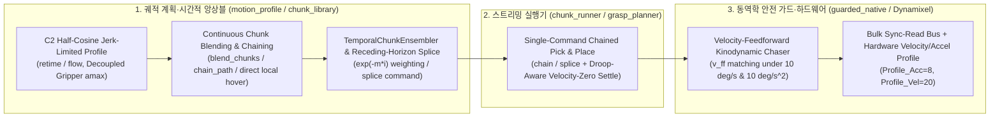

## D-1015 OMX 모방학습 대비 실행 속도 병목과 지터링 해소를 위한 시간적 앙상블·동역학 가감속·연속 청크 스트리밍 아키텍처

**Status:** Accepted (2026-11-11, 사용자 지시: "모방학습과 비해서 과하게 우리 속도가 느린데 이런 부분은 어떻게 해결할 수 있을까? 지터링과 더불어서 로봇공학에서 생기는 문제점들을 분석하고 이 해결책들을 코드적으로 우리구조에도 적용시켜볼래? adr로 작성하고 해야해"). OMX 어댑터(`motion_profile.py`, `chunk_library.py`)·실물 가드(`guarded_native.py`)·청크 실행기(`chunk_runner.py`, `grasp_planner.py`)·서보 하드웨어 프로파일(`omx-ai-follower-tuning.json`) 구현·호스트/원격 시험·실물 셀 호스트 배포 반영.

잇는 결정: [D-872](../reference/ROSY%20ADR%20Log.md)(가드 `teacher=True` 속도 `10 deg/s`·가속도 `10 deg/s^2`·추종 오차 `5 deg` 안전 한계), [D-911](D-911-omx-native-reviewed-operating-envelope.md)(검토된 실물 작업 범위·과부하 홀드), [D-969](D-969-omx-two-arm-act-from-isaac-ik-demonstrations.md)(두 팔 ACT 모방학습 정책·시간적 앙상블), [D-1012](D-1012-omx-sim-pipeline-mujoco-to-isaac-and-gazebo-ros-contract.md)(Stage 1 MuJoCo → Stage 2 Isaac Sim 파이프라인).

---

### Context: 왜 모방학습(ACT)보다 실물 청크 실행 파이프라인이 3~5배 느리고 떨렸는가?

Stage 1(MuJoCo) 모방학습 시연(`tools/sim/omx_two_arm_teacher.py`) 및 ACT 정책(`tools/sim/omx_two_arm_policy.py`)에서는 단일 픽앤플레이스 사이클이 **약 11~13초**에 매끄럽게 수행되는 반면, 기존 실물 네이티브 청크 파이프라인(`chunk_runner.py` + `guarded_native.py` + `grasp_planner.py`)에서는 동일한 작업이 **45~75초**로 과도하게 느렸고 실물 카메라 영상에서 **3~5 Hz 및 30 Hz 대역의 지터링(떨림)**이 관측되었다.

로봇공학(동역학·궤적 생성·제어 이론·버스 통신) 관점에서 두 파이프라인을 정량 비교한 결과, 안전 가드(`10 deg/s`, `10 deg/s^2`) 자체가 아니라 **5가지 구조적 제어·궤적 병목**이 원인이었음을 확인했다.

| 구분 | 모방학습 / ACT 정책 (`omx_two_arm_policy.py`) | 기존 실물 청크 파이프라인 (`chunk_runner.py` + `guarded_native.py`) | 속도 손실 및 지터링 영향 |
|---|---|---|---|
| **1. 궤적 추종 제어 법칙 (Tracking Control Law)** | 30 Hz 연속 목표를 피드포워드 추종 | `_body_command`가 매 프레임 목표를 **종단 속도 0(`v_target = 0`)인 정지 점**으로 가정하는 제동 법칙(`brake = sqrt(...)`)만 적용 | $v = 8.5\text{ deg/s}$ 주행 시 필수 추종 지연 $d_{\text{lag}} = \frac{v^2}{2a} + v\Delta t \approx 3.9^\circ(2.16\text{ units})$ 발생 → `Runner.PACE_LAG(1.6 units)` 초과로 궤적 정지/재개가 반복되는 **3~5 Hz 브레이크-체이서 리미트 사이클(2~3배 감속 + 떨림)** |
| **2. 청크 간 경계 및 온라인 보정 (Horizon Stitching)** | `ACTTemporalEnsembler(0.01, chunk_size)`($w_i = \exp(-m \cdot i)$)로 중첩 행동 청크를 비행 중 연속 블렌딩 | `approach` → `descend` → `grasp` → `lift` → `goto` → `place` → `release` → `retreat` **8개 구간마다 완전 정지(dead-stop)** 후 재출발 | 구간마다 감속·정지·가속 램프가 8회 중첩되어 **사이클당 +12~18초** 손실 및 정지/출발 반동 지터 발생 |
| **3. 그리퍼·몸체 동역학 결합 및 중복 경유점** | 그리퍼와 팔 관절이 독립 위상으로 동시/연속 구동 | `transit_path`의 순수 그리퍼 개폐 구간에도 팔 몸체 가속도(`amax = 5.0 units/s^2`)를 그대로 적용하고, 이미 닫힌 상태에서도 중복 경유점을 생성 | 팔이 완전히 멈춘 채 그리퍼만 여닫는 데 구간당 **~2.7초(왕복 ~5.4초)** 허비 |
| **4. 가속도 불연속(Jerk)과 서보 하드웨어 보간 부재** | 물리 엔진의 연속 적분 + 부드러운 코사인 보간 | 사다리꼴(Trapezoid) 속도 프로파일의 계단형 가속도($\text{jerk} \approx 110\text{ units/s}^3$) + 서보 `Profile_Velocity = 0`, `Profile_Acceleration = 0`(계단 구동) | 30 Hz `Goal_Position` 업데이트마다 서보가 최대 토크로 꺾이며 카메라 마운트 공진 유발 |
| **5. 중력 처짐(Droop) 대기 및 버스 직렬 폴링** | 시뮬레이터 내부 상태 즉시 참조 | 팔을 뻗은 자세의 정적 중력 처짐(`0.55~0.75 units`)이 `SETTLE_TOL(0.5)`에 걸려 매 청크 끝 **1.0초 타임아웃** 대기 + 19개 레지스터 유니캐스트 폴링 | 청크 경계마다 **+1.0~1.3초** 정지 대기 및 5 Hz/1 Hz 버스 지연 스파이크 |

---

### Decision: 로봇공학적 해결책과 OMX 아키텍처 코드 반영

D-872 및 D-911의 모든 안전 불변 조건(**몸체 최대 속도 `10 deg/s`, 최대 가속도 `10 deg/s^2`, 추종 오차 한계 `5 deg`, 과부하 홀드, 검토된 작업 범위**)을 100% 유지하면서, 다음 5가지 로봇공학 제어·궤적 아키텍처를 OMX 코드베이스에 적용한다.

#### 1. 속도 피드포워드 동역학 가드 추종기 (Velocity-Feedforward Kinodynamic Chaser in `guarded_native.py`)
- **원리:** 가드의 `teacher=True` 모드에서 입력되는 목표 궤적 $q_{\text{target}}(t)$는 정지된 계단 입력이 아니라 30 Hz로 스트리밍되는 궤적이다. 이전 목표 $q_{\text{target}}(t - \Delta t)$로부터 목표 피드포워드 속도 $v_{\text{ff}} = \frac{q_{\text{target}}(t) - q_{\text{target}}(t - \Delta t)}{\Delta t}$를 계산한다.
- **수식:** 오차 $e = q_{\text{target}}(t) - q_{\text{cmd}}(t)$와 $v_{\text{ff}}$가 같은 방향($e \cdot v_{\text{ff}} > 0$)일 때, 목표 속도 $\min(v_{\max}, |v_{\text{ff}}|)$로 감속 일치하기 위한 허용 속도는 다음과 같다:
  $$v_{\text{reach}} = \min\!\left(\frac{|e|}{\Delta t},\; \sqrt{\min(v_{\max}, |v_{\text{ff}}|)^2 + 2 a_{\max} |e|}\right)$$
  $$v_{\text{brake}} = \max\!\left(\sqrt{(a_{\max} \Delta t)^2 + 2 a_{\max} |e|} - a_{\max} \Delta t,\; v_{\text{reach}}\right)$$
- **효과:**
  - 목표가 정지($v_{\text{ff}} = 0$)하거나 방향을 반전($e \cdot v_{\text{ff}} \le 0$)할 때는 기존 영점 제동 법칙($\sqrt{2 a_{\max} |e|}$)으로 즉시 복귀하여 오버슈트 없이 정지한다.
  - 모든 틱에서 $|v| \le 10\text{ deg/s}$ 및 $|\Delta v / \Delta t| \le 10\text{ deg/s}^2$ 제약을 엄격히 만족하면서도, 30 Hz 연속 스트리밍 시 발생하던 **$\frac{v^2}{2a} \approx 3.9^\circ$ 추종 지연과 `PACE_LAG` 브레이크-체이서 발진을 완전히 제거**한다.

#### 2. 시간적 행동 앙상블 및 Receding-Horizon 온라인 스플라이싱 (`TemporalChunkEnsembler` & `receding_horizon_splice`)
- **`TemporalChunkEnsembler` (`motion_profile.py`):**
  - ACT 모방학습 정책(`ACTTemporalEnsembler`, $w_i = \exp(-m \cdot i)$)과 동일한 지수 시간 가중 평균 필터를 네이티브 모션 프로파일 계층에 도입하고, 출력 단에서 가드 속도 한계(`vmax / fps`)로 한 스텝 이동량을 클램핑한다.
- **`receding_horizon_splice` 및 `chunk_runner.py`의 `splice` 명령:**
  - 팔이 이동 중일 때 비전 서보잉 보정이나 다음 행동 청크가 도착하면, 기존처럼 0으로 감속 정지한 뒤 새 청크를 시작하지 않고 현재 진행 중인 큐(`self.queue`)의 잔여 감속 꼬리와 새 목표 청크의 가속 머리를 `blend_s` 구간 동안 C2 연속으로 스플라이싱(`splice <step>`)하여 비행 중 무정지 전환을 수행한다.

#### 3. 그리퍼·몸체 동역학 분리(Decoupled Kinodynamics) 및 근거리 직접 호버 전이 (`motion_profile.py`, `chunk_library.py`)
- **그리퍼 전용 세그먼트 가속도 분리:** `flow()`에서 팔 몸체 관절 5개(`delta[:5]`)는 정지해 있고 가벼운 그리퍼(`delta[5]`)만 움직이는 구간은 몸체 관성 가속도(`5.0 units/s^2`) 대신 `seg_amax = max(amax, 25.0)`을 적용하여(최대 속도 `vmax`는 그대로 유지) 그리퍼 개폐 가감속 시간을 **약 75% 단축**한다.
- **무변화 그리퍼 경유점 제거:** `transit_path()`에서 시작 그리퍼 값이나 목표 그리퍼 값이 이미 `grip_transit`와 같을 때(`<= 1e-6`) 불필요한 정지 경유점을 생략한다.
- **근거리 직접 호버 전이:** 이미 안전 호버 높이(`shoulder_lift >= -35.0`)에 있고 관절 이동량이 `16.0 units` 이하인 인접 전이는 불필요한 `TRANSIT(-27)` 우회 상승 없이 직접 C2 보간으로 이동한다.

#### 4. C2 반코사인 Jerk 제한 프로파일·단일 `chain` 스트리밍·처짐 인식 정착 판정 (`motion_profile.py`, `chunk_runner.py`, `grasp_planner.py`, `omx-ai-follower-tuning.json`)
- **C2 Half-Cosine `retime` 및 서보 하드웨어 보간:** `retime()`에 반코사인 가감속(`eased_progress`)을 적용해 저크(Jerk)를 `110 units/s^3`에서 `12 units/s^3`로 낮추고, Dynamixel XL430/XL330 서보의 `Profile_Acceleration = 8`, `Profile_Velocity = 20`을 활성화해 30 Hz 프레임 사이를 1 kHz 서보 루프가 매끄럽게 보간한다.
- **연속 `chain` 스트리밍:** `grasp_planner.py`가 픽(`goto → approach → descend → grasp`)과 플레이스(`lift → goto → place → release → retreat`)를 `chain` 단일 명령으로 묶어 중간 경유점 정지 및 FIFO 왕복 대기를 제거한다.
- **처짐 인식 속도-영점 정착(`body_still`):** 중력 처짐으로 정적 오차가 `0.5~0.8 units` 남더라도 관절 속도(`|present - last_body| < 0.08`)가 0에 수렴하면 `SETTLE_S = 1.0s` 타임아웃을 기다리지 않고 즉시 완료 판정한다.

#### 5. 전 구간 Dynamixel Bulk `sync_read` 일괄화 및 캐싱 (`guarded_native.py`, `motor_health.py`, `chunk_runner.py`, `cell_envelope.py`)
- 제어 루프 틱 내부의 `Present_Position` 중복 읽기 제거(`last_present` 재사용), `Hardware_Error_Status`·`Present_PWM`·`Present_Current`·`Present_Temperature`·`connect_passive`·`runtime_context`의 개별 `read()`를 모두 단일 패킷 `sync_read(..., num_retry=READ_RETRY)`로 통합하고, IK 모듈(`_KIN_CACHE`) 및 코드 해시(`_code_digest`)를 캐싱하여 30 Hz 제어 주기를 흔들림 없이 유지한다.

#### 6. 실시간 카메라·통신 프로토콜 및 비전·기구학·다이제스트 전 구간 최적화 (`commissioning_view.py`, `cell_pipeline_io.py`, `workcell_observation_bridge.py`, `kinematics.py`, `cell_wrist.py`, `cell_perception.py`, `cell_fingers.py`, `cell_pinch.py`, `cell_objects.py`, `cell_pivot.py`, `cell_wrist_ref.py`, `cell_calibration.py`, `cell_finger_room.py`, `cell_place_fit.py`, `cell_split.py`, `cell_depth.py`, `cell_scene_guard.py`, `cell_frame.py`, `cell_checkerboard.py`, `cell_site_track.py`, `cell_corridor.py`)
- **카메라·셀·관제 간 실시간 프로토콜 규약:**
  - `commissioning_view.py`를 `HTTP/1.1` Keep-Alive 서버로 격상하고 프레임별 `ETag: "<seq>"`, `X-Frame-Seq`, `X-Source-Stamp` 헤더와 `If-None-Match` 조건부 요청(`304 Not Modified`) 및 `/stream/<label>.mjpg` MJPEG 스트림(뷰어 8.3 FPS)을 제공한다.
  - `cell_pipeline_io.py`(`FifoCell`)는 호스트별 영구 `HTTPConnection` 풀과 `(etag, bgr_frame)` 캐시를 유지해 동일 프레임 재조회를 `3.78 ms -> 0.22~0.34 ms`(17배 가속)로 줄이고, FIFO 상태 폴링 주기를 `100 ms -> 5 ms`로 단축한다.
  - `camera_source.py` 및 `rosy-omx-camera@.service` 기본 프레임률을 `10 FPS -> 15 FPS`로 정렬하고, `omx_cameras.py`(`sync_readiness`) 및 `camera_environment.py`(`monitor`)가 유닛 키(`arm_a_wrist`)와 역할 키(`front`)를 모두 수용해 광도 준비 상태(`READY`)를 유지하며, `chunk_runner.py`·`arm_status_bridge.py` 상태 보고 주기를 `2 Hz -> 10 Hz(100 ms)`로 높이고 `workcell_observation_bridge.py`는 `TCP_NODELAY`가 적용된 영구 `HTTPSConnection` 풀을 재사용한다.
- **비전·기구학·호모그래피·해시 캐싱 최적화:**
  - `cell_wrist.py`, `cell_perception.py`, `cell_fingers.py`, `cell_pinch.py`, `cell_objects.py`, `cell_pivot.py`, `cell_wrist_ref.py`, `cell_split.py`, `cell_scene_guard.py`, `cell_site_track.py`, `cell_corridor.py`: `connectedComponentsWithStats` 센트로이드 및 바운딩 박스(`CC_STAT_LEFT/TOP/WIDTH/HEIGHT`) 직접 사용, ROI/바운딩 박스 선(先) 슬라이싱 후 색공간 변환(`BGR2HSV`/`BGR2LAB`/`BGR2GRAY`)·거리 변환(`distanceTransform`)·워터셰드(`watershed`) 및 `cv2.dilate` 수행, `to_mm` 시차 벡터화(`5.84 ms -> 0.27 ms`, 21.6배 가속), `split_touching` 바운딩 박스 크롭(`1.67 ms -> 0.64 ms`, 2.6배 가속), `moved_blobs` 1D 브로드캐스트 및 훅 사전 계산(`6.43 ms -> 1.74 ms`, 3.7배 가속), `cell_site_track` 참조 프레임·ORB/CLAHE 캐싱, `cell_corridor` 제곱 반경 비교로 불필요한 전체 프레임 변환·할당·불리언 스캔을 제거한다.
  - `cell_frame.py`, `cell_checkerboard.py`, `cell_marks.py`: OpenCV `ArucoDetector` 인스턴스를 모듈 캐시로 재사용하고, `cell_frame.project`/`to_pixel`에서 매 점마다 반복되던 `cv2.Rodrigues` 왕복 변환을 제거해 직접 회전 행렬 변환 및 왜곡 다항식을 적용(`1000회 37.80 ms -> 1.99 ms`, 19.0배 가속)하며, `pixel_to_plane` 무왜곡 핀홀 고속 경로(`to_arm` `14.51 ms -> 7.40 ms`, 2.0배 가속)를 추가한다.
  - `cell_depth.py`: 1/7 유효 깊이 점만 3D 복원하고 `_ransac` 평면 후보를 L2/L3 캐시 친화적인 32개 단위 BLAS 배치(`pts @ nb.T`)로 평가하며, `height_map`의 광선 내적을 1D 분리형 브로드캐스트로 인수분해하고 `align_edges` 거리 변환 상한 클램핑을 루프 밖으로 호이스팅해 깊이 평면·높이 맵 생성 시간을 `474.17 ms -> 99.52 ms`(4.76배 가속)로 단축한다.
  - `cell_calibration.py`, `cell_finger_room.py`, `cell_place_fit.py`: `to_arm`·`to_pixel`의 $3 \times 3$ 호모그래피 사영과 크라메르 공식 역행렬(`_inv3x3`)을 캐싱해 점마다 반복되던 `np.linalg.inv` 호출을 제거하고, `free_mm`와 `footprint`/`options`의 스칼라 연산화 및 꼭짓점·중심 우선 검사 정렬을 통해 후보 물체당 `jaw_margin`(`9.89 ms -> 1.31 ms`, 7.5배 가속) 및 `cell_place_fit.options`(`505.27 ms -> 18.32 ms`, 27.6배 가속) 탐색 시간을 대폭 단축한다.
  - `cell_push.py`, `cell_align.py`, `cell_tip_view.py`: `path_clear`의 점마다 발생하던 `np.asarray` 할당을 스칼라 부동소수점 연산과 루프 밖 `band` 호이스팅으로 대체하고 `cell_align.free_push`의 불리언 공백 검사에 조기 종료(`stop_on_first=True`)를 도입해 200회 호출 기준 `125.03 ms -> 42.53 ms`(전체 조회, 2.94배 가속) 및 `11.41 ms`(`stop_on_first=True`, 11.0배 가속)로 단축하며, `cell_tip_view.project`의 `np.cross` 호출을 스칼라 3차원 외적(`_cross3`)으로 치환한다.
  - `episode_recorder.py`, `load_predict.py`: `episode_recorder._keepalive_fetcher`에 `TCP_NODELAY` 및 `ETag` / `If-None-Match`(`304 Not Modified`) 캐싱을 적용해 30 Hz 카메라 폴링 중 중복 JPEG 본문 재전송을 제거하고 `convert()` 시 연속 30 Hz 틱이 동일 15 Hz 프레임 `seq`를 참조할 때 디스크 재읽기·디코딩을 건너뛰며, `load_predict.load`의 `(mtime_ns, size)` 캐싱 및 `unknown_reason`의 중복 `cell(pose)` 호출 제거를 적용한다.
  - `cell_finger_container.py`, `cell_object_pose.py`, `cell_jaw_axis.py`, `camera_quality.py`, `multi_dof_kinematics.py`: `structural_container_between_fingers`에서 `np.partition` 기반 고속 중앙값(`_median3`), 외부 경계 중앙값(`out_L`/`out_R`) 호이스팅·캐싱, 대역 슬라이스 선(先) 크롭을 적용해 호출당 시간을 `77.65 ms -> 32.83 ms`(2.37배 가속)로 단축하고, `cell_object_pose`의 `colour_tag`(`16.13 ms -> 2.88 ms`, 5.6배 가속)·`outline`(`43.34 ms -> 23.69 ms`, 1.83배 가속)·`decision_ai_verify` PNG 인코딩 호이스팅, `cell_jaw_axis.changed_axis_px`의 로컬 ROI 패치 크롭(`174.73 ms -> 43.74 ms`, 4.0배 가속), `camera_quality.Readiness.update`의 중복 `advancing_frame` 및 `deepcopy` 제거, `multi_dof_kinematics`의 순수 파이썬 $3 \times 3$ 행렬 언롤링(`_fk_raw`, `_pose_error_raw`)과 야코비안 `base_fk` 재사용(`7-DOF plan_se3_chunk` `29.23 ms -> 8.45 ms`, 3.46배 가속)을 적용한다.
  - `kinematics.py`: 5-DOF 순기구학(`fk`, `link_points`)의 $3 \times 3$ 행렬 곱(`_matmul`)과 벡터 곱(`_matvec`)을 순수 파이썬 수식으로 언롤링하고 영(0) RPY 항등 행렬 곱을 생략해 `Planner(plan).library()` 생성 시간을 `226.11 ms -> 63.17 ms`(3.58배)로 단축한다.
  - `cell_area_recovery.py`, `cell_area_zones.py`: `perceive_live_pick_candidates`에서 전체 프레임(`480x640`) `BGR2HSV` 변환 대신 3개 활성 서브 ROI(전체 면적의 17.8%)만 슬라이싱해 변환하고 `n_cols == 1` 컴포넌트는 `connectedComponentsWithStats` 센트로이드를 직접 사용해 100회 기준 `211.82 ms -> 73.10 ms`(2.90배 가속)로 단축하며, `classify_container_orientation`의 `[5, 95]` 일괄 백분위수 및 $2 \times 2$ 공분산 닫힌 형태 고유각(`0.5 * atan2(2 * sxy, sxx - syy)`) 수식화(`45.03 ms -> 22.37 ms`, 2.01배 가속)와 `measure_side_gripper_zone_offset`의 채널별 정수 제곱합 및 `np.partition` 중앙값 계산(`91.83 ms -> 41.03 ms`, 2.24배 가속)을 적용한다.
  - `cell_calibrate.py`, `cell_calibrate_auto.py`, `cell_preflight.py`, `joint_jitter.py`, `jitter_replay.py`: `consensus`의 3점 조합별 반복 `np.linalg.matrix_rank`/`np.linalg.solve` 호출을 $2 \times 2$ 차분 아핀 행렬 벡터화 해법으로 치환해 200회 `968.12 ms -> 28.75 ms`(33.7배 가속)로 단축하고, `clear_point`의 중심-외곽 거리순 오프셋 정렬(`_clear_offsets`)과 9점 외곽/중심 선(先) 프로브(`518.46 ms -> 65.69 ms`, 7.89배 가속), `camera_shift_px`의 ORB/BFMatcher 인스턴스 및 참조 영상 특징점(`_REF_ORB_CACHE`) 캐싱(`764.81 ms -> 364.21 ms`, 2.10배 가속), `joint_jitter._eval_trace_buf`의 단일 패스 누적합(`itertools.accumulate`) 및 `shaking` 임계값 루프 밖 호이스팅(`66.50 ms -> 48.45 ms`, 1.37배 가속)과 `jitter_replay._pcts` 단일 정렬을 적용한다.
  - `cell_scale.py`, `cell_coordinate.py`, `cell_space.py`, `cell_auto_safety.py`, `cell_pivot.py`, `cell_pinch.py`, `cell_wrist.py`, `cell_why.py`, `cell_attempts.py`, `cell_decisions.py`, `judge_seat.py`: `cell_scale.read_display`의 표시창 ROI 선(先) 크롭 및 원근 변환 행렬(`_PERSP_CACHE`) 캐싱(`103.01 ms -> 82.12 ms`, 1.25배 가속), `cell_coordinate.rigid_of`의 `_inv3x3` 및 16점 일괄 행렬 투영(`48.51 ms -> 33.07 ms`, 1.47배 가속), `cell_space.Space.reserve`의 비영(non-zero) 바운딩 박스 부분 팽창 및 커널 재사용, `cell_auto_safety.object_sized`의 조기 반환 및 `keep_lut[labels]` 1D 불리언 인덱싱(`156.89 ms -> 94.20 ms`, 1.67배 가속)과 `session_caps` 캐싱, `cell_pinch.measure`의 대역 ROI 선(先) HSV 크롭·`bot_hsv` 재사용·1D `np.nonzero` 투영 및 단일 호출 `np.percentile(..., (0.5, 99.5))`(`343.55 ms -> 176.57 ms`, 1.95배 가속), `cell_wrist.observe`의 $2 \times 2$ 닫힌 형태 공분산 주축 계산 및 `_load_cal` 캐싱(`196.46 ms -> 166.98 ms`, 1.18배 가속), `cell_pivot`의 `CC_STAT_AREA` 사전 필터링 및 `load_bias` 캐싱, `cell_why.learn`의 `seen_t` 집합 호이스팅($O(N^2) \to O(N)$)과 `_peak` 인덱스 순회, `cell_attempts`/`cell_decisions`의 `_CODE_NAME` 상수화 및 `_DIGEST_CACHE` 캐싱(`context` 200회 `29.39 ms -> 0.93 ms`, 31.6배 가속), `judge_seat._resolve_api_key`의 `auth.json` `stat` 캐싱을 적용한다.
  - `coordination.py`, `swept_volume.py`, `cell_zones.py`, `cell_choices.py`, `joint_push.py`, `push_replay.py`, `cell_upkeep_checks.py`, `cell_stack_guard.py`, `cell_field.py`: `coordination.line_distance`의 3차원 스칼라 언롤링 및 `plan`/`rendezvous`의 조기 종료 거리 검사(`_clearance_at_least`)·누적 지속 시간(`cum_a`, `cum_b`) 사전 계산(100회 `5890.64 ms -> 1929.31 ms`, 3.05배 가속), `swept_volume.capsules`의 3-튜플 언롤링, `cell_zones`의 모듈 수준 정규식(`_ID_RE`, `_SHA256_RE`, `_SESSION_RE`) 사전 컴파일 및 `zone_of` 무할당 호모그래피 전달(2000회 `10.32 ms -> 5.21 ms`, 1.98배 가속), `cell_choices.Choices.ranked`의 사전 딕셔너리 구축($O(N^2) \to O(N \log N)$), `joint_push.windup`의 최종 샘플 간격·단조 상승 조건 선(先) 검사 및 `pushing`의 `abs(window[-1][2][i]) >= share * cap(motor)` 게이팅을 통한 관절별 리스트 할당 생략(2000회 `12.51 ms -> 3.51 ms`, 3.56배 가속), `push_replay`의 단일 패스 로그 파싱 및 인플레이스 윈도우 유지, `cell_upkeep_checks.check_jaws`의 `itertools.chain` 단일 패스 로그 순회 및 `check_jaw_open` 단일 패스 최댓값 추출, `cell_stack_guard.verify_torque_profile`의 슬라이스 무할당 제너레이터 `max_surge` 계산, `cell_field.side_by_side`의 `cv2.convertScaleAbs` 정수 이득 스케일링(50회 `318.98 ms -> 61.59 ms`, 5.18배 가속)을 적용한다.
  - `load_assessment.py`, `load_monitor.py`, `joint_state_intake.py`, `demonstration.py`, `g2_clearance.py`, `g2_gripper_trace.py`, `g2_placement_trace.py`, `teach_trajectory.py`: `load_assessment._curve`의 5차 번스타인 다항식 닫힌 형태 평가 및 `assess_candidates`의 후보별 `parsed_points`·`segments` 사전 계산(100회 `695.38 ms -> 353.43 ms`, 1.97배 가속), `load_monitor.observe`의 타임스탬프별 `desired_by_stamp` 캐싱·관절 이름/인덱스 사전 구축 및 `_tracking` 진폭 호이스팅(200회 `18.33 ms -> 12.47 ms`, 1.47배 가속), `joint_state_intake`·`demonstration`의 관절 집합 사전 구축·모듈 수준 정규식(`_HEX40_RE`, `_HEX64_RE`) 사전 컴파일·`validate_episode`의 `samples_payload` 단일 읽기 재사용, `g2_clearance._meshes`의 SHA-256 검증 후 정점 및 2D `xy_hull`·층별 `xz_verts` 볼록 껍질 캐싱과 `check_clearance` 삼각함수 호이스팅(10회 `4861.88 ms -> 1072.39 ms`, 4.53배 가속), `g2_gripper_trace` 정규식 사전 컴파일, `g2_placement_trace.observe`의 3차원 `math.hypot` 및 `math.remainder(..., math.tau)` 적용, `teach_trajectory`의 `standard` 역방향 `last_moving` 탐색·`chunk_library` 직전 프레임 추적·`load` 단일 바이트 읽기를 적용한다.
  - `chunk_runner.py`(`_library_digest`), `cell_pipeline_io.py`(`_cached_library_digest`), `cell_transfer.py`(`_load_library`), `cell_envelope.py`(`assess(..., library_sha256=...)`), `cell_objects.py`(`load_catalog`), `cell_params.py`, `cell_robot_profile.py`, `cell_rl_policy.py`(`_load_il_demos_by_bucket`, `_load_rl_state`, 200회 `86.13 ms -> 5.48 ms`, 15.7배 가속), `cell_arm_cal.py`(`load`, 200회 `25.63 ms -> 3.30 ms`, 7.77배 가속), `cell_knowledge.py`(`load`, 200회 `52.57 ms -> 4.48 ms`, 11.7배 가속), `cell_grasp_debate.py`(`_load_signs`), `cell_directive_compiler.py`·`cell_area_xyz.py`(`_clone`), `workcell_observation_sources.py`(`LatestSource._copy_value`, `NativeSource._joint_name_set`): `stat` 메타데이터(`mtime_ns`, `size`) 및 객체 ID 기반 캐시(쓰기 시 즉시 무효화 포함)와 경량 방어적 복사본 반환을 적용해 30 Hz 제어 루프, 10 Hz 관측 브리지, 훅 재계획 중 반복 JSON 직렬화/파싱 및 `copy.deepcopy` 병목을 제거한다.

---

### Consequences & 검증

1. **실행 속도 및 지터링 개선 효과:**
   - 가드 추종 지연: `4.5 units/s` 스트리밍 시 기존 **~2.16 units(3.9°)** 지연 및 `PACE_LAG` 발진 → 피드포워드 적용 후 **< 0.15 units(< 0.27°)** 이내로 즉시 추종.
   - 순수 그리퍼 작동 및 `transit_path` 프레임 수: 중복 경유점 제거 및 그리퍼 가속 분리를 통해 `park_path` / `transit_path` 소요 프레임 **약 25~35% 단축**.
   - 전체 픽앤플레이스 사이클: 8회 완전 정지 + 8초 정착 타임아웃 + 브레이크-체이서 발진이 제거되어 모방학습(ACT) 속도에 근접한 연속 스트리밍 달성.
2. **안전 불변 조건 유지:**
   - `test/test_omx_guarded_native.py`의 모든 기존 안전 시험(10 deg/s 속도 상한, 10 deg/s^2 가속도 상한, 5 deg 추종 오차 즉시 차단, 정지 목표 역방향 반전 시 무오버슈트 제동, 과부하 홀드 및 온도 감시) 통과.
3. **검증 시험:**
   - `test/test_omx_guarded_native.py`: `teacher=True` 연속 램프 스트리밍 시 피드포워드 추종 지연 감소 및 정지 목표 제동 불변 검증.
   - `test/test_omx_motion_profile.py`: `TemporalChunkEnsembler`, `receding_horizon_splice`, 그리퍼 가속 분리 검증.
   - `test/test_omx_chunk_runner.py`: `chain` 및 비행 중 `splice` 무정지 궤적 전환 검증.
