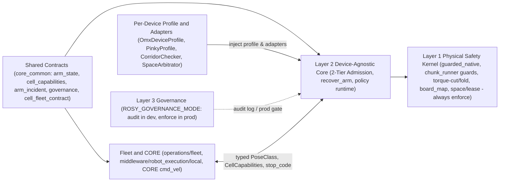

## D-1089 OMX 셀·Fleet·CORE 안전 가드와 복구 경로의 3단계 구조 통합 (공통 코어·기기별 프로필·3층 분리)

**Status:** Accepted (2026-11-28, 사용자 승인 — 3층 분리·공통/기기별 경계·개발 단계 우회금지 `audit` 전환 확정; 단계별 PR로 구현, 실물 수용은 별도).

### Context

`deploy/robot/omx/`와 주변 연동 계층을 `origin/main` 기준으로 실측한 결과, 장애·거절 반복과 개발 병목의 주원인은 **물리 안전 커널, 공통 코어, 기기별 차이, 절차적 우회 금지(Anti-Bypass)가 한 평면 폴더와 얕은 파일 조각에 섞여 있는 구조**다.

- **평면 파일 과밀과 400줄 수평 분할:** `deploy/robot/omx/` 단일 폴더에 `.py` 파일 473개(총 102,543줄)가 섞여 있으며, `tools/harness/rosy_harness.py`의 `< 400줄` 규칙에 걸려 118개 파일이 350줄 이상, 85개 파일이 380줄 이상이다. 기능·가드를 더할 때마다 얕은 수평 파일이 늘어나 최근 14일간 `cell_job_spec.py`(51회), `cell_calibrate.py`(50회), `cell_job_api.py`(35회), `cell_auto_pick.py`(33회), `cell_policy_drive.py`(30회)에 수정이 집중되었다.
- **불변식 분산과 중복:** 접힘·홈 판정 상수와 함수가 7개 파일(`cell_job_peer_health.py`, `cell_auto_fold.py`, `cell_unwedge.py`, `chunk_runner_guards.py`, `omx_incident.py`, `cell_act_verdict.py`, `bench_record_auto_recover.py`)에 흩어져 35개 파일이 참조한다. `human_hold` 래치는 폐기 결정(D-1079) 뒤에도 50개 파일에 남았고, 토크/idle/baseline 판정은 73개 파일, 세션 잠금·리스는 34개 파일에 퍼져 있다. 복구·접기 흐름만 22개 파일(4,637줄)로 나뉘어 있다.
- **절차적 우회 금지(Anti-Bypass) 과밀:** `platform_parts.yaml`의 `safety_review_paths` 160개 중 OMX 파일이 141개를 차지한다. OMX 내부에도 SHA/digest 봉인(159개 파일), 주체/토큰 분리(39개 파일), 복구 펜스·만료·일회 마커(15개 파일), 정책 사전 거절(22개 파일), 게이트 39개 파일 내 57종 거절 코드가 겹쳐 모델·설정·복구 수정마다 연쇄 거절이 발생한다. `tools/harness/`·착지 도구 78개(18,993줄)와 `test/architecture/` 32개(5,431줄)도 워크플로 마찰을 키운다.
- **공통 로직과 기기·셀 차이의 혼재:** `arm_s`(2D USB 단독·고정 사이트)와 `arm_a`/`arm_b`(D435 깊이·양팔 공유·`arm_b` 손목 롤 예외), `Pinky Pro` 기체별 차이를 프로필/어댑터로 분리하지 않아 `d435_factory` 유무나 기기 ID 분기가 공통 복구·검증 코드 곳곳에 스며 있다. `probe_*`/`sim_*`(50개, 10,445줄)와 `bench_*`(19개)도 셀 런타임과 같은 폴더에 있다.
- **계층 간 문자열 결합:** `contracts/foundation/core_common/protocol/arm_incident/arm_incidents.py`(414줄)는 러너 오류 문자열을 정규식으로 판별하고 `REMEASURE_HOME_TOL = 3.0`을 별도 선언한다. `operations/fleet/`의 49개 파일(14,663줄, `pipeline_recovery_policy.py` 598줄, `pipeline_recovery_tools.py` 487줄 등)은 5갈래 OMX 복구 진입점을 개별 조정한다. `middleware/robot_execution/local/`(13개, 1,996줄)은 로컬 정책 리스를 별도로 관리한다.

### 목표 아키텍처 (3층 분리 + 공통/기기별 경계)

물리 안전 커널과 거버넌스(우회 금지)를 분리하고, 기기 무관 공통 코어가 선언형 기기 프로필과 어댑터 seam을 주입받아 실행하며, Fleet·CORE는 공유 계약을 통해서만 연동한다.

위 구조에서 물리 안전을 지키는 `Layer 1 Physical Safety Kernel`만 항상 차단하며, 개발 단계 우회 금지는 `Layer 3 Governance`에서 기본 `audit`(기록만)로 동작해 물리 안전을 잃지 않고 병목을 해소한다.

### 3층 책임과 물리 안전 커널 (개발 병목 해소)

1. **Layer 1 — 물리 안전 커널 (`safety_review_paths` 141개 → OMX 17개 + `arm_state.py`):** 실제로 팔 파손·충돌·인명 위험을 막는 5불변식만 버스·러너 경계에서 항상 강제한다. ① 뻗은 팔(`EXTENDED`) 토크 차단 금지, ② `hardware_error != 0`·과열(`>= 55 C`)·PWM/전류/속도 상한·30 Hz 추종오차/접촉 정지, ③ 타 팔 보드 시리얼 오구동 금지(`omx-arm-boards.json`), ④ `HOLDING_HIGH`, ⑤ 이웃 팔 `space.reserve`·AMR 베드 인터락(`AMR_IN_BED_ZONE`)·E-stop. 대상 OMX 17개 파일: `guarded_native.py`, `guarded_native_effort.py`, `guarded_native_probe.py`, `guarded_device.py`, `chunk_runner.py`, `chunk_runner_guards.py`, `chunk_runner_interrupt.py`, `record_session.py`, `record_session_baseline.py`, `commissioning_limits.py`, `commissioning_stop.py`, `cell_torque_off_folded.py`, `cell_safe_home.py`, `cell_auto_fold.py`, `cell_space.py`, `cell_arm_lease.py`, `cell_job_peer_health.py` + `core_common.protocol.arm_state`.
2. **Layer 2 — 공통 코어 + 기기별 프로필/어댑터:** `arm_state`, `CellCapabilities`, 2층 Admission(`Tier B` 자동 선행 복구), `recover_arm`, 캘리브레이션, 정책 구동을 둔다.
3. **Layer 3 — 거버넌스 / 우회 금지 (`ROSY_GOVERNANCE_MODE=audit|enforce`, 개발·랩 기본 `audit`):** ① SHA/해시 봉인(`operating_profile`, `library_sha256`, `reference_top_sha256`, `trusted_grasp` 5 mm/0 deg), ② 주체/토큰 4종 분리·`proposer != operator`, ③ 복구 펜스(`safety_fence`, `stop_generation`, `expires_at`, `O_EXCL` 1회 마커, `STOP_PROOF _MINTED`), ④ 정책 사전 거절(`StateGate`, `trained_grasp_mismatch`, `canonical_start`)을 개발 단계에서는 `audit` 기록만 남기고 Layer 1 물리 가드에 위임하며, 운영 배포 시에만 `enforce`로 전환한다. 개발 하네스(`safety_review_paths` 141→17개, 400줄 컷 경고 전환)도 이 원칙을 따른다.

### 공통 계층과 기기별 계층의 분리 기준

새 코드와 리팩터링 코드는 모든 책임을 아래 표의 두 축으로 나눠 배치한다. 공통 코어 모듈 안에는 특정 기기 이름(`arm_s`, `arm_b`, `rosy_42`) 분기문을 두지 않는다.

| 구분 | 소유 범위 | 정본 위치 (목표) | 포함 요소와 예시 |
|---|---|---|---|
| **공통 계층 (Device-Agnostic Core & Contracts)** | 모든 기기·셀에 동일하게 적용되는 상태 정의, 물리 가드, 상태 머신, 프로토콜 | `contracts/foundation/core_common/protocol/` + `deploy/robot/omx/{omx_state,omx_recovery,omx_jobs}/` + `operations/fleet/` + `middleware/core/` | `PoseClass` 5단계와 토크/모션 판정 3종; 2층 Admission(Tier A/B); `recover_arm` 상태 머신 골격; `STOP_PROOF`·감사 장부; 30 Hz 추종오차/전류/온도/접촉 가드; `cell_fleet_contract` 베드 인터락; CORE 단독 `/cmd_vel` 및 로컬 정책 리스 |
| **기기·셀별 계층 (Per-Device Profile & Adapters)** | 보드 시리얼, 모터 모델/캡, 카메라 기하, 자유도 예외, 사이트/청크/모델 자산, 센서 어댑터 | `deploy/robot/omx/devices/` + 기기/셀 설정 파일 + `middleware/devices/pinky/profile/config/` | OMX: 보드 시리얼(`arm_*`), `caps-*.json`(XL430/XL330, `arm_a` 손목 400 mA 등), `arm_*_follower.json` 캘리브레이션, `tcp_x_m`, `DeviceCapabilities`(`arm_s` 2D 단독 vs `arm_a/b` D435 양팔, `roll_branch` 등), `CorridorChecker`(D435 3D vs 2D), `SpaceArbitrator`(단독 no-op vs 양팔 예약), 사이트/청크/ONNX 번들. Pinky Pro: `ROSY_ROBOT_NUMBER` 기반 ID/도메인(D-33), 기체 YAML, 도킹/LiDAR/배터리 오프셋 |

### Decision

1. **단일 팔 상태·접힘·토크 판정 계약 (`core_common.protocol.arm_state`):**
   - 분산된 7곳의 접힘 상수(`FOLD_TOL`, `REST_TOL`, `SETTLE_TOL`, `HOME_TOL`, `FOLD_TOLERANCE`, `SAFE_FOLD_TOL`, `REMEASURE_HOME_TOL`)를 단일 계약으로 통합한다.
   - 자세를 `AT_HOME`(±3.0), `AT_REST`(±8.0), `BODY_FOLDED`(coarse + 관절 0–3, 축 회전 `wrist_roll` 제외), `FULLY_FOLDED`(관절 0–4), `EXTENDED` 5단계 `PoseClass`로 정의한다.
   - 호출자는 원시 각도를 비교하지 않고 `can_cut_torque`(토크 차단 — 중력 낙하 모멘트 기준 `BODY_FOLDED`), `can_restore_caps`(이미 토크 OFF면 자세 무관 허용), `can_start_motion`(`FULLY_FOLDED` 또는 등록된 시작 자세) 3개 판정만 사용한다.

2. **선언형 기기 프로필과 `CellCapabilities` (공통·기기별 분리):**
   - OMX 셀 설정 로더 1곳에서 기기·셀 능력 객체(`has_depth`, `peer_arms`, `has_side_camera`, `supervised_2d_fold_fallback`, `constraints` 등)를 계산해 `/readiness`, `cell_task_worker` claim, `recover_arm`에 전달한다.
   - `arm_s`의 2D 단독 폴백, `arm_a/b`의 D435 깊이 검사 및 이웃 팔 공간 예약, `arm_b`의 `wrist_roll` 브랜치 검사 같은 기기 특화 규칙은 프로필 필드와 어댑터 구현으로만 표현한다.

3. **2층 Admission과 단일 복구 상태 머신 (`recover_arm`):**
   - 중복 거절(Admission 가드 4중 체인)을 두 층으로 분리한다. **Tier A(하드 물리 위험 — 절대 우회/자동 해제 금지):** 뻗은 팔 토크 차단, `hardware_error != 0`·과열(`>= 55 C`), `HOLDING_HIGH`, `load_check == risky`, 이웃 팔 `space.reserve` 충돌, `cell_fleet_contract` 인터락(`AMR_IN_BED_ZONE`·E-stop), 보드 시리얼 불일치·활성 모션 리스. **Tier B(자동 선행 복구 후 진행 — 409 데드락 제거):** 토크 OFF 상태 raised idle caps, `hardware_error == 0` + `BODY_FOLDED` 잔류 토크, 죽은 세션의 stale latch, 2D 셀 감독 복구의 `look()` 폴백(Tier A 가드 유지).
   - 5갈래 복구 진입점(`torque_off_folded`, `recover_hold`, `safe_home`, `omx_incident launch`, `cell_hold_retry`)을 단일 상태 머신 `recover_arm`(`probe_hw -> heal_residual_torque -> unlatch -> plan_and_park -> verify_home -> report`)으로 합치고, 기존 HTTP/CLI 엔드포인트는 호환 어댑터로만 남긴다. 잔존 `human_hold` 대기 분기는 D-1079 원칙대로 제거한다.
   - `chunk_runner`가 구조화 `stop_code`를 함께 내보내 `arm_incidents.py`의 문자열 정규식 의존을 단계적으로 대체한다.

4. **`deploy/robot/omx/` 하위 패키지 구획 및 400줄 린트 규칙 전환:**
   - 최상위 폴더를 새로 만들지 않고 `deploy/robot/omx/` 내부를 역할별 패키지(`omx_state/`, `omx_recovery/`, `omx_jobs/`, `omx_policy/`, `omx_calibration/`, `devices/`, `bench/`, `probes/`)로 정리한다.
   - `probe_*`/`sim_*`(50개)과 `bench_*`(19개)를 운영 런타임과 분리한다.
   - `tools/harness/rosy_harness.py`의 일률 400줄 컷은 하위 패키지 구획과 `tools/harness/platform_parts.yaml`의 `safety_modules` 소유 단위 기준으로 전환한다(전환 방식은 아래 Open 참조).

### D-427 · D-429 · D-430 및 기존 ADR 관계

| 기준 ADR | 유지되는 계약 | 이번 ADR의 정리·확장 |
|---|---|---|
| [D-33](../reference/ROSY%20ADR%20Log.md) | 로봇 정체성 기본값 금지(`ROSY_ROBOT_NUMBER` 필수) | 변경 없음. 기기별 계층이 기체/보드 ID를 명시 프로필로만 소유한다. |
| [D-427](D-427-platform-three-parts-middleware-operations-learning.md) | 3분할 소유권(Middleware / Operations / Learning)과 단방향 계약 | 유지. 새 최상위 폴더 없이 `core_common`과 `deploy/robot/omx/` 내부 정합만 맞춘다. |
| [D-429](D-429-five-concerns-control-port-and-site-devices.md) | 5관심사 분리, 원시 장치 직접 구동 금지, Fleet-Cell 단일 경로 | 유지. `recover_arm`과 어댑터도 세션 잠금과 `cell-job-api`를 통해서만 버스에 쓴다. |
| [D-430](D-430-safety-as-a-separate-concern.md) | `safety_modules` 변경 시 독립 `Safety-Review: AGREE` 필수, 가드 한계 유지 | 유지. 판정 단일화와 패키지 재배치 단계 모두 `platform_parts.yaml` `safety_modules`와 리뷰 게이트를 동기 갱신한다. |
| [D-777](D-777-concise-human-agent-documentation.md) | 간결 문서·단일 기준 문서 | 이 ADR과 후속 모듈 문서에 적용한다. |
| [D-911](D-911-omx-native-reviewed-operating-envelope.md)·[D-1077](D-1077-stop-capability-proof-replaces-presence.md)·[D-1081](D-1081-free-position-pick-as-fleet-cell-task-motion.md) | `Gate` 경유, 실행 직전 `STOP_PROOF`, 자유 위치 집기 조건 | 유지. Tier A 물리 가드와 `STOP_PROOF`는 약화하지 않고 Tier B 자동 복구만 정리한다. |
| [D-971](D-971-omx-arm-incidents-in-fleet.md)·[D-1057](D-1057-cell-task-admission-evidence.md) | 사건 보고/해제 소유권, 측정 완료 증거(`corridor_clear`) | 유지. `arm_incidents.py`에 구조화 `stop_code` 판별을 추가하되 기존 근거 규칙을 보존한다. |
| [D-1048](D-1048-automatic-fold-of-a-held-extended-arm.md)·[D-1079](D-1079-held-arm-recovery-retried-without-a-person.md) | 복도 검사 자동 접기, `human_hold` 사람 대기 금지·자동 재시도 | 5개 분산 복구 진입점을 `recover_arm` 1개로 합쳐 D-1048·D-1079 실행 일관성을 높인다. |
| [D-1061](D-1061-records-fragments-merge-queue.md) | ADR·로그·API 변경 조각 기반 병합(Merge Queue 충돌 방지) | 준수. 단계별 PR마다 `logs/2026/...` 조각과 본 ADR 상태 갱신을 분리 적용한다. |

### 3단계 마이그레이션 계획

각 PR은 `Safety-Review`와 원격 `remote_pytest.py` + `known_failures.py` 검증이 가능한 작은 단위로 쪼갠다. 호스트 pytest 통과는 실물 장치 수용을 대신하지 않으며, 장치 경로 PR 뒤에는 제어 PC 실물 수용을 별도 확인한다.

| 단계 | PR 분할 | 주요 변경과 경계 | 완료·검증·롤백 기준 |
|---|---|---|---|
| **Phase 1: 커널 축소·계약 단일화·능력 분리** | `PR 1` 커널 축소·`arm_state`·`CellCapabilities`·`governance` `PR 1C` 구조화 `stop_code` | `1`: `platform_parts.yaml` `safety_review_paths`를 물리 안전 커널(OMX 17개 + `arm_state.py`)로 축소하고, `core_common.protocol.{arm_state,governance}` 신설, `cell_capabilities.py` 도입, OMX 7곳 상수 통합. `1C`: `chunk_runner`가 `stop_code` 동시 출력, `arm_incidents.py`는 `stop_code` 우선·정규식 폴백. | 기존 CLI/JSON 스키마 100% 하위 호환. `affected` + `test_safety_separation.py` + `core_common` 원격 pytest 0 new failure, `Safety-Review: AGREE`. PR 단위 즉시 revert 가능. |
| **Phase 2: 2층 Admission & 단일 `recover_arm` & `audit` 전환** | `PR 2A` Tier A/B Admission 분리 `PR 2B` `recover_arm` 통합 `PR 2C` Layer 3 `audit` 전환 및 Fleet 전환 | `2A`: `cell_job_admission`에서 Tier B 상태(idle raised caps, `BODY_FOLDED` 잔류 토크, stale latch) 자동 선행 복구. `2B`: 5개 복구 진입점을 `recover_arm`으로 통합, 잔존 `human_hold` 대기 분기 정리. `2C`: SHA/주체/펜스/사전 게이트에 `governance.py` 적용(개발 `audit`), Fleet·워커가 구조화 `PoseClass`·`CellCapabilities`·`stop_code` 소비. | 기존 엔드포인트(`/jobs/safe_home`, `/jobs/recover_hold`, `/jobs/torque_off_folded`) 호환 래퍼 유지. 실물 셀 3대(`arm_s`, `arm_a`, `arm_b`) dry-run + `safe_home`/정책 실행 수용 확인. |
| **Phase 3: 폴더 구획·레거시 격리·하네스 정리** | `PR 3A` 하위 패키지 구획 및 `probe`/`bench` 격리 `PR 3B` 하네스 린트 및 `platform_parts.yaml` 정합 | `3A`: `deploy/robot/omx/`를 역할 패키지(`omx_state/`, `omx_recovery/`, `omx_jobs/`, `omx_policy/`, `omx_calibration/`, `devices/`, `bench/`, `probes/`)로 재배치하고 기존 스크립트 위치에 얇은 진입점 shim 유지. `3B`: `rosy_harness.py` 크기 검사 및 `platform_parts.yaml` `safety_modules` 경로 일괄 갱신. | systemd 유닛·세션 래퍼·`cell_job_spec` 경로 동작 무변경 검증. `rosy_harness.py lint` 0 error 및 전체 OMX/Fleet `affected` 통과. |

### Open (후속 결정)

1. **`tools/harness/rosy_harness.py` 400줄 규칙 전환 방식 (Phase 3):** 하위 패키지로 나눈 뒤에도 400줄 엄격 제한을 유지할지, 패키지 내 응집 모듈(예: 600줄 상한, 400줄 경고)로 완화할지 Phase 3 착수 시 확정한다.
2. **`bench_*` 19개 파일 배치 (Phase 3):** `deploy/robot/omx/bench/` 하위 패키지로 남길지 `tools/` 아래 벤치 도구로 옮길지 Phase 3A에서 확정한다.
3. **실물 수용:** Phase 1·2 코드·단위/회귀 시험 통과 뒤 제어 PC(`arm_s`, `arm_a`, `arm_b`) 실물 수용을 별도 확인한다.
