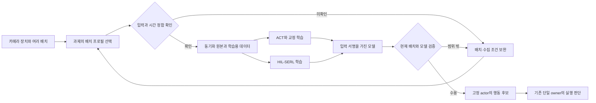

## D-832 Rosy Learning에서 다중 팔 ACT+교정·HIL-SERL과 다양한 카메라 배치를 연결한다

**Status:** Accepted (2026-10-21, 사용자 요청에 따른 구현 방향). 기능 구현·모델 성능·실물 실행·배포 수용은 별도다.

## Context

사용자는 OMX-AI의 같은 집기·재파지 과제에서 ACT+교정과 HIL-SERL을 함께 구현하고, 학습자가 솔루션 화면에서 준비·실행·진행·결과·다음 학습을 확인하도록 요청했다. 카메라 여러 대와 다양한 위치·방향뿐 아니라 **로봇팔 두 대 이상에서의 학습**을 처음 구조부터 포함한다.

결정 당시 `/learning/omx`는 intake 검수·카메라 판정을 읽는 화면이다. `/learning`의 결과 폴더 연결은 작업 시작이 아니고, `learning_control.py`는 고정된 review pipeline만 제어한다. ACT에는 기존 학습 CLI가 있지만 HIL-SERL의 통합 실물 학습 경로는 이번 결정에서 새로 연결할 범위다.

카메라도 경로별 지원 범위가 다르다. 실물 native 수집은 `top`과 손목 카메라를 기록한다. `act_inference.py`와 `InferenceObservation`의 현재 계약은 단일 RGB 입력이다. 카메라 등록 화면만 늘리면 수집·학습·추론의 입력 의미가 갈라진다.

## Decision

### 1. 한 학습 작업대에 두 경로를 둔다

Rosy Learning의 기존 `/learning`, `/learning/omx`, `/learning/camera`를 확장한다. 별도 앱·포털을 만들지 않는다. 사용자는 다음 흐름을 터미널 명령 조합이나 수동 결과 폴더 이동 없이 완료한다.

`과제·카메라 준비 → 시범/교정 검토 → ACT+교정 또는 HIL-SERL 선택 → 학습/실험 실행 → 실제 진행 확인 → 고정 모델 평가·비교 → 다음 학습`

공통으로 사용할 것은 과제, 관측 원본, 개입·초기화 절차, 팔별 실행 owner, 평가 기준이다. 학습용 데이터 선별, replay buffer, optimizer, checkpoint는 방법별로 분리한다. **각 팔의 최종 writer는 하나**이며, 해당 시도의 팔 그룹에는 정합한 정책/사람 제어 계획 하나만 허용한다. ACT 성능 통과는 HIL-SERL 개발의 선행조건이 아니다.

단일 팔 smoke 과제는 고정 수레의 트레이 안에서 블록 하나 집기·유지와 허용된 비정렬·빈 집기의 재파지다. 완료 범위에는 두 팔의 개별 과제와 수용된 협동 과제의 공동 학습도 포함한다. 무게·높이·작업영역·유지 시간·허용 주기는 수용된 rig와 과제 프로필에서 정한다. 이동 중 조작·VLA는 이번 범위에 넣지 않는다.

### 1a. 학습 단위는 단일 팔이 아닌 팔 그룹이다

팔 그룹은 작업대의 명시된 팔 identity·역할·순서와 task/배치를 묶은 학습 단위다. 한 팔은 길이 1인 경우이고, 두 팔은 길이 2인 경우다. API·데이터·화면에 `left/right` 두 슬롯이나 팔 한 개를 고정하지 않는다. 기존 실행 조율자는 두 owner만 받으므로 이를 N개 지원 증거로 사용하지 않는다.

| 모드 | 학습·실행 | 결과 |
|---|---|---|
| 개별 학습 | 팔별 정책·데이터로 각자의 과제를 배운다. 자원을 공유하면 허용된 범위에서만 병행한다. | 팔별 성공·개입·비용 |
| 협동 학습 | 공동 관측과 팔별 행동을 하나의 group episode에 묶어 공동 정책 또는 명시된 협동 정책 조합으로 학습한다. | 공동 과제 성공과 각 팔의 실제 행동·개입·실패 |

두 팔에서 같은 단일 팔 모델을 각각 실행하는 것을 양팔 협동 학습 완료로 표시하지 않는다. ACT는 선언한 팔별 관절·그리퍼의 순서로 공동 행동 묶음을, HIL-SERL은 선언한 팔별 행동 공간과 공동 전이를 지원한다. 존재하지 않는 팔을 0 값으로 채워 기존 모델에 넣지 않으며 팔 추가·제거·역할 변경은 새로운 입력/행동 서명과 검증을 요구한다.

동일 팔의 이름 같은 관절도 `(arm identity, joint name)`으로 구분한다. 작업대 공통 좌표와 각 팔 base transform, 부착 카메라·도구·gripper revision을 기록한다. 공동 전이는 각 팔의 실제 실행 시각·receipt와 동일 관측 묶음에 결속한다. 허용된 시각 오차·원자성/부분 수락 처리·group 권한이 확정되지 않으면 짧은 주기의 공동 정책을 실행하지 않는다.

### 1b. 협동 실행·개입은 기존 다중 owner 경계를 유지한다

사용자는 ACT 시범·재교정과 HIL-SERL 사람 개입 모두 기존 OMX Leader를 기본으로 사용하고, 게임패드 어댑터도 지금 구현해 선택할 수 있도록 지정했다. 게임패드는 필수 준비 조건이 아니다. 입력 장치 어댑터와 선택/매핑을 학습기와 분리하며 어떤 장치도 별도 최종 writer가 되지 않는다. 연결·매핑이 검증된 장치를 사용자가 선택하고, 장치·대상 팔 변경은 기존 입력 차단·실제 상태 확인·새 기준 정렬 후 명시적으로 수행한다. 단절 시 다른 장치로 자동 전환하지 않는다. 실제 입력 장치·매핑 버전·대상 팔을 시도/개입 기록에 남긴다. 연결된 Leader reader와 joystick reader의 공통 관절 제안·기록 재생은 구현했다. 게임패드는 명시 축/중립점/단위 gain·deadzone·deadman을 쓰는 관절 조그이며 Cartesian 명령을 관절 값으로 대체하지 않는다. 실제 장치 연결·버튼 교정·화면 선택·owner takeover는 별도 구현·수용 대상이다. 기존 Leader 시범 녹화와 자동 정책 운용 중 Leader로 조작권을 전환하는 HIL 개입은 별도 경로이며, 후자는 아래 owner 중재·정렬·명시 복귀 조건으로 연결한다.

Fleet은 그룹 자원·팔·구역 claim과 실행 권한을 소유하고 각 팔 owner는 최종 명령과 정지를 집행한다. 조율자는 새 writer나 grant 발급자가 아니다. 현재 D-778·D-780의 barrier/결합 정지 기반은 재사용 후보지만, 공동 learned-action streaming의 수용 증거가 아니다. D-778이 보류한 L3 정책과 D-496 제한을 변경할 실제 제어 계약·설치 바인딩·독립 안전 검토가 선행된다.

공유 물체·공간에 결합된 과제는 한 팔의 단절·늦은 명령·실행 불명·사람 개입 시 관련 팔과 과제를 함께 격리한다. 정지 요청·각 팔의 실제 상태·파지/물체 지지를 확인한다. ACK 하나로 전체가 멈췄다고 기록하지 않고, 파지 해제나 다른 팔 자동 복귀를 하지 않는다. 독립 구역 과제는 수용된 자원·충돌·결합 조건이 있을 때만 영향을 받은 팔로 범위를 제한할 수 있다.

Leader 하나로 여러 팔을 번갈아 조작할 때는 대상 팔을 명시 선택하고 전환마다 입력 차단·자세/그리퍼 정렬을 확인한다. 공동 양팔 시범에는 필요한 복수 입력 장치 또는 검증한 조작 방식을 준비하며 한 Leader를 두 팔의 동시 시범으로 복제하지 않는다. 협동 중 한 팔만 수동으로 바꿀 때에도 나머지 팔의 유지·지지 조건을 그룹에서 확인한다.

공동 초기화는 모든 멤버의 팔·그리퍼·물체·공간 상태를 확인한 뒤 종료한다. group episode와 그 하위 팔·교정 segment는 같은 train/eval split에 둔다. 초기화·부분 성공·공동 성공·개입을 구분한다. 첫 완성 수용은 실제 두 팔의 ACT+교정과 HIL-SERL 공동 과제를 포함하고, 3개 이상은 계약/화면/기록 시험과 실제 설치 용량 검증을 구분한다.

### 2. 화면의 요청·worker 실행·팔 동작을 구분한다

웹 서버는 인증된 사용자의 작업 요청을 소유 작업 owner에 전달한다. 모델 PC의 고정 worker가 학습하고, AI PC의 추론과 현장 Fleet·장치 owner의 실행 권한은 기존 역할을 따른다. 웹 요청이나 learner가 직접 serial·ROS·최종 팔 명령 권한을 얻지 않는다.

학습 요청·worker 수신·학습 업데이트·checkpoint 저장·독립 평가를 실제 run identity로 결속한다. 수락 응답만으로 학습 중이라고 표시하지 않는다. 중복 클릭·두 탭·재접속에도 같은 작업을 복원하고, 임의 shell·host 경로·credential을 브라우저 입력으로 받지 않는다.

[공통 SIM 작업공간 계획](../plans/2026-10-21-sim-learning-workspace.md)의 불변 run 기록·요청 중복 방지·기존 GPU admission 접점을 공유 후보로 우선 확인한다. 별도 원장·GPU 잠금 체계를 중복 구축하지 않는다. 그 계획은 아직 구현 수용이 아니며 Isaac 실행기 자체를 실물 학습 제어기로 사용하지 않는다. ACT/HIL worker의 자원 획득·해제와 장치 실행 권한은 각 계약에서 검증한다.

학습 중지와 실물 실험 중지를 분리한다. HIL 화면은 actor가 실제 사용하는 revision과 learner가 만든 새 후보를 구분한다. 새 후보는 에피소드 경계에서 검증·설치·권한 계약을 거쳐 사용하며 실행 중 파일을 덮어쓰지 않는다. 연결이 끊기면 마지막 관측 시각과 확인 불가 상태를 표시한다.

현재 SIM 전용 정책 세션을 실물 기능으로 이름만 바꿔 사용하지 않는다. 필요한 연속 로컬 제어·개입·후보 갱신은 실제 producer/consumer와 ADR/API/schema를 함께 설계·검증한다. 이 결정이 D-390의 제한 목표·100ms 주행 루프 금지나 기존 stop·rearm 규칙을 해제하지 않는다.

### 3. 카메라 장치와 배치·모델 입력을 분리한다

| 용어 | 뜻 |
|---|---|
| 카메라 장치 | 실제 영상 원천. USB 검색 순번이 아닌 안정된 source identity로 식별한다. |
| 카메라 배치 | 장치가 어디에 어떤 방향으로 장착됐는지와 확인 가능한 기준. 고정 작업대·손목 등 부착 대상을 포함한다. |
| 카메라 배치 프로필 | 과제에서 함께 사용할 장치·배치·용도·입력 키·기준 자료를 고정한 불변 설정. 사용자는 이름을 붙여 저장·복제한다. |
| 모델 입력 서명 | 정책이 요구하는 영상 키·형상·전처리·장치/배치 허용 조건. 연결된 모든 카메라를 뜻하지 않는다. |
| 검증한 배치 범위 | 모델이 실제로 학습·독립 평가한 배치 프로필 집합 또는 측정 가능한 변화 범위. 한 배치의 성공으로 임의 위치를 허용하지 않는다. |

카메라 수를 두 대로 하드코딩하지 않는다. 상부·좌우 측면·사선·손목 등 다양한 배치와 추가 장치를 등록할 수 있게 한다. 사용 가능한 동시 카메라 수·해상도·fps는 USB·네트워크·저장·GPU의 실측 용량을 readiness로 확인하며 무제한 지원을 약속하지 않는다.

각 장치는 작업대 공용 또는 특정 팔 부착이라는 연결을 가진다. 두 팔의 손목 카메라는 같은 용도지만 서로 다른 장치·입력 key이며 별칭 정규화도 대상 팔 안에서만 적용한다. 한 작업대 공용 카메라를 여러 팔이 함께 볼 수 있지만 같은 영상을 별개의 새 source처럼 중복 기록하지 않는다. 프로필은 카메라→팔/작업대 관계와 모델 key를 명시해 팔·카메라 순서 교환을 거절한다.

동일 용도의 장치가 여러 개여도 camera identity와 모델 input key는 서로 달라야 한다. `front`/`wrist`는 기존 OMX 손목 역할의 별칭이라는 D-794 이행 규칙을 유지한다. Pinky 전방 `front`를 변경하지 않는다. `top`과 손목은 기존 실물 기본 구성으로 유지하고, 다른 구성을 선택할 때 task profile에 그 이유·수용 범위를 남긴다. 과거 데이터와 학습된 특징 키는 원본대로 읽고 쓰는 시점의 새 프로필과 구분한다.

### 4. 여러 대 연결과 다양한 위치 실험을 모두 지원한다

사용자는 등록된 카메라를 격자 미리보기에서 확인하고, 이름·부착 위치·용도와 배치를 저장한다. 같은 장치를 상부에서 사선으로 옮긴 경우 새 장치를 중복 등록하지 않고 새 배치 프로필 revision을 만든다. 여러 장치를 서로 바꿔 꽂아도 USB index가 같다는 이유로 같은 입력으로 취급하지 않는다.

배치별로 기준 사진, 촬영 조건, 필요할 때 실측 mount·내부/외부 교정·hand-eye revision, crop/resize를 연결한다. 모르는 위치·각도·보정은 미확인으로 남긴다. 영상 기반 점선 맞춤은 D-792의 촬영 기준 확인이며 미측정 3D 외부 교정이나 정밀 위치를 자동 승인하지 않는다. 사용자가 임의 배치를 등록할 수 있다는 것과 그 배치가 특정 정책에서 수용됐다는 것은 다르다.

손목 카메라가 팔을 따라 움직이는 것은 정상 관측이다. 장착 위치가 그대로면 매 동작마다 새로운 고정 배치 프로필을 만들지 않는다. 기준 사진 비교는 확인 자세에서 수행하고, 기하 계산에 필요한 동적 camera pose는 같은 시각의 관절·FK와 수용된 hand-eye에 결속한다. 사람이 브래킷·장착 각도를 바꾸면 새 배치·관련 보정 검토가 필요하다.

첫 구현은 에피소드 사이에 사람이 배치를 바꾸고 준비를 다시 확인하는 실험을 지원한다. 실행 중 외부 고정 카메라의 재배치는 실험을 중단하고 프로필을 다시 확인한다. 움직이는 외부 카메라의 연속 pose 추적·동적 학습은 별도 범위다. 손목의 정상 움직임을 이 제한과 혼동하지 않는다.

### 5. 배치 변화에 견디는 학습을 실험 조건으로 만든다

프로필 하나를 고정해 재현하는 실험과 여러 프로필을 섞어 강건성을 학습하는 실험을 모두 표현한다. 후자는 각 에피소드에 실제 배치·보정·영상 입력과 변화 범위를 기록하고, 배치별 수량·성공률을 확인한다.

학습에 쓴 배치와 별도 위치·각도를 남겨 독립 평가한다. 검증한 범위 안의 배치는 모델 manifest의 허용 조건으로 결속해 재사용할 수 있다. 범위 밖의 배치는 추가 데이터·평가 또는 새 모델 후보가 필요하다고 표시한다. 카메라를 움직일 때마다 무조건 재학습시키지도 않고, 보지 못한 시점에서도 동작한다고 가정하지도 않는다.

다중 시점·영상 증강·시뮬레이션 랜덤화는 보조 수단이다. 실제 배치·가림·손목 움직임에서의 성공 판정을 대체하지 않는다. 정책 입력이 다른 두 실험은 그 차이를 명시한다.

### 6. 수집부터 추론까지 같은 카메라 의미를 유지한다

카메라마다 정책 입력·기록·보상 판정·독립 평가·모니터링 용도를 구분한다. 모니터링 전용 장치를 추가했다고 기존 모델의 입력 차원이 바뀌지 않는다. 정책 입력 카메라를 추가·제거·전처리 변경하면 새 입력 서명과 이에 맞는 dataset·모델이 필요하다. 보상·평가용 카메라를 바꾸면 해당 판정기의 데이터·유효 범위를 별도로 확인한다.

동기화된 관측 묶음은 각 영상의 원본 capture/receive 시각·clock·sequence·hash와 관절 시각을 보존한다. 원본 capture 시각이 없으면 receive 시각으로 몰래 바꾸지 않고 그 한계·동기화 증거를 기록한다. 허용 skew·freshness는 task와 실측 프로필에서 정하고, 미래 영상·오래된 영상·누락을 거절한다. 정확한 시각을 입증할 수 없는 묶음은 유효 전이로 승격하지 않는다.

각 consumer가 요구하는 카메라가 빠지면 그 consumer를 중지한다. 정책 필수 입력 상실 시 owner의 기존 중단 계약을 적용하고, 보상 관측 상실을 성공·보상 0의 정상 전이로 위장하지 않는다. 모니터링 전용 입력 상실은 명확히 표시하되 별도의 필수 조건이 없다면 정책 입력 상실처럼 처리하지 않는다. 학습 때 필수였던 입력을 추론에서 검은 영상·다른 카메라·자동 단일 카메라로 대체하지 않는다.

동일 source의 미리보기와 수집은 기존 source owner·fan-out을 사용한다. 웹이 장치를 다시 열거나 무제한 full-resolution stream을 복제하지 않는다. 미리보기 해상도·화면 배치는 모델 입력·원본 저장 설정과 분리한다.

카메라 배치 선택은 수집·학습·추론까지 같은 profile로 연결한다. 다음 그림은 목표 구조이며 현재 구현 상태가 아니다.

### 7. 학습 편의와 데이터 의미를 함께 지킨다

과제별 템플릿과 마지막 수용 프로필을 불러오고, 변경점을 보여 준 뒤 명시적으로 새 run을 만든다. readiness에는 실행기·저장 공간·필수 카메라·시간 정합·초기화·데이터 분할을 표시하고, 준비되지 않은 이유와 바로 이동할 설정 화면을 제공한다.

영상 검토는 같은 시도의 카메라들을 같은 시간축으로 재생하고, 자율·사람 교정·초기화·성공 판정 위치를 보여 준다. 키보드 단축키·스크러빙·직전 실패 시도 열기·실패 사유 선택을 지원하되 성공·사람 교정 라벨은 명시 입력으로 남긴다. 검토 후 수용한 구간만 ACT 정답에 편입하고, RL에는 실제 적용 행동과 유효 다음 관측을 쓴다.

학습 화면은 실제 update step·저장·평가·새 기록 시각과 실패 이유를 표시한다. loss 감소와 물체 과제 성공률은 별도다. 새로고침·두 탭·재접속으로 중복 학습을 만들지 않고, 실패·중단 run의 원본과 부분 결과를 보존한다. 현재 세션의 최종 평가 자료를 다음 학습에 무단 편입하지 않는다.

### 8. 검증을 사용자 흐름으로 닫는다

완료는 버튼 노출이나 mock 상태가 아니다. 화면 요청 identity가 실제 worker의 dataset·학습 step·checkpoint·평가·재접속 결과와 이어져야 한다. HIL은 실물 owner의 시도·개입·정지·판정 증거도 따로 확인한다.

카메라 등록·재배치·복수 입력 수집·학습·재적재·추론·누락 거절·배치별 평가를 같은 후보로 검증한다. 기존 단일 카메라 모델과 두 카메라 native 경로의 호환 시험을 유지한다. 브라우저 검증은 전용 fixture/복사 state를 쓰며 실제 사람 라벨을 바꾸지 않는다.

구체 작업과 확인 순서는 [구현 계획](../plans/2026-10-21-omx-learning-workspace.md)이 소유한다. 이 ADR은 신규 wire endpoint나 schema 필드를 현재 지원 API로 선언하지 않는다. 구현 착수 시 해당 계약과 producer/consumer를 같은 변경에서 확정한다.

## 기존 결정과 관계

| 결정 | 관계 |
|---|---|
| D-427 | 기존 learning·middleware·applications 책임을 유지한다. 새 최상위 영역·앱·장치 학습 payload를 만들지 않는다. |
| D-429 | UI가 직접 trainer·driver를 호출하는 우회를 두지 않는다. 공통 타입만 계약 wheel에, 실행은 기존 owner에 둔다. |
| D-430 | final writer·stop·설치 권한을 유지한다. 관련 runtime 변경은 별도 안전 분류·독립 검토·검증을 거친다. |
| D-458·D-792 | 기존 Learning 화면을 확장한다. 결과 연결을 실제 실행으로 오인하지 않도록 새 실행 작업과 구분한다. |
| D-516·D-527 | 운영 추론·현장 실행의 경계와 각 검증 증거를 유지한다. 아래 사용자 승인 범위에서 두 PC에 격리된 학습 인스턴스를 추가한다. |
| D-633·D-775 | 촬영 배치 점검과 목적별 기하 교정의 책임을 유지한다. |
| D-770·D-787 | 기존 native/ACT 수집·SIM 연구를 재사용하며 이번 범위의 학습 완료로 계산하지 않는다. |
| D-281·D-778·D-779·D-780 | 팔별 owner·claim·barrier·결합 정지 기반을 재사용하되 두 팔 전용 조율자를 N개 팔 또는 공동 학습 streaming의 수용 증거로 쓰지 않는다. 필요한 후속 계약을 먼저 수용한다. |
| D-794 | `top`·손목 의미와 `front`→`wrist` 이행을 보존한다. 추가 카메라·배치는 새로운 프로필 계약으로 확장하며 과거 입력 키를 재작성하지 않는다. |
| D-823 | 개입·복귀 방향을 참고하되 Proposed 전체를 구현·실물 수용으로 승격하지 않는다. |

native 시범의 ACT 배열 변환은 원본 metadata와 프로필의 카메라 입력 키·영상 크기를 정확히 대조하며 추가 카메라 키를 보존한다. 역할·배치·용도는 명시 프로필을 사용하고 wrist는 팔 소속을 요구한다. 과거 키를 별칭으로 다시 쓰지 않는다. 기존 단일 정규화 6관절·생산 검토·원본 봉인 조건은 유지하며 raw 수집기 설정이나 다중 팔 native 형식의 지원으로 해석하지 않는다.

## Alternatives and Consequences

현장 PC의 봉인 자료 전달은 기존 upload/publish/experience 경로를 사용한다. 같은 identity·offset·bytes의 재전송과 부분 prefix 복구를 지원하고 게시된 데이터는 변경하지 않는다. 체크포인트는 원본 지문·대상 origin·선택 작업·전송 UUID를 보존하며 자격 증명을 저장하지 않는다. Linux loopback 터널의 기존 인증·CSRF 경계를 유지하고 프록시·리디렉션을 거절한다. 파일·체크포인트 이름·데이터 이동의 디렉터리 sync를 다음 외부 효과·SQL commit보다 먼저 수행한다. 전달 수신과 실제 학습 소비를 구분하며 이 경로는 현장 관측·보상·개입을 생산하지 않는다.

두 실험을 독립 CLI로 만들면 예제 실행은 빠르지만 준비·카메라·기록·권한을 중복 구현하고 사용자가 솔루션 밖에서 작업해야 한다. 단일 ACT 모델을 곧바로 RL로 이어 학습하면 가중치 호환을 별도 전제로 만들며 두 경로 비교 목적도 흐린다. 따라서 공통 기반과 별도 학습기를 선택했다.

카메라 위치를 하나로 고정하면 검증은 단순하지만 사용자 배치 자유와 강건성 학습 요구를 충족하지 못한다. 모든 배치를 자동 허용하면 입력 분포와 교정의 유효 범위를 잃는다. 따라서 저장 가능한 여러 배치와 모델별 검증 범위를 함께 둔다.

등록·미리보기뿐 아니라 계약·원본·내보내기·학습·추론·관측 신선도까지 변경해야 한다. 실제 동시 카메라 수와 학습 성능은 측정 전이며, 이 결정만으로 제품 화면이나 장치 기능이 활성화되지 않는다.

## 구현 범위와 두 PC 기동 (2026-10-21)

사용자는 Model PC와 AI PC 각각에서 실제 학습센터를 기동하고 학습을 시험하도록 요청했다. D-516의 기존 역할에서 확장되는 **격리된 호스트 학습**을 승인 범위로 기록한다. 기존 운영 추론·GPU 프로세스·기존 검수 상태·로봇 실행 서비스를 바꾸지 않는다. 두 PC에 같은 `/learning/omx` 후보 앱과 별도 데이터·작업 DB·Python 환경을 둔다. 초기 실행은 CPU이며 GPU 학습은 공용 admission 연결 전 거부한다.

`experiment_profile.py`는 N개 팔의 행동 순서와 카메라 identity·입력 키·소속 팔·배치 revision을 검증한다. `experiment_dataset.py`는 해시·형상·세션/원본 분할을 검증한다. `experiment_center.py`가 고정 worker만 실행하며, 요청을 먼저 영속 예약하고 실제 프로세스 identity·진행 파일·종료 결과를 조회한다. 사용자 argv·서버 경로를 실행 요청으로 받지 않는다. 기존 review pipeline 제어를 재해석하지 않는다. 공용 RunStore 구현은 현재 없으므로 소유 OMX 작업만 저장하고, 실제 공용 모듈이 생길 때 통합한다.

ACT는 저장된 시범·사람 교정을 학습하며 자율 rollout의 감독 대상은 사람 개입 구간으로 한정한다. 첫 HIL 경로는 LeRobot 0.4.4 SAC 오프라인 replay였다. 이후 호스트의 지속 SAC 경험 수신을 연결해 같은 모델·optimizer에 등록된 경험을 추가하고 고정 train 정규화·선언된 행동 공간·완료 정책 버전을 유지한다. 두 PC에서 실제 수치 갱신과 앱 경로를 확인했지만 현장 actor의 경험 생성은 아직 연결되지 않았다. 화면에 학습 모드를 명시하고 합성 자료는 `synthetic_smoke`로 구분한다. 모델 저장·재로딩·eval 행동 오차는 실물 성공률을 대신하지 않는다. 사람 제어 전환·물체 초기화·보상 판정·실제 다중 팔/카메라 수집·추론 연결의 수용 기준은 유지한다.

사용자는 현장 PC에 팔·카메라를 연결하고 Model/AI PC에서 학습하는 구성을 확정했다. 현장 owner가 최종 팔 명령·정지·개입 전환을 집행하고, 학습 PC는 경험과 정책 버전을 교환한다. 현재의 SIM-only 정책 세션이나 별도 native recorder를 온라인 실물 제어권으로 재해석하지 않는다. 실제 구현·기동과 남은 범위는 [검증 기록](../validation/omx-learning-center-2026-10-21/result.md)에 둔다.

검토 화면은 등록된 준비 세트의 원본 지문과 정확한 episode/frame/camera를 묶은 RGB 프레임을 표시한다. 사람의 결과·분할 결정은 원래 수집 파일을 덮어쓰지 않고 별도 불변 검토 버전으로 보존한다. 인증 검수자는 서버 세션에서 바인딩하고 로컬 입력 이름은 미인증 신원으로 표시한다. 명시 확인은 사용자의 자기 선언이며 모든 영상을 관찰했다는 자동 증명이 아니다. 변환 시 사용자가 선택한 검토 버전과 현재 원본을 다시 검증하고, 기존 production·독립 분할·단위·카메라 검증을 유지한다. 저장 중단은 예약한 동일 identity로 복구하며 기존 최종 스냅샷은 덮어쓰지 않는다. 이 경로는 실물 집기 성공·개입이나 정책 실행 승인을 새로 부여하지 않는다.

복수 카메라 검토는 공식 reader의 한 기록 행에서 가져온 이미지 묶음을 표시한다. 요청한 카메라·episode/frame/global index·episode 상대 timestamp와 fps를 확인하고 읽기 전후 원본 지문을 재검증한다. 표시 묶음은 최대 8개 카메라·16M pixels·8MiB JPEG이며 누락/변경/잘못된 시각을 대체하지 않는다. 화면은 묶음 전체의 디코딩 뒤 한 번에 반영하고 오래된 응답을 버린다. 자동 넘김은 순차 조회하고 원본/보기 변경·오류·마지막 프레임에서 멈춘다. 기록 행의 시간 일치는 실제 센서의 촬영 동기화와 별개이며 재생이 사람 판정·확인 여부를 자동 작성하지 않는다.

팔·카메라 입력 프로필은 화면에서 작성하고 불변 버전으로 저장한다. 팔과 관절의 순서·단위·선언된 행동 범위, 카메라 identity·입력 키·소속 팔·배치·영상 형상·용도를 보존한다. 불러온 버전을 수정하면 부모를 가진 새 버전으로 저장하며 물리 연결이나 교정 확인을 자동 부여하지 않는다. ACT·지속 SAC 요청의 선택적 `profile_id`는 이미 등록된 데이터와 전체 입력 정의가 같을 때만 수용한다. 작업의 `selected_profile`은 선택한 저장 버전의 참조이고 worker의 `profile_revision`은 실제 모델 입력 프로필의 지문이다. 브라우저의 숫자 직렬화 차이는 검증 후 의미 비교로 처리하며 원래 데이터·모델 지문을 재작성하지 않는다. native 변환에서는 선택한 서버 저장 문서를 그대로 사용한다.

개별 모드의 다중 팔 데이터는 작업의 `arm_id`로 대상 팔을 명시하고 별도 정책으로 학습한다. 모델 입력에는 해당 팔의 관절과 소속 없는/해당 팔 카메라만 포함한다. 원본 전체 데이터는 유지하며 `training_scope`가 대상 팔·원래 행동 열·정책 카메라 키·원래 전체 프로필 지문을 모델 입력에 연결한다. 팔별 보상·교정·종료 전이는 독립 데이터 schema 2에서 명시하고 공동 신호를 임의 복제하지 않는다. 추가 경험도 큐 등록과 worker 갱신 전에 같은 범위를 검증해 잘못된 입력만 거절한다. 공동 모드는 전체 행동 벡터와 공동 관측을 사용하고 단일 `arm_id`를 거절한다. 이 구분은 실제 두 팔 공동 집기의 수용과 별개다.
