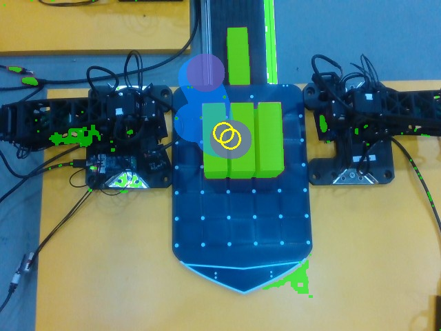
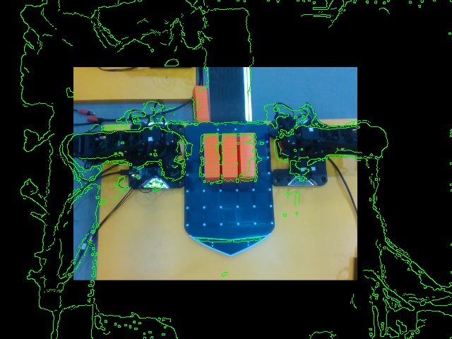
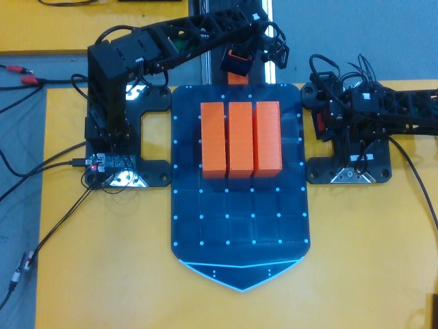
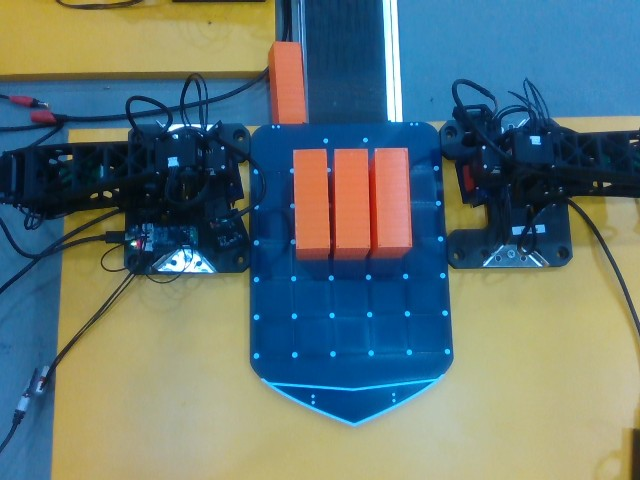
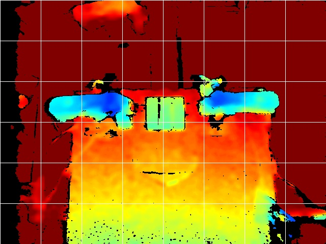

## D-951 ROSY Calibration 앱을 두고, 두 팔 셀의 보정·높이·공간 점검을 코드 한 경로로 돌린다

**Status:** Accepted (2026-11-01). 사용자 결정이다: "rosy calibration 이라고 하나 만들어", "보정과정이나 기타 들은 무조건 우리가 나중에도 자동으로 쓸 수 있게… 코드적으로", "너가 직접 다 판단하지 말고", 벨트 끝 사각형에만 계획 바닥을 낮추는 승인. 앱 화면은 아직 없다. 부품 코드는 착지 대기 중이고 현장 수용은 없다.

잇는 결정: [D-933](D-933-arm-s-cell-coordinate-frame-markers.md)(인쇄 마커로 카메라 모델, 이 기록이 3항 "높이는 터치로 잰다"를 고친다) · [D-911](D-911-omx-native-reviewed-operating-envelope.md)(검토된 운용 범위와 감독 시험, 바꾸지 않는다) · [D-932](D-932-field-runs-one-landed-revision.md)(현장은 착지한 main만 움직인다) · [D-876](D-876-rosy-monitoring-independent-site-and-aggregate.md)(앱 화면과 소유 서비스의 경계) · [D-822](D-822-fleet-application-source-boundary.md)

### Context

2026-10-31 셀을 다시 배선했다. 위 카메라는 RealSense D435(색·깊이, USB 2.0)로 바뀌었고 팔은 두 대가 됐다. 2026-11-01 밤에 두 팔로 컨베이어 → 팔레트 작업을 준비하며 다음을 확인했다. 날짜와 증거는 작업 공간 기록 `omx-two-arm-cell-rewiring-issues.md` 1~13절에 있다.

1. **사람 손 측정과 터치가 높이를 못 줬다.**
   - 왼팔은 10~20 mm 판 위에 서 있다. 벨트 끝은 테이블보다 낮다.
   - 그래서 벨트 위 컨테이너 윗면(FK z ≈ −0.012)이 계획 바닥 0.005 아래에 있었다.
   - 닫은 집게로 내려 닿을 때까지 재는 터치는 바닥에서 멈췄다. 승인된 벨트 사각형 안에서도 16 g 컨테이너가 접촉으로 잡히지 않고 밀려 레일 옆 틈으로 떨어졌다(그림 4).
2. **깊이 영상은 면 높이를 준다.**
   - 테이블 평면(RANSAC)에서 잰다.
   - 팔레트 10~11 mm, 2층 스택 75~79 mm(팔레트에서 65 mm, 사용자 값과 같음), 벨트 −29~−35 mm, 왼팔 판 20.9 mm. 한 번에 4.5 s(그림 5).
3. **깊이는 집게 위치를 주지 못한다.** 오른팔 10점 정지 기록으로 네 방법을 시험했다. 가장 좋은 방법의 LOO가 평균 62.6 px다. 손가락(1~2 mm)이 깊이 잡음보다 작고, 높은 링크가 원근으로 더 바깥에 찍힌다.
   - 깊이↔색 정렬 자체는 장면 가장자리 chamfer 정합으로 유일하게 맞는다(scale 0.628, shift 104/95, 그림 2).
   - 물체 마스크만으로 맞추면 물체가 한 줄일 때 해가 여럿이다.
4. **색 열고 닫기 표식은 어두운 바닥 위에서 실패했다.** 왼팔 벨트 위 4점 중 1점, 오른팔 팔레트 위 10점 중 6점(서로 모순 포함)만 잡혔다.
5. **I 게인이 없어 위치가 모자랐다.** 하중 받는 관절에 I 게인이 없어 목표에 못 미쳤다.
   - 왼팔 벨트 끝 TCP 오차 12.3 mm, 팔꿈치 I 게인 50으로 3.3 mm. 손목도 같다.
   - 앞의 터치가 컨테이너 모서리를 친 이유와 맞는다.
6. **두 팔이 동시에 돌 수 없었다.** 셀 잠금 `session.lock` 하나가 셀 전체를 잡는다. 한 팔 세션마다 다른 팔 관찰기를 멈춰야 했다.
7. **경로 점검이 비어 있었다.** 경로 점검(그림 1)이 옛 카메라의 표면 다각형으로 빈 마스크를 만들었다. 컨테이너 위에 놓는 경로를 통과시켰다.
8. **보정 절차가 에이전트의 즉석 스크립트였다.** 잴 점, 높이, 판정이 사람의 손 판단에 기대 다시 쓸 수 없다.

### Decision

1. **ROSY Calibration 앱을 둔다.** 앱 경계는 D-876을 따른다.
   - 화면은 `applications/calibration/`이다.
   - 보정 엔진은 지금 소유인 셀 도구(`deploy/robot/omx/cell_*`)다.
   - 에이전트 절차는 `rosy-calibration` 스킬 카드다.
   - 앱은 엔진의 결과(지도, 높이, 카메라 모델, 점검)를 읽고 보정 실행을 요청한다. 팔을 움직이는 실행은 D-911 감독 시험(사람이 스위치 옆, 매 동작 확인)으로만 한다.
2. **보정은 코드가 정한 순서 하나로 돈다.**
   1. 장치 점검(`omx_devices scan`, `omx_cameras`)
   2. 높이(`cell_depth`)
   3. 카메라 모델(`cell_frame learn/check`, D-933 마커)
   4. 면 높이(아래 4항)
   5. 관절 게인 확인(아래 6항)
   6. 점검(`cell_calibrate check`)
   
   각 단계의 입력·결과·판정은 파일로 남는다. 다음 실행은 그 파일을 읽어 바뀐 것만 다시 한다. 사람이나 에이전트가 숫자를 손으로 정하지 않는다.
3. **집게 위치는 D-933 집게 상면 마커로 잰다.** 색 열고 닫기 차이와 깊이 표식은 쓰지 않는다. 인쇄물은 Fleet `cell_print_sheets`가 낸다. 왼팔 slot 1은 ids 35~49, 오른팔 slot 2는 50~64다.
4. **면 높이는 깊이로 잰다.** D-933 3항을 고친다.
   - `cell_depth`가 테이블 평면, 깊이↔색 정렬, 각 팔의 판(= FK 0) 높이를 재고, 면마다 `surface_z`를 낸다.
   - 터치는 무거운 물체나 단단한 면에서 깊이 값을 확인하는 데만 쓴다. 가벼운 물체 위에서는 터치하지 않는다.
   - 깊이↔색 정렬은 장면 가장자리 정합으로 한다.
5. **팔이 테이블보다 낮은 면에 닿을 때는 `limits.low_zones`로만 바닥을 낮춘다.**
   - 사각형 안에서만 낮추고, 밖은 기존 바닥 그대로다. 높이는 쪽으로는 쓰지 않는다.
   - 값과 사각형은 사람이 승인한다. 2026-11-01 승인: 왼팔 벨트 끝 x 0.155~0.195, y 0.095~0.140, z −0.030.
6. **하중 받는 관절에는 세션이 I 게인을 준다.**
   - 손목과 팔꿈치에 50을 준다. `session_caps`의 `i`이고, 세션이 끝나면 되돌린다.
   - 전원을 끄면 지워지는 값이므로 세션 설정이 매번 다시 쓴다.
7. **두 팔은 동시에 돈다.**
   - 세션 잠금은 팔마다 둔다(`session_lock(arm)`). 셀 잠금은 공유로 잡고, 자기 팔 잠금은 배타로 잡는다.
   - 자동 갱신과 두 팔 원격조종은 셀 전체를 배타로 잡는다.
   - 팔은 움직이기 전에 자기 통로를 위 카메라 픽셀(두 팔 공통 좌표)에 예약한다(`cell_space`). 다른 팔의 살아 있는 예약과 겹치면 거절하고 HOLD한다. 예약은 만료된다.
8. **움직이기 전 경로 점검(`cell_corridor`)은 보이지 않는 곳을 통과로 보지 않는다.**
   - 표면 다각형 밖은 `off_surface`로 거절한다.
   - 낮은 구간은 집을 물체 말고 모두 막는다.
   - 높은 이동은 카탈로그에 없는 덩어리만 막는다.
   - 다른 팔은 검은 몸체가 벨트와 구별되지 않는다. 그래서 다음 단계에 관절 상태의 FK로 넣는다.

### Consequences

- **사람이 할 일**
  - D-933 인쇄물을 100 % 무광으로 인쇄하고 50 mm 막대를 확인한다.
  - 집게와 베이스에 마커를 붙이고, 벨트와 팔레트에 면 마커를 넷씩 붙인다.
  - 벨트 끝 사각형처럼 바닥을 낮출 때는 승인한다.
- **판단의 기준**
  - 평균 3 mm 이하(D-933 목표)를 실측으로 받아들인다.
  - 지금 왼팔 벨트 지도는 LOO 2.56 mm(마크 범위 밖은 모름)다. 오른팔은 RealSense 지도가 없다.
- **부품의 상태(2026-11-01)**
  - `cell_corridor`, `cell_depth`, `low_zones`, 팔별 잠금, `cell_space`, I 게인 세션 설정은 원격 시험을 통과했다. 착지 대기 중이다.
  - 화면과 단계 실행기는 없다.
- **하지 않는 것**
  - 가드 한계를 넓히는 일반 설정.
  - 사람 확인 없는 팔 동작.
  - 깊이로 집게를 찾는 경로.
  - 에이전트가 고른 보정 점을 기록 없이 쓰는 일.

### 그림 (2026-11-01, 현장 위 카메라)

1. 경로 점검: 팔레트 컨테이너 위에 놓는 경로를 거절했다(노란 원은 막힌 덩어리, 빨강은 낮은 구간, 파랑은 높은 이동).
   
2. 깊이↔색 정렬: 깊이 높이 가장자리(초록)가 색 영상의 팔, 컨테이너, 팔레트와 겹친다.
   
3. 왼팔이 벨트 위 컨테이너 40 mm 위에서 멈췄다(접촉 없음).
   
4. 닫은 집게 터치 뒤 16 g 컨테이너가 밀려 레일 옆 틈에 있다.
   
5. 깊이(450~650 mm, 기울어진 테이블): 팔(청록), 스택(초록), 테이블과 팔레트(주황~노랑).
   
