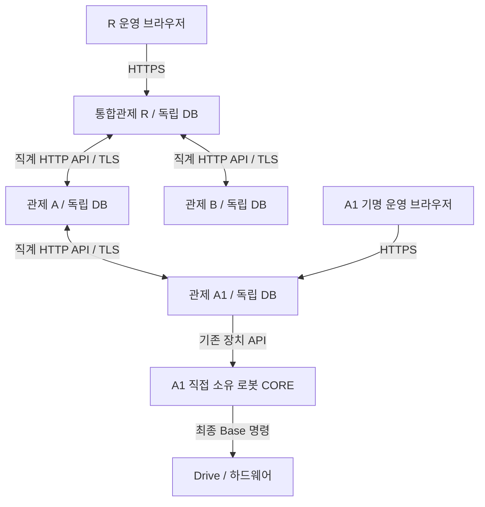

# 독립·중첩 관제 구성

관제 하나는 자기 SQLite 원장·직접 소유 자원·기명 운영자를 가진 Fleet 인스턴스다. 상위 연결 없이 독립 실행할 수 있고, 같은 구조를 하위에 넣어 최대 3수준으로 구성한다. 상위는 작업 후보를 전달하고, 최종 대상 관제의 기명 운영자가 승인한다. CORE의 최종 주행 권한과 기존 Task admission·dispatch 닫힘은 유지한다.

이 문서는 소프트웨어 설정 절차다. 실제 서비스 배포·장치 운행·현장 수용을 실행한 기록이 아니다. 계약은 [D-855](../adr/D-855-control-unit-wire-and-scoped-cancel.md)와 [API reference](../reference/ROSY%20API%20%26%20Protocol%20Reference.md)를 따른다.

## 각 관제와 PC의 역할

관제 단위는 논리적인 책임 범위이고, 관제 PC는 이를 실행하는 호스트다. 독립 관제·통합관제·서브 관제는 서로 다른 제품이나 실행 모드가 아니다. 같은 Fleet 인스턴스가 자원 소유자이면서 부모·자식 역할을 함께 맡을 수 있다. PC 한 대에 여러 인스턴스를 놓는 경우에도 포트·DB·설정·자격을 분리한다.

| 역할 | 소유하는 책임 | 통합관제와의 관계 |
|---|---|---|
| 통합관제 R | 자기 원장의 후보·경로·자식 응답 투영, 자기 직접 자원의 로컬 승인·Task | 자식에게 작업 후보·원래 위임의 취소를 전달한다. 자식 승인·완료 결과를 대신 쓰지 않는다 |
| 중간 관제 A | 자기 직접 자원과 Task, 자기 원장의 위임, A1으로 향하는 다음 경로 | R에는 하나의 서브 관제이며 A1에는 통합관제다. R의 요청을 A1에 중계하되 A1의 실행을 승인하지 않는다 |
| 대상 관제 A1 또는 B | 직접 소유 로봇의 기명 운영자 승인, Task admission·dispatch·실행 결과 대조 | 원래 identity에 결속된 결과를 직계 부모에게 반환한다. 대상 관제에 자식이 있어도 자기 직접 로봇의 승인 책임은 동일하다 |
| 운영 화면 PC | 접속한 관제의 허용 범위 조회·기명 작업 요청·승인·취소 | 브라우저가 원장을 소유하지 않는다. R 화면 로그인으로 A1 승인 권한이 생기지 않는다. A1 승인은 A1 화면에서 해당 기명 자격으로 수행한다 |
| 로봇 PC의 CORE / OMX owner | CORE는 최종 Base 명령·실행·안전, OMX는 기존 joint/action 책임 | 직접 소유 관제의 기존 장치 API 경로를 받는다. 상위 관제·모델 PC가 직접 최종 명령을 쓰지 않는다. 이번 관제 위임 구현은 유한 navigation 범위다 |
| 모델 PC·AI PC·World | 각각 학습/평가, 승인 고정 버전 추론·후보, 현재 관측·상태 투영 | 관제 계층과 별개 역할이다. 모델 결과·관측은 작업 완료나 Fleet 원장 쓰기·장치 실행 권한을 만들지 않는다 |

## 네트워크 연결 구조

아래 R/A/B/A1과 주소는 모두 합성 예다. 화살표는 허용한 논리 연결이며 실제 PC 간 연결 수용 증거가 아니다.



R에서 A1로 직접 건너뛰는 peer 연결이나 A와 B 사이의 연결은 두지 않는다. 관제 간에는 `/api/fleet/control-unit` 아래 HTTP API만 사용한다. 이 기능을 위해 관제 PC끼리 DDS/ROS 도메인·공유 SQLite·메시지 브로커를 연결하지 않는다. R이 직접 소유한 로봇은 R의 로컬 Fleet→CORE 경로를 사용한다.

| 호출 시작 → 수신 | 경로 (공통 prefix 아래) | 목적·결과 |
|---|---|---|
| 부모 → 직계 자식 | `POST /inbox` | 고정 origin/identity·구성 revision·목표 전달. 자식이 같은 요청을 복구·중계하고 그 응답으로 부모가 상태를 투영한다 |
| 부모 → 직계 자식 | `GET /delegations/{origin}/{identity}` | 같은 위임의 저장된 상태 조회. 서비스 자격으로 전체 원장·요약을 읽지 않는다 |
| 자식 → 직계 부모 | `GET /delegations/{origin}/{identity}` | 승인 직전 자신에게 배정된 정확한 위임과 취소 여부 확인. 중간 부모는 다시 자기 부모를 확인하므로 조상까지 검증한다 |
| 부모 → 직계 자식 | `POST /delegations/{origin}/{identity}/cancel` | 같은 위임의 취소 요청. 원래 실행의 조건부 취소까지 중계하며 물리 정지 완료를 뜻하지 않는다 |
| 대상 관제의 운영 브라우저 → 해당 관제 | `POST /delegations/{origin}/{identity}/approve` | 최신 revision과 기명 운영자로 로컬 승인. 부모/자식 service 자격은 호출 권한이 없다 |

결과는 자식이 부모에게 별도 callback으로 밀어 넣지 않는다. 현재 복구 worker가 같은 inbox를 재전달해 받은 응답을 검증·투영한다. 따라서 부모→자식 연결뿐 아니라 승인 확인을 위한 자식→부모 연결도 필요하다. 전송은 고정 origin, 요청별 3초 timeout, redirect 거절, 최대 128 KiB 응답이며 환경 proxy를 사용하지 않는다. 5초 stale 기준은 성능 보장이 아니며 미완료 위임 복구는 현재 순차 처리다.

## 예제 R → A → A1 및 R → B

[설정 예제](../../deploy/site/control-unit.example.yaml)는 A1용 3수준 구성이다. B도 넣으려면 모든 인스턴스의 manifest에 동일한 `id: B`, `parent: R`, 직접 소유 resources를 추가한다. 같은 manifest와 revision으로 아래 네 인스턴스를 준비한다. 파일·DB·자격을 인스턴스 사이에 공유하지 않는다. 직접 자원은 한 관제만 소유하며 robots 파일은 해당 관제의 직접 로봇 목록과 정확히 일치해야 한다.

| 인스턴스 | 직접 로봇 목록 | peers에 필요한 이웃 | 수신 users의 service principal |
|---|---|---|---|
| R | `robots: []` | A, B | `control-unit:A`, `control-unit:B` |
| A | `robots: []` | R, A1 | `control-unit:R`, `control-unit:A1` |
| A1 | `example-robot`만 | A | `control-unit:A` |
| B | `robots: []` | R | `control-unit:R` |

각 인스턴스의 `unit_id`와 `peers`만 자기 위치에 맞게 정한다. 예를 들어 A의 파일은 다음 형태다. `manifest`는 위에서 확정한 동일 revision·전체 unit 목록을 각 파일에 넣는다. 아래 설명용 줄임 표기를 실제 YAML 값으로 사용하지 않는다.

```yaml
unit_id: A
# manifest: 위의 공통 manifest 전체를 여기에 배치
peers:
  R:
    url: https://control-r.invalid:8443
    token_file: secrets/a-to-r.token
  A1:
    url: https://control-a1.invalid:8443
    token_file: secrets/a-to-a1.token
```

R의 peers에는 A/B의 origin, A1과 B의 peers에는 각각 A/R의 origin을 넣는다. peers 집합은 전체 manifest에서 계산한 직계 이웃 집합과 정확히 같아야 한다. 경로·query·사용자 정보가 붙은 URL이나 같은 인스턴스에서 중복된 peer origin은 시작 시 거절된다. 부모 없는 단일 관제는 자기 unit 하나의 manifest와 `peers: {}`로 구성할 수 있다. 계층에 속한 관제도 부모 단절 중 자기 출처·자기 직접 자원의 작업은 로컬 정책에 따라 처리한다.

각 peers 항목의 `token_file`은 **상대 관제**가 그 호출자를 service로 인증하는 별도 비밀 파일이다. `users-file`에는 수신 토큰의 hash와 `role: service`, 위 principal ID를 등록한다. 기명 운영자는 별도의 `operator` 자격이다. 장치·운영자 토큰을 관제 사이의 service 토큰으로 재사용하지 않는다. 실제 비밀·주소·설정은 승인된 private 위치에 둔다.

예를 들어 A의 `a-to-r.token`은 R의 users 파일에서 `principal_id: control-unit:A`, `role: service`, `token_sha256`으로 등록한다. 역방향 R→A에는 별도 토큰을 만들고 A에서 `control-unit:R`로 등록한다. TLS 서버 인증과 이 Bearer 호출자 인증은 모두 필요하다. `token_file`의 상대 경로 기준은 control-unit YAML의 디렉터리다. 수신 users 파일 형식은 [기존 예제](../../deploy/site/site-users.yaml.example)를 따른다.

각 인스턴스는 기존 `fleet console`에 다음 인자를 더한다. 아래 경로는 배치 시 정하는 예시다.

```sh
fleet console --robots /etc/rosy/robots.yaml \
  --users-file /etc/rosy/site-users.yaml --tasks-db /var/lib/rosy/fleet.sqlite3 \
  --control-unit-config /etc/rosy/control-unit.yaml
```

단독 CLI 기본 바인드는 `127.0.0.1:8090`이다. PC 간에는 승인된 TLS reverse proxy의 외부 origin으로 연결하고 내부 Fleet 포트는 proxy에서만 접근하게 한다. 기존 site 배치는 [Caddyfile](../../deploy/site/Caddyfile)과 [Compose](../../deploy/site/compose.yaml)의 `ROSY_SITE_HTTPS_PORT`를 사용하며 `.env.example`의 `8443`은 예시다. Compose 안의 Fleet은 `0.0.0.0`으로 bind하지만 컨테이너 내부 범위다. 실제 방화벽에는 선택한 외부 TLS 포트에 대해 직계 이웃과 승인된 운영 화면의 접근만 허용한다. 장치 API의 주소·포트·자격은 별도 robots 설정을 따르며 이 관제 peer 포트와 혼동하지 않는다.

**현재 배치 연결의 한계:** 기본 site Compose는 `--control-unit-config`와 해당 파일·이웃 token mount를 제공하지 않는다. 예제 YAML을 복사하거나 기존 site를 기동하는 것만으로 중첩 관제가 켜지지 않는다. 위 CLI 방식 또는 검토된 private 배치 설정으로 인자·설정·독립 DB·수신 users·토큰 mount를 모두 연결해야 한다. 설정이 없으면 기존 Fleet 동작을 유지한다.

관제 peer의 `httpx.AsyncClient(trust_env=False)`는 기본 TLS 검증을 사용하고 전용 `tls_ca_file` 옵션을 받지 않는다. site의 `SSL_CERT_FILE`이나 로봇의 CA 설정이 peer client에 자동 적용된다고 가정하지 않는다. 현재 client가 검증할 수 있는 인증서 체인을 사용해야 하며, 사설 CA 연결은 신뢰 전달 방법을 먼저 구현·검증하기 전까지 수용 대기다. 인증서 검증을 끄거나 원격 HTTP로 대체하지 않는다. 내부 loopback proxy 경로와 외부 TLS origin을 구분한다.

소스 대조 위치: `control_unit_config.py`(소유·경로), `control_unit_runtime.py`(이웃·URL·전송·자격), `control_unit_routes.py`(호출자 범위), `control_unit_service.py`(중계·승인·결과·복구)는 모두 `operations/fleet/fleet/server/ledger/`에 있다. 정본 API 경로와 wire는 D-855/API reference를 따른다.

## 요청과 결과 확인

1. R의 작업 화면에서 대상 A1·그 직접 소유 로봇·목표 좌표를 지정해 후보를 요청한다. `origin_id`는 R 서버가 정한다. 요청 접수는 실행 승인이 아니다.
2. A1의 작업 화면에서 출처·대상·목표·원장 상태를 확인하고 기명 운영자로 승인한다. A와 R의 운영자는 A1을 대신해 승인할 수 없다. 서비스 자격도 승인할 수 없다.
3. 승인 시 같은 journal transaction에서 기존 Task에 위임을 결속한다. 실행은 기존 dispatch 재무장·로봇 상태·안전·자원 검사를 통과해야 한다. 이 기능이 dispatch를 자동 재무장하지 않는다.
4. R은 A를 통해 A1의 원래 작업 결과를 읽는다. 같은 identity와 본문의 재전달은 새 Task를 만들지 않는다. 응답이 유실됐으면 identity를 바꾸지 않고 원장을 다시 확인한다.

최근 위임 조회는 최대 100건, 미완료 복구 대상은 최대 256건이다. 완료 기록이 많아도 오래된 미완료 항목을 복구한다. 완료 이력의 보관·DB 유지보수는 기존 현장 journal 운영 절차를 따른다.

## 취소·단절·재시작

- 취소는 같은 위임의 요청으로 전달한다. 미제출 후보는 닫을 수 있다. 제출된 Task는 원래 boot/run/correlation의 조건부 취소만 사용하며 구형 무조건 취소로 대체하지 않는다.
- 취소 receipt는 실제 정지나 자원 해제 증거가 아니다. 기존 native 결과·quiescence 재조정이 Task claim을 해제한다. 현재 facade가 새 실행을 가리킬 수도 있으므로 원래 receipt의 범위를 확인한다.
- 상위에서 받은 위임의 승인 직전 직접 부모부터 조상까지 같은 배정의 취소 여부와 연결을 확인한다. 단절 때 해당 위임의 새 승인을 막는다. 이미 admission을 마친 유한 Action은 기존 owner가 처리한다. 자동 대체·재배정·재무장은 없다.
- 미완료 owner 투영은 마지막 성공 조회 뒤 5초가 지나면 stale이다. 원장 상태가 바뀌지 않아도 재대조로 신선도를 확인한다. 확정된 종단 결과는 단절 뒤에도 원래 결과로 보존한다.
- 재시작해도 위임·승인자·Task identity를 유지하며 dispatch는 기존 startup 정책대로 닫힌다. Task 없는 승인 중 기록은 운영자가 최신 상태로 다시 확인한다.
- 미완료 위임이 있는 구성 revision 변경은 시작을 거절한다. 기존 구성에서 원래 작업을 조정·해결한 뒤 계획된 변경을 수행한다. DB를 새 unit ID에 재사용하지 않는다.

## 검증 경계

관제 HTTP·SQLite·권한·재시작 시험과 CORE 조건부 취소 시험은 호스트 소프트웨어 검증이다. 실제 actuator 동작·물리 정지·현장 네트워크 단절과 복구·운영 PC 화면 수용은 별도로 확인해야 한다. 세부 상태가 Proposed인 D-851 전체를 이 구현으로 일괄 수용하지 않는다.

실제 설치 승인을 받은 뒤에는 다음 순서로 연결을 수용하고 결과를 해당 날짜의 검증 기록에 남긴다. `/healthz`만 통과한 것은 관제 간 인증·위임 경로 통과가 아니다.

1. 모든 인스턴스의 unit ID·manifest revision·직접 roster·독립 DB·직계 peers·수신 principal을 대조한다. 미완료 원장이 있으면 기존 revision으로 먼저 해결한다.
2. **각 직계 연결의 양방향**에서 DNS, 외부 TLS origin·인증서 이름·client 신뢰 체인, 방화벽·reverse proxy 경로를 확인한다. 인증 실패·잘못된 parent·sibling·서비스 승인·전체 원장 읽기는 거절되어야 한다. 실제 토큰을 명령행·로그·공개 기록에 남기지 않는다.
3. dispatch가 닫힌 상태에서 R→A→A1 후보를 한 번 만들고 같은 identity·본문 재전달이 새 Task를 만들지 않는지 확인한다. A1에 배정된 정확한 위임만 A1→A→R로 승인 사전 조회되는지 확인한다. 실제 승인·재무장·운행 단계는 별도 장치 작업 승인 후 진행한다.
4. 부모·조상 링크를 끊었을 때 신규 위임 승인 거절과 stale을 확인하고, 재연결·프로세스 재시작 뒤 동일 identity·취소 의도·원래 결과가 유지되는지 확인한다. 이미 승인된 작업은 기존 장치 정책을 따르며 부모 링크 단절을 물리 정지로 기록하지 않는다.
5. 실제 운행 수용에서는 원래 boot/run/correlation의 취소 receipt, native terminal·claim 해제, 실제 정지 관측을 각각 남긴다. 기존 E-stop 범위를 확인하며 이 기능에 전체 관제 일괄 E-stop 전파가 있다고 가정하지 않는다.

소프트웨어 구현·공식 원격 회귀 근거는 [동결 기록](../validation/control-unit-pipeline-2026-10-24b/result.md), 현재 목표와 남은 현장 수용은 [목표 현황](../plans/2026-10-23-composable-control-goals.md)을 따른다.
