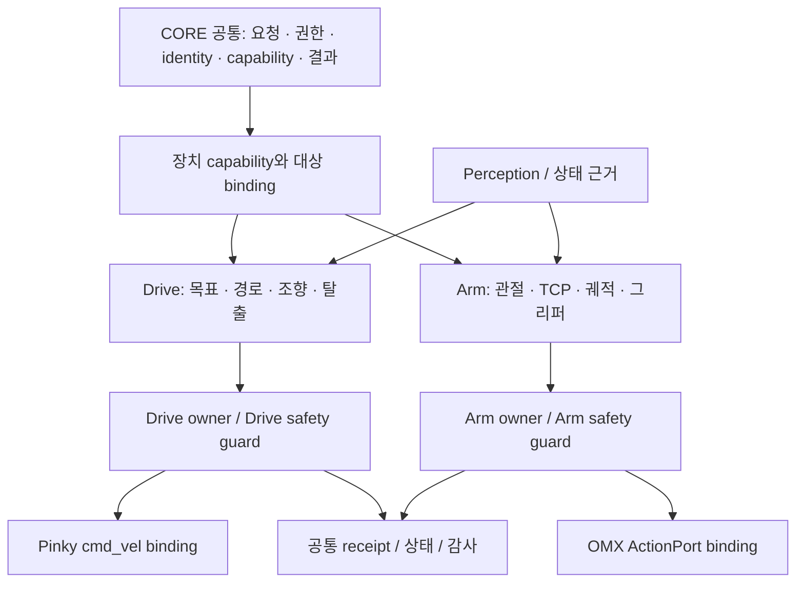
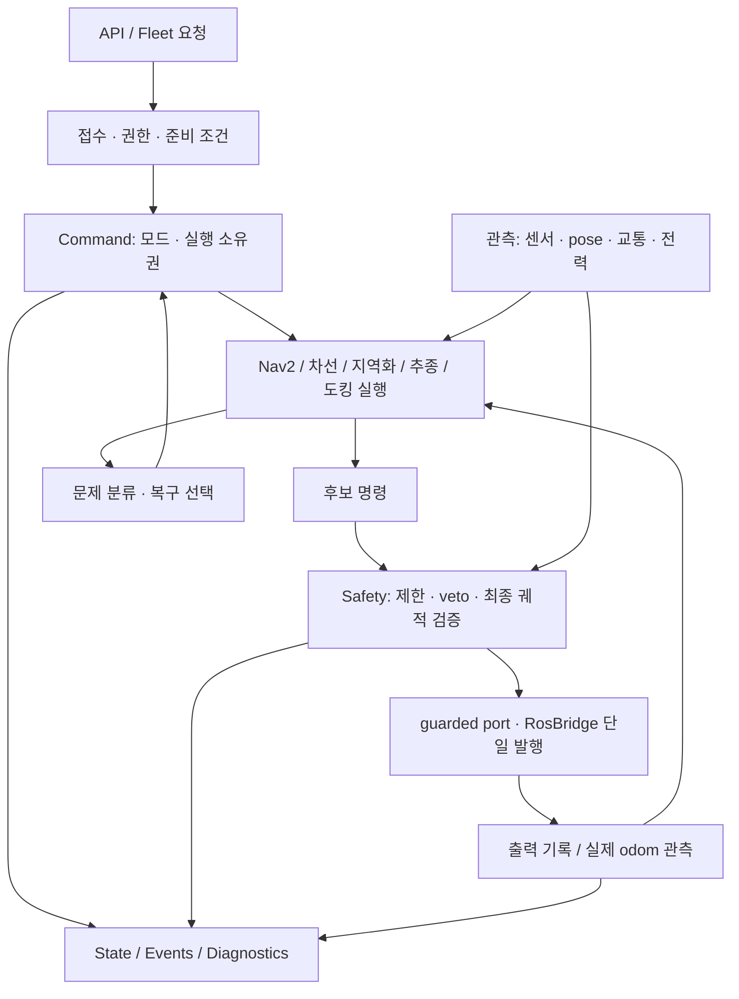

# CORE 공통·장치 제어 책임 분해와 Drive·Arm·Safety 설계

**현재 폴더 단계:** D-627/D-628 CORE 조립·주행 경계와 D-630 holder 분리는 local main에 반영했다. 현행 경로는 `middleware/core/api`, `middleware/devices/{pinky,omx}`, `middleware/control/drive`, `middleware/perception/{sensors,vision}`이며 [CORE·Drive 책임표](../reference/core-drive-responsibilities.md)를 따른다. 아래 원래 계획의 API/모션 계약 확장·전 producer admission·실기 시험까지 완료한 것으로 읽지 않는다.

**상태:** Proposed — 설계·실행 계획이며 모듈 이동이나 운용 정책의 적용 완료가 아니다.
**기준:** 2026-10-11, `81b6ed879`, 작업 브랜치 `docs/core-responsibility-plan`.
**실행:** [구현 계획](2026-10-11-core-responsibility-and-driving.md).

**상위 구조:** [ROSY 정체성·최대 5단계 책임 폴더·world model 설계](2026-10-11-rosy-platform-identity-and-structure-design.md).

## 1. 목적과 범위

CORE 공통과 장치 제어를 구분하고, Drive의 조향·길찾기·탈출과 Arm의 관절·궤적·작업공간을 각각 설명한다. CORE 전체에서 누가 무엇을 결정하고 기록하고 출력하는지 명확히 한다. 기존 패키지를 유지하며 책임과 계약부터 통일한다. 함수 이동만으로 제어 권한이 정리됐다고 판단하지 않는다.

이 문서는 저장소 소스의 구조와 제안 구조를 구분한다. 장치의 현재 설정, Safety 정책의 실제 활성화, 설치 이미지, 실물 주행 성능은 확인하지 않았다. 기존 API와 ADR이 계약이며 이 문서는 이를 대체하지 않는다.

유지할 기준은 다음과 같다.

- CORE가 외부 API의 단일 관문이다. API/WS와 ROS 연결은 기존 한 프로세스 구성에 남는다.
- Pinky의 논리적 최종 명령 선택은 `CommandManager`, 실제 ROS 발행은 `RosBridge`의 단일 출력 지점이다. 모델·Fleet·센서 모듈은 여기에 병렬 최종 writer를 만들지 않는다.
- services는 ROS 없이 동작하고 gateway/API를 역으로 import하지 않는다. 생성과 의존 주입은 `CoreServices`가 맡는다.
- 현행 Pinky 공개 모드는 `IDLE`, `MANUAL`, `NAVIGATION`, `DOCKING`, `EMERGENCY`를 유지한다. 이 주행 모드 표를 Arm·다른 장치의 공통 상태기계로 강제하지 않는다. 탈출·후진·재정렬을 새 공개 모드로 추가하지 않는다.
- Safety는 독립 책임이다. Fleet나 모델의 응답 없이도 로봇 로컬의 정지·제한이 작동해야 한다.

## 2. CORE 공통과 Control은 다른 책임이다

**CORE는 공통 운용·조정의 경계이고, Control은 장치에 맞는 움직임을 실행하는 책임이다.** 현재 `middleware/core/`에는 두 책임이 함께 배치돼 있다. 폴더 이름이 개념의 정확한 경계는 아니다. 다음은 논리 구분이며 새 폴더 이동의 확정안은 아니다.

| 층 | 나눌 책임 | 기존 자리 | 공통화의 한계 |
|---|---|---|---|
| CORE 공통 운용 | API·인증·identity·capability·설정·기동/종료 | core gateway/API, foundation | Drive/Arm의 제어 수식·종단 판단을 품지 않음 |
| 공통 실행 계약 | 요청 식별·부모/시도·권한·lease·취소·receipt·관측 상태 | `contracts/motion`, `contracts/skill`, core 각 owner/연결 | 계약이 공통이어도 하나의 전역 executor/arbiter로 합치지 않음 |
| 장치별 Control 도메인 | Drive, Arm 및 향후 장치의 계획·제어·완료·복구 | Drive는 core services/navigation, Arm은 OMX adapter/agent | 도메인별 상태기계와 실시간 주기를 유지 |
| 장치별 Safety | 공통 정지/검증 의무 + 실제 장치 guard | core safety/anchors, OMX command owner, driver | 검사 수식·필요 센서·정지 방식은 장치별 |
| Transport·adapter·driver | ROS/action 변환, vendor SDK, 실제 I/O | core bridge, `middleware/apps/device/`, `middleware/drivers/`, `integrations/robots/` | 제어 전략과 vendor 전송을 분리 |
| Perception·evidence | 센서→좌표/상태·confidence·freshness·provenance | `middleware/perception/`, core vision/관측 수신 | 좋은 인식 결과가 실행 권한을 주지는 않음 |
| Skill·local execution | 작업 선행/완료 조건, 정책 실행의 binding·journal | `middleware/skills/`, `middleware/execution/local/` | Skill 계약·모델 로딩은 실행 소유권/복구 허가와 다름 |
| 사이트 조정 | 다중 장치 예약·교통·작업 흐름·연계 stop | `operations/fleet/`, `operations/execution/` | 로컬 장치 guard·실시간 제어를 대체하지 않음 |

추가로 분리할 책임은 **작업 계획과 제어 계획**, **명령 접수와 실행 승인**, **취소 요청과 물리 정지 확인**, **동작 완료와 작업 성공 증거**, **장치 관측 상태와 실행 상태**, **설정 값과 검증된 capability**다. 각각의 소유자를 기존 owner/contract에 연결하고 동명 manager를 추가하지 않는다.

### 2.1 Drive와 Arm에서 같고 다른 것

| 항목 | 공통 의무 | Drive | Arm |
|---|---|---|---|
| 명령 | 대상·source·시도·만료·취소 식별 | base twist/pose/path | joint trajectory/TCP/gripper |
| 계획 | 시작 조건·제약·취소·완료 근거 | 경로·곡률·차선·교통 | 관절 공간/작업공간·접근·파지 순서 |
| Safety | 검증 뒤 단일 writer, stale/unknown 처리 | 차체 sweep·제동·cliff·저속/후진 | 관절/속도/가속·시작 자세·보정·충돌/하중 근거 |
| 제어 주기 | 해당 도메인의 deadline 준수 | 현재 CORE cmd_vel 50 Hz | action 기반 궤적과 하위 controller 주기; 50 Hz 강제 없음 |
| 정지 | 안전 상태와 확인 근거 정의 | zero 후보·driver deadman·물리 readback | 현재 owner cancel→HOLD 및 제어기 결과; 그리퍼 강제 개방 금지 |
| 복구 | 원인·한도·승인·부모 목표 재개 조건 | 대기·replan·pivot·후진 | HOLD 조정·재보정·재계획·재시도; 주행 탈출 재사용 없음 |
| 성공 | 명령 수락과 목표 달성 분리 | 실제 이동/도착·도킹/충전 근거 | 관절 도달과 물체 파지/배치 근거 구분 |

Arm의 작업공간 충돌·payload/파지 안전은 필요한 책임이며 모두 현행 구현으로 보장된다는 뜻은 아니다. 현재 `middleware/apps/device/omx/adapter/omx_adapter/command_owner.py`는 source/session·상태 freshness·calibration revision·관절/속도/가속·시작 자세 등을 검증하고 `ActionPort`로 궤적을 보낸다. 이 owner를 Pinky `CommandManager` 뒤에 억지로 넣거나 `cmd_vel`로 변환하지 않는다. `contracts/motion`에는 이미 base와 arm 명령 형태가 함께 있고, port/producer의 전체 이행은 별도다.

단일 실행 소유자 규칙의 범위는 **장치의 제어 자원/binding**이다. 한 프로세스나 사이트에서 base와 arm을 전부 한 슬롯로 막는다는 뜻이 아니다. 복합 로봇의 동시 이동·팔 동작은 자원 충돌과 결합 안전 조건을 명시한 coordination 계약이 있을 때만 허용한다. 새 동시 실행을 이 문서만으로 열지 않는다.

### 2.2 폴더 조사 결과와 정리 원칙

현행 큰 가지는 `middleware/{core,perception,execution,skills,apps,drivers,ui}`이다. `core/`의 실제 가지는 `gateway`, `api_web`, `events`, `services`, `navigation`이다. 따라서 `core/services` 전체를 CORE 공통이라고 보면 Drive 실행 책임을 숨긴다.

특히 **`middleware/perception/control`은 옛 ROS 패키지 이름이 `control`인 자리**다. 그 안에는 `sensing`, `planning`, `control`, `safety`, 노드 wrapper가 함께 남아 있다. 최상위의 모든 Control을 대표하는 폴더로 해석하지 않는다. `control_sensor_adapter.py`를 통한 센서 근거 흡수와 legacy 최종 writer의 비활성 경계를 유지한다. 순수 planning/escape/safety 계산을 재사용할 때는 호출자·시험·활성 launch를 확인하고 새 소유자에 맞춰 단계적으로 정리한다.

실제 폴더 분리 전 현행 경로마다 `공통 운용 / 실행 수명 / Drive / Arm / Safety / 인식 / transport / driver / 작업 계약` 중 책임을 붙인다. 그 뒤 import·패키징·launch·테스트·문서·manifest를 함께 추적해 응집된 단위만 이동한다. 공통과 장치 실행기를 분리하기 위해 새 top-level `control/`을 먼저 만드는 방식은 채택하지 않는다. 물리 목적 경로 변경이 필요하면 D-427/D-429에 맞는 후속 ADR과 migration 표를 먼저 확정한다.

### 2.3 현재 CORE 모듈의 책임 지도

아래 services 경로의 기준은 `middleware/core/services/core_features/`이다. 논리 책임을 나누되 새 서비스 프로세스나 범용 프레임워크를 기본 해법으로 삼지 않는다.

| 책임 | 기존 자리 | 결정·쓰기 권한 | 넘겨야 할 경계 |
|---|---|---|---|
| 외부 요청·인증·응답 | `middleware/core/api_web/` | 요청 형식·권한 검증, 접수 결과 | 제어 선택·복구 전이를 라우트마다 독자 구현하지 않음 |
| 조립·기동·종료 | `middleware/core/gateway/core/services.py`, `main.py`, `node.py` | 객체 생성·주입, 타이머·종료 순서 | 장기 실행의 정책은 해당 feature에 둠 |
| 런타임·설정·identity·capability | gateway의 `system/`, `contracts/foundation/core_common/` | 실제 사용 가능한 기능과 설정의 근거 | 설정 존재만으로 장치 준비·현장 수용을 선언하지 않음 |
| 주행 접수·모드·실행 소유권 | `command/`, API `api/v1/common.py`, gateway 연결 | 어떤 요청이 현재 움직임을 제안할 수 있는지 | Safety 해제나 성공 판정의 권한을 소유권 선택에 섞지 않음 |
| Safety 정책 | `safety/`, 보호 대상 옆의 safety 코드 | E-stop·만료·속도 제한·안전 veto | 목표 생성, 경로 선택, OS halt를 맡지 않음 |
| 길찾기·목표 수명 | `navigation/`, `middleware/core/navigation/` | 목표 접수·준비 조건·Nav2 연계 | CORE manager는 글로벌 경로 탐색 알고리즘 자체가 아님 |
| 차선 주행·조향 | `line_follow/` | 근거를 소비해 후보 `(v, w)`와 진행 상태 생성 | 교통 허가·모드 소유권·최종 발행은 별도 책임 |
| 지역화·보정 | `localization/`, `calibration/` | pose 근거·revision·보정 세션, 제한된 미션 | 준비되지 않은 pose로 다른 실행기의 주행을 열지 않음 |
| 도킹·충전 접근 | `docking/` | staging·접근·재접근·종단 조건 | 도킹 접수와 실제 충전 확인을 구분 |
| 대형·추종 | `swarm/` | leader/anchor 근거와 추종 후보 | 별도의 최종 출력이나 MANUAL 자동 선점 없음 |
| 문제 분류·복구 | `line_follow/recovery/`, 각 실행기의 복구 단계, `recovery/` | 대기·재계획·허용된 동작·사람 개입의 제안 | Safety veto를 해제하거나 센서 unknown을 성공으로 바꾸지 않음 |
| 교통·행동 판단 | `traffic_policy/`, `road_behaviour/`, `decision/` | 허가·금지·분기·속도 cap | 신호 허가는 실제 차체 공간 여유의 증거가 아님 |
| 전력·배터리 | `power/` | 배터리 무결성·필터·sentinel·전력 상태 | SAF-005 판단은 Safety, 실제 OS 종료는 host 쪽 |
| 관측·상태·지도·영상 | `state/`, `maps.py`, `vision/`, `waypoints/` | 최신 snapshot·저장/조회·근거 전달 | 관측용 상태를 두 번째 제어 상태기계로 만들지 않음 |
| 진단·이벤트·감사 | `diagnostics/`, `middleware/core/events/` | 원인·전이·접수·출력 결과 기록 | 기록 실패 때문에 정지 발행이 늦어지지 않음 |
| Fleet 연계 | `fleet_agent/` | 연결·임대·응답 correlation·상태 전달 | 연결 상태와 로컬 주행 권한을 구분 |
| ROS 연결·최종 출력 | gateway `core/bridge/` | 센서/action/timer 연결, guarded 최종 발행 | 복구 전략·모드 판단을 transport에 계속 추가하지 않음 |

목표 의존 방향은 `API → feature 요청`, `feature → 주입된 계약/관측`, `Command → Safety 검증`, `gateway → ROS/장치`이다. `CoreServices`는 이 관계를 조립한다. state·events는 결정의 결과를 읽으며 다른 manager의 내부 상태를 직접 수정하지 않는다.

`CoreServices`의 생성 코드는 기존 `line_follow_wiring.py`, `fleet_loss_wiring.py`처럼 응집된 조립 단위가 필요할 때만 추출한다. 새 컨테이너, 두 번째 상태 저장소, 추가 thread/lock은 만들지 않는다. 구조 개선의 기준은 파일 수가 아니라 정책 소유자와 호출 방향이다.

## 3. Drive에서는 모드·실행기·동작·사유를 분리한다

| 구분 | 뜻 | 예 |
|---|---|---|
| 공개 모드 | 현재 운용 권한과 범주 | `NAVIGATION` |
| 실행기 | 이번 목표를 수행하는 제어 방식 | Nav2, line-follow, swarm trail, localization mission |
| 내부 동작 | 실행기 안의 현재 행동 | 추종, 대기, pivot, 짧은 후진, 재접근 |
| 사유 | 행동을 바꾼 원인 | 차선 상실, 진전 없음, 장애물, 신호 대기 |
| 목표/시도 식별 | 취소·재시작·늦은 응답의 적용 범위 | 부모 목표와 복구 자식 시도 |

이 표는 설계 어휘다. 모두가 현행 API 필드로 존재한다는 뜻은 아니다. 외부 노출이 필요하면 D-18에 따라 schema와 API reference를 함께 바꾼다.

현행 `CommandManager.select_output()`은 모드에 따라 manual/nav/docking 슬롯을 고른다. 등록된 `Priority`를 정렬하는 범용 우선순위 큐가 아니다. nav 슬롯은 Nav2·차선·지역화·추종 계열이 공유한다. gateway의 route/gate가 충돌을 막는 부분이 있으나 슬롯 자체의 생산자 세션 식별과는 다르다. `_input_epoch`도 입력 변경 감지를 제공할 뿐 모든 생산자의 목표 수명 계약을 대신하지 않는다.

| 모드·요청 | 후보 생성 | 현행 연결·주의점 |
|---|---|---|
| MANUAL | teleop | watchdog·모드·준비 조건·finite 검증; 활성 MANUAL 보호 유지 |
| NAVIGATION / Nav2 | Nav2 controller | goal tracker/action 취소와 늦은 cmd callback을 함께 검증 |
| NAVIGATION / 차선·추종 | line-follow, swarm trail | 실행기 활성 상태와 nav callback 차단이 소유권에 연결돼야 함 |
| NAVIGATION / 지역화 | localization mission | 일반 nav와 같은 슬롯을 쓰므로 bounded mission 종료 시 반환 명확화 |
| DOCKING | staging Nav2 + 도킹 executor | staging→접근 전환에 writer 중복·늦은 Nav2 명령 방지 |
| IDLE / EMERGENCY | 정지 | 이전 자율 후보가 모드 복귀만으로 재생되지 않아야 함 |

최소 통일 계약은 **제어 자원별 한 활성 실행 소유자**, **목표/시도 식별**, **만료**, **취소**, **종단 결과와 근거**다. 이미 있는 `contracts/motion`의 `MotionHeader`/`MotionIntent`, goal tracker와 lease를 먼저 사용한다. D-442 이행을 생산자 하나씩 진행하며 모든 실행기를 새 엔진으로 다시 쓰지 않는다.

## 4. Safety의 책임과 실제 배치

Safety는 `safety/manager.py` 하나에 모든 코드를 모은다는 뜻이 아니다. D-430처럼 보호할 장치와 실행기 옆에 필요한 검사를 두고 `platform_parts.yaml`의 `safety_modules`/`safety_anchors`로 추적한다.

| Safety 책임 | 주된 자리 | 결과와 권한 |
|---|---|---|
| E-stop latch·제어 입력 제한 | `safety/manager.py`, command 안전 경계 | 정지·제한; 해제는 기존 권한 있는 명시적 경로만 |
| 입력 시간·세대·출처 무효화 | command, gateway guarded port | 오래되거나 취소된 후보를 출력하지 않음 |
| 주행 준비·근거 freshness | navigation readiness 및 실행기 admission | 필요한 센서·pose·lease가 없으면 해당 동작 진입 거절 |
| 차체 충돌·pivot·후진 공간 | `line_follow/body_stop.py`, `clearance.py`, 각 motion admission | 수행할 최종 궤적의 swept footprint 허용 여부 |
| Fleet loss·전력 제한 | `safety/fleet_loss.py`, 배터리 정책 연계 | 조건부 STOP/HOLD/RETURN_HOME 등 기존 정책; 수동 권한 우회 금지 |
| 발행 단일성·grant | gateway `bridge/cmd_vel.py` | 허용된 cycle의 최종 출력만 전달 |
| 드라이버 deadman·물리 정지 | Pinky bringup, 실제 장치 체인 | CORE·통신 장애에도 별도 보호; 장치 readback 필요 |

현재 `PinkyTwistPort`는 기존 출력의 guarded cycle grant를 감싸는 단계다. 복사/위조/만료 grant와 재사용을 거부하지만 모든 producer의 identity/cancel 이행 완료를 뜻하지 않는다. port의 물리 E-stop unknown을 확인된 정상으로 해석하지 않는다.

**커버리지 구분:** 최종 Safety 경로를 지난다는 사실과 동일한 공간 검사를 받는다는 사실은 다르다. line-follow와 trail의 body stop, 지역화의 회전 검사, Nav2의 costmap, 도킹 접근 검사는 필요한 근거와 범위가 다르다. MANUAL/Nav2/line/trail/localization/docking별로 `검사 있음 / 없음 / 외부 검사에 의존 / 실기 미확인`을 따로 기록한다. 모든 경로에 swept-body가 구현됐다고 선언하지 않는다.

안전 태그 코드의 이동도 D-430 독립 리뷰와 `Safety-Review:` trailer 대상이다. 이 계획의 자체 검토나 원격 pytest 통과는 그 리뷰와 장치 수용을 대체하지 않는다.

## 5. 길찾기부터 조향까지

길찾기는 서로 다른 두 층이다. Fleet의 `operations/fleet/fleet/routing/planner.py`는 lane graph의 경로·방향·via 등을 다룬다. Nav2는 로봇의 지도/pose로 이동 경로와 제어 후보를 만든다. CORE는 목표 접수·권한·준비·취소·결과를 연결한다. 차선 추종은 인식한 lane 근거를 직접 후보 조향으로 바꾸며 글로벌 길찾기와 같은 알고리즘으로 합치지 않는다.

공통 흐름은 `요청 → 근거 확인 → 소유권 획득 → 후보 생성 → 제한/공간 검사 → 발행 → 관측 → 계속/완료/복구`다. 완료는 후보를 내보낸 사실이 아니라 실행기별 종단 근거로 판단한다. ROS에 발행한 `(v,w)`, 드라이버에 전달된 값, odom에 관측된 이동, 현장 목표 성공을 각각 구분한다.

## 6. 문제 상황과 탈출

현행 복구가 있는 곳은 다음과 같다. `core_features/recovery/camera_fault.py`는 선택 가능한 행동의 자격을 보고하며 탈출 명령을 직접 실행하지 않는다.

| 상황 | 기존 구현 | 허용할 대응과 재개 조건 |
|---|---|---|
| 차선 상실·일시 인식 공백 | `line_follow/recovery/lane_return.py`, `lane_bridge.py` | 제한된 return/retrace/search 또는 bridge; 기대한 공백과 센서 장애를 구분 |
| 장애물·진전 없음·dithering | `line_follow/recovery/stuck/stuck_recovery.py`, `progress_watch.py` | 대기·보고·승인된 후진/재정렬; watcher 보고만으로 자동 탈출 승인하지 않음 |
| 교차로·횡단보도 대기 | crosswalk/junction gate | 신호·허가 대기, 사람 인계·중단; 단순 stuck으로 우회 탈출하지 않음 |
| 방향 불일치 | `stuck/realign/`, `cue/odom_pivot.py` | 허용 공간에서 pivot/KTURN; 현재 기본 flag·권한을 보존 |
| 지역화 미확인 | `localization/mission.py`, `rotate_to.py`, `halt.py` | 제한된 지역화 동작 또는 정지; 재개 전 pose·revision 재확인 |
| 도킹 실패 | `docking/`의 단계·재접근 | 단계별 budget과 실제 접근/충전 근거; 무한 재접근 금지 |
| Nav2 경로/제어 실패 | Nav2 behavior와 goal tracker | 기존 취소·결과와 연동; 별도 CORE 탈출과 동시 실행 금지 |
| 센서 장애·Fleet loss·E-stop | camera-fault eligibility, fleet-loss, Safety | 허용 정책에 따른 정지/인계; recovery가 safety latch를 풀지 않음 |

제안하는 공통 전이는 다음과 같다.

1. 문제의 종류·시각·필요 근거·부모 목표를 기록한다.
2. 기존 실행 시도를 무효화하고 정지/취소의 적용을 확인한다. 늦은 action·센서·Fleet 답변을 세대 식별로 버린다.
3. 대기, 재계획, 허용된 제한 동작, 사람 인계 중 하나를 선택한다.
4. 복구 시도마다 시작 조건·deadline·거리/각도·횟수 budget·취소·완료 근거를 확인한다.
5. 실패하면 같은 문제 회차의 잔여 budget을 줄인다. 상태기계 재진입만으로 budget이 초기화되지 않도록 한다.
6. 성공하더라도 목표·소유권·lease·map/pose revision·센서 근거가 유효할 때만 부모 목표를 재개한다. MANUAL 개입·E-stop 뒤에는 오래된 자율 목표를 자동 재생하지 않는다.

공통화는 식별·취소·budget 의미부터 한다. `OdomPivot`과 `rotate_to`는 제어 법칙·deadband·완료 조건이 달라 이름이 비슷하다고 합치지 않는다. primitive별 필요한 근거도 다르다. 예상된 카메라 공백을 허용하는 동작에 모든 센서를 일률적으로 요구하지 않되, odom·공간 근거의 필요성을 따로 명시한다.

기존 KTURN의 후진 근거와 곡선 전체 swept footprint의 관계는 검토 대상이다. 직선 rear strip 검증을 회전 후진 전체 공간 증명으로 확대 해석하지 않는다. 이것은 현재 버그 확정이나 현장 실패 판정이 아니며, 기하 시험과 D-607 계약 대조 뒤 안전 변경 여부를 결정한다. 시간 기반 후진 종료와 실측 이동 거리도 구분한다.

legacy `middleware/perception/control/control/`의 escape 관련 로직은 순수 계산·계약의 비교 자료로만 평가한다. archived/legacy 실행기를 CORE 옆에서 활성화하거나 두 번째 최종 발행자로 가져오지 않는다.

## 7. 곡률은 조향·속도·차체 검사를 함께 연결한다

`v`가 0이 아닌 이동에서 `κ = w/v`, `R = |v/w|`이다. `w=0`은 직선이다. `v≈0`에서 나누지 않고 pivot/정지로 분류한다. 후진의 부호는 좌표계와 진행 방향을 기준으로 별도 검증한다. 인식 픽셀의 오차·confidence는 단위가 있는 지도 곡률과 구분한다.

다음 세 값은 같다고 가정하지 않는다.

- 경로/실행기가 요청한 곡률.
- 모든 제한을 적용한 최종 후보의 `w/v`.
- 충분한 관측 구간에서 odom 이동량·각도 변화로 측정한 곡률.

같은 경로를 유지하며 감속하는 자율 후보는 공통 배율을 적용하면 곡률이 보존된다. `v`만 줄이고 `w`를 유지하면 회전 반경이 바뀐다. 다만 모든 cap을 기계적으로 공통 배율로 바꾸지는 않는다. MANUAL 입력 의미, 교통 대기, collision veto, 축별 상한은 각 계약을 먼저 확인하고 Safety 정지가 우선이다.

목표 순서는 `후보 → 관련 속도/각속도/가감속 제한 → 최종 후보의 swept footprint 검사 → 출력`이다. 안전 보정이 궤적을 바꾸면 검증된 후보군 안에서만 선택하거나 계산 시간 한도 안에서 다시 검사한다. 보장이 없으면 정지한다. 50 Hz 경로에 무한 재검사 루프를 넣지 않는다. 기존 body envelope가 특정 traffic cap 범위에 대해 증명한 범위를 모든 임의 cap의 증명으로 일반화하지 않는다.

하드웨어 허용 곡률은 차체·wheelbase·휠 속도/가속·슬립·센서 사각·제동거리와 결합한다. 새 전역 `max_curvature`나 숫자를 추정해 넣지 않는다. 요구 곡률을 따라갈 속도가 실물 최소 제어 속도 아래이면 감속만 계속하지 않고 정지·재계획·허용 pivot으로 전환한다. 최종 휠 포화가 발생하는 경우 드라이버의 공통 RPM scaling과 실제 odom 결과도 확인한다.

## 8. 모듈화의 단위와 순서

첫 단계는 기존 모듈 안의 책임 경계 정리다. Command는 소유권/만료, 실행기는 제어/완료, Recovery는 문제/대응 선택, Safety는 정지/제한, bridge는 transport/발행을 맡는다. 이때 필요한 작은 추출만 허용한다. 모든 recovery 코드를 한 패키지로 이동하거나 모든 실행기를 상속하는 base class를 먼저 만들지 않는다.

| 순서 | 결과 | 다음 단계로 넘어갈 조건 |
|---|---|---|
| P0 현재 경로 고정 | 호출자·writer·gate·Safety 범위 표와 회귀 기준 | 현재 동작과 미이행 계약을 구분 |
| P1 실행 수명 통일 | 기존 계약으로 owner/시도/취소/만료 연결 | 한 producer씩 늦은 명령·MANUAL 보호 회귀 통과 |
| P2 최종 후보·Safety 경계 | cap 이후 기하 검사와 곡률 의미 정리 | source별 검사 범위·독립 safety 리뷰 |
| P3 복구 수명 통일 | 부모 목표와 제한된 복구 시도·budget·재개 조건 | 원인별 시험과 취소/실패 종료 검증 |
| P4 배선·비주행 책임 정리 | 조립 코드 추출, 상태·전력·관측 경계 정돈 | import/기동/종료·API 동작 불변 |
| P5 수용 | 설치·readback·실제 주행/정지 기록 | ROS-SIM, ARM64, DEVICE, FIELD를 별도 판정 |

P0 문서만으로 P1~P5가 완료되지는 않는다. P2의 공간 검증과 안전 리뷰 전에는 새로운 자동 탈출을 켜지 않는다. 독립적인 비주행 조립 정리는 별도 작은 변경으로 진행할 수 있다.

관련 기준: D-1(프로세스), D-18(외부 schema), D-126/D-168(서비스 의존·크기), D-315(폴더와 실행 권한), D-427/D-429(제어·모델 경계), D-430(Safety), D-442(Motion Intent/port), D-584(원격 시험). 기존 ADR과 다른 권한/동작 결정이 필요하면 구현 전에 번호를 선점해 후속 ADR로 결정한다.

## 9. 완료 기준과 남은 결정

구조 완료는 모든 모드에서 호출 흐름과 한 실행 소유자가 설명되고, 실행 중 교체·취소·E-stop·만료·복구가 같은 수명 규칙으로 닫히는 것이다. 파일 이동, import 성공, pytest 성공만으로 실물 주행 수용을 선언하지 않는다.

구현 시작 시 현재 부족한 producer identity를 대조해 필요한 필드만 정한다. cap별 곡률 보존 여부는 현행 의미를 기본값으로 두고 실측과 기하 결과로 변경한다. Recovery budget은 현재 실행기의 제한을 먼저 보존하고 목표 회차에 연결한다. 후진/pivot 근거가 불충분한 동작과 기본 꺼진 정책은 장치 수용 전까지 비활성 상태를 유지한다.

실행 결과에는 `SOURCE/원격 시험`, `ROS-SIM`, `ARTIFACT/설치`, `DEVICE readback`, `FIELD 물리 수용`을 따로 기록한다. 실제 충전·E-stop readback unknown은 unknown으로 남긴다.
