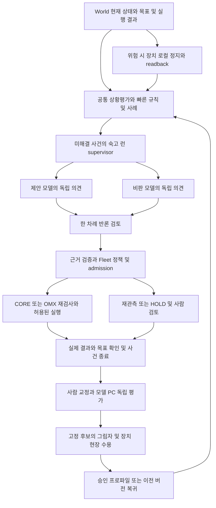

# Fleet 범용 문제 해결 런과 지속 개선 설계

**상태:** D-640 Accepted (2026-10-12), 후보 전용 source 구현. [실제 책임 경계](2026-10-12-decision-deliberation-boundary.md)를 우선한다. 배포·실제 모델 토론·현장 자율 복구는 미확인이다.

2026-10-12 사용자 지시로 Discord를 제외한 source를 먼저 구현한다. 아래의 모델 토론 구현 선행 관문은 실제 provider 활성화·승격 관문으로 제한한다. 기존 규칙·검수 사례 owner는 그대로 두며 자가 개선은 offline 비교 도구까지 구현했다. 실제 정답/모델 재생 및 정책 승격은 HOLD다.

**우선 실행 순서:** 2026-10-11 사용자 추가 지시로 [Fleet 중앙 판단 선행 계획](2026-10-11-fleet-central-judgment-stages.md)의 D-647에서 공통 판단 책임·초기 배포를 먼저 결정한 뒤 D-642~D-646을 수행한다. 개입 불필요/판단 보류도 판정·평가하고 외부 알림과 담당자 처리 결과를 같은 사건으로 회수한다. 중앙 판단 규약과 독립 수용 receipt가 준비되기 전 모델 토론 구현은 진행하지 않는다.

## 목적과 흐름

**후속 구조 구체화:** [D-648](../adr/D-648-shared-judgment-target-structure.md)의 [목표 구조](2026-10-11-shared-judgment-structure-design.md)를 따른다. 공통 필요성 평가는 Situation, 기존 빠른 도메인 규칙/사례와 실행 승인은 현재 owner에 두고 미해결/불확실한 대안만 Decision의 모델 런으로 전달하는 Proposed 경계다. Fleet PC 배치를 전체 판단의 Fleet coordination 소유로 해석하지 않는다.

World의 현재 상태와 주어진 목표에서 문제를 만들고, 빠르게 풀 수 있는 경로를 선택하며, 실제 결과를 통해 다음 판단을 개선한다. 입력은 정상 작업·미지 상황·목표 불일치·실행 실패를 포함한다. 주행 중 문이 닫히거나 암 작업 대상이 옮겨진 상황은 공통 루프의 예다. 정상 안전 정지와 모델 실패는 별도 판정이다.

## 빠른 범용 처리와 모델 선택

공통 문제 자료는 목표/성공 조건, 현재 관측과 시각/출처, 제약/허용 capability, 기존 시도와 결과, 시간/자원 예산으로 구성한다. World는 현재 확인된 관측을 제공하고 모델은 가설/예상 효과를 별도로 낸다. 모델 설명을 World의 확인된 사실로 덮어쓰지 않는다. 행동 조건부 미래 예측은 현재 World 구현에 없으며 별도 후속 계약이다(D-630).

처리 순서는 검증된 규칙·해결 사례 → 필요한 빠른 전문 모델 → 새로운/불확실한 문제의 복수 모델 숙고다. 영상/공간 해석, 상태·계획 추론, 반론 검토처럼 작업 적합성에 따라 승인 프로파일을 고른다. 텍스트 모델이 영상 관측을 직접 확인했다고 주장하지 못한다. provider 불가·입력 부족·시간 예산 부족이면 기존 규칙/사람 경로로 끝낸다. 전문 모델과 느린 숙고의 라우팅은 결정론 정책으로 시작하며 정책 변경도 독립 재생 대상이다.

다양한 모델은 선택 가능한 능력 풀이다. 최초 숙고 한 런은 문제에 맞는 두 모델을 선택하고 검토된 추가 모델은 이후 프로파일로 등록한다. 모델 수·동의율보다 문제 유형별 정확한 해결, 위험 회귀, 지연, 비용으로 구성의 가치를 판정한다. 빠른 모델로 해결된 분모와 느린 숙고로 넘어간 분모를 따로 기록한다.

실제 결과가 기대와 다르면 입력 부족, 환경 변화, 인식/추론/계획 오류, 장치/통신 고장 중 무엇인지 교정한다. 검수된 해결 사례는 적용 전제·원본 근거·성공 확인·버전을 가지고 재사용 시 현재 근거를 다시 검사한다. 사례 축적, 라우팅/프롬프트 개선, 가중치 학습 중 필요한 최소 교정을 선택한다. 새 사례의 수집은 자동 정책 승격을 뜻하지 않는다. 독립 평가에서 지속 개선과 과거 문제의 회귀를 함께 측정한다.

도표의 실행 연결은 기존 허가 경로다. 첫 숙고 구현은 H에서 보고/후보로 종료하며 새로운 자동 dispatch를 열지 않는다.

## 계층과 재사용

| 계층 | 책임 | 재사용 위치 |
|---|---|---|
| 장치 | 장애 감지, bounded 정지/복구, 실제 상태 읽기 | CORE 및 OMX의 기존 Action owner |
| Situation | 최신 관측과 문제 종류, 누락 근거 | `operations/situation`, D-619 공통 assessment |
| 숙고 supervisor | 사건별 큐/예산, 모델 역할, 반론, 후보 검증 | `operations/decision/src/rosy/decision`에 추가 예정 |
| 작업/사건 중재 | 원장·owner·generation, 작업 승인과 결과 | 현재 `operations/fleet`의 incident/Mission 서비스; D-647에서 논리 경계 검토 |
| Fleet coordination | 가용성·배차·교통·로봇 공유 자원 | 기존 Fleet coordination 경로 |
| 모델 실행기 | Claude Code/OpenCode의 제한된 구조화 추론 | 공급자 adapter; 전용 Fleet PC 계정, 추론 위치 별도 |
| 학습·평가 | 사람 정답, 재생 비교, 고정 프로파일·승격 증거 | `learning/curation`, `evaluation`, `registry`, 모델 PC |

CLI 이름과 모델 이름을 분리한다. Claude Code는 실행기, Claude의 정확한 모델 revision은 평가 대상이다. OpenCode 역시 실행기이며 GLM 5.x 후보는 설치 버전의 실제 provider/model ID, 처리 가능한 입력, 지역/외부 추론 위치, 인증·전송 동의 확인 후 프로파일에 등록한다. 후보명만으로 지원·성능·라이선스 적합성을 주장하지 않는다.

## 문이 새로 닫힌 경우

1. 센서가 현재 경로의 장애를 감지하면 로컬 owner가 모델 응답 전에 정지한다. 정지 요청, controller readback, 물리 정지 검증을 구별한다.
2. Fleet은 목표·현재 위치·센서 시각·지도/보정 revision·전후 녹화·최근 동작 결과를 사건에 연결한다. 비교 가능한 과거 관측이 있어야 환경 변화를 주장한다. 현재 영상만 있으면 문처럼 보이는 장애 가설로 남긴다.
3. 모델 A는 닫힌 문/일시 장애/위치 오류 등의 가설과 근거를 제시한다. 모델 B는 A를 보기 전에 같은 자료로 판단하고, 이후 사각·낡은 지도·사람 위험·증거 부재를 반론으로 검사한다.
4. 구조화 후보는 D-619의 hold/reobserve/recover/replan/human_review/continue 범위다. 문 조작, 미검증 우회 경로, 새 Skill을 모델이 만들어 실행하지 못한다. 새 경로가 없거나 여유가 불명확하면 HOLD/사람 검토다.
5. 실행을 허가할 때는 현재 사건·generation·capability와 새 관측을 다시 확인한다. 장치가 거부하면 그 거부를 사건 결과에 남긴다. 동일 원인의 반복 복구는 기존 사건 묶음의 예산을 공유한다.
6. 성공은 접수 응답이 아니라 실제 통과/목표 도달 증거로 판정한다. 사람은 환경 변화, 인식 오류, 잘못된 경로, 센서/위치 오류, 구동 고장을 구별해 교정한다.

암도 같은 사건 흐름을 쓴다. 대상/목표 frame·보정 revision, 관절 상태·한계, 그리퍼/힘 자료, Action/attempt 결과를 추가한다. 정지 중 하중 지지와 그리퍼 유지 조건은 Arm owner의 검증된 프로파일을 따른다. 영상상의 파지와 실제 파지, trajectory 종료와 실제 배치 성공을 구별한다.

## 숙고 런 규칙

- 사건 자료의 hash와 기존 robot/workcell/episode/Mission/attempt/generation을 참조한다. 새 식별은 숙고 런 상관관계용이며 실행 grant가 아니다. 필요한 공통 필드는 후속 내부 계약과 validator에서 확정한다.
- 같은 사건의 최초 의견 두 개를 독립 요청으로 받고 제안자의 반론 반영 한 번으로 끝낸다. 최대 세 모델 호출이며 SDK 내부 재시도와 모델이 생성한 하위 호출도 예산에 포함한다. 무제한 에이전트 토론은 없다.
- 선택은 결정론적으로 처리한다. 근거가 없는 사실, 지원되지 않는 방향, 새 좌표/조인트/셸 명령, 허위 verified 주장, ID/세대 불일치, 상충하는 안전 전제는 실행 후보로 통과시키지 않는다. 해결 안 된 반론은 사람/재관측으로 넘긴다.
- 최초 제안 deadline 30초는 HOLD 중 느린 숙고의 전체 예산이다. 호출별 재시도에 새 30초를 주지 않는다. 기존 빠른 규칙/VLM 경로의 timeout/TTL을 늘리지 않는다. 대기 중 stop·세대·사건 종료가 바뀌면 런을 폐기한다.
- 작업 큐·동시 호출·입출력 크기·token·비용은 배포 프로파일에서 유한값으로 검증한다. 미설정 프로파일은 호출 불가다. Fleet PC는 웹/원장/안전 중재 여유를 우선하며 과부하 시 새 숙고를 받지 않는다. 프로세스 자원 상한과 자식 프로세스 종료를 검증한다.
- 두 모델 중 하나 실패/timeout/기권이면 불완전 토론으로 기록하고 기존 규칙/사람 경로로 종료한다. 단일 응답을 두 모델 합의로 표시하지 않는다. provider 실패 뒤 무조건 재시도하지 않고 비용/응답 상태의 불확실성을 기록한다.
- 재시작 후 durable 런 상태와 현재 사건을 대조한다. 기록 실패는 후보 전달을 차단하며, 이미 전달된 후보는 동일 identity/content로 조정한다. 불명 실행 결과는 새 실행을 만들지 않고 owner readback을 읽는다.

## 실행기 권한과 자료 경계

최소 입력은 supervisor가 만든 사건의 비식별 JSON과 승인된 관측이다. 모델에게 운영 소스나 Fleet DB 전체를 열 필요가 없다. 셸·수정·배포·임의 네트워크 도구·MCP·장치 credential·E-stop 해제 권한을 제거한 전용 세션/계정을 사용한다. CLI permission 설정만으로 격리를 주장하지 않고 OS 파일/네트워크 경계와 금지 호출을 실제 확인한다. stdout의 구조화 답만 adapter가 읽고 Fleet 기록은 trusted supervisor가 수행한다.

공식 문서는 Claude Code의 비대화 실행 및 JSON schema 출력, OpenCode SDK의 구조화 세션 응답과 권한 설정을 제공한다. 따라서 설치된 실행기의 제한 추론 adapter를 만드는 방향을 검토할 수 있다. 설치 버전의 CLI/SDK·인증 방식·권한 병합·hooks/skills/MCP/사용자 메모리 상속·실패 종료/취소 동작은 각각 스모크로 확인해야 한다. 개인 코딩 세션이나 기존 작업 세션을 재사용하지 않는다.

외부 제공자 사용은 승인된 전송 범위와 보관 조건을 프로파일에 고정한다. 동의 없는 원본 영상/개인 정보 반출은 없으며 비식별 자료만으로 판단할 수 없으면 사람 큐다. provider 이름·모델 revision·prompt·정책·CLI 버전·적용 권한 hash와 실제 호출 수/지연/비용을 기록한다. 호스팅 모델의 불변 revision을 얻을 수 없으면 그 한계와 재평가 조건을 명시한다.

## 개선과 승격 기준

자가 개선은 운영 중 모델의 무검증 자가 변경이 아니라 사건 수집과 교정, 오프라인 후보 생성, 독립 평가, 승인된 고정 버전 교체로 닫는다. 신규 정책/모델/프롬프트/토론 구성 중 무엇을 고쳤는지 식별한다. 지도 또는 하드웨어 고장이면 해당 소유자가 고치며 모든 사건을 재학습으로 보내지 않는다.

| 평가 면 | 측정과 판정 |
|---|---|
| 정지 | 위험 감지부터 controller readback까지 시간, 현장 계측 정지 거리·하중 상태. 장치 프로파일별 한계를 정하기 전 HOLD. |
| 원인 해석 | 사람 정답과 원인별 혼동, 근거 없는 주장, unknown/기권. 독립 검토와 모델 설명을 구분. |
| 후보 안전 | 위험 계속/복구 후보, 금지 효과, 허위 근거/세대 수락을 각각 계산. 고정 평가 세트에서 각 0건, 발생하면 해당 후보 승격 거절. |
| 운영 품질 | 전체 대상 사건 수, 선택된 사건 수, 유효 응답률, timeout/오류/기권, p50/p95와 비용. 성공 응답만 분모로 쓰지 않음. |
| 실제 대응 | owner 거절률, 검증된 복구 성공률, 같은 원인 재발률, 사람 개입률. 안전한 HOLD는 작업 미완료와 별도로 보고. |
| 숙고의 가치 | 규칙만/단일 모델/두 모델을 같은 사건·자료·버전에서 비교. 안전 관문 후 지연·비용을 포함한 개선이 없으면 단일 모델 또는 규칙을 선택. |
| 회귀 | 닫힌/열린 문, 사람/로봇, 가림/stale, 지도·보정 오차, 통신/구동 고장, 암 대상/파지 실패를 분리. 평균 향상으로 위험 회귀를 덮지 않음. |

학습/개발/평가는 세션·장소·시간 lineage를 기준으로 분리하고 동일 녹화/유사 프레임 누출을 검사한다. 모델 의견·Fleet 선택·사람 초안은 정답 후보이며 독립 검수 없이 정답이 아니다. 원인별 평가 건수와 허용 회귀·지연·비용 한계를 평가 시작 전에 고정한다. 표본 부족/상충/미정 한계는 HOLD다. 0건 관측은 그 평가 세트의 결과이며 위험률 0 또는 물리 안전 인증으로 해석하지 않는다. D-492의 정체 V0/V1 수치는 해당 좁은 작업에만 적용한다.

승격 순서는 독립 재생→Fleet 출력 미적용 그림자→장치별 제한 수용→현장 결과/재발 확인이다. 고정 평가 receipt·모델/프롬프트/정책 hash·승인자·이전 프로파일을 연결한다. 런타임 위험 후보, 잘못된 binding, 자원/지연 초과가 관문을 위반하면 숙고 사용을 중단하고 규칙/사람 및 이전 승인 프로파일로 복귀한다. 모델 변경은 E-stop·복구 권한을 넓히지 않는다.

## 첫 완료 범위와 증거

첫 구현 완료는 문 장애와 암 대상 오류 두 도메인 fixture, 독립 초기 의견/반론 제한, 금지 효과·stale·세대·중복·재시작·실패 종료의 원격 계약 시험, provider 제한 스모크와 실제 모델 고정 재생을 요구한다. fake adapter의 통과를 실제 모델 품질로 쓰지 않는다. 현장 설치 및 출력 미적용 런 readback, 실제 장치/목표 검증은 각각 후속 증거로 보고한다.

## 공식 실행기 자료

- [Claude Code programmatic runs](https://code.claude.com/docs/en/headless): 비대화 호출과 구조화 출력.
- [OpenCode SDK](https://opencode.ai/docs/sdk/): 세션과 JSON schema 출력.
- [OpenCode permissions](https://opencode.ai/docs/permissions/): 명시 권한과 기본/agent 병합. 설치 버전으로 재확인.

조회일: 2026-10-11. 문서는 기능 방향의 근거이며 현재 Fleet PC 설치·모델 ID·성능의 증거가 아니다.
