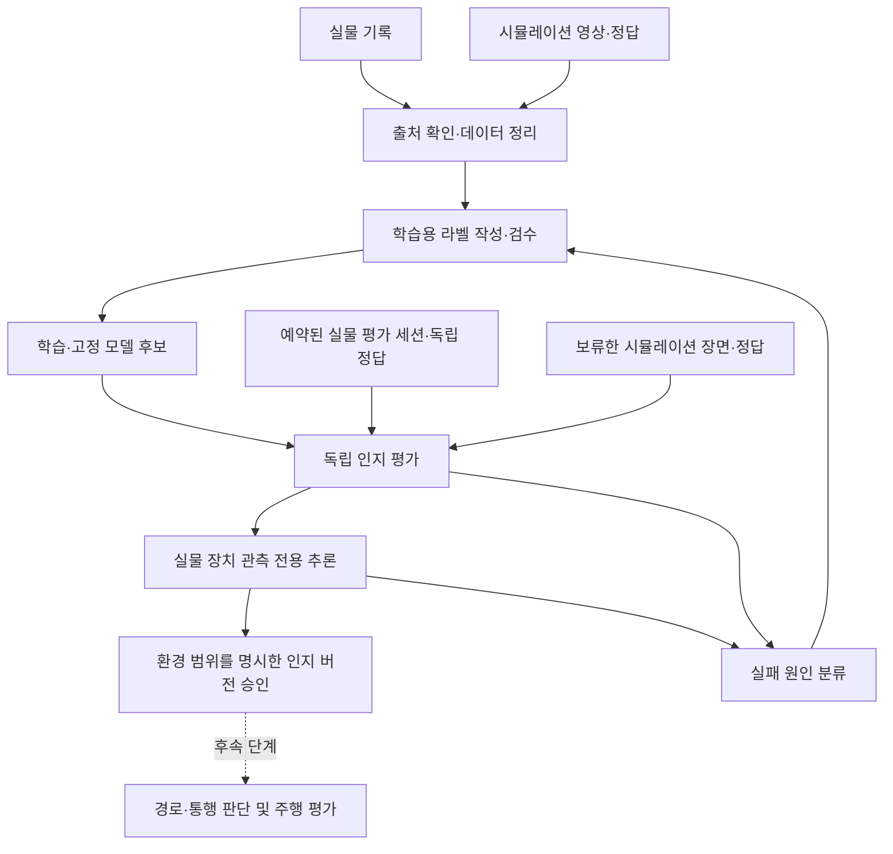

# 도로면·현재 도로 구역을 분리한 인지 적합성 설계

날짜: 2026-10-11

상태: [D-659](../adr/D-659-perception-fitness-and-road-region-semantics.md)에서 인지 우선 범위·의미 분리와 구현 전 선행 조건을 Accepted로 기록했다. 구현, 평가 정답 확정, 인지 승인, 배포 및 주행 수용은 별도다.

## 1. 목표와 단계 경계

이번 목표는 도로·경계·물체를 인식하는 모델의 적합성이다. 도로면과 로봇이 현재 속한 도로 구역을 각각 평가한다. 목적지에 따른 경로 선택, 신호에 따른 진입 허용, 조향·속도 제어 및 주행 적합성은 후속 단계다.

인지 단계의 전달물은 고정 모델, 전처리·라벨 의미, 독립 평가 결과, 장치 추론 결과와 적용 가능한 환경 범위다. 모델 정확도, 장치 적재 및 관측 전용 추론을 서로 구분한다. 인지 승인은 주행 소비자의 활성화나 CORE/Fleet admission 변경을 뜻하지 않는다.

## 2. 의미 정의

아래 이름은 설계 개념이다. 새 API 필드, 모델 role 또는 기존 클래스 ID로 등록된 이름이 아니다.

| 개념 | 정의 | 필요한 근거 | 이번 평가 |
|---|---|---|---|
| 도로면 | 영상에 보이는 도로 바닥 전체. 목적지나 선택한 진행 방향에 따라 의미를 바꾸지 않는다 | 영상, 도로 경계 | 포함 |
| 현재 도로 구역 | 로봇이 현재 속한 차선 또는 도로 구획의 가시 영역. 도로면 전체와 별도로 판정한다 | 도로면, 경계, 로봇 위치; 필요 시 검증된 지도 | 포함 |
| 따라갈 경로 | 목적지와 통행 규칙에 따라 선택한 진행 경로 | 인지 결과, 지도, 미션, 통행 판단 | 후속 주행 단계 |

갈림길의 두 갈래는 모두 도로다. 경계로 구획되지 않은 연결부에서는 현재 도로 구역도 두 갈래와 연결될 수 있다. 인지 정답을 만들기 위해 목적지로 한 갈래를 고르거나, 선택하지 않은 도로를 도로 밖 바닥으로 칠하지 않는다. 현재 구역을 확정하기 어려우면 불확실로 표시한다.

도로 바닥, 차선·정지선·횡단보도 칠, 도로 밖 바닥, 물체 및 가림/불확실을 구분한다. 기존 평가 클래스의 의미를 유지하며, 새 도로 구역 정답의 표현은 별도 확정한다. 물체에 가려진 바닥을 임의로 복원해 확정 정답으로 삼지 않는다. 물체의 존재와 도로의 의미, 현재 통행 가능 여부는 별개다.

## 3. 기존 계약과의 관계

| 근거 | 이번 설계와의 관계 |
|---|---|
| [D-475](../adr/D-475-human-reviewed-fixed-eval-truth.md) (Proposed) | 사람이 검수하는 도로 바닥 전체 정답과 학습/평가 분리를 설계 근거로 사용한다. 문서 존재를 실제 검수나 게이트 구현 완료로 해석하지 않는다 |
| [D-576](../adr/D-576-drivable-own-road-beyond-boundary-blocked.md) (Accepted) | 기존 조향 소비자의 direct 의미와 도로 전체 평가 의미를 구분한다. 이번 문서로 기존 조향 소비자·라벨을 바꾸지 않는다 |
| [D-379](../adr/D-379-learning-data-pipeline-auto-labels-local-store.md) | 수집 출처, 자동 라벨, 고정 평가 세트, 세션 분리 및 같은 평가 버전의 후보 비교를 재사용한다 |
| [D-356](../adr/D-356-perception-learning-loop-and-model-delivery.md) | 모델 전달·관측 전용 추론과 주행 선택의 증거를 구분한다 |
| [D-638](../adr/D-638-isaac-single-pinky-cpu-rl-diagnostic.md) | 경로 추종 보정 학습이나 완주 결과를 영상 인지 적합성으로 사용하지 않는다 |

현재의 단일 `drivable` 클래스나 role을 두 의미로 재해석하지 않는다. 구현 전에 해당 라벨·manifest·모델 출력·평가 소비자·검수 화면의 변경을 별도 ADR과 마이그레이션으로 확정한다. 기존 데이터셋과 모델은 원래 의미와 버전을 보존한다.

## 4. 최소 파이프라인

기존 위치를 재사용한다. `learning/curation/perception`은 기록·검수·데이터 구성, `learning/training/perception`은 학습, `learning/evaluation/perception`은 재생 평가, `learning/registry/perception`은 산출물과 계보를 맡는다. `tools/perception`은 이 경로를 연결한다. 새로운 앱·최상위 폴더·통합 시뮬레이터 추상화는 이번 설계에 필요하지 않다.

사용자 보완과 D-663/D-665에 따라 모델은 길 자체를 drivable로 검출하고, 현재 구역은 기존 인지 출력과 경계·검증된 위치에서 산출하는 로직을 평가한다. 현재 구역 segmentation head를 추가하지 않는다. 위치/지도 입력이 필요한 방식에는 그 입력이 유효한 경우에만 결과를 인정하는 조건을 둔다.

## 5. 데이터·정답과 누설 방지

학습, 개발용 검증, 최종 시험은 원본 세션 및 capture group 단위로 분리한다. 같은 기록의 MCAP·영상·추출 프레임 또는 같은 시뮬레이션 장면의 단순 변환본을 서로 다른 split으로 보내지 않는다. 날짜·조명·구간이 다른 보류 장면을 확보하고, 시뮬레이션은 장면 구성과 생성 조건도 분리한다.

학습용 자동 라벨은 지도 투영·센서·기하 등의 출처와 오차를 기록한다. 실물 최종 평가 정답은 독립적으로 검수하고 평가할 모델의 출력을 그대로 정답으로 삼지 않는다. 평가 대상 세션은 검수 전에 예약해 학습 입력에서 제외한다. 기존 평가 세트를 고칠 때는 새 버전과 이유를 남긴다.

최종 시험 실패를 보고 학습 데이터나 설정을 수정하면 해당 시험 결과는 개발 근거가 된다. 이후 최종 수용에는 새로 보류한 시험 장면을 사용한다. 실패를 보고 합격 임계값이나 정답을 후보에 맞추지 않는다.

기록에는 원본 해시, 세션/프레임 정체성, 촬영 시각, 카메라 보정, 지도와 라벨 의미 버전, split 및 검수 근거를 남긴다. 실물 지도는 `260919 MAP FILE.STL` 기반 `map_v2_fleet`의 출처를 유지한다. 곡률 등을 바꾼 학습용 변형은 별도 버전으로 표시하며 실물 지도 평가를 대신하지 않는다.

## 6. 시뮬레이션과 실물 비교

이번 시뮬레이션의 역할은 인지 장면과 평가 정답을 제공하는 것이다. 기존 Isaac/Gazebo 경로를 활용하되 필요한 카메라 장면과 정답 기능부터 확인한다. MuJoCo와 세 환경 동시 구축은 현 단계에 포함하지 않는다.

같은 의미 정의·전처리·고정 모델·지표로 조명, 반사, 경계 가림, 곡선, 교차로 및 물체 유무를 시험한다. 시뮬레이션의 물체/표면 ID가 평가 클래스에 올바르게 대응하는지 검수한다. 정답 생성용 privileged 위치·ID를 실물에서 얻을 수 없는 모델 입력으로 넣지 않는다. 지도·위치를 입력으로 쓰는 방식은 실물에서도 가능한 관측 수준을 명시한다.

시뮬레이션과 실물의 점수는 출처별·조건별로 따로 보고한다. 시뮬레이션의 높은 점수가 실물의 실패를 상쇄하지 않는다. 영상 재생은 인지 정확도를, 실제 장치 관측 전용 추론은 전처리 동등성·지연·프레임 손실·버전 적재를 확인한다. 이동 장면은 기존 사람 운전 기록을 사용할 수 있으며 새 주행 실행은 별도 작업이다.

## 7. 판정 기준과 실패 처리

| 평가 축 | 지표/증거 |
|---|---|
| 도로면 | 클래스별 IoU, 도로 밖 바닥의 도로 오인율, 도로 누락률, 경계 오차 |
| 현재 도로 구역 | 독립 구역 정답과의 IoU, 다른 구역 포함률, 자기 구역 제외율, 교차로/가림 조건별 결과 |
| 물체 | 확정한 클래스별 정밀도·재현율, 작은/가려진 물체 누락; 거리 출력이 있으면 별도 거리 오차 |
| 불확실 | 유효 판정 비율, 보류 비율, 보류를 포함한 장면별 실패 수 |
| 장치 추론 | 원본 촬영부터 결과까지 지연의 분포, 프레임 손실, 모델·전처리·입력 보정 버전 readback |

도로 오인율 등은 분모와 평가 영역을 사전에 정의한다. 픽셀 오차를 미터로 바꾸는 경우 검증된 보정과 좌표계를 사용한다. 전체 평균과 함께 조건별 결과·유효 정답 수·제외 사유를 보고한다. 불확실 영역을 모두 제외하거나 전부 보류하는 모델이 높은 점수만으로 합격하지 않도록 최소 유효 범위를 함께 정한다.

출처/해시 불일치, 학습·시험 중복, 정답 없음, 라벨 의미 불명, 입력 보정 불명 또는 관측 시각 정렬 실패는 해당 평가를 미확인/HOLD로 처리한다. 유효한 시험에서 기준을 못 맞춘 후보는 실패로 기록한다. 정확도 실패, 정답 오류, 보정 오류, 런타임 지연을 나눠 다음 수정의 근거로 삼는다.

합격 수치는 아직 확정하지 않았다. 의미별 검수 정답과 기준 모델을 준비한 후 적용 환경, 최소 장면/표본 범위, 클래스별 임계값과 지연 조건을 최종 시험 전에 고정한다. 수치 미설정이나 증거 누락 상태에서는 인지 승인을 내리지 않는다.

## 8. 후속 작업과 완료 기준

1. D-659의 원칙 아래 기존 클래스·라벨·manifest·검수 화면·평가 및 주행 소비자의 의미를 목록화하고, 실제 출력·라벨 표현과 구형 호환/거절 조건을 후속 상세 계약으로 확정한다.
2. 평가용 세션을 예약하고 도로면·현재 구역의 검수 기준과 기준선 평가를 마련한다.
3. 시뮬레이션/실물의 같은 의미별 지표, 불확실 처리 및 사전 합격 조건을 적용한다.
4. 고정 후보의 독립 시험과 실물 장치 관측 전용 추론 증거를 수집한다.
5. 통과한 모델·입력 조건·평가 정답·적용 환경을 묶어 인지 버전을 승인한다.

위 단계가 끝나면 후속 주행 설계가 그 인지 계약을 소비한다. 주행에는 경로 선택·통행 규칙·CORE/Fleet 검사·실제 움직임의 별도 평가가 필요하다. 이번 문서의 작성이나 계약 시험 통과는 인지 모델 자체의 적합성 증거가 아니다.

## 9. 내부 진단 보고의 집계 상세

기존 `road_fitness.evaluate_frame`을 확장하고 `summarize_frames`가 그 내부 결과를 집계한다. 프레임 IoU 평균은 작은/큰 정답의 분모 차이를 숨기므로 TP·FP·FN을 합친 비율을 사용한다. 기존 승격 gate를 재사용해 이 진단을 승인으로 바꾸지 않는다. 실물과 시뮬레이션은 별도 표이며, 조건별 표는 중복 가능한 부분집합이므로 서로 더하지 않는다.

정답 유효/255/해당 영역/영역 밖 화소 수와 실제 점수화 화소 수를 모두 남긴다. 추론 가능 frame, 정답을 점수화한 frame, 추론 보류 frame, 정답 전체 255 frame을 구별한다. 누락·다른 구역 포함은 점수화한 정답 분모를 쓰고 전체 정답 대비 coverage도 함께 표시한다. 미관측 정답을 제거해 유효 범위가 충분한 것으로 보고하지 않는다.

경계는 foreground 화소 중 네 이웃과 다른 화소다. 정답의 중심과 네 이웃이 모두 알려진 위치만 점수화하고 영상 끝·255 이웃으로 제외한 경계 수를 기록한다. 양쪽 경계의 최근접 유클리드 화소 거리 합을 양쪽 경계 화소 수로 나눈다. 어느 경계가 없거나 추론이 보류되면 거리 0으로 대체하지 않고 사유를 기록한다. 이 거리는 미터·BEV 오차나 미관측 영역을 통과하는 물리적 거리 증거가 아니다.

검증은 알려진 경계의 한 화소 이동, 255 둘레, 예측 경계 없음, 구역 보류, 정답 전체 255, 비대칭 정답 분모, 다른 구역 오인 및 실물/시뮬레이션 분리 사례를 사용한다. 새 라이브러리·서비스·ROS field·주행 소비자는 추가하지 않는다. 입력 dataset/모델 재생 연결, 원본 영상 단위 불확실성 분석과 사전 승인 profile은 별도 구현/실행 근거가 필요하다.

모델 프레임 재생은 기존 로더와 preprocess를 사용한다. 도로면/구역 정답과 투영 기준점은 원본 카메라 화소 좌표에서 시작하고, 영상과 같은 resize grid/crop으로 옮긴다. 라벨은 nearest-neighbour, 기준점은 화소 중심의 스케일 변환을 사용한다. crop 밖 알려진 정답을 정상 음성이나 실제 255 정답으로 바꾸지 않고 제외 수와 전체 grid coverage를 남긴다. 이 내부 어댑터에는 독립 정답을 추론 입력으로 전달하는 경로가 없다. 파일/검수/원본 분리 결속과 실제 보정 검증은 실행 caller가 별도로 수행해야 한다.

## 10. 물체 프레임 진단의 지표와 기존 detector 연결

D-659 물체 평가는 D-602의 여섯 클래스와 기존 ObjectDetModel의 letterbox·decode·NMS를 유지한다. 원본 영상 좌표 bbox_xyxy를 사용하고, 정답은 infer 입력으로 전달하지 않는다. 픽셀 박스 면적을 원본 영상 면적으로 나눈 작은 물체 기준과 매칭 IoU를 실행 전에 명시한다. 검출 confidence 내림차순으로 같은 클래스의 미매칭 정답 중 IoU가 가장 큰 하나를 매칭한다. 같은 confidence/IoU는 입력 순서를 유지한다. 임계값 이상이면 TP, 중복·다른 클래스·미매칭 검출은 FP, 남은 정답은 FN이다. AP/mAP, 최적 이분 매칭 또는 신호 상태 판정을 대신하는 수치는 아니다.

클래스별 precision=TP/(TP+FP), recall=TP/(TP+FN)을 기록하고 분모 0은 null이다. 작은 정답은 전체 프레임 매칭 결과에서 별도로 matched/truth와 recall을 계산한다. 가린 정답도 검수 박스의 명시적 boolean `occluded=true`에 대해서만 같은 방식으로 센다. 해당 필드가 없는 기존 박스는 가림 미확인 정답 수로 남기며 false로 채우지 않는다. 이 추가 속성을 넣은 박스는 기존 검수 변경·재승인과 object_review_sha256 결속을 거쳐야 한다. 함수의 boolean 검사는 인증된 가림 검수를 증명하지 않는다.

None 검출은 추론 보류다. 보류된 프레임도 정답·FN·작은/가린 정답 분모를 유지한다. 카메라 snapshot이 무효·오래됨·미래이면 모델 호출 전에 보류한다. 검출 모델의 오류나 무효 결과 revision/latency는 평가 오류로 전파하고 빈 검출로 성공 처리하지 않는다. 실물/시뮬레이션 및 조건별 집계는 정수 개수를 합산하며 프레임 recall 평균을 사용하지 않는다. 서로 다른 매칭/크기 기준, 모델 revision, camera profile, 전처리 또는 confidence/NMS 기준을 섞거나 모델 결속이 있는 결과와 없는 결과를 섞으면 거절한다.

`learning/evaluation/perception/object_fitness.py`는 지표와 열린 기존 detector의 프레임 어댑터다. 내부 합성 회귀는 통계·전처리 호출 경계의 SOURCE 증거이며 실제 독립 물체 성능은 아니다. D-682의 `object_fitness_replay.py`와 `rosy_ml object-fitness`는 고정 검수 출판물·모델 파일·학습 참조·조건의 실행 전후 해시/예약 결속을 담당한다. explicit complete review와 empty negative 기록, 선언 세션/그룹/실제 이미지 분리는 확인하되 authenticated reviewer·전체 upstream closure·검수 freshness는 별도다. 출력은 항상 HOLD이며 intake·전달·운영 소비자·cmd_vel을 실행하지 않는다. 구현·합성 실행과 미완료 항목은 [검증 기록](../validation/fixed-road-fitness-replay-2026-10-12.md)에 구분한다.
