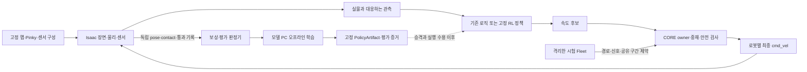

# Pinky 실제 맵 기반 강화학습 구조 초안

**상태:** Draft — 구조 준비만. 시뮬레이션·학습·정책 활성화는 실행하지 않는다.
**목표:** `260919 MAP FILE.STL` 기반 맵에서 Pinky 한 대의 주행 정책을 학습하고, 이후 두 대가 각자의 경로를 완주하며 신호·공유 구간을 지키는 Fleet 시험으로 확장한다.
**기준:** [D-427](../adr/D-427-platform-three-parts-middleware-operations-learning.md), [D-606](../adr/D-606-model-pc-isaac-lab-rl-environment.md), [Isaac 통합 단계](2026-10-04-isaac-navigation-integration-review.md). 이 문서는 기존 계약을 바꾸거나 신규 실행 권한을 부여하지 않는다.

## 1. 먼저 준비할 경계

Isaac 환경, 학습 작업, 정책 실행, Fleet 평가를 나눈다. 첫 구현은 한 환경·한 로봇이다. 동일 정책을 두 CORE 인스턴스에 적용하고 Fleet로 조정하는 시험은 한 대의 주행 평가 다음이다. 다중 에이전트 학습과 대규모 병렬 환경은 아직 결정하지 않는다.

학습 정책은 `linear_x`, `angular_z` **후보**를 낸다. CORE가 최종 `/cmd_vel`을 로봇별로 단독 발행한다. Fleet는 경로·신호·교차로와 공유 구간의 통행을 조정한다. 환경이나 학습기가 바퀴를 직접 구동하는 경로를 만들지 않는다. sim에서도 같은 middleware 엔벌로프와 Safety Guard를 거친다.

## 2. 기존 코드에 놓을 자리

아래의 추가 파일은 **예정 위치**이며 이번 회차에 생성하거나 연결하지 않는다. 빈 실행 스크립트와 가짜 학습 결과는 만들지 않는다.

| 책임 | 기존 자리 | 후속 최소 구현 |
|---|---|---|
| 맵 원본·파생·경로 기준 | `middleware/perception/map/map_v2_fleet/` | 원본과 `training-curved`의 출처·hash를 고정한다 |
| Pinky 형상·센서 배치 | `middleware/apps/device/pinky/description/`, `middleware/apps/device/pinky/profile/` | 명목 구성과 수용된 보정을 구분해 재사용한다 |
| Isaac 맵·로봇·센서 | `learning/envs/isaac/` | 기존 `run_rosy.py`에 대응하는 장면·센서 어댑터, 이후 `pinky_map_env.py` |
| 관측·행동·산출물 경계 | `contracts/learning/` | 기존 PolicyArtifact를 재사용하고 실제 필요한 확장만 별도 검토한다 |
| 오프라인 RL 학습·평가 | `learning/training/pinky/` | 이후 `rl_train.py`, `rl_evaluate.py`; 기존 속도 비교 연구와 결과를 구분한다 |
| Episode·Dataset | `learning/curation/pinky/` | sim 기록의 epoch·시계·행동 의미를 기존 계약에 연결한다 |
| 정책 메타데이터·증거 | `learning/registry/policy/` | 기존 원장을 재사용한다. 등록·승격은 실행 허가와 다르다 |
| 정책 소비·안전한 명령 후보 | `middleware/skills/`, `middleware/execution/local/`, `middleware/core/` | 실제 owner binding·중재·stale/HOLD·stop 연결을 먼저 설계한다 |
| 두 대 경로·통행 평가 | `operations/fleet/` | 기존 Fleet를 격리 배치한다. 학습 중 원장·운영 설정은 사용하지 않는다 |

새 최상위 폴더나 독립적인 RL 전용 안전 제어기는 필요하지 않다. 로봇 이미지에는 학습 프레임워크를 넣지 않는다. 학습과 시뮬레이션은 모델 PC, 작업 PC는 준비·원격 실행·증거 열람을 맡는다.

## 3. 맵과 센서의 입력

- 원본: `map_v2_fleet`의 `260919 MAP FILE.STL` 출처와 원본 생성 자산. 실측 맵을 변경된 훈련 맵과 구분한다.
- 훈련 파생: `training-curved`의 더 굽은 동쪽 S자, 30 cm 높이의 흰 사각 외곽 벽, 흰 차선·회색 바닥. 원본·파생의 world, paint mesh, lane graph를 함께 고정한다.
- Isaac 변환: Gazebo world를 그대로 실행할 수 있다고 가정하지 않는다. 같은 미터 좌표·기준 자세의 USD 장면을 만들고 벽의 충돌 형상과 바닥의 도색 시각 형상을 구분해 대조한다. 원본 STL을 다시 임의 배율로 읽지 않는다.
- 카메라·LiDAR·IR·odom: 실제 사용할 채널, 보정, 지연, 유효성·timestamp와 업데이트 주기를 확인한 뒤 관측을 고정한다. 과거 사진만으로 현재 보정 수치를 확정하지 않는다.
- 실제로 흰 선과 흰 벽이 이어져 보이는 구간을 유지한다. 인위적인 검은 간격이나 색 테두리를 넣어 과제를 쉽게 만들지 않는다. 조명·반사·가림·센서 지연의 변화 범위는 실물 자료로 정한다.

lane graph와 실제 sim pose는 보상·완주 판정에 쓸 수 있다. 정책에는 실물에서도 얻을 수 있는 경로 지시와 센서 관측만 준다. simulator의 정답 위치·장애물 분류를 관측에 몰래 넣지 않는다.

## 4. 한 환경의 관측·행동·step

| 항목 | 구조 초안 | 구현 전에 고정할 것 |
|---|---|---|
| 관측 | 전방 영상, 거리/근접 센서, 속도·odom, 경로 지시, 유효한 신호·통행 제약 | 실제 공급 채널, 단위·순서·shape, 보정·정규화, 관측 나이, 누락 표현 |
| 행동 | 기존 `pinky_base_velocity_v1`: `base_velocity_candidate`, `[linear_x, angular_z]`, `[m/s, rad/s]` | 장치 profile과 수용된 owner 엔벌로프의 limits, 제어 주기·유효기간 |
| 권한 | `owner.kind = pinky_core_command_manager`; `failure_mode = hold` | 실제 후보 소비 경로, owner/controller/envelope revision, lease·중재·정지 readback |
| 환경 API | `reset(seed, options) → (obs, info)`; `step(action) → (obs, reward, terminated, truncated, info)` | 고정된 physics/control 주기와 CORE tick·센서 수신의 동기화 |
| 기록 | 요청 후보, CORE 거절/제한, 최종 명령, 실제 이동, 보상 항목, 종료 사유 | run·episode·epoch·로봇 식별자와 source/map/policy hash |

관측은 아직 후보 목록이며 새 API 필드가 아니다. 행동 이름·단위·owner는 [기존 validator](../../contracts/learning/src/rosy/contracts/learning/artifacts.py)의 계약이다. 벡터 크기, 학습 알고리즘, 보상 가중치와 속도 상한은 미정이다.

`step`은 후보 전달 → CORE 판정 → 정해진 물리 구간 진행 → 새 관측·독립 판정 순서다. 실제 비동기 ROS/CORE와 이 순서가 맞는지는 별도 어댑터 시험이 필요하다. physics 시간으로 이동을 판정하고, 명령 유효기간·연결 watchdog은 기존 monotonic 계약을 유지한다. 빠른 학습을 위해 timeout을 임의로 느슨하게 만들지 않는다.

`reset`은 sim에만 적용한다. CORE의 이전 명령이 소거되고 실제 바퀴가 정지한 것을 확인한 뒤 sim 자세·속도를 초기화하고 새 epoch의 관측을 기다린다. 정책의 기억도 `stop`, `hold`, `lease_change`, `episode_change`에서 초기화한다. 이전 신호·통행 승인·완료 기록을 새 episode에 넘기지 않는다.

## 5. 보상과 종료 판정

보상은 아래 항목을 분리해 기록하고 가중치는 기준선 결과 이후 정한다.

| 항목 | 판정 원칙 |
|---|---|
| 진행 | 지정된 경로의 순서 있는 전진에 보상한다. 같은 구간 왕복과 지도 지름길로 보상을 반복 취득하지 못하게 한다 |
| 차선·벽 | 차선은 바닥 도색이고 벽은 장애물이다. 경로 이탈·벽 근접·실제 접촉을 독립 형상으로 판정한다 |
| 신호·횡단보도 | 유효한 통행 조건에서만 통과한다. 적색·unknown·만료 응답에서의 올바른 대기는 진행 지연 벌점과 구분한다 |
| 명령 | 과도한 조향 변화와 안전 가드 개입을 기록한다. 가드에 계속 막힌 상태를 성공으로 보상하지 않는다 |
| 완주 | 지정 체크포인트를 순서대로 통과하고 목표 자세·정지 조건을 충족해야 성공이다 |

엔벌로프 이탈은 D-427에 따라 `terminated=True`와 실패 보상, HOLD 사유로 기록한다. 충돌·경로 실패·규칙 위반도 명시적인 실패 종료로 설계한다. 시간 한도만 `truncated=True`다. 센서 누락·stale·연결 단절은 CORE의 HOLD와 환경 중단 사유를 기록하며 성공으로 세지 않는다. 세부 실패 한계와 센서 중단 정책은 구현 전에 고정한다.

규칙은 보상으로만 학습시키지 않는다. CORE/Fleet의 명시적인 통행·안전 제약을 유지한다. baseline과 RL 후보 모두 같은 제약으로 평가하고, 정책 요청과 가드가 수정한 최종 출력을 함께 비교한다.

## 6. 과제를 나누는 순서

| 단계 | 과제 | 다음 단계 전 확인 |
|---|---|---|
| R0 | 구조와 장면·센서·행동 의미 준비 | map/robot/sensor hash, 관측·행동 계약, reset/stop 설계 |
| R1 | 한 대 직진·회전·정지, 흰 벽 접근 | Isaac 접지·전진 추종·명령 만료 후 물리 정지; CORE 최종 publisher 하나 |
| R2 | 동쪽 S자와 선·벽 경계가 흐린 구간 | 기존 로직의 고정 기준선, 실제 관측 폐루프, 같은 조건에서 RL 후보 비교 |
| R3 | 한 대 전체 경로·횡단보도·신호 | 순서 있는 완주·정지, 신호 대기/재개, stale/unknown 실패 시험 |
| R4 | 두 대와 격리된 Fleet | 각자 완주, 신호 준수, 공유 구간의 상호 배제, 충돌·교착·연결 유실 판정 |
| R5 | 고정 정책의 sim→real 승격 | 독립 L0 평가 → 실행 없는 L1 shadow → 별도 수용을 거친 L2 제한 사용 |

R4는 먼저 같은 고정 정책을 두 로봇에 각각 적용하고 Fleet가 통행을 조정한다. 두 로봇을 하나의 단순 Gymnasium 행동 벡터로 묶거나 운영 Fleet가 학습하며 규칙을 바꾸도록 만들지 않는다. 협력 정책 학습이 필요하면 그때 별도 관측·행동·다중 에이전트 API를 설계한다.

완주율은 로봇별 결과와 **두 대 모두 성공한 episode 비율**을 함께 보고한다. 한 대의 성공이나 전체 reward 평균을 두 대 완주로 표시하지 않는다. 유효한 신호 대기와 통행 가능한 상태의 교착을 구분한다.

## 7. 실행별 입력·출력과 독립 평가

실행 전에 후보 SHA, map variant와 자산 hash, robot/sensor/owner revision, 시나리오·seed·시작 자세·순서 있는 경로·신호 일정·시간 한도·판정 한계를 한 묶음으로 고정한다. 학습과 평가 seed·episode를 분리하고 원본 맵과 파생 맵 결과를 각각 낸다. 평가 기준은 학습한 뒤 성공하도록 바꾸지 않는다.

모델 PC의 checkout 밖 scratch에 새 run 디렉터리를 만들고 Windows에 가져오는 로그·증거는 관리 도구가 만든 `X:/DevTemp/projects/rosy-platform/<session>/` 아래에 보관한다. 가중치·정규화·Episode·평가 원본·승격 receipt를 소스 저장소에 넣지 않는다. sim identity·ROS context·Fleet DB·endpoint·토큰도 실행별로 격리한다.

PolicyArtifact에는 실제 파일 hash, 관측·행동 의미, 정규화, 장치·카메라·owner·timing, dataset revision, 독립 평가 보고를 묶는다. 현재 Pinky registry의 `assess-pinky`는 기록 속도 비교용 오프라인 보고서를 판정한다. RL 완주·신호·안전 평가를 그대로 수용한다고 가정하지 않고, 필요한 report 계약·등록·승격 연결은 후속 작업으로 둔다.

## 8. CORE로 가능한 범위와 현재 준비 상태

CORE를 최종 명령·안전 owner로 재사용하는 구조는 기존 계약과 맞는다. **현재 CORE 차선 로직의 완주 성공, RL 정책의 실행 연결, 두 대 신호 주행은 아직 검증되지 않았다.** PolicyArtifact validator와 설치 binding 검사는 실제 주행 정책 소비·실행 수용을 대신하지 않는다.

| 항목 | 이번 구조 준비의 상태 |
|---|---|
| 맵 파생 | 이전 작업에서 자산·Gazebo 선택 경로와 원격 계약 시험 준비. Isaac 장면 수용과 다르다 |
| Isaac 연결 | 기존 한 대 URDF/ROS 그래프 helper 재사용 가능. 이 맵의 카메라·LiDAR·주행 폐루프는 후속 |
| RL 환경·trainer | 예정 위치와 계약만 정리. 실행 구현 없음 |
| 모델 PC | D-606의 2026-10-10 기록에는 RAM·의존성·물리 주행 HOLD가 있다. 이번 회차에 재점검하지 않음 |
| CORE 정책 소비·Fleet | 기존 권한 경계 유지. RL 행동의 실제 owner 연결과 두 대 시험은 후속 |

다음 구현 전 결정할 것은 세 가지다: 첫 관측 채널과 shape, 실제 owner 후보 연결·제어 주기, R2 S자 과제의 시작/종료·평가 한계. 결정 후 필요한 코드·시험만 추가한다. 환경 실행은 D-606의 자원·의존성·물리 정지 게이트가 충족된 뒤 재개한다.
