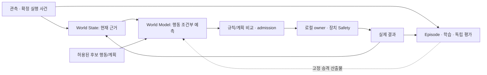

# ROSY Platform 정체성과 3단계 책임 구조 설계

**상태:** Proposed. 2026-10-11 사용자 요청에 따른 제품·구조 재검토다. 기존 Accepted ADR, API, 배포 구조를 변경·승격하지 않는다.
**기준:** `81b6ed879`, `docs/core-responsibility-plan`. 세계 상태와 행동 예측을 함께 다룬다는 사용자 답변을 반영한다.
**실행:** [플랫폼 구조 실행 계획](2026-10-11-rosy-platform-identity-and-structure.md).
**상세:** [CORE·Drive·Arm·Safety 설계](2026-10-11-core-responsibility-and-driving-design.md), [상세 실행 계획](2026-10-11-core-responsibility-and-driving.md).

## 1. ROSY가 무엇을 소유하는 제품인가

우산 폴더와 저장소의 `AGENTS.md`, `README.md`, `PRODUCT.md`, `CONCEPTS.md`, v0.2 목표 아키텍처와 D-290/D-427/D-429/D-430/D-516을 읽어 기준을 잡았다. 현재 제품은 **ROSY Platform**이며 로봇 미들웨어와 Fleet 관제를 연결한다. Pinky는 첫 구현 대상이고 Arm/셀·사이트 장치까지 책임이 확장돼 있다.

이번 제안의 제품 정의는 다음과 같다.

> **ROSY는 서로 다른 로봇과 현장 장치를, 근거를 가진 작업으로 연결하고, 장치별 안전한 실행과 실제 결과를 확인하며, 그 경험으로 개선하는 로봇 작업 플랫폼이다.**

이는 제품 정의 제안이며 root 문구를 이미 바꿨다는 뜻은 아니다. 다음 네 가지가 함께 있어야 이 정의가 성립한다.

1. **이해:** 무엇을 관측했고 무엇을 모르는지, 어떤 상태/예측을 사용했는지 설명한다.
2. **조정:** 누가 어떤 작업을 맡고 어떤 자원을 예약했는지 기록한다.
3. **실행:** Drive·Arm·사이트 장치의 각 owner와 Safety를 통해 허용된 동작만 수행한다.
4. **개선:** 관측·행동·실제 결과를 재현 가능한 경험으로 연결하고 독립 평가 뒤 고정 산출물을 승격한다.

따라서 CORE는 플랫폼 전체의 별명이 아니다. 로봇 쪽 공통 관문·조립·실행 경계이고, Drive/Arm Control은 도메인별 실행 책임이다. World State, 행동 예측, Fleet 작업 원장, 학습은 CORE 밖의 독립 수명과 권한을 가진다. 모델이 늘어도 이 책임은 유지한다.

## 2. 실제 폴더와 현재 역할

추적 파일과 `platform_parts.yaml`, 각 모듈 안내·진입점을 대조했다. 폴더 존재, 코드 존재, 다른 모듈의 소비, 활성 서비스, 실물 수용은 각각 다르다. 아래는 소스 기준이며 실시간 설치 상태는 확인하지 않았다.

| 현재 경로 | 역할 | 구조상 고려점 |
|---|---|---|
| `middleware/core/{gateway,api_web,events,services,navigation}` | CORE와 로봇 주행 기능 | 공통 운용과 Drive 실행이 services/bridge에 혼재 |
| `middleware/perception/control` | 흡수된 ROS `control` 패키지 | 인식·planning·control·safety·legacy wrapper가 함께 있음 |
| `middleware/apps/device/{pinky,omx}` | 장치 프로파일·기동·OMX owner/agent | 책임 이름보다 apps/device라는 중간 분류가 깊이를 늘림 |
| `middleware/{skills,execution,drivers,ui}` | 작업 계약·local 수명·I/O·로봇 표면 | Skill 정의와 실시간 Control, 실행 기록과 장치 I/O를 구분 |
| `operations/fleet` | 원장·자원/교통·dispatch·규칙·콘솔 | AI 연계와 조회 projection이 Fleet 내부 상태를 쓰는 경계 확인 필요 |
| `operations/{execution,processes,world}` | 사이트 실행 계약·공정·관측 참조 | 사이트/로컬 원장은 별개; world가 원장 쓰기를 소유하지 않음 |
| `operations/{vision,situation}` | 사이트 관측, AI PC 상황 사실 | 인식 사실·상황 분석·미래 예측을 구분 |
| `operations/{site_devices,apps,ui}` | 신호/도크·사이트 조합·Cam 등 | 로봇 모터 제어와 사이트 I/O의 writer/감독이 다름 |
| `learning/{curation,training,envs,registry}` | episode·학습·평가 환경·승격 기록 | runtime 모듈이 학습 코드를 import하지 않음 |
| `contracts/{foundation,motion,skill,learning,ros_idl}` | 경계를 넘는 계약 | 공통 데이터 계약과 모듈 내부 API를 구분 |
| `integrations/{robots,simulation}` | OMX/provider, Gazebo 연결 | 모델/저장소 adapter의 목적 분류는 D-427에 있으나 현재 구현과 구분 |
| `shared/web`, `profiles`, `deploy`, `tools`, `test`, `docs` | UI 공용·설치 조합·배포·개발·검증·거버넌스 | 제품 도메인 코드의 두 번째 보관소로 사용하지 않음 |

소스의 주요 혼재는 `core/services`, `perception/control`, `apps/device`다. Fleet의 판단·원장처럼 트랜잭션이 결합된 기능은 이름만 맞추려고 먼저 떼지 않는다. `operations/world`에 `ObservationSnapshot` 코드가 존재하지만 Fleet의 현행 pose 사실은 `MapPose`이고, 일반 world service로 이행 완료된 상태가 아니다. `operations/situation`은 실제 소스가 있는 사실 생산자이며 미래 행동 예측기를 이미 구현한 것으로 보지 않는다.

## 3. 최상위 이름의 의미

세 제품 파트는 현재 Accepted D-427의 `middleware`, `operations`, `learning`을 유지하는 안을 권고한다. 실행·조정·개선이라는 권한 경계가 이미 있고, 새 장치나 world model이 들어와도 기준이 흔들리지 않는다. 이름을 줄이는 목적만으로 전체 root를 바꾸지는 않는다.

| 최상위 | 한 문장 의미 | 여기에 들어가면 안 되는 책임 |
|---|---|---|
| `middleware` | 장치의 capability를 실제로, 제한된 권한과 안전 아래 실행한다 | 사이트 원장·훈련 worker·대규모 미래 상태 저장 |
| `operations` | 세계 상태를 바탕으로 로봇·셀·사이트 장치를 작업으로 조정한다 | 직접 모터/관절 쓰기·학습·로컬 안전 대체 |
| `learning` | 실행 경험으로 모델·정책을 개선하고 평가·승격 근거를 만든다 | 운영 원장 쓰기·장치 권한 발급·학습 중 자동 배포 |
| `contracts` | 파트가 주고받는 뜻·형식·버전을 고정한다 | 런타임·정책 구현·vendor SDK |
| `integrations` | 외부 로봇·모델·시뮬레이터·저장소 기술을 연결한다 | 제품의 승인·Safety·작업 정책 |
| `shared` | 실제 여러 표면에서 공유하는 좁은 UI 기반 | domain/common/core 등의 범용 잡동사니 |

`runtime/site/learning`은 실행 호스트를 연상시키고, `control/world/ai/...`만으로 최상위를 구성하면 online/offline 권한과 원장 경계가 약해진다. 이번 권고는 현재 역할 이름을 유지하고 **2·3단계의 도메인 이름을 더 정확하게 고치는 것**이다. 추후 root 명칭 자체를 바꿀 근거가 생기면 D-427 후속 ADR에서 결정한다.

## 4. 최대 3 depth 목표 분류

depth는 저장소 root 아래 책임 폴더를 센다: `middleware/control/drive`가 3이다. 아래 트리는 **미래 책임·패키지 holder의 목표안**이며 빈 폴더 생성 목록이 아니다. `src/rosy/...`, package 구현·test/resource 같은 언어/빌드 내부 경로는 이 분류 depth와 별개다. 실제 물리 depth도 모두 3으로 제한하려면 namespace/ament/vendor 규칙을 먼저 대조해야 한다.

```text
rosy-platform/
├─ middleware/                    # 장치 실행
│  ├─ core/{gateway,api,events}    # 공통 관문·조립; services의 공통 책임은 여기 소유
│  ├─ control/{drive,arm}          # 도메인 계획·제어·복구; 새 제안, 이동 계약 필요
│  ├─ perception/{sensors,vision} # 관측 생성; 현재 absorbed control을 단계적으로 분해
│  ├─ execution/local             # 로컬 시도·취소·receipt·재시작 수명
│  ├─ skills/{api,navigation,manipulation}
│  ├─ devices/{pinky,omx}         # apps/device의 장치 조합·profile·bringup
│  ├─ drivers/{imu_bno055,pinky_adc,pinky_lamp,pinky_led}
│  └─ ui/{robot,pilot,face}
├─ operations/                    # 현장 상태·작업 조정
│  ├─ fleet                      # 기존 원장·자원·dispatch·console
│  ├─ execution/{api,site}
│  ├─ world/{api,state}           # 관측·확정 사건의 조회 projection
│  ├─ decision/{rules,models}     # 작업/대응 후보의 선택; 실행 권한은 admission
│  ├─ prediction/world_model     # 미래 상태 예측, 새 제안; world/state와 별도
│  ├─ situation                  # 현재 상황·예외 분석; 사실만
│  ├─ vision                     # 현장 카메라·신호 관측
│  ├─ processes/{cell,palletizing}
│  ├─ site_devices/{dock,signal}
│  ├─ apps/{fleet,games}
│  └─ ui/{console,cam}
├─ learning/                      # 경험·학습·독립 평가
│  ├─ curation/{pinky,omx}        # 기록→episode; 장치별 원본 매핑
│  ├─ training/{perception,pinky,omx,world_model}
│  ├─ evaluation/{perception,policy,world_model}
│  ├─ registry/{policy,models}
│  └─ envs/{isaac,replay}
├─ contracts/{foundation,ros_idl,motion,skill,learning}
├─ integrations/
│  ├─ robots/omx
│  ├─ models/<provider>
│  ├─ policies/{lerobot_inference,lerobot_training}
│  ├─ simulation/{gazebo,isaac}
│  └─ storage/<provider>
├─ shared/web
└─ profiles/ deploy/ tools/ test/ docs/
```

이 트리의 중괄호는 같은 depth의 형제다. 새 `middleware/control`은 CORE 밖의 **논리 도메인 구현 holder** 제안이며 두 번째 공개 API·process·writer가 아니다. 현재 D-429가 기각한 top-level `decision`과 구분하고, 기존 D-427의 물리 목적 경로 변경이므로 ADR 없이 이동하지 않는다.

### 이름별 유지·변경 이유

| 현행 이름 | 권고 | 의미와 조건 |
|---|---|---|
| `middleware/core` | 유지·범위 축소 | 공통 관문/조립을 뜻함; Drive 알고리즘 전체의 별명으로 사용하지 않음 |
| `core/services/core_features` | 책임별 분리 후보 | 공통 운용은 CORE, Drive/Arm 실행은 Control; import/runtime/guard 경계 유지 |
| `core/navigation` | `control/drive`의 Nav2 연결 후보 | navigation은 Drive의 한 실행 방식; ROS package명은 이동과 별도로 유지 |
| `perception/control` | 순수 인식과 제어 책임 분리 | Python `control` 호환 이름·entry point·legacy launch는 단계적으로 처리 |
| `apps/device` | `devices` 후보 | 중간 apps 계층을 줄여 장치 조합이 2·3단계에서 보이게 함 |
| `api_web` | `api` 후보 | 외부 관문 책임을 이름에 표시; 웹 UI와 API 실행 책임은 다름 |
| `world` | 세계 상태로 유지 | 관측/확정 사건의 읽기 모델; 미래 예측으로 덮어쓰지 않음 |
| `prediction` | 첫 실소비자 때 신설 후보 | 행동 조건부 미래 예측의 별도 수명·budget·평가를 표현 |
| `safety` | cross-cutting 책임 유지 | 기존 장치 guard 옆에 배치; 최상위 중앙 safety 서비스로 모으지 않음 |

각 물리 이동은 호출자·설치·launch·manifest·test·Safety 검토를 포함한 단위로 한다. 3 depth를 위해 모든 feature를 큰 단일 파일로 합치거나 같은 타입을 다른 파트에 복제하지 않는다.

## 5. 세계 상태와 world model은 연결하되 섞지 않는다

사용자 방향은 **세계 상태 + 행동 예측**이다. 이를 세 가지 별도 산출물로 연결한다.

| 산출물 | 의미·소유 | 반드시 보존할 근거 |
|---|---|---|
| World State | 현재 관측과 확정 사건의 projection, operations/world | 관측/수신 시각, frame·calibration·revision, source, age/unknown/conflict |
| Prediction | 특정 행동/계획을 가정한 미래 상태, operations/prediction 후보 | 입력 snapshot/revision, 후보 행동 참조, horizon·단위, 모델 digest, 불확실성·만료·기권 |
| Episode/평가 | 관측→행동 요청→허용/실제 출력→실제 결과, learning | device/task/attempt 상관, 시간·좌표·보정, train/eval 분리, 실제/합성 구분 |

위 표는 설계 요구이며 새 wire 필드를 발행하지 않는다. `ObservationSnapshot`과 기존 `contracts/learning`을 우선 대조한다. Arm 전용 `InferenceObservation/Result`를 범용 world model 계약으로 무작정 확대하지 않는다. 다음 실소비자와 독립 평가 문제가 정해질 때 필요한 schema만 결정한다.



예측은 상태 조회를 돕거나 허용된 계획을 비교하는 입력이다. 예측이 말한 빈 공간은 로봇의 실제 clearance 근거가 아니고, 예측 성공은 작업 완료가 아니다. 실제로 관측되기 전에는 World State의 확정 사건을 바꾸지 않는다. 다중 장치/장기 horizon 예측과 로봇의 실시간 제어는 별도의 시간 예산이다.

모델 PC의 학습/평가→고정 산출물→AI PC의 제한된 추론→Fleet 검증/admission→로컬 재검사 경계를 유지한다(D-516). 추후 로봇 로컬의 단기 predictor가 필요하면 장치 예산·contract·envelope를 별도로 수용한다. 어떤 배치에서도 추론 모델은 command binding을 얻지 않는다.

## 6. 확장성을 실제로 판단하는 시나리오

- **새 이동 로봇:** 공통 요청/receipt와 Drive 계약을 소비하되 geometry·driver·guard·배포 profile만 해당 장치에 맞춰 연결한다. CORE/World/Fleet를 통째로 복사하지 않는다.
- **새 Arm:** 관절·action·gripper·보정의 owner/guard를 연결하고 작업 Skill을 등록한다. 차선/곡률/DOCKING 의존이 따라오지 않는다.
- **복합 로봇:** base와 arm의 제어 자원·결합 위험·동시 실행 조건을 명시한다. 장치별 한 writer와 사이트/로컬 coordination을 함께 유지한다.
- **world model 교체:** 같은 평가 입력·horizon·출력 의미·fallback을 고정하고 provider/model artifact만 교체한다. 승인 정책·예측을 사실로 승격하는 규칙은 모델이 변경하지 않는다.
- **새 공정:** 공정 recipe/compiler가 Skill 계획을 내고 site execution이 승인/예약한다. world가 레시피·작업 원장을 모두 소유하지 않는다.

책임 확장은 소비자·계약·교체 단위·실패 출구로 검증한다. 폴더가 3단계라는 사실만으로 확장성이 증명되지는 않는다.

## 7. 구현 순서와 현재 한계

전체 구조의 목표를 정리한 뒤 기존 root 역할은 유지하고 작은 단위부터 이동한다. 먼저 CORE/Drive/Arm 책임·Safety·실행 수명 정리를 수행한다. World State는 두 번째 실소비자와 실제 데이터 요구가 확인될 때 얇게 연결한다. World model은 하나의 행동 예측 문제를 오프라인 재생으로 평가한 뒤 shadow 추론으로 진행한다. 새 예측기 활성화·자동 복구·장치 motion은 이 문서 작성의 범위가 아니다.

D-503은 Proposed이고 일반 World State 선확장을 미루는 방향이다. D-577의 situation 사실 체계는 Accepted 계약이며 예측 fact를 임의 추가하지 않는다. root/폴더 이동과 prediction의 소유권, 새로운 World/Prediction 계약은 후속 ADR이 필요한 제안이다. 현재 패키징과 물리 acceptance를 유지하며 다음 단계를 [실행 계획](2026-10-11-rosy-platform-identity-and-structure.md)에 둔다.
