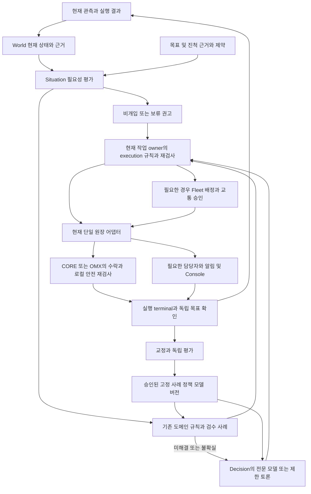

# 공통 판단과 작업 조정 목표 구조 설계

**Status:** [D-648](../adr/D-648-shared-judgment-target-structure.md) Proposed의 구체화. D-647 0단계의 검토 자료이며 코드 이동·새 평가 구현·독립 서비스·장치 수용 완료가 아니다. 출발점은 D-637을 포함하는 `5026a8558`; 추가 확인한 main snapshot은 `654e88851`이다.

## 목적과 선택
단일 암 셀·단일 로봇·다중 로봇에서 현재 상태와 목표의 차이를 빠르게 평가하고, 필요한 대안만 만들며, 승인된 조치의 실제 결과를 같은 사건으로 회수한다. 정상 비개입도 유효한 판단 결과다. Fleet을 쓰지 않는 소비자도 공통 평가를 실행할 수 있어야 하며 물리 명령의 승인·writer는 기존 owner에 남는다.

D-647의 A(Fleet 내부 고정)는 실제 셀 소비를 Fleet 원장에 종속시킬 수 있고 C(즉시 독립 서비스)는 일관성·지연·장애 조정 계약을 먼저 늘린다. B(공통 논리 분리 후 현재 배포 유지)를 추천하되 0단계 사례·성능·설치 확인 전 Accepted로 보지 않는다. Work Orchestration은 새 `operations/orchestration`을 병행 신설하는 대신 기존 `operations/execution` 안의 site 책임을 확장하는 방향으로 제안한다.

## 목표 트리
아래는 **현재 존재하는 holder와 제안한 파일의 혼합 트리**다. `[제안]`은 해당 단계에서 실제 코드와 시험이 생길 때 만들며 지금 빈 폴더를 생성하지 않는다. 기존 API namespace와 DB는 별개다.

```text
operations/
├─ world/src/rosy/world/
│  ├─ api/observation.py                  관측·근거 참조
│  └─ state/projections/map_pose.py       현재 상태 projection
├─ situation/rosy_situation/
│  ├─ assessment.py [제안]               공통 개입 필요성·비개입·보류
│  ├─ analyzers/                         현재 stuck/traffic 근거와 기존 제한 제안
│  ├─ incidents/                         원인 가설·영상/사건 근거
│  └─ service.py                         현재 Fleet 연동 I/O
├─ decision/src/rosy/decision/
│  ├─ candidate.py, decision_pipeline.py  비실행 후보·응답 해석
│  ├─ model_tool_contract.py             기존 provider-neutral 도구 형식
│  ├─ model_tool_catalog.py              기존 closed 도구 목록
│  ├─ er2_standard.py                    현재 provider adapter
│  ├─ deliberation.py [D-640 제안]        필요한 모델 선택·제한 토론
│  └─ cli_deliberation.py [D-640 제안]    제한된 Claude Code/OpenCode runner
├─ execution/src/rosy/execution/
│  ├─ api/                              현재 PlanBundle·내부 계약
│  └─ site/
│     ├─ cell_submission.py, item_pose.py 현재 submission·목표 검증
│     ├─ workflow.py [제안]              추출한 작업 전이·진척/복구 규칙
│     └─ goal_evidence.py [추출 제안]     기존 순수 Mission 목표 검증
├─ fleet/fleet/
│  ├─ server/                           현재 auth·serving·Work Orchestration 어댑터
│  │  ├─ mission_*, cell_job_*, proposal_store.py, dispatch_admission.py
│  │  └─ model_feedback_dispatch.py [이전 제안]  원장에 결속된 모델 도구 중재
│  ├─ stuck/                            기존 이동 도메인 정책·사건/transport 어댑터
│  ├─ traffic/, routing/                로봇 교통·경로·공유 자원 조정
│  ├─ formation/, swarm/                집합 배정·협업
│  └─ incidents/ [D-661 구현]           이름 있는 담당 인수·같은 사건의 알림 outbox/채널 어댑터
├─ processes/{cell,palletizing}/         공정·도메인 목표 정의
└─ ui/console/                          판단·담당·조치·실제 결과와 사람 처리

learning/{curation,training,evaluation,registry}/   교정·학습·독립 평가·승인 버전
middleware/{core,devices,control,execution}/       기존 장치 안전·로컬 실행·writer
```

World의 `predicted`는 odom dead reckoning이며 미래 행동 rollout이 아니다. `operations/prediction/world_model`은 구현·소비자 계약이 없어 생성하지 않는다. integrations나 새로운 모델 adapter 폴더도 필요한 현재 코드가 없는 단계에서 미리 만들지 않는다.

## 현재 코드와 목표 책임

| 현재 파일/소비자 | 확인한 사실 | 제안하는 변화 |
|---|---|---|
| `world/api/observation.py` | immutable 근거 참조이며 validity는 물리 정답 보증이 아님 | 사실/가설/예측을 분리한 입력으로 재사용 |
| `situation/analyzers/stuck_scene.py` | facts와 `self.proposals`가 별개; 기존 WAIT/BACK_AND_RETRY 제안 | 현재 API를 보존하고 공통 필요성 평가를 순수 assessment로 분리 |
| `decision/tool_dispatch.py` | Fleet store 예외·Mission 서비스와 proposal journal을 사용 | Fleet site 어댑터로 이전하고 후보/도구 형식은 Decision에 유지 |
| `fleet/stuck/resolver.py` | 반환하는 Answer에는 CORE 명령 의미와 기존 retry 예산이 있음 | 전부 공통 assessment로 옮기지 않음; 필요성 평가와 도메인 조치 선택을 구별 |
| `fleet/server/mission_service.py`, `mission_progress.py`, `step_dispatcher.py` | store·시각·진척·장치 조정을 소비 | 먼저 순수 규칙/목표 검증만 execution/site로 추출; owner와 store/transport는 현재 어댑터 |
| `execution/site/cell_submission.py`, `item_pose.py` | 기존 submission·predicate·목표 판정 구현 | Work Orchestration 의미 추출의 기존 출발점; 원장 이관으로 오인하지 않음 |

## 입력·출력과 의존 방향
공통 assessment는 사건/관측 binding, 불변 상태·근거 참조, 목표/진척 predicate 결과, 도메인 제약, owner의 현재 상태, clock·정책 revision을 입력으로 받는다. 출력은 개입 필요성·근거/누락·사유·불확실성·유효기간/재평가 조건이다. 입력 capability나 과거 owner는 실행 허가가 아니다. 원인 진단의 확정은 독립 검증 근거가 있어야 한다. 도메인별 predicate 의미는 공정/장치 producer에 유지하며 이동과 Arm의 측정값·안전 조건을 하나의 범용 dict 또는 동일 학습 모델로 합치지 않는다.



도표는 논리 데이터 흐름이며 폴더 간 import나 새 endpoint가 아니다. 비개입/보류에서 장치 요청 화살표는 통과하지 않는다. 정상 작업은 Decision 호출 없이 기존 승인 계획으로 진행한다. 장치 정지·수동 조작도 이 상위 루프나 모델 응답을 새 선행 조건으로 삼지 않는다.

World·assessment·Decision 핵심·순수 workflow/goal verification은 Fleet service/store, CORE, rclpy와 transport를 import하지 않는다. 현재 서비스/DB/provider I/O는 외부 어댑터에서 이 핵심을 소비한다. 기존 store 예외를 Decision에 옮겨 이름만 바꾸는 방식은 쓰지 않는다. 기존 tool 계약과 주입 callback을 먼저 재사용하며 실제 분산 서비스가 필요해질 때 별도 port/wire를 설계한다.

## 사례별 책임과 비개입

| 사례 | 공통 평가 | 작업/사건 처리 owner | Fleet coordination·장치·종료 근거 |
|---|---|---|---|
| 단일 암 셀의 대상 누락 | 목표 predicate 미충족과 인식 누락을 구별, 재관측/개입 권고 | 현재 cell Job/Mission owner | 로봇 배차 불필요; OMX Action와 item pose 근거로 결과 확인 |
| 단일 로봇에서 문이 닫힘 | 새 장애/진척 실패, 신선도·시도 예산 평가 | 현재 trip/stuck owner | 필요할 때만 교통 승인; CORE 수락과 실제 이동/목표 근거 |
| 다중 로봇 교착 | 관측 상충·owner·지속 교착을 구별 | 현재 작업 owner, Fleet 교통 owner는 자원 범위 담당 | 배정/교통/claim과 세대 fence; 실제 점유 readback·진척 확인 |
| 신선한 정상 진척·유효 대기 | 비개입, 재평가 조건 기록 | 현재 작업 owner | 추가 명령·신규 문제 알림 zero-send; 정상/대기 근거로 검수 |
| 다른 사람이 처리 중 | 경쟁 개입 불필요, 담당/기한 감시 | 현재 인증된 사건 담당 | owner 상실·실패·기한 초과에 재평가; 읽음만으로 해결하지 않음 |
| Mission 없는 관측 이상 | 목표 부재와 근거 부족을 명시, 새 Mission을 자동 생성하지 않음 | 기존 사건/관측 수신 어댑터가 담당 지정; 지정 불가하면 미담당 보류 | Fleet 조정 불필요; 추가 관측·사람 검토로 결과 확인 |
| stale·단절·위치 불명·상충 | 정상 비개입으로 합치지 않고 보류 | 현재 owner와 local 장치 안전 | 임의 재개 없음; 최신 상태와 결과를 재조회 |

공통 평가의 사유/반환 형식이 공통인 것이지 셀·이동·다중 로봇의 동일 제어·DB·모델을 요구하는 것은 아니다. 평가 세트에는 정상 분모·처리 중·관측-only·자연 해소·위험·기권을 포함하며 정책/샘플링·허용 한계는 평가 전에 고정한다.

## transaction·장애·배포
현재 SQLite의 Mission/Job/claim·proposal·tool-call 결속과 stop/generation fence는 한 소유 경로로 유지한다. Model/provider 호출을 SQLite 쓰기 transaction 안에서 기다리지 않는다. 권고 채택 시 최신 binding·권한·owner를 같은 기존 수락 경계에서 다시 검사한다. timeout·중복·재시작·늦은 모델/채팅 응답은 재무장 또는 physical action 맹목 재전송으로 이어지지 않는다.

공통 assessment를 Fleet 안에서 직접 호출할 수 있도록 설치 closure를 확인한다. 초기 후보는 기존 Fleet static holder mapping으로 `rosy_situation` source namespace를 같은 wheel/sdist에 포함하는 방식이며 새 wheel은 만들지 않는다. 해당 모듈 설치가 AI PC Situation 서비스를 Fleet에서 기동하거나 그 credential·EnvironmentFile을 공유한다는 뜻은 아니다. 현재 Situation service를 AI PC에서 따로 실행하는 것과 순수 모듈의 사이트 소비는 다른 배치다. 예산을 넘기거나 사용할 수 없으면 기존 도메인 규칙/사람 경로와 local 안전을 유지한다. 같은 프로세스는 논리 격리만 제공하므로 실제 자원 경합·오류 영향·지연 예산이 분리를 요구하면 snapshot 일관성·인증·timeout/fence·재시작 계약 후 서비스를 나눈다. 새 서버 수는 지금 늘리지 않는다.

알림 outbox의 발송/수신/담당 접수/조치 수락/실제 종료는 별도 상태다. 정상 비개입의 신규 알림은 만들지 않되 이미 열린 사건이 끝나면 기존 알림의 종료 업데이트는 가능하다. 채널 장애는 안전 명령으로 전환하지 않는다. 학습은 결과 receipt와 사람 교정을 입력으로 받고 독립 평가·그림자·장치/현장 수용을 통과한 고정 버전만 소비시킨다.

실제 분리 작업·검증·회귀 범위는 [실행 계획](2026-10-11-shared-judgment-structure.md)을 따른다. 현재 구조 안내와 Accepted ADR은 현재 상태이며 이 목표 트리로 이미 바뀐 것으로 수정하지 않는다.
