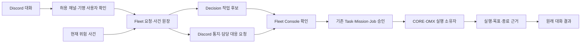

# Discord 대화와 ROSY Fleet 파이프라인 점검

2026-10-12. 점검 기준 소스 `c41dfcb0a`. 결정 제안: [D-669](../adr/D-669-discord-work-intake-and-fleet-response-boundaries.md).
사용자 방향: 대화로 작업 요청, 기본 관리·규약은 Fleet Console, 위험 상황은 Discord 관리·대응.

## 현재 연결과 확인한 공백

| 구간 | 현재 소스/증거 | 개선할 부분 |
|---|---|---|
| Discord 알림 | `fleet/incidents/notifications.py`; 별도 연결 확인 1건 HTTP 200·메시지 ID·UI 수신 | 실제 Fleet outbox 경로와 기명 인수·종료까지 별도 수용 필요 |
| Discord 대화 수신 | 구현 없음 | Bot transport·허용 guild/channel·자기 메시지 제외·기명 사용자 연결 |
| 자연어 작업 후보 | 기존 Decision 후보 계약은 있지만 대화 입력 계약 없음 | 기존 관측/대상 grounding 재사용; 모호함은 질문/보류; provider HOLD 유지 |
| 구조화 실행 | `core_common.intent`, `server/intent_routes.py` | JSON 실행 문법을 자연어 parser처럼 사용하지 않음; Discord에서 직접 do/teleop 호출 금지 |
| 작업 승인 | `server/mission_routes.py`, `proposal_store.py`, Task store | 일반 Mission의 동일 owner와 Cell Job의 독립 approver 구분 유지 |
| 사건 담당 인수 | `incidents/handoff.py`, `console_routes.py`, `incident-view.js` | Discord principal 연결 후 기존 인수 경로 재사용; 현재 사건·revision 재확인 |
| 결과 확인 | `execution/site/goal_evidence.py`, `workflow.py`, Fleet progress | HTTP 200·알림 수신·ACTION_SUCCEEDED를 실제 목표 달성으로 표현하지 않음 |
| 원래 대화 결과 | 사건 OPEN/CLOSED 통지만 구현 | 요청 message→작업/사건→결과 revision→reply 관계와 중복·UNKNOWN 처리 |
| 설치·운영 | webhook만 준비; Bot transport와 Fleet runtime 설정 없음 | wheel/sdist/source/native closure, 기명 계정·실제 Console HTTPS, 기본 OFF 활성화 계약 |

점검 중 사용자 계정에서 Rosy Fleet Bot application을 생성했다. 사람 확인은 사용자가 직접 완료했다. application 생성은 서버 설치·Bot token 발급·Gateway 접속·Fleet 계정 연결이나 대화 intake 구현이 아니다. 세 privileged intent는 꺼져 있으며 실제 실행 권한을 부여하지 않았다.

이 공백은 구현이 없다는 뜻이며 확인하지 않은 현장 장애를 추정한 목록이 아니다. 기존 outbox와 기명 인수의 transaction/freshness 검사는 유지한다. 특히 `LineStuckBoard.judgment_view`는 읽을 때 근거 나이를 재평가하므로 그 검사를 중복 구현하지 않는다.

## 분리할 파이프라인

일반 요청은 사람의 의도를 보존하는 draft이며 바로 Mission이나 장치 요청이 아니다. 현재 사용자/대상/지도·capability에 맞는 구조화 후보가 생긴 뒤 기존 Console에서 확인한다. 잘못된 위치를 임의 좌표로 대체하거나 현재 map/source lineage를 바꾸지 않는다. 요청 문장에 여러 작업이 있으면 첫 버전은 한 작업씩 확인한다.

위험 대응은 현재 사건의 ID·근거·판단 revision을 먼저 고정한다. 알림 답변·담당 인수·정지 요청·복구 이동·해소는 서로 다른 기록이다. ‘제가 처리할게요’는 인수 요청으로 검토하며 관측상 해소나 실행 성공으로 기록하지 않는다. 연결/원장 실패는 UNKNOWN/보류로 남기고 CORE 보호를 계속 유지한다.

첫 사건 대응의 현재 owner는 Pinky 차선 정지 board/handoff다. 배터리·trip·카메라 신뢰·Arm Action 실패는 각각의 기존 상태/사건 owner를 확인한 뒤 연결하며, line-stuck API를 모든 위험의 범용 인수 API로 재해석하지 않는다. 현재 주행 Task는 navigate, 일반 Mission은 고정 workcell PICK_PLACE, Cell Job은 제한된 pallet.transfer이므로 대화 입력만으로 혼합 장치 실행 범위를 넓히지 않는다.

Discord의 표시 이름으로 Fleet operator를 만들어서는 안 된다. Bot token, webhook, Fleet 계정 credential, provider credential을 서로 분리한다. 공개 문서·스크린샷·로그에 token을 넣지 않는다. 관리자에게 이미 존재하는 채널의 권한과 기명 principal 연결을 확인받아야 한다.

## 증거 구분

이번 Discord 연결 확인은 수동 webhook 전송 1건이며 Fleet outbox/장치 경로가 아니다. 비공개 receipt와 화면은 X의 `discord-channel-setup` 세션에 보관했다. 실제 Fleet 자동 알림·대화 수신·기명 인수·현장 결과는 아직 미확인이다. 기존 D-640 source 착지와 remote 시험은 실제 launcher/provider/FIELD 승격이 아니다.

소스·설치·원격 fake → 비공개 운영 설정 → 실제 요청 수신/Console 인수 → 장치 없는 승인 경로 readback → 별도 승인된 제한 장치 수용 → 목표 증거/대화 결과 순으로 진행한다. 현재 로봇 오프라인 조건에서 마지막 장치/현장 단계는 통과했다고 집계하지 않는다.

## Discord transport 근거

2026-10-12 공식 [Gateway](https://docs.discord.com/developers/events/gateway), [권한](https://docs.discord.com/developers/topics/permissions), [webhook](https://docs.discord.com/developers/resources/webhook) 계약을 확인했다. 첫 수신 범위는 Bot을 명시적으로 mention한 지정 채널 대화다. mention 메시지의 본문은 privileged MESSAGE_CONTENT 없이도 제공되므로 전체 채널 대화 열람을 위한 intent를 먼저 켜지 않는다. Gateway 재접속/Resume은 이벤트를 재생할 수 있어 transport seq만으로 작업 중복을 막지 않고 Fleet 요청 ID/hash를 유지한다.
