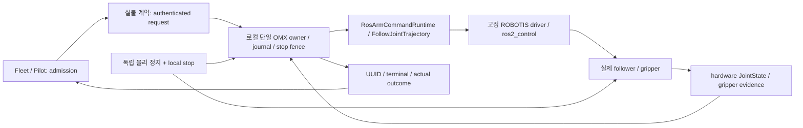

# OMX AI 실물 제어 완성 목표와 구조

상태: 진행 중. **실물 제어 완료 또는 활성화 수용이 아니다.**
사용자 요청: 실제 OMX AI 제어 구조를 완성하고 딸기 왕복을 수행한다.
기존 [D-496](../adr/D-496-omx-hardware-arm-control-acceptance.md)의 Proposed 상태를 이 문서로 승격하지 않는다.
실행은 [실물 제어 실행 계획](2026-10-15-omx-hardware-control.md)에 둔다.

## 목표와 끝난 기준

완료란 명령을 보낼 API가 생긴 상태가 아니다. 실제 rig/profile에 묶인 요청을 접수하고,
한 로컬 owner가 벤더 controller로 보내며 실제 관절·그리퍼 피드백과 종단 결과를 읽고,
정지·장애·복구 뒤 중복 실행 없이 Fleet/Pilot에서 결과를 확인하는 상태다.
최종 교육 과제는 흰 용기에서 딸기를 꺼내 [선정 구역](../validation/omx-strawberry-placement-2026-10-15/result.md)에
놓고 원래 용기로 복귀하는 것이다. camera pixel을 직접 목표 관절/metric 위치로 쓰지 않는다.

| 완료 항목 | 필요한 증거 |
|---|---|
| 실제 follower 선택 | USB 물리 연결·leader/follower 역할·firmware·ordered joints·단위의 확인 |
| 지원 runtime | 선택한 OS/ROS와 고정 벤더 source의 native build·설치·실행 readback |
| 측정 profile | EEPROM/기구 한계·속도·하중·workspace·jaw·보정·revision과 측정 기록 |
| 단일 writer | 버스·graph·instance 배타성, stale/재시작/lease/stop 차단 시험 |
| 요청과 결과 | 접수·ROS UUID·실제 feedback·종단·취소 미확인 분리, 원장 readback |
| 물리 정지·복구 | 독립 정지 수단과 실제 정지, 처짐/통신·전원 상실·재시작 및 명시 재개 |
| 사용자 흐름 | 실물 Pilot driver·Fleet admission·관측/녹화·실패 복구의 실제 UI 확인 |
| 딸기 왕복 | fresh 시퀀스·보정된 위치·감독 조건·단계별 독립 outcome |

## 현재 확인된 단절

2026-10-15 현장 기본 native 환경은 Ubuntu 26.04.1, Python 3.14.4, ROS Lyrical이다.
`/opt/ros/jazzy`는 Lyrical을 가리킨다. 폴더 이름만으로 Jazzy 수용을 인정하지 않는다.
저장소 `stack.lock.yaml`의 대상은 Jazzy이고 벤더 source는 immutable revision이다.
기본 환경에서 `controller_manager`는 있지만 `open_manipulator_bringup`, description,
`dynamixel_hardware_interface`, `joint_trajectory_controller`, `omx_adapter`는 발견되지 않았다.
기본 환경 밖의 미탐색 overlay에 대해서까지 부재를 주장하지 않는다.

읽기 전용 domain 13 discovery에서 팔 Action은 없고 `/joint_states`의 publisher는
`joint_state_publisher`였다. 이는 물리 feedback을 입증하지 않는다. OpenRB USB 두 개는
접근 가능하지만 어느 것이 follower인지, 모터가 연결·통전됐는지, firmware·한계는 미확인이다.
따라서 serial 포트를 열거나 driver를 기동·활성화하지 않았다.

## 재사용할 경로와 구현할 연결

이 그림은 완성 목표이며 현재 설치된 연결을 표시하지 않는다.

- `command_owner.py`와 `ros_runtime.py`: 이미 single owner·freshness·한계·timeout/HOLD·UUID/feedback/terminal이 있다. 같은 정책을 재사용한다.
- `local_stop.py`, `owner_recovery_api.py`, Action store/API: 소프트웨어 latch·generation·원장·재개를 재사용한다. cancel ACK를 물리 정지로 승격하지 않는다.
- `rosy_agent/omx_cell_owner.py`와 `run_cell_owner.py`: SIM composition이다. `simulation=True`, SIM profile, `sim_gripper_observation`, sim clock를 실물에서 재사용하지 않는다.
- Pilot 실물 driver와 API는 아직 계약 미확정이다. SIM endpoint에 hardware 플래그를 넣지 않는다. 계약·공유 schema·API reference·driver/asset/Android 등록을 같은 변경으로 만든다.
- AI PC는 승인된 관측/후보, 모델 PC는 학습·독립 평가다. 팔의 최종 writer는 local OMX owner이며 CORE는 base `/cmd_vel`을 계속 소유한다.

## 선택한 순서

먼저 현장 누락을 재현 가능한 **읽기 전용 software readiness**로 고정한다. 이 진단은
패키지·ROS 배포판·typed Action·JointState publisher를 확인하며 serial open·controller 실행·goal 전송을 하지 않는다.
positive graph에서도 motion admission은 항상 false다. node 이름은 물리 provenance가 아니기 때문이다.

그 뒤 현재 OS를 유지한 native Lyrical 호환성을 별도 비구동 build로 평가한다.
이 평가 전 Lyrical을 지원 runtime으로 선언하거나 source lock을 느슨하게 하지 않는다.
불가능하면 별도 native Jazzy host 또는 호스트 재구성이 필요하며 운영 host의 ROS/OS를 자동 교체하지 않는다.
기존 카메라 환경은 계속 동작하게 둔다. OCI는 개발 시험용이며 현장 actuator runtime으로 바꾸지 않는다(D-246).

벤더 고정 [omx_f.launch.py](https://github.com/ROBOTIS-GIT/open_manipulator/blob/0a4af6a923b8b7d80b8c20506d1839c54d2e993e/open_manipulator_bringup/launch/omx_f.launch.py)에는
`init_position=true`인 시작 동작과 controller spawner가 있다.
단순 launch가 무동작 준비라고 가정하지 않는다. 실물 진입점은 자동 초기 위치 이동을 제거하고,
driver configure/activate가 torque·목표값에 미치는 영향까지 검증한 뒤 사용한다.
정지 불명 상태에서 torque-off를 실행하면 팔이 처질 수 있으므로 안전 정지 대용으로 쓰지 않는다.

10/15 후속 비구동 검증에서 고정 벤더 8패키지와 ROSY adapter가 현장 Lyrical의 별도 prefix에
빌드됐다. controller 관련 4개 배포 패키지도 시스템 설치 없이 별도 prefix에 추출해 검사했다.
두 핵심 라이브러리의 `ldd` 누락은 0이다. 이는 build/link 준비이며 지원 runtime 승인·driver lifecycle·
실물 실행 수용이 아니다. [준비 결과](../validation/omx-hardware-control-preparation-2026-10-15/result.md).

측정 profile·독립 stop이 없는 동안 할 수 있는 것은 source 구현·비구동 build·오프라인/ROS-SIM 시험이다.
하드웨어 미실측 상태에서 빈값을 SIM 명목값으로 채우거나 가짜 JointState로 관문을 넘기지 않는다.
