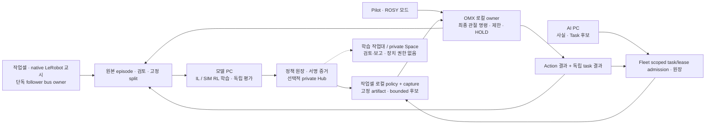

# OMX 암 학습·운용 통합 설계

상태: **제안 설계**. 구현·배포·학습 정책 또는 실물 운용 수용 기록이 아니다.
기준 소스: `64d15df7` · 브랜치: `docs/omx-learning-operations-plan`.
사용자 확정 첫 과제: **고정 작업대에서 가벼운 부품을 집어 트레이로 옮긴다**.
실행 작업은 [통합 실행 계획](2026-10-15-omx-learning-operations.md)에 둔다.

## 1. 목표와 기존 정본

운영자가 작업셀 준비 → 교시·시연 → 검수 → 학습 → 독립 평가 → 승인 → 제한 운용 →
결과 확인을 끝낼 수 있게 한다. 모방학습(IL)과 강화학습(RL)의 데이터·실행 경로와
Web UI/UX를 함께 계획한다. 새 범용 학습 플랫폼이나 별도 관리자 대시보드는 만들지 않는다.

| 기존 정본 | 계속 소유하는 내용 |
|---|---|
| [D-273](../adr/D-273-omx-camera-stream-and-arm-control-order.md) | 고정 작업대·카메라 보정·규칙 집기 기준선과 단계 순서 |
| [D-427](../adr/D-427-platform-three-parts-middleware-operations-learning.md) §4–5 | 학습 산출물·승격·RL 실행 조건 |
| [D-449](../adr/D-449-learning-artifact-and-owner-binding-contracts.md) | 산출물 provenance와 owner binding |
| [D-756](../adr/D-756-omx-imitation-preparation-and-resumption-gates.md) | Accepted인 IL 준비·보류·재개 조건 |
| [10/14 IL 설계](2026-10-14-omx-imitation-preparation-design.md) / [실행](2026-10-14-omx-imitation-preparation.md) | native 녹화·검토·ACT·private Hub·Spaces 세부 절차 |
| [10/14 SIM 준비](2026-10-14-omx-simulation-preparation.md) | Gazebo 우선, 이미지·자원·실행 관문 |
| [실물 팔 설계](2026-10-07-omx-hardware-arm-enablement-design.md) | B0–B8 실측·정지·그리퍼·Pilot 확인 |
| [D-496](../adr/D-496-omx-hardware-arm-control-acceptance.md) | **Proposed**인 실물 API·프로필·BENCH→DEVICE 조건 |

이 문서는 위 상세계획을 복제하거나 Proposed 결정을 승인하지 않는다. 새 공개 API,
모드·권한·스키마 및 새 모듈 holder는 구현 전에 ADR·SRS/API reference·공유 계약을
같은 변경으로 확정한다. 과거 문서의 경로·실물 미도착·노트북 시험 문구는 당시 이력이다.
현재 경로와 원격 전용 pytest 규칙을 사용한다.

## 2. 현재 증거와 부족한 부분

| 영역 | 지금 확인한 것 | 아직 완료가 아닌 것 |
|---|---|---|
| 카메라·추론 | 실제 USB top/front 미리보기, 기본 수신기 약 10 FPS, watchdog 복구, 새 JPEG의 Model/AI PC Qwen 응답 | 노출시각·동기화 녹화·CameraInfo·hand-eye/TCP, ACT 정책·연속 AI→Fleet 소비 |
| 실물 | 두 OpenRB USB 항목 발견 | 실제 leader/follower 역할, 실측 joint/gripper/충돌 profile·관절 feedback·정지 수용 |
| 수집·IL | config 검사·native reader 검토/분할·ACT 준비와 합성 CPU smoke 코드 | 실물 시연, 실제 데이터 GPU 학습·일반화·과제 성공 |
| 정책 | registry·설치 binding·owner/lease/stale/HOLD·journal 경계 | 승인된 실물 조작 정책과 실제 설치·실행·과제 receipt |
| RL | D-427의 계약·진입조건 | OMX 환경·reward·curriculum·trainer·독립 evaluator |
| Web | Pilot SIM 팔, Fleet Cell, 기존 검수/학습 작업대 | 실물 Pilot·episode 검수·OMX/RL job 제어·승격/배포의 종단 UI |

2026-10-15 고정 `8223bb893e`의 관련 원격 시험은 703 passed·7 skipped·NEW 0이다.
이는 준비 도구와 연결 시험이며 학습 정책 품질 증거가 아니다. 기존
[ACT 평가](../validation/omx-act-offline-2026-10-04.md)와
[다양한 SIM 평가](../validation/omx-diverse-sim-act-2026-10-04.md)는 상수 기준선보다
나빠 reject였다. 성공한 대화·영상 설명을 조작 정책 성공으로 표시하지 않는다.

## 3. 선택한 접근과 첫 과제 카드

IL만 완성하면 가장 빨리 기준선을 얻지만 RL 빈칸이 남는다. IL과 실물 RL을 동시에
켜면 수집·정지·보상·평가 실패의 원인을 분리하기 어렵다. **IL 운용 흐름을 먼저 닫고,
같은 과제의 SIM RL을 별도 실험으로 병행 준비**한다. 실물 온라인 탐험은 후속 관문이다.

| 첫 과제에서 반드시 채울 값 | 판정·사용처 |
|---|---|
| 부품 종류·실측 질량·파지 자세, 트레이와 시작 구역 | 하중·collision·과제 적용 범위 |
| leader/follower 정체, ordered joints·단위·부호·gripper 표현 | native/ROSY 변환·owner 계약 |
| rig·렌즈·작업면·hand-eye·TCP revision, 카메라별 역할 | 관측 호환성과 좌표 유효성 |
| 목표 구역·허용 오차·놓은 뒤 안정 시간·시간 상한 | 독립 성공/실패/미판정 판정 |
| 정지 수단·낙하/처짐·전원/USB 손실 후 거동 | BENCH와 재개 조건 |
| 수집·학습 담당자, 독립 평가자·승인자, PC/저장·GPU 예산 | 작업 소유·분리·자원 admission |

아직 주어지지 않은 질량·오차·시간·성공률을 임의로 채우지 않는다. 값과 검증자가
없으면 데이터 준비·SIM 연구까지만 진행한다. 첫 10 pilot episode는 동기화 점검용이며
충분한 학습량을 뜻하지 않는다. D-273의 분리된 30회 중 27회 초기 실증 목표는
실측 조건을 정한 뒤 사용하고, 생산 신뢰도나 다른 부품·배치로 일반화하지 않는다.

## 4. 데이터와 제어의 연결

- native 교시는 LeRobot이 버스를 단독 소유한다. ROSY 모드에서는 OMX owner가 최종
  trajectory writer다. 모드 전환은 입력 차단 → 정지 readback → 이전 owner 종료·포트
  해제 → 새 binding·상태 확인 → 사람 시작 순서다. 녹화 종료는 물리 정지가 아니다.
  native 교시/녹화 중 운영 owner/Action Gateway는 정지하고 Fleet은 장치를 사용 불가로 본다.
- 모델 PC는 학습·독립 평가, AI PC는 승인된 사실/Task 후보 추론, Fleet은 원장·admission을 맡는다.
  반응형 ACT/RL 추론은 장치 미들웨어와 같은 작업셀 호스트에서 한다. D-427이 유지하는
  D-399의 추론 위치와 D-231 §4를 명시적으로 개정한 별도 ADR·전송/지연/안전 계약 전에는
  원격 반응형 추론을 수용하지 않는다. 원격 모델 응답·브라우저 heartbeat를 제어 주기로 쓰지 않는다.
- Fleet PC와 작업셀 PC가 같은 컴퓨터여도 프로세스·venv·권한·저장·자원 예산은 분리한다.
  CORE의 최종 base `cmd_vel` 권한은 변경하지 않는다.
- SIM의 domain·GZ partition·localhost 경계는 기존 Compose를 따른다. 실물 preview와
  테스트 domain을 합치지 않는다. SIM profile·가짜 joint state로 실물 진입조건을 채우지 않는다.

## 5. 모듈별 최소 확장

| 책임 | 재사용할 현재 경로 | 필요한 확장 |
|---|---|---|
| 장치·녹화 준비 | `deploy/robot/omx/{preflight.py,record_config.py}` | 실측 카드, 독점·정지·환경 lock readback |
| 원본·검수·split | `learning/curation/omx/{native_review.py,common_episode.py,lerobot_export.py}` | 실제 episode 품질·결과 검토, UI 연결 |
| IL | `learning/training/omx/{act_job.py,act_inference.py,native-act.example.json}` | 기존 공식 CLI 우선으로 실데이터 학습·재적재 |
| 공통 계약 | `contracts/learning/src/rosy/contracts/learning/` | native action mapping, RL transition·reward/eval 계약 제안 |
| 원장·전달 | `learning/registry/policy/{registry.py,dataset_store.py,hub_sync.py,fleet_join.py}` | 실제 private 왕복·정책/데이터 호환·현장 receipt |
| 로컬 실행 | `middleware/robot_execution/local/src/rosy/execution/local/` | 기존 policy install/runtime/journal과 accepted hardware binding 연결 |
| 최종 팔 owner | `middleware/devices/omx/adapter/omx_adapter/` | 실물 controller·capture·profile·stop 수용 |
| 독립 평가 | 제안 `learning/evaluation/omx/` | 새 holder 승인 후 task outcome·baseline·seed 평가 |
| RL 환경 | 제안 `learning/envs/omx/` | 기존 Gazebo 작업셀의 작은 task adapter; 새 엔진부터 만들지 않음 |
| RL 학습 | 기존 `learning/training/omx/` 확장 후보 | pinned upstream config로 부족할 때만 runner 추가 |

제안 경로는 현재 존재·설치·등록된 모듈이 아니다. 신규 holder는 ADR·manifest·AGENTS·
progress/logs·시험 소유와 배포 경계를 먼저 정한다. 기존 Isaac의 OMX URDF import나
Pinky Q-learning을 OMX RL 구현으로 세지 않는다.

모든 episode는 원본 해시, task/rig/profile/보정, source·시각/clock domain, 관절 순서·
단위, requested/accepted/executed action, review·중단·개입을 연결한다. native normalized
값과 SIM ordered radians를 섞지 않는다. native action 의미는 pinned reader/fixture로 확인한다.
requested/accepted/executed가 없는 입력은 추정하지 않으며, executed 표시는 실제 owner/driver
readback이 있을 때만 쓴다. 실패·중단 원본은 보존하고, 첫 BC 학습 채택과
RL 실패 transition 사용은 서로 다른 검토 결정으로 둔다. split은 episode뿐 아니라 수집
세션·동일 내용·물체 배치 조건을 분리하며 정규화는 train에서만 만든다.

## 6. RL 계약과 실험

기존 D-427을 따른다. `reset/step`은 관측·적용 action·다음 관측·reward·종료·출처를
재현할 수 있어야 한다. envelope 이탈은 실패 `terminated`, 시간 상한만 `truncated`다.
reset의 episode 초기화와 물리 복귀를 구별하며 자동 home을 묵시적으로 넣지 않는다.
RL 관측·행동 공간은 대상 PolicyArtifact와 일치해야 한다. SIM/real 모두 같은 OMX owner·
envelope·Safety Guard를 통과하며 env 안에 병렬 제어기나 안전 우회 경로를 만들지 않는다.

- 독립 GT로 파지·이송·release·목표 구역의 안정 상태를 판정한다. 제안 모델이 자신의
  성공 보상을 채점하지 않는다. `Action SUCCEEDED`도 task 성공과 다르다.
- reward revision·근거·계수를 고정한다. 충돌·낙하·envelope 이탈·개입·timeout을 기록하고,
  shaping이 정지/개입을 회피하거나 task 성공과 충돌하지 않는지 시험한다.
- stale·거절·HOLD·연결 단절은 정상 실행 transition credit으로 넣지 않는다. 요청·실제
  적용 action의 차이, intervention, 중단 이유를 보존한다.
- 제안 curriculum: 도달/그리퍼 → 한 물체 고정 위치 → 위치·방향 변화 → 조명·외관·지연 변화.
  reward와 훈련 seed를 고정하고 독립 holdout seed·조건을 학습에 재사용하지 않는다.
- ACT/규칙/상수 기준선을 같은 조건에서 비교한다. 이후 SIM RL 알고리즘 spike로 선택한다.
  HIL-SERL은 조사 후보이며 현재 OMX 호환·ROSY owner 호환·실물 사용 수용이 아니다.
- sim2real은 관절·gripper 접촉·하중·마찰·backlash·카메라/TF·지연을 실측해 정렬한다.
  domain randomization으로 잘못된 단위·보정·기하를 덮지 않는다.

실물 RL은 local owner·envelope skill·MANUAL preempt·leader MANUAL 결정·Fleet unavailable와
연결된 학습모드 진입/해제/lease 계약·독립 E-stop 실측을 모두 갖춘 별도 후속 단계다.
모델·GPU·시간·episode·물리 시행 예산과 중단 조건도 필요하다. 운영 Fleet에서 탐험하거나
native 녹화 소유권을 그대로 RL actor 권한으로 확대하지 않는다.

## 7. Web UI/UX 사용자 여정

등록 표면 정본은 `shared/web/surfaces.yaml`이다. 기존 Pilot·Fleet·학습 작업대를 재사용한다.
현재 학습 작업대의 시작/중지/재시도는 bound perception pipeline 전용이고 OMX/policy
카드는 보고서용이다. 이를 OMX job scheduler로 표시하지 않는다.

| 단계·주 역할 | 화면에 먼저 보여 줄 것 | 행동·차단·완료 확인 |
|---|---|---|
| 준비 · 설치자 | 과제·rig·실물 신원·현재 owner·camera/frame/age/FPS·각 보정 | 읽기/진단; 누락·중복·stale에서 시작 차단 |
| 교시/제어권 · 시연자 | native/ROSY 모드·seat·진행 goal·실제 joint·HOLD 이유 | 단독 owner 확인; 모드 변경은 정지와 포트 해제 readback |
| 녹화 · 시연자 | episode ID·영상/관절 시간·frame 수·누락·디스크·저장 | 종료/재생/새 ID 재시도; 중단본 보존, stop 상태 별도 |
| 검수 · 검수자 | 영상+관절/action 비교·출처·성공/실패/미판정·사유·split | 채택/제외/충돌 재확인; 원본 삭제·성공 자동 채움 금지 |
| IL · 학습 담당자 | manifest·환경 lock·고정 설정·GPU 대기·run 단계·로그 | 허용된 작업만 실행; 요청 접수/running/terminal 구별 |
| RL · 연구 담당자 | SIM 환경·reward/종료·seed·제약 위반·예산·baseline | SIM 실험만; reward 증가만으로 배포하지 않음 |
| 평가/승격 · 독립 평가자/승인자 | 성공/전체·개입·실패 영상·hash·단계·서명 증거 | 독립 판정·권한 있는 metadata 승격; 실행 승인과 분리 |
| 전달/적용 · 배포 담당자 | 현재/후보/이전 revision·rig 호환·검증·적용 상태 | 비활성 전달→검증→승인된 적용→실제 재적재 확인 |
| 운용/복구 · 운영자 | Fleet task→owner goal→실제 상태→task 결과 | 명시적 시작/정지/취소; 재연결 자동 재개 금지 |

Pilot은 기존 `screens/arm.js`, `recording.js`를 활용하되 `drivers/omx_sim.js`의 SIM guard를
유지한다. 실물 driver/API는 별도 계약 뒤 추가한다. Android pairing/proxy/bundle도 함께
검증하며 Pinky의 DEVICE GO나 GroupDrive를 OMX 실물·leader 교시 수용으로 사용하지 않는다.
Fleet의 설치/Cell/관제에는 각자 소유한 준비·admission·운용 상태를 표시하고, episode
검수·학습 상세는 기존 review `learning.html` 작업 안에 연결한다.

Robot 상세, Cam, robot-face/LCD, game-board, control-diagnostic, lane-live-view, pilot-shell,
web-common까지 영향 여부를 확인하되 무관한 표면에 학습 조작을 추가하지 않는다.
객체/픽셀 승인과 episode 승인을 혼동하지 않는다. private Space는 고정 결과 읽기 전용이다.

모든 행동은 권한·차단 사유와 다음 복구 행동을 함께 보여 준다. 자료 없음/필터 결과 없음/
권한 없음/서비스 오류를 구분하고, 중복 클릭·409 충돌·중단·재로그인에서 편집과 원본을
보존한다. SHA·JSON은 상세에 두고 한국어 작업 상태를 먼저 보인다. 키보드·터치·명확한
focus·색 외 상태 설명·긴 사유·200% 확대·좁은 화면·Android 가로/세로를 검증한다.

## 8. 평가·승격·중단

현행 artifact 단계는 `unregistered → L0 → L1 → L2 → L3`다. L0는 `offline_eval`,
`sim_eval`, `owner_contract`, `independent_task_outcome` 네 증거 모두를 요구한다.
L1은 shadow·stop readback과 visual policy의
known camera profile, L2는 restricted-use, L3는 registered-scope 평가를 더 요구한다.
**원장 metadata 승격·전달·설치·runtime admission·실제 과제 성공은 별개**다.

평가는 성공/전체와 실패·미판정, 개입, 충돌/낙하, cycle/inference 지연, 관측 age·drop,
owner 거절·stop readback을 함께 남긴다. 모델/config/processor/정규화·dataset/split·rig/
profile/보정·소스·환경·reward·seed를 고정한다. 학습자는 평가 조건을 보고 재학습한 결과를
같은 독립 평가로 재사용하지 않는다.

새 입력 중단 → 현재 행동 종결 또는 정지 readback → 승인된 이전 artifact 검증 → 새 session
순서로 rollback한다. 실행 중 weight hot-swap, 자동 재학습·승격·재개는 넣지 않는다.
source/remote/SIM/artifact/BENCH/DEVICE/FIELD의 완료 증거와 차단 사유를 각각 표시한다.

## 공식 참고

- [LeRobot v0.4.4 HIL-SERL](https://huggingface.co/docs/lerobot/v0.4.4/hilserl): actor/learner 조사 후보.
- [Gymnasium 종료·시간 제한](https://gymnasium.farama.org/v0.26.3/tutorials/handling_time_limits/): transition/eval 구분.
- 버전은 기존 LeRobot 0.4.4 기준과 따로 잠근 recorder/GPU/SIM 환경으로 검증한다.
  direct requirements만으로 완전 lock을 주장하거나 latest로 자동 변경하지 않는다.
