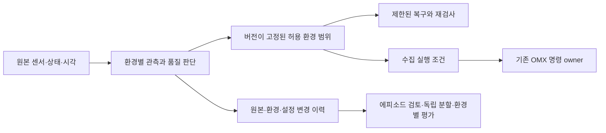

# OMX 환경 조건을 포함한 수집·학습 구조

## 목적과 범위

사용자 요구는 어둠에 대한 일회성 보정이 아니라, 예상 환경 범위를 먼저 정하고
환경이 바뀔 때 관측·실행·데이터 채택·평가가 일관되게 대응하는 구조다.
[D-770](../adr/D-770-fleet-omx-autonomous-imitation-pipeline.md)의 실제 데이터 완료 기준을 유지한다.
조도 센서 없는 RGB 영상의 밝기는 lux 측정값이 아니다. 이미지 상태와 실제 환경 확인을 분리한다.

## 경계

이 그림은 목표 연결이다. 이번 구현은 카메라의 B·D·G와 만료되는 photometric receipt다.
수집 executor가 receipt 만료/품질 저하를 받아 기존 owner로 HOLD/stop을 요청하는 결선과
에피소드·학습 manifest에 환경 원본을 byte-bound하는 결선은 미완료다. 카메라 service가
관절 Action이나 torque를 직접 제어하지 않는다. 최종 실물 admission은 기존 owner 책임이다.

## 환경 범위와 실패를 먼저 정한다

| 조건 | 입력과 판단 한계 | 대응 | 수집·평가에서 확인할 것 |
|---|---|---|---|
| 보통 밝기 | RGB 밝기·암부·포화·대비·공간 구조 | 별도 설정 쓰기 없이 지속 관측 | 실제 물체·집게 식별과 독립 결과 판정 |
| 어두움 | 영상의 UNDEREXPOSED, lux는 unknown | 범위가 확인된 dark 후보만 적용 | 노이즈 증가를 밝기 개선과 구분, 암실 실패도 보존 |
| 과다 노출 | 포화 비율과 OVEREXPOSED | 별도 bright 후보로 노출/gain 감소 | 흰 물체·반사체·강조도 실제 조건별 수용 |
| 밝은 영역과 깊은 그림자 | MIXED_LIGHTING, 원인은 미확정 | 자동 gain 증폭을 시도하지 않고 unsupported 보고 | 관심 영역의 정보 소실·역광·반사 사례를 따로 검토 |
| 대비/공간 구조 부족 | LOW_CONTRAST 또는 LOW_SPATIAL_SIGNAL | 어둠으로 단정해 노출을 반복하지 않음 | 균일한 배경·노이즈·가림의 원인을 독립 확인 |
| 프레임 간 밝기 변화 | 최근 advancing sample의 밝기 변동 | temporal hold 뒤 안정된 조건을 다시 확인 | 조명 깜빡임·물체 이동·자동 노출을 원인별로 구별;10Hz로 전원 주파수 flicker 검증하지 않음 |
| 영상 지연·단절·재생 | source/receipt age, stamp, sequence | 최신 조건을 폐기하고 confirmation 초기화 | 단절 구간·불완전 episode 보존, 자동 성공 라벨 금지 |
| 카메라/물체/기구 배치 변경 | rig·calibration·scene revision 및 실제 시야 | 기존 revision의 실물 수용을 재사용하지 않음 | 가림·작업대·물체·배경별 coverage; 현재 자동 검증 미구현 |
| 통신·저장·부하·장치 상태 | 각 기존 owner/host의 실제 telemetry | 해당 owner의 제한·중단 정책과 합성 | 쓰기 실패·누락·시간 초과·hardware fault를 환경 실패와 함께 기록 |
| 온도·진동 등 미계측 항목 | 확인된 telemetry 없으면 unknown | 임의 정상값을 채우지 않음 | 필요 센서/시험과 허용 범위를 정하기 전 지원 환경으로 선언하지 않음 |

모든 환경에 대응한다는 주장을 하지 않는다. 각 항목에는 관측 출처, 시각, 정책 revision,
수치 범위, 복구 한계, 독립 수용 증거가 있어야 한다. 이미지 조건이 정상이어도 실제 물체
가시성·보정·하중·기계 간격·정지 수용이 빠지면 실물 준비 완료가 아니다.

## 이번 카메라 구현

- `camera_quality.py`: 원본 프레임의 정적 조건. 혼합 명암을 단순 어둠/과다 노출보다 먼저 판단한다.
- `camera_environment.py`: 지속적인 조건 전이, entry/exit 각3회의 advancing sample,
  완료된 적용/readback 이후5초 cooldown과1초 settling. 설정 뒤의 host receive cutoff를
  넘은 sample만 재확인한다. exposure timestamp 동기화는 미검증이다.
- dark와 bright 후보를 별도로 둔다. 같은 조건에서 후보를 소진하면 멈추지만, 충분히
  확인된 다른 조건/정상 복귀 뒤에는 새 epoch로 재평가한다. 과거 어둠에서 고른 best를
  밝은 epoch에 재사용하지 않는다.
- 실제 설정 시도는 실패·partial·best 선택을 포함해 두 카메라 합계 분당6 batch로 제한한다.
  budget은 durable 파일에 먼저 예약하고 재시작 뒤에도 유지한다. budget 소진은 기다리고,
  clock rollback/기록 이상은 중단한다. 마지막 baseline 복구는 budget과 별도로 항상 시도한다.
- policy는 v3다. 구형 viewer 판단을 섞지 않는다. readiness에 run ID, 환경 epoch,
  control generation, 조건·전이·시각 경계를 넣고 환경/설정 변화를 append-only 기록한다.
- viewer는 원본 카메라 producer를 대체하지 않는다. profile 변경 시 원본 baseline을
  덮어쓰지 않고 새 state directory로 옮긴다. 단독 장치 소유와 producer identity를 다시 확인한다.

## 데이터와 학습으로 연결할 계약

1. episode 원본에 환경 이력의 hash와 시간 범위, run/profile/rig/calibration revision을 묶는다.
   원본 RGB·요청/실제 명령·feedback·중단 원인은 그대로 보존한다. 추정된 이미지 조건을
   사람이 확인한 환경 정답이나 물체 성공으로 취급하지 않는다.
2. 정상/어둠/강조도/혼합/변동/unknown의 실제 수량과 실패·개입 수량을 별도로 보고한다.
   품질 부족 원본을 지워서 정상 수량을 늘리지 않는다. 성공 BC 채택은 기존 사람 검토를 거친다.
3. session/parent cycle 독립 분할을 유지한다. 프레임별 환경 분류를 이유로 같은 cycle을
   train과 test에 나누지 않는다. train 통계만 정규화에 쓰고 held-out 조건의 coverage를 보고한다.
4. 실제 촬영 환경·설정과 학습용 영상 증강을 구분한다. 증강으로 실제 강조도·암실 수용을
   대체하지 않는다. 최종 평가는 환경별 성공 분자/분모·중단·미판정과 데이터 부재를 표시한다.

## 검증과 남은 수용

- [x] 어둠/과다 노출/혼합/대비 부족 classifier 원격 회귀.
- [x] dark→bright→dark, 단발성 오판, stale, cutoff, persistent budget, 느린 적용 cooldown 회귀.
- [x] 실제 monitor·budget·이력·복구 helper를 사용하는 fake-scene 통합 시험으로 epoch 간 best 격리.
- [x] 관련 실제 Chromium 실행. 이것은 실물 광학 수용을 뜻하지 않는다.
- [ ] 실제 강조도·역광·조명 변화·가림·노이즈·지연을 독립 현장 조건으로 수용.
- [ ] 물체/집게 가시성과 calibration·정지·국소 구동 수용.
- [ ] 수집 executor의 환경 저하 중단·개입 결선, 환경 이력의 실제 episode/학습 manifest binding.
- [ ] 실제 시연과 모델 PC 학습·재적재·환경별 독립 실물 평가.

실제 조명이 꺼진 환경의 camera-only 실행과 설정 복구는 별도 검증 기록으로 남긴다.
강한 조명의 실물 증거가 없으면 소스 시험과 구분한다. 시연 데이터는 계속0회다.
