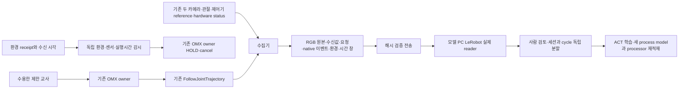

# OMX 실물 시험 전 연결과 다음 날 실행

2026-10-17 준비, 2026-10-18 첫 실물 시험을 위한 실행 안내다.
[D-770](../adr/D-770-fleet-omx-autonomous-imitation-pipeline.md)의 실제 데이터 완료 기준을 유지한다.
오늘은 구동 없이 소프트웨어를 연결한다. 실물 수용과 실제 시연·학습은 별도 증거다.

## 연결한 경로



`collection_cli.py`가 `check`, `preflight`, `collect`, `rehearsal-suite`를 제공한다.
실물 수집은 기존 ROS publisher를 구독하며, 환경 receipt에 해당하는 정확한 원본 image stamp를
유한 buffer에서 선택한다. action label은 실제 JTC controller-reference를 정규화한 값이다.
요청한 최종 목표를 실제 전달값으로 바꾸어 기록하지 않는다. native rad 요청·관절 피드백·원본 RGB·
host 시각을 별도로 보존한다. 정규화 endpoint와 native 관절 순서는 실측 profile의 선언이다.

`collection_ros.py`는 기존 `RosArmCommandRuntime`을 사용한다. 카메라 receipt가 실물 명령 권한을
부여하지 않는다. 동일 ROS domain/action의 canonical lock, 다른 Action client 배제, 유일한
기대 server/publisher와 GID, controller/watchdog PID·시작 시각·binary hash를 확인한다.
native 목표 수용과 종료가 같은 command/goal인지 확인하고 기존 owner의 정상 READY 전이를 거친다.
HOLD를 자동 해제하거나 재접속 뒤 실행을 재개하지 않는다.

독립 감시는 승인 만료·센서/환경/프로세스 이상·전체 실행시간 만료를 받아 HOLD를 요청한다.
ROS 이벤트 callback은 bounded queue에만 기록하며 파일 fsync를 기다리지 않는다. 저장 실패 시에도
stop 요청을 먼저 한다. 취소 응답·terminal·HOLD는 물리 정지 또는 하중 지지의 증명이 아니다.
별도 검수된 장치 watchdog과 현장 정지 수단이 필요하다.

원본 manifest의 `complete`만 바꾸어 데이터로 채택할 수 없다. 변환기는 teacher hash,
단계별 INTENT/수용/native goal/result/terminal, ABORT 부재, owner HOLD·terminal 종료와 최소2frame을
재검증한다. complete는 기록 종료이며 물체 과제 성공이 아니다. 사람 결과 판정은 unknown으로 시작한다.

## 오늘 실행 가능한 시험

양쪽 PC에 동일한 커밋 `b88eee5f18`의 소스293개를
`~/rosy-test/omx-collection-b88eee5f18/`에 배치했다. 각 PC의 `staging-receipt.json`과
`source.json`에 검증 결과와 파일 hash가 있다. 양쪽6개 모의 시나리오가 통과했고 모터 목표는0개다.
Fleet의 실제 ROS import와 모델 PC의 LeRobot0.4.4 import도 통과했다.
Fleet private 예시는 `~/.config/rosy/omx-collection/`에 있으며 `source-root`가 배치 경로를 가리킨다.
수집 systemd unit은 설치 후 inactive로 확인했다. 실행 env와 실측 수용 입력은 아직 채우지 않았다.
모델 PC 진입점은 `~/rosy-test/omx-collection-b88eee5f18/model-il`이다.
strict SSH/scp-3로 양쪽 PC 사이52byte 시험 파일의 hash 일치도 확인했다. 실제 collection 전송은
첫 수집 뒤에 검증한다. [고정 검증 기록](../validation/omx-next-day-collection-2026-10-17/result.md).

Fleet 또는 소스 snapshot에서 다음 명령은 ROS나 장치에 연결하지 않는다.

```bash
python3 deploy/robot/omx/collection_cli.py rehearsal-suite --out <새-시험-디렉터리>
```

정상, 어두움, 센서 단절, reference 만료, owner 거절, terminal 실패를 시험한다.
rehearsal 원본은 `mode=rehearsal`, `source_mode=simulation`이며 실물 intake가 거부한다.
수집 소프트웨어 시험과 광학·기구·powered stop 수용을 구분한다.

## 내일 실물 시험 전에 채울 입력

private profile·teacher·acceptance 예시는 `deploy/robot/omx/collection-*.json.example`이다.
실측 이전 예시는 `enabled=false`, 빈 목표/범위, false 수용값으로 유지한다.
profile와 teacher의 canonical SHA-256은 `collection_profile.digest`로 계산한다.
수용 receipt는 그 두 hash·rig/보정 revision·유효기간을 묶으며 실제 검수 후에만 발행한다.

| 실물에서 확인할 항목 | 반영할 입력 |
|---|---|
| 국소 관절/집게 범위·속도·가속도·시작 허용차 | owner_config의 실측 제한, native rad teacher 단계 |
| native 좌표와 기존 normalized 단위의 대응 | 여섯 normalization endpoint와 calibration_revision |
| 실제 물체/집게 시야·작업공간·하중·전원 차단/정지 | acceptance의 해당 검수 사실과 rig_revision |
| 기존 controller와 독립 watchdog 활성·정지 수용 | 실제 PID/start ticks, controller binary SHA-256 |
| 기존 topic/server/publisher의 단독 소유 | ROS 배치와 기대 node/namespace |
| 실제 촬영 주기·누락·reference/관절/카메라 시차 | fps, max_frame_jitter_s, freshness/skew 제한 |

설정 예시10Hz는 측정 결과가 아니다. 허용 주기를 못 지키면 수집을 중단하며 frame 복제나 시간축
보간으로 수량을 채우지 않는다. 실제 시각은 raw와 native dataset의 `source.*_time_ns`에도 남긴다.
host 수신 시각이며 sensor exposure 동기화는 아니다. 환경 receipt 재조회는 원본을 중복 저장하지 않는다.
환경 묶음은8MiB 제한이며 대규모 수집은 그 한계를 넘기 전에 별도 묶음 전략을 검토한다.

## Fleet PC 실행 순서

기존 승인된 native controller와 독립 watchdog을 현장 검수 경로에서 준비한다. collector는 이를
시작하거나 torque/보정/제한을 변경하는 도구가 아니다. 실측·정지·시야 확인 뒤 해당 private 입력으로
진행한다. 코드 수정이나 새 recorder 구현 없이 다음 순서로 실행할 수 있다.

```bash
python3 <source-root>/deploy/robot/omx/collection_cli.py check --profile <profile.json> --teacher <teacher.json> --acceptance <acceptance.json> --out <새-check-경로>
python3 <source-root>/deploy/robot/omx/collection_cli.py preflight --profile <profile.json> --teacher <teacher.json> --acceptance <acceptance.json> --out <새-preflight-경로>
python3 <source-root>/deploy/robot/omx/collection_cli.py collect --profile <profile.json> --teacher <teacher.json> --acceptance <acceptance.json> --out ~/rosy-test/omx-collections/<session> --episodes 1
```

`preflight`는 구독/기존 owner 준비를 확인하며 목표를 보내지 않는다. 첫 수집은 한 세션 한 시도로
시작한다. 원본 확인과 다음 시작 배치·정지 확인 후 별도 세션을 만든다. 첫5회 목표에는 실패와
중단도 남긴다. systemd 사용 시 `run_collection.sh`와 `rosy-omx-collection.service`를 사용한다.
필수 env가 없으면 ROS setup 전에 실패하며 Restart=no, SIGINT, 최대120초다. 자동 enable/start하지 않는다.

### 실행 환경과 남은 점검의 재개

추가 준비 묶음은 개발 PC의 gitignored `private/omx-next-day-preparation-20261017/`에 보존한다.
`manifest.json`이 묶음의 파일 hash를 확인하며 기존 `private/lab-hosts.json`만 사용한다.
실물 구동 없이 준비를 재개하는 명령은 다음과 같다.

```text
python private/omx-next-day-preparation-20261017/run-preparation.py --role fleet
python private/omx-next-day-preparation-20261017/run-preparation.py --role model
```

Fleet 단계는 기존 카메라 env의 ROS domain과 실제 setup을 사용해6초간 원본 영상 metadata와
ROS graph만 관측한다. 임의의 관절/Action 배치를 추정하거나 controller를 시작하지 않는다.
수집용 env가 없을 때만 `~/.config/rosy/omx-collection.env`를 만들고 기존 파일은 보존한다.
비활성 설정의 고립된 사본으로 launcher 거부를 검사하며 수집 unit은 inactive인지 확인한다.
모델 단계는 기존 `model-il`의 prepare/train 도움말, 원본 소스 hash, 저장 공간과 수신 경로를 점검한다.
두 단계 모두 과제 목표·실측 범위·acceptance를 채우지 않는다. 연결 실패 시 attempt별 원본 로그를 보존한다.

2026-10-17 추가 시도는 SSH banner 시간 초과로 원격 실행 전 실패했다. 위 묶음은 Bash/Python 문법만
확인했으며 원격 설치/동작 검증은 보류다. 이전 양쪽 배치 성공 기록과 구분한다.
[추가 준비·접속 진단](../validation/omx-remaining-preparation-2026-10-17/result.md).

service env에 필요한 필드는 다음과 같다. 실제 파일은 remote 준비 후 값을 확인한다.
systemd EnvironmentFile은 `$HOME`을 확장하지 않으므로 각 경로에 실제 절대 경로를 사용한다.

```text
ROSY_OMX_COLLECTION_ROOT=<immutable-source-root>
ROSY_ROS_SETUP=<existing-ros-setup.bash>
ROSY_OMX_OVERLAY_SETUP=<existing-verified-native-overlay>/install/setup.bash
ROS_DOMAIN_ID=<existing-camera-workcell-domain>
ROSY_COLLECTION_PROFILE=<private-profile.json>
ROSY_COLLECTION_TEACHER=<private-teacher.json>
ROSY_COLLECTION_ACCEPTANCE=<private-acceptance.json>
ROSY_COLLECTION_OUTPUT=<new-absolute-session-directory>
ROSY_COLLECTION_EPISODES=1
```

직접 CLI preflight/collect를 실행하는 shell에서도 위 ROS setup과 overlay를 먼저 source하고
같은 ROS_DOMAIN_ID를 export한다. `check`는 ROS를 불러오지 않는 정적 검사다.
중단되거나 끝난 session 경로를 재사용하지 않으며 다음 실행마다 OUTPUT을 새 경로로 바꾼다.
실물 확인 결과는 [첫 현장 시험 기록지](2026-10-17-omx-first-field-test.md)에 남긴다.

## 전송·검토·학습

개발 PC에서 private host 설정의 Fleet→모델 PC로 복사한다. source/destination은 고정된 collection
루트 아래의 안전한 이름만 받는다. 부분 전송은 보존하며 새 destination으로 다시 시도한다.

```text
python tools/remote/omx_collection_transfer.py --session <session>
```

송수신 해시와 원본 재검증을 마친 receipt는 raw 밖에 기록한다. byte 전송 성공은 reader 검증이 아니다.
모델 PC의 기존 LeRobot0.4.4 분리 환경으로 독립 세션을 모은다.

```text
<lerobot-python> <source-root>/learning/curation/omx/collection_pipeline.py prepare <raw-session-1> <raw-session-2> <raw-session-3> --out <새-dataset> --repo-id local/omx-task
```

`inspection.json`, `decisions.json`, `capture.json`, `environment.json`, `intake-receipt.json`이 생성된다.
실제 영상을 본 사람이 outcome/reviewer/reason과 train/eval/test를 기록한다. 같은 session/cycle을
나누지 않는다. 기본 unknown/exclude로는 학습을 시작할 수 없다. 준비 명령은 다음 실행 argv를 출력한다.

```text
<lerobot-python> <source-root>/learning/curation/omx/collection_pipeline.py train <dataset> --decisions <검토한-decisions.json> --out <새-run> --steps 100 --batch-size 2 --device cpu
```

원본·사람 검토·분할·학습·processor와 모델 재적재를 각각 해시로 연결한다. 기본 첫 smoke는2step으로
줄여 연결을 확인할 수 있으나 성능 수용은 아니다. 학습된 정책의 실물 실행은 별도 승인 모델/owner
수용과 독립 과제 평가를 거친다. 오늘의 소프트웨어 연결과 내일의 첫 수집으로 G4를 완료하지 않는다.
