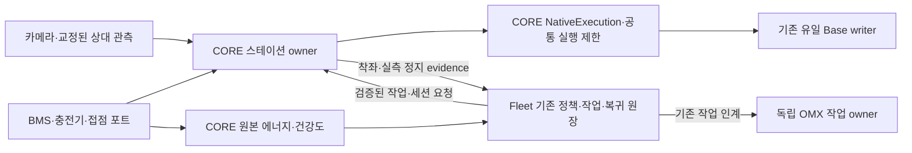

# 스테이션 실기 결합 설계안 R2

상태: 독립 설계·비판 검토용 동결 초안. 기준 소스 `ee0153823ab8b4b464cb2ceb33929af71da642ac`. 이번 산출물은 설계안이며 구현·시험·장치 수용 완료가 아니다. 기존 [수명주기 설계](2026-10-16-station-charge-lifecycle-design.md), [전체 실행 제한 설계](2026-10-17-bounded-station-execution-design.md), [원본 에너지 R2](2026-10-17-original-pack-energy.md)를 실기 연결 관점에서 구체화한다.

## 1. 목표와 유지할 합의

한 스테이션·한 이동 로봇에서 상대 관측 기반 접안, 실제 착좌·정지 이후의 후속 작업, 충전 정상 완료, 배터리 건강도/에너지·작업 비용에 따른 복귀와 재투입, 스테이션 이동 후 좌표 재합의를 연결한다. 시뮬레이터는 사용자 요청으로 제외한다. Python 단위/통합·실제 HTTP/장치 시험은 유지하며, 시험 PC 접속 문제를 시뮬레이션 문제로 바꾸어 설명하지 않는다.

현장 담당자의 카메라·장치 확인은 이후 가능한 시점으로 남긴다. BMS·충전기·접점 모델은 미정이다. 이미 연결된 Fleet PC·로봇·카메라·OMX의 기존 승인 접속과 구성을 확인하고, 없는 장비/측정값은 그대로 결측으로 남긴다. 장비 모델·전력·제동값·SOH·좌표를 추정하지 않는다. 기존 실행 승인은 유지하되 이 설계 검토 중에는 제품 코드·장치·배포를 변경하지 않는다.

## 2. 현재 근거와 실제 연결 공백

| 현재 소스 | 확인한 사실 | 필요한 연결 |
|---|---|---|
| `core/drive/station_docking.py:build_station_owner` | 현재 모든 non-simulation runtime을 거절 | 실측/지원 근거를 요구하는 하드웨어 구성 경로 |
| `core/drive/execution.py:install_native_execution` | 실제 Nav/Dock owner, 원본 odom/map/energy, 최초 cycle 전 단일 설치 | node/bridge 부트와 같은 인스턴스에 조립 |
| `station_owner.py`, `station_departure_control.py` | 기존 owner는 `docking.dock/undock` 직접 호출 | NativeExecution의 exact-parent/one-use 진입 티켓 사용 |
| `core/node.py`, `core/bridge/ros_bridge.py` | CoreServices 생성 뒤 RosBridge 생성, bridge 내부에서 50Hz 등 타이머 등록 | 타이머 등록 전 필요한 owner/포트를 결속하는 초기화 단계 |
| `core/bridge/pack_energy.py`, `power/execution_energy.py` | 원본 계측·시계·재생/만료와 CORE publication 경계 구현 | 실제 vendor reader와 승인된 교정/전력 프로필 |
| `rosy.execution.site.battery_evidence` | 기존 health exporter는 voltage_only/unknown | 원본 에너지의 identity/수명·소비 의미를 보존하는 Fleet readback |
| `fleet.server.charge_bootstrap/runtime` | 공유 TaskStore/TripRunner/World/HTTP client identity, 주기 평가·최종 dispatch guard 존재 | 실제 포트·원장·작업/복귀 비용과 단일 운영 구성 |

새 에너지 소스는 정적 안전 검토/AST/크기 검사를 통과했지만 실행 시험은 미실행이다. 이 사실을 연결 완료나 사용 가능한 capability로 승격하지 않는다. 기존 소스·미실행 근거는 [검증 기록](../validation/station-pack-energy-source-2026-10-17/result.md)을 따른다.

## 3. 선정 구조와 대안

**선정: 기존 상태 머신과 owner를 유지하고, 검증된 포트와 CORE 소유의 결합 경계를 추가한다.** 새로운 BT·범용 스케줄러·모터 writer를 만들지 않는다. 하드웨어 추상화와 현재 상태 머신을 결합하는 `robotics-design-patterns`의 원칙을 적용하되, 기존 부품의 실제 책임을 우선한다.

| 대안 | 이점 | 비용/선정 판단 |
|---|---|---|
| 선정 구조 | 현재 API·상태 머신·작업 원장과 단일 writer를 재사용, 실기 포트를 교체 가능 | 부트·티켓·계약 경계를 실제로 결합하고 검증해야 함 |
| 외부 station daemon이 Fleet/BMS를 묶어 동작 명령 | vendor 프로토콜 격리가 쉬움 | 별도 명령 권한/세션 재조립 위험. 필요한 경우 **관측 전용** vendor reader로만 사용 |
| `runtime_mode`/enabled 설정만 바꾸어 기존 SIM 구성을 사용 | 변경량이 작음 | 실측 수용·원본 입력·native 티켓을 제공하지 못하므로 목표를 충족하지 못함 |

## 4. 책임과 입력 경계

- Fleet: 기존 durable session/TaskStore/TripRunner의 예약·정책·작업 선택·인계·복귀 비용·station pose revision 소유. World는 현재 위치/지도 변환 사실을 제공한다. Vision은 관측과 불확실성을 제공한다.
- CORE: 로컬 관측 검증, 접안·착좌·측정 정지, 충전 상태 해석과 이안 interlock, parent/native ticket와 최종 Base 출력 제한 소유. 외부 reader와 Fleet은 `/cmd_vel` 또는 native mutation 권한을 얻지 않는다.
- OMX: 기존 joint/action owner 유지. Fleet은 착좌/실측 정지 evidence와 현재 작업 identity를 확인한 뒤 기존 후속 작업 경로로 인계한다. Base ZERO 또는 접안 ACK만으로 암 작업 완료·정지를 선언하지 않는다.
- 첫 현장 시나리오는 후속 작업·충전·이안을 직렬화한다. 후속 작업이 있다면 착좌/정지 확인 후 기존 작업을 수행하고, 해당 owner의 종료·작업 영역 해제를 확인한 뒤 충전/이안의 다음 단계를 진행한다. 동시 암 작업·충전·이안 허용은 현재 범위에 추가하지 않는다.

OMX 작업 종료 조회만으로 Base 출발을 허가하지 않는다. 기존 OMX command owner의 admission 경계에서 작업 영역 인계를 획득하고, 새 arm 요청을 차단하는 owner/세대에 결속된 예약을 확인한 뒤 출발을 허가한다. 이 예약은 이안·충돌 영역 이탈 확인까지 유지하며, 재시작·소유권 변경·만료·소실 시 Base 출발을 닫고 진행 중 실행을 HOLD/정지·조정한다. 현재 `StationDepartureSample`에는 이 결속이 없으므로 기존 OMX owner와 CORE interlock의 계약·구현·시험을 함께 추가해야 한다. 해당 결합이 없으면 OMX 후속 작업을 포함하는 자동 주기는 지원 불가로 남긴다. CORE는 암 관절 명령 권한을 얻지 않는다.

하드웨어 port는 확인된 vendor/interface별로 명시적으로 등록한다. 임의 module path를 설정에서 import하거나 공개 요청으로 provider 객체를 지정하지 않는다. BMS port는 원본 sequence/time/source-now·pack/epoch/capacity revision, 측정 사용 가능 Wh 하한·SOC/SOH·온도·fault를 공급한다. 하한의 교정은 오차·부하·온도·cutoff 근거를 포함한다. 전압/SOC/명목 용량으로 이를 만들어내지 않는다. 현재 장치가 공급하지 못하면 해당 자동 정책은 WAIT이며, 지원 가능한 계측의 추가/교정을 별도 실제 작업으로 남긴다.

카메라 port는 기존 `StationObservation`의 `base_link` 상대 pose, source/epoch/교정 revision·원본 순서/시각·오차를 공급한다. 상부/스테이션/로봇 카메라 중 실제 설치된 유효한 원본만 채택한다. 관제 화면 맞춤 좌표와 오래된 검은 영상은 근거가 아니다. 카메라 또는 스테이션 이동 시 변환과 교정 revision을 새로 확인한다.

## 5. 부트와 hardware 구성

1. 기존 승인 release/장비 identity·실측 profile의 일치 여부를 읽기 전용으로 검사한다. 프로필은 robot/model/firmware·pack/교정 revision·camera/map revision·전력/reserve/제동/watchdog 근거에 결속한다. 단순 `accepted: true`나 operator 메모만으로 capability를 생성하지 않는다. 기존 commissioning 기록의 증거·승인 주체를 재사용하고, station 전용 추가 항목은 계약 단계에서 정의한다.
2. CoreServices의 실제 Nav/Dock/Command에 부트 한 개의 Ledger와 native 제한을 **최초 ZERO cycle보다 앞서** 설치한다. 필요한 슬롯은 REQUIRED/CLOSED로 시작한다. CPython 3.12/GIL을 벗어난 runtime은 현재 제한의 지원 대상으로 선언하지 않는다.
3. RosBridge의 작은 조립 hook에서 실제 map-adoption client, 원본 odom, 선택된 hardware energy/contact/charger/camera port를 같은 인스턴스에 결속한다. 큰 조립 로직은 `core/drive`/ROS-free bridge sibling에 두고 bridge ratchet을 늘리는 단일 거대 생성자로 만들지 않는다. source clock은 정확히 Ledger의 trusted callable을 공유한다.
4. 조립 검증 뒤 기존 타이머를 등록한다. source가 아직 오지 않았으면 자동 운행은 WAIT다. 한 슬롯의 부분 실패도 ordinary NAV/metadata-only/전압-only 경로로 우회하지 않는다. 기존 수동/E-stop 우선권과 독립 OMX owner는 유지한다.
5. 설치 후 지원 상태와 결측 사유를 readback한다. ‘지원 가능’과 ‘현재 ready’, 요청 수락과 실제 정지/충전 완료를 구분한다. 늦은 설치·동일 boot 재구성/owner 재생성으로 실패한 claim이나 이력을 초기화하지 않는다.

지도 포트의 client 생성만으로 기동 구성이 완성되지 않는다. 현재 verified native build는 기본 OFF이고 localization launch는 일반 AMCL을 사용한다. 별도 구현 작업으로 승인된 standalone verified AMCL과 verified global StaticLayer를 실제 launch/config에 결속하고 같은 release의 IDL·SDK·binary/config fingerprint를 대조한다. lifecycle 실패·재시작·instance 교체 때 기존 근거는 무효이며 CORE 자동 admission은 CLOSED를 유지한다. 남아 있는 failed-config/TF-listener teardown 문제는 운영 활성화 전에 해결하고 실패·정리·재기동을 실제 프로세스로 검증한다. 기존 host native 시험을 이 운영 startup 수용으로 대체하지 않는다.

## 6. HTTP·native 티켓·전체 실행 창

CORE가 검증 후 생성한 boot/session/work-bound parent **참조**를 Fleet이 운반한다. 참조는 운동 허가나 재사용 가능한 receipt가 아니다. 공개 요청이 profile/provider/source 근거를 생성할 수 없다. 현재 station/nav 요청→CORE local admission→exact native invocation→receipt sync→CommandManager→같은 writer→원본 측정/종료 readback을 하나의 실제 호출 사슬로 검증한다.

Station owner의 dock/undock와 return/staging/일반 작업 navigation은 CORE 소유 binding을 통해 NativeExecution의 one-use entry를 사용한다. 직접 manager 호출을 살려두는 예외 flag를 추가하지 않는다. work→return→dock/재시도·lease 갱신은 같은 parent의 원래 시간·경로·회전·공간·에너지 창을 소비한다. 허용 공간의 중간 위치에서도 승인된 귀환 경로가 가능한 작업만 받는다.

Fleet은 원본 계측 이후 대기 소비, 선택 작업·최악 귀환 경로·접안/재시도·정지 tail·reserve를 포함해 비용을 비교한다. CORE는 원본 Wh 하한과 원래 capture→parent end를 다시 검사한다. raw Wh와 이미 소비를 뺀 Wh의 의미를 섞어 수명을 갱신하거나 두 번 공제하지 않는다. monotonic 시각을 Fleet UTC와 직접 비교하지 않으며, source→readback 변환의 검증된 시간 bracket이 없으면 유효한 Wh evidence를 내보내지 않는다.

공개 계약 추가는 구현 직전에 ADR/API 번호를 예약해 SRS/API reference/schema·CORE producer·Fleet consumer·시험을 함께 변경한다. 필요한 의미는 parent 참조/원본 observation identity·pack/epoch/capacity/profile revision·원본 수명·비용 context·소모 사유다. 이 문서의 용어를 이미 존재하는 wire field로 취급하지 않는다. 같은 TaskStore·TripRunner·World·client를 쓰는 기존 `install_charge_runtime`의 identity 검사를 유지한다.

## 7. 물리 상태와 복구

이동 작업/복귀 → 상대 접안 → 착좌·측정 정지 → 후속 작업 종료 확인 → 충전 → 정상 완료/CHARGED_HOLD → 새 원본 에너지·작업 승인 → 이안 → 작업/복귀 흐름을 사용한다. 없는 후속 작업을 임의 생성하지 않는다.

착좌는 접점/하중·위치/heading·측정 선속도/각속도와 유지/디바운스 창으로 검증한다. source가 만료되면 후속 인계는 닫힌다. 충전 완료는 현재 세션 이후 charger/BMS의 정상 종료와 신선한 팩 근거를 사용하며 `charging=false` 하나로 완료하지 않는다. charger 전기적 조건과 이안 시 접점 해제 순서는 실제 vendor 사양으로 결속한다. 알 수 없는 충전기 relay를 추정 제어하지 않는다.

이미 후속 작업이 실행 중일 때 착좌/접점/정지 근거가 만료되거나 상실되면 CORE의 해당 세션 근거 철회를 Fleet의 기존 durable 작업 조정 경로로 전달하고, OMX의 기존 작업 owner가 HOLD/cancel과 실제 종료 확인을 수행한다. 다음 작업 인계 차단만으로 처리 완료로 보지 않는다. 전달 단절·종료 미확정 동안 새 암 작업과 Base 출발은 닫힌다. 로컬 장치 interlock/watchdog의 정지 근거도 별도로 확보한다.

긴 충전/정지 대기에는 이전 이동 parent를 종료·소모한다. 상태 세션은 보존하되 이동 수명을 늘리지 않는다. 새 출발에는 현재 착좌/완료/작업 영역 해제·팩 건강도와 새 energy admission으로 만든 parent가 필요하다. SOH 저하/온도/fault/결측이면 WAIT 또는 maintenance HOLD를 기존 정책 사유로 남긴다. 주기 재평가 외에도 근거 만료/고장/비용·station revision 변화와 최종 dispatch에서 재검증한다.

정상 착좌·실측 정지에 따른 이동 parent 종료는 충전 세션 고장과 구분한다. 종료 receipt와 잔여 native 명령 부재를 확인하고 정상 stationary 세션을 유지한다. 이 동안에도 착좌·정지·충전 근거는 계속 신선해야 하며, 고장 종료를 정상 완료로 바꾸거나 옛 이동 parent를 재사용하지 않는다.

통신 단절·관측 상실·clock/epoch 변경·전달 미확정·수동 인계는 exact-parent STOP/HOLD와 기존 durable cleanup으로 처리한다. 새 정상 값, 재접속, 주기 tick만으로 소모한 작업을 복구하지 않는다. 재시작 후 다른 boot의 참조는 거절한다. 충전기 자체 보호·실제 제동과 장치 watchdog은 소프트웨어 STOP과 별도 수용한다.

스테이션 이동은 이전 실행의 정지/종료 확인 → 새 교정/위치 후보 → Fleet의 새 map/pose revision과 접근 경로 검증 → CORE의 같은 revision ACK → 새 admission 순서다. 이동 전후 목표를 겹쳐 실행하거나 station revision 변경으로 예산을 reset하지 않는다.

## 8. 실행 순서와 완료 증거

| 단계 | 책임/변경 범위 | 완료를 증명할 결과 |
|---|---|---|
| G0 소스 회귀 | 원격 pytest, 기존 source/API 검증 | 최신 커밋의 에너지/native/map/odom/경합 시험과 필수 FULL CI 실제 로그·실행/skip·NEW 비교. 접속 불가를 PASS로 보지 않음 |
| G1 장치/근거 확인 | 기존 승인 SSH/commissioning·카메라/충전기/팩 | 실제 모델/배선/원본 신호·release/runtime·교정/전력/정지 envelope. 원격 최소 확인과 현장 확인 항목 구분 |
| G2 계측 포트/수명 | power, bridge, hardware driver | 실제 입력→원본 receipt→Fleet readback, identity/clock/age/재생/고장/소비 의미를 시험. 미지원 장비는 명확한 거절 |
| G3 초기화/실기 조립 | CoreServices/node, drive/bridge, verified AMCL/global StaticLayer launch/config | 최초 cycle 전 단일 설치와 부분 client/port 실패 주입, 같은 writer/owner 유지. 실제 native 생산자의 release fingerprint·lifecycle/재시작·failed-config/TF 정리 검증, 실패·늦은 설치는 CLOSED |
| G4 실제 요청 사슬 | 기존 station/nav API·native binding, Fleet bootstrap/runtime, OMX admission/인계 계약 | 실제 authenticated HTTP→동일 parent/native run→same writer→측정 readback. 늦은 ACK/재생·수동·통신/저장 장애에서 중복 실행 없음. 작업 중 접점/정지 근거 상실의 OMX HOLD/cancel 조정과 종료 확인→새 arm 요청→이안 경합 차단 |
| G5 입회 한 주기 | 기존 현장 절차·실측 profile | 물리 상대 오차·착좌·정지·후속 처리·정상 충전·이안/재투입의 원본 evidence와 원장 identity 일치 |
| G6 반복/이동/지속 운행 | 같은 로봇·스테이션·부트 이력 | 전체 실제 3회 주기와 station relocation, 운영 예정 기간의 source/nonce/parent 소진·재시작/통신 장애 검증. 성공 1회로 완료하지 않음 |

G1 장비 식별·프로토콜이 확보되면 G2의 해당 vendor 어댑터를 구체 구현한다. G1/G5의 사람 확인은 현장 가능 응답이 있을 때 진행한다. 그동안 수행 가능한 계약/조립/negative-path 준비는 진행하되 장비값을 채워 PASS를 만들지 않는다. G0 실행 기반이 없을 때 검증을 완료로 닫지 않는다. 물리 동작은 기존 입회/명시적 감독 절차를 따른다.

G5 이전에 허용 오차·디바운스/타이밍·전기적 분리 순서와 예정 운영 기간을 G1의 수용된 실측 profile에 결속한다. G0 필수 FULL CI가 접근 불가하거나 현재 배포/게시 권한 안에서 실행 불가하면 미완료로 남긴다. CI 확보 필요성을 push 권한으로 해석하지 않는다.

현재 native map은 부모 64개·질의 65,536개, energy cache는 동시 유효 receipt 8개 한도가 있다. 예정 source rate·최대 유효기간·부트 운영 시간에 대한 한계 계산과 경계/소진 시험을 G2/G3의 activation prerequisite로 삼는다. 예정 운행을 수용하지 못하면 issuance/retention 설계를 별도 독립 검토해 해결한 후 G6를 통과한다. owner 재생성·부트 강제 반복·이력 FIFO 삭제로 연속 운영을 가장하지 않는다. 현장 3회 성공 후에도 지속 운행의 이 조건이 미해결이면 전체 목표는 미완료다.

핵심 counterexample은: slot 하나 결측/교정 변경/전압-only → admission 거절, source/ledger 작은 clock offset/원본 clock 역행 → 거절/소모, duplicate/늦은 callback → 원본 수명 불변, fault→higher → 같은 parent STOP 유지, 최종 검사 뒤 fault publication → 이미 진입한 write 이후 ZERO, contact 상실/고장 종료 → 후속/출발 차단, station 이동/옛 ACK → 이전 실행 정리, charging 중 parent 만료 → 자동 출발 없음, owner 작업 미종료 → 이안 없음이다.

## 9. 변경·검증 원칙과 검토 상태

실행은 위 단계별로 현재 승인 범위에서 진행하고 안전 경계 변경은 독립 D-430 검토 후 커밋한다. public contract reservation은 실제 계약 변경 직전에 수행한다. 장치·배포·재시작·운행은 소스 구현/설계 검토와 구분해 기존 입회·승인 근거를 따른다. 되돌림은 새 admission을 닫고 exact 실행을 정지/HOLD한 뒤 실제 정지/종료를 대조하는 절차다. 실행 중 모드/owner를 바꿔 legacy 경로로 복귀하지 않는다.

R1 독립 검토는 양쪽 제출 뒤 종합했다. critic은 단계 설계 승인과 실행 중 OMX 근거 상실 처리 보완을 제시했고, architecture는 실제 native map 생산자 기동과 OMX 종료→출발 사이 재진입 차단을 필수 수정으로 제시했다. R2는 세 항목과 정상 stationary 세션 전환, G1 실측 기준·G0 미완료 표기를 반영했다. 같은 동결 R2를 양쪽에 독립 재검토하며 최대 3회 내 종료한다. 미해결 장비 정보나 설계 결정을 승인으로 포장하지 않는다. 검토 통과도 코드·실기 통과는 아니다. 기존 실행 승인을 다시 요구하는 절차는 추가하지 않는다.
