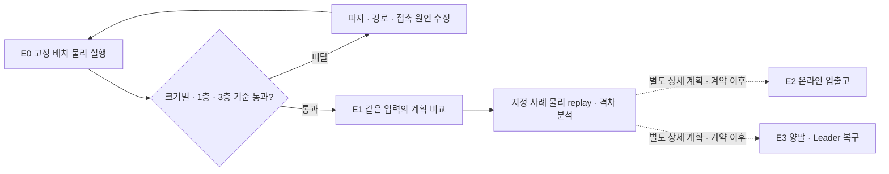

# 3×3×3 혼합 화물 야드 실험 계획

상태: **Proposed · v2 · 2026-10-21**. 연결 결정은 [D-826](../adr/D-826-port-grid-experiment-and-evidence-boundaries.md)이다. 모든 새 실험은 **NOT RUN**이다. 아래 수치는 프로젝트의 초기 실험 조건이며 제조사 보증·성능 달성값이 아니다. 독립 검토를 반영해 부하/혼합조성의 해석과 야드 내부 재배치 회계를 명확히 했다.

## 1. 얻으려는 답

1. OMX-F가 서로 다른 길이의 화물을 집고 놓았을 때, 계획한 위치·지지 상태로 실제 안착하는가?
2. 같은 야드·화물·정보·버퍼 조건에서 반출 순서를 고려한 적재가 단순 적재보다 재취급을 줄이는가? 높은 점유율에서 반출 실패나 시간이 늘어나는가?
3. 같은 장애 상태에서 한 팔+지그로 해결되지 않는 작업을 양팔 인계나 사람의 Leader 개입으로 복구할 수 있는가?

고정 배치의 성공은 1번에 대한 기준선이다. 2·3번은 서로 다른 계획·복구 방식을 동일한 입력으로 비교해야 답할 수 있다. 화물이 화면에서 쌓이는 장면만으로 적재 계획의 우수성·항만 효과·양팔 필요성을 주장하지 않는다.

아래 흐름은 제안된 실험 순서다. 고정 배치의 물리 실행을 통과한 뒤 전략을 비교하고, 물리 replay 결과를 읽은 뒤 온라인·협응 범위를 개정한다.



## 2. 현재 구현과 재사용 경계

조사 기준은 main `45b2bfe064b739d425564d1bd0b3c06af314fa2f`다. 구현 착수 시 revision과 사용 환경을 새로 고정한다.

| 부분 | 현재 소스·증거 | 실험에 필요한 추가 작업 |
|---|---|---|
| Isaac OMX | `learning/envs/isaac/prepare_omx_urdf.py`, `import_omx.py`: 고정 자산 준비·USD import·articulation/관절 검사 | 작업 장면, articulation 제어·그리퍼, 물리 집기/놓기, 실행기와 계획 연결 |
| 혼합 적재 | `operations/processes/palletizing/.../mixed_planner.py`와 recipe/3: m 좌표 후보·0/90° yaw·지지/하중/핑거/도달성 검사 | 정확한 격자 후보·점유 제약. 기존 planner를 그대로 27슬롯 계획기로 취급하지 않음 |
| 공급 | `mixed_plan.py:pick_pose`: 공급자가 place yaw에 맞춰 station에 준비한다고 가정 | 처음부터 트레이에 존재하는 개별 화물의 실제 source pose와 집기 연결 |
| 반출 | recipe/3는 `depalletize` 거부 | 목표 화물 선택·노출 여부·재배치 버퍼·회수/원장 정합 |
| 협응 | mixed plan의 기본 Step은 `place`·`independent` | 공동 접촉·인계·복구는 별도 계약/제어·검증 |
| Leader | D-823 Proposed | 제어권 전환·연속성·재정합 구현 전. 즉시 사용 가능한 기능 아님 |

G1의 IK·capsule·일정 계산 기록은 물리 실행 증거가 아니다. 기존 Gazebo 단일 transfer의 DetachableJoint SIM AID도 마찰 파지 증거가 아니다. Isaac의 Pinky 주행 성공을 OMX 조작 성공으로 사용하지 않는다. 오래된 module progress보다 해당 소스와 날짜 증거의 범위를 함께 확인한다.

## 3. 고정할 실험 세계

### 야드·화물·공급

- 야드는 칸막이 없는 **3×3 바닥, 최대 3층** 논리 격자다. 물체는 직육면체이며 높이는 모두 한 단위다. `1×1`, `2×1`, `3×1`은 바닥 점유 크기이며 yaw 0/90°만 허용한다.
- 좌표 인덱스는 x/y/z=0..2이고 물체 ID는 개체마다 고정한다. 논리 최대 용량은 27칸이며 화물 27개를 뜻하지 않는다.
- 초기 물리 목업 후보: pitch `p=40 mm`, 같은 층의 간격 `g=8 mm`, 물체 높이 `h=20 mm`. k×1 화물의 길이 `k*p-g`, 폭 `p-g`이므로 32/72/112×32×20 mm다. 질량 후보는 각각 10/20/30 g다. 그리퍼 외형·실제/모의 한계·IK·충돌 검사에 실패하면 후보를 바꾼 새 fixture revision을 만들고 비교 전 고정한다. 실물 제작치로 사용하지 않는다.
- active grid 외곽은 120×120 mm이고 3층 화물 높이는 60 mm다. 고정 backing pallet 후보는 200×200 mm다. 작은 active grid에서는 양팔 동시 작업이 직렬화될 수 있으며 큰 backing 크기만으로 병렬성이 생기지 않는다.
- 첫 물리 장면은 단일 OMX-F, 고정 공급 트레이, 고정된 yaw의 한 층 화물이다. 물체는 시작부터 모두 존재한다. 다음 물체를 매번 생성·순간이동해 공급한 결과와 구분한다.
- 최초에는 Isaac ground truth로 source/target pose를 읽는다. 인식 성능은 이번 기준선의 변수가 아니다. 시각 인식·불규칙 더미 picking은 후속 실험이다.
- 논리 지지와 실제 물리 안정성을 별도로 판정한다. 초기 고정 배치는 층마다 같은 footprint를 반복한다. 기존 support_ratio_v1이 부분 지지를 허용한다는 사실을 기록하고, 계획기 비교에서는 같은 지지 규칙을 모든 방식에 적용한다. 고정 배치의 전면 지지를 기존 일반 planner의 보장으로 표현하지 않는다.

### 기준 배치와 적재율

각 층의 배치 예시는 다음과 같다. 같은 문자는 한 물체다. 이것은 실행 기준선에만 제공하고 본 비교의 정답 배치로 주입하지 않는다.

```text
A A A    3×1 하나
B B C    2×1 하나 + 1×1 하나
D E F    1×1 셋
```

| 조건 | 1×1 개수 | 2×1 개수 | 3×1 개수 | 논리 점유 칸 / 27 |
|---|---:|---:|---:|---:|
| 낮은 부하 | 6 | 3 | 2 | 18 / 27 |
| 중간 부하 | 9 | 3 | 3 | 24 / 27 |
| 가득 찬 기준 | 12 | 3 | 3 | 27 / 27 |

위 고정 배치 3층은 마지막 행의 화물 18개다. 논리 점유율과 실제 직육면체 체적/야드 체적 비율은 간격 때문에 다르므로 둘 다 표시한다.

세 행은 화물 개수·SKU 조성도 함께 바뀌는 **부하/혼합조성 조건**이다. 방식 비교는 같은 행의 동일 manifest 안에서 하고, 행 사이의 차이를 점유율 하나의 인과 효과로 해석하지 않는다. 점유율만의 효과는 조성을 통제한 별도 실험이 있어야 주장한다.

### 반출·버퍼·정보 공개

- 요청된 화물만 출고 구역에 놓을 수 있다. blocker는 야드 안의 합법적인 빈 위치 또는 명시적 외부 재배치 버퍼로 옮긴다. yard→yard 이동도 지지·하중·접근·점유 검사와 원장·재취급 회계에 포함한다. 공급 트레이·기타 야드 바깥·그리퍼를 숨은 무제한 버퍼로 사용하지 않는다.
- 버퍼는 야드 밖의 단층 0칸, 3×1칸, 3×3칸 세 조건이다. 직육면체가 실제로 들어갈 연속 공간·회전·집기 여유를 함께 검사한다. 단순 남은 칸 수만으로 수용 가능하다고 보지 않는다.
- 외부 버퍼 0칸에서도 야드 내부 빈칸 재배치는 허용한다. 야드가 가득 찬 상태와 빈칸이 있는 상태를 구분하고, 이 모형의 실패를 항만 전체의 반출 불가능으로 확대하지 않는다.
- 버퍼 9칸도 모든 화물 상태의 반출 가능성을 보장하지 않는다. 공간 부족/경로 미발견/제어 실패를 분리한다. 탐색 예산 소진을 수학적 불가능으로 기록하지 않는다.
- 오프라인 비교에서는 모든 화물 목록과 반출 순서를 모든 방식에 동일하게 공개한다. 온라인 후속에서는 보이는 입고 큐 최대 3개와 현재 반출 요청만 공개하고 미래 이벤트·봉인된 정답 경로를 공개하지 않는다. 오프라인 결과를 온라인 방식과 같은 조건의 우위로 발표하지 않는다.
- 반출 시나리오는 top-first, 깊은 화물 우선, 혼합 순서로 구분한다. 가능한 초기 상태에는 독립적으로 검사한 실행 가능 경로를 별도로 보관하고 계획기에 노출하지 않는다. 불가능 사례는 증명 가능한 소형 반례와 제한 탐색 미해결을 구분한다.

## 4. 실험과 비교군

| ID | 핵심 질문·변수 | 비교·고정 조건 | 완료 산출물 |
|---|---|---|---|
| E0 실행 기준 | 크기별 집기·놓기와 혼합 1층/3층이 물리적으로 가능한가 | 미리 정한 배치·한 팔·동일 물성/제어. 계획 최적화 비교 없음 | 파지/안착 성공, 실제 위치·기울기·낙하·충돌·실패 위치·영상 |
| E1 오프라인 적재·회수 | 적재에 반출 순서를 반영하면 재취급을 줄이는가 | P0 격자 first-fit, P1 격자화한 기존 혼합 greedy, P2 반출 고려 계획. 동일 공개 정보·화물·지지/하중/IK/핑거 제약·버퍼·탐색 예산 | 점유율 대 반출 성공·재취급·이동·시간의 표. 반출과 격자 지원 구현 후 실행 |
| E2 온라인 입출고 | 도착 순서 변화와 제한 버퍼에 대응하는가 | 같은 이벤트 스트림·보이는 큐·계산 예산으로 P0/P1/P2 비교. 미래 반출 정보 사용 금지 | 거절/보류·큐 대기·반출·재배치 기록. D-781 오프라인 범위를 확장하는 후속 계약 필요 |
| E3 장애 복구 | 두 번째 팔/Leader가 복구 가능한 상태를 넓히는가 | 같은 장애 snapshot·화물·지그·허용 준비/시도 예산. A/B 각각 최선 한 팔+받침, 양팔 후보, 사람 개입 분리 | 상태별 가능/성공/안전 중단/사람 개입. D-778·D-823의 선행 관문 유지 |

P0/P1/P2는 공통 실행기·독립 검증기·반출 실행 규칙을 사용한다. 적재 전략만 비교하는 회차에서는 반출 알고리즘을 동일하게 고정한다. 다른 반출 알고리즘까지 바꾸는 회차는 별도 요인 실험으로 기록한다. 기존 연속좌표 planner의 결과를 사후 격자 반올림하여 P1로 만들지 않는다.

E1의 첫 시나리오 세트는 부하 3조건×버퍼 3조건×봉인 평가 seed 30개(1000..1029)=270개이고, 방식 3개이면 논리 실행 810회다. seed가 입고 ID 순열·허용 yaw·반출 순서를 생성하며, 충족한 형상/지지/도달성 조건과 가능한 경로 증거도 manifest에 기록한다. 개발 seed 0..9는 튜닝에만 쓴다. 개발·평가 입력 파일과 생성기 revision/hash를 실행 전에 고정한다. 평가 중 파라미터를 바꾸면 새 버전으로 전 회차를 다시 비교한다.

물리 replay는 논리 회차 전부를 성공으로 간주하는 단계가 아니다. 각 부하에서 평가 seed 1000·1001을 선택하고, 버퍼 9칸·방식 3개·물리 seed 0/1/2로 총 54 episode를 사전에 지정한다. 논리 해법 미발견도 결과로 남기며 물리 실행 없음으로 표시한다. physics seed가 실제로 바꾸는 것은 허용 물성/초기 오차이며, 범위는 E0 개발 뒤 manifest에서 고정한다. 동일 seed만으로 다른 궤적의 외란이 공정해졌다고 가정하지 않는다.

E2/E3의 상세 case manifest와 수용 조건은 E0/E1 증거를 읽은 후 별도 개정한다. 현재 810회나 양팔·Leader 구현을 이미 승인·실행한 것으로 표현하지 않는다.

## 5. 측정과 독립 성공 판정

| 지표 | 정의 |
|---|---|
| 논리 점유율 | 해당 시점 야드 안 화물의 점유 칸 합 / 27. 시간 경과와 함께 기록 |
| 실제 충전율 | 야드 안 화물 체적 합 / 선언된 물리 야드 체적. 논리 100%와 구분 |
| 반출 성공률 | 기한·실행 예산 안에 올바른 ID가 출고 구역에 안착한 요청 / 전체 요청. 불가능·보류·시간 초과 포함 집계하고 원인별 분리 |
| 재취급 | 초기 입고와 요청 화물의 최종 반출을 제외한 실제 pick-place 완료 횟수. 한 물체를 여러 번 옮기면 매번 계산 |
| 계획 재취급 | planner가 예상한 수. 실제 완료 횟수와 별도 표시 |
| 시간 | 시뮬레이션 경과 시간, wall time, 계획 계산 시간, 대기를 분리. 논리 비용모델 시간을 물리 실행 시간으로 바꾸어 쓰지 않음 |
| 복구 성능 | 사전 정의 장애 상태별 시도/성공/안전 중단/사람 개입과 새로 해결된 상태 수. 사람 개입 성공은 무인 성공에서 제외 |
| 부작용 | 낙하, 의도치 않은 충돌, 인접 화물 이동, 파지 상실, 보유 불명, 원장 불일치 |

초기 물리 판정 후보: release·그리퍼 퇴피 후 3초 동안 대상 위치 오차 ≤3 mm, yaw 오차 ≤3°, roll/pitch ≤5°, 병진 속도 ≤5 mm/s를 유지하고 야드/버퍼 경계·지지 조건을 만족해야 안착 성공이다. 동시접촉의 정상 접촉과 의도치 않은 충돌은 접촉쌍·단계 allowlist로 구분한다. 인접 화물의 기준 자세에서 3 mm 넘는 이동도 실패 사건이다. 센서·단위·physics tick으로 이 조건을 실제 관측할 수 있는지 E0 전 preflight에서 확인하고, 불가능하면 새 계획 revision에서 기준을 재설계한다. 결과를 본 뒤 합격선을 완화하지 않는다.

verifier는 명령 성공 응답·관절 도달과 독립적으로 화물 ID/pose/속도·접촉·지원 상태를 읽는다. 진실 위치를 사용하는 판정임을 표시한다. reset·cleanup은 측정 종료 뒤에만 하고, 측정 도중 화물 좌표를 덮어쓰거나 자동 안정화하지 않는다.

실행 도중 초기화·로그 실패·SDK 중단·안전 중단도 전체 시도 목록에 남긴다. SDK 실패는 물체 성공의 증거가 아니다. 성공 사례만 평균내지 않고 성공 분자/전체 분모, 실패 원인·중단·미판정, 시간 분포를 함께 보고한다. 방식 간 차이는 같은 시나리오의 paired 값으로 제시하고 효과가 없거나 악화된 경우도 기록한다.

## 6. 착수 순서와 관문

| 순서 | 작업·중단 기준 | 다음 단계 조건 |
|---|---|---|
| G0 환경·자산 | 승인된 GPU 시험 호스트의 SDK/driver·자산 hash·좌표계·관절·단위·충돌형상·그리퍼·물성 확인. 실행 주소는 private/scratch에만 | 실제 OMX import·저속 관절/그리퍼·reset 확인. 호스트 pytest와 SDK 실행 증거 구분 |
| G1 연결 smoke | 한 화물 집기→이동→놓기·영상·상태 기록. attach aid를 쓴 경우 `SIM_AID`로 별도 기록 | source→planner→controller→object 결과 연결 확인. 이것만으로 물리 파지 통과 아님 |
| G2 E0 물리 | attach aid 없는 각 SKU 단일 사이클 10회씩. 그다음 혼합 1층 10 episode, 3층 10 episode | 각 조건 완전 성공 ≥9/10, 낙하·붕괴·의도치 않은 충돌 0. 실패 1회도 기록. 미달이면 E1 물리 확대 보류 |
| G3 E1 논리 | 격자·source pose·반출·버퍼·공통 verifier 구현/회귀 후 810회 비교 | 모든 배치에 독립 기하/지지/하중/접근 검증, 모든 반출 결과에 정확한 ID/버퍼 회계. 버퍼 부족을 숨기지 않음 |
| G4 E1 물리 replay | 사전 지정 최대 54 episode. 불가능/미해결은 물리 실행 없음으로 남김 | 계획/물리 격차·실제 재취급·시간·부작용 보고. 논리 우위를 물리 우위로 자동 승격하지 않음 |
| G5 후속 결정 | E2 온라인·E3 장애/양팔/Leader 상세 계획 | 기존 ADR·단일 writer·명령/정지·관측·복귀 계약이 준비된 범위만 별도 착수 |

첫 실행 범위는 G0→G1→G2다. 현재 없는 컨트롤러·장면·파지·판정 연결을 구현하는 후속 작업이 선행한다. 계획·ADR 작성이나 host tests 통과를 실제 Isaac 실행으로 보고하지 않는다. 실제 로봇·Pinky 이동·장치 배포는 이 계획에 포함하지 않는다.

## 7. 실행 기록과 재현

각 run은 immutable `run_id`, code/scene/asset/recipe/cell/planner/verifier revision과 hash, Isaac/PhysX/GPU driver·physics step·solver 설정, seed·실제 초기 pose·질량·마찰·충돌형상, 모든 입력 이벤트와 정책 정보 공개 범위, 실행 목표/실제 관측/접촉/보유 전이, raw trace·영상·독립 판정·전체 요약을 보존한다. 실제 호스트 주소·포트·계정은 private에 둔다. 산출물은 외부 scratch에 쓰고, 검증 기록에는 hash와 역할만 옮긴다.

결과 요약에는 반드시 `LOGICAL_ONLY`, `SIM_AID`, `PHYSICS_GRASP` 중 증거 종류를 표시한다. 이를 ROS/Fleet 전체 연계·실물 가반하중·양팔 접촉 안전·항만 현장 성능으로 환산하지 않는다.

## 8. 실행 전 확인할 개방 항목

- p/g/h·질량 후보가 실제 모의 그리퍼와 제어 경로에서 가능한지, 3층의 전체 손목·퇴피 경로가 비는지.
- 현재 SDK 버전과 import/관절 제어의 실제 동작, GPU 시험 호스트 가용성. 새 패키지 설치·버전 변경은 별도 검토.
- 접촉쌍 allowlist, 낙하/붕괴·지지 판정의 구현과 허용 오차를 관측할 주기.
- 기존 recipe/1·/2·/3 의미를 바꾸지 않고 격자·반출을 표현할 계약. 새 wire/API는 이 문서가 정의하지 않음.
- 양팔 공중 인계·contact recovery와 Leader takeover는 현재 구현 기능으로 사용하지 않음.

## 관련 근거

- D-322·D-778~781·D-823. 기존 기록: `docs/validation/cell-isaac-2026-10-04/`, `docs/validation/bimanual-g1-sim-2026-10-17/`, `docs/validation/rosy-cell-gazebo-c3-2026-10-02/`, `docs/validation/omx-sim-finger-envelope-2026-10-17/`.
- [NVIDIA manipulator setup](https://docs.isaacsim.omniverse.nvidia.com/latest/learn/setup_a_manipulator.html): 모델 import·설정·제어·pick/place를 연결하는 참고. 최신 문서를 설치된 SDK 호환성·OMX 파지 성능의 증거로 전용하지 않는다.
