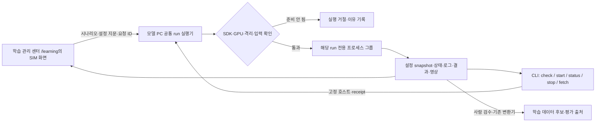

# 웹·CLI 공통 시뮬레이션 실험 작업공간 설계

2026-10-21 · 설계 v1 · 사용자 설계 승인 · 제품 구현 전

학습 관리 센터에서 시나리오를 고르고 실행한 뒤, CLI에서도 같은 run의 상태·로그·영상·결과를 확인한다. 같은 조건으로 다시 실행하면 이전 결과를 보존하고 새 run을 만든다. 사용자는 **웹과 CLI가 같은 실험 설정·결과를 공유**하는 구성을 선택했다.

실험의 목적·물체·성공 기준은 [D-826](../adr/D-826-port-grid-experiment-and-evidence-boundaries.md)과 [항만 실험 계획](2026-10-21-port-grid-experiment-design.md)이 맡는다. 이 문서는 그 실험을 반복하기 위한 실행·열람 경계를 정한다. 구현·SDK 실행·물리 실험은 이 문서 작성으로 완료되지 않는다.

## 선택과 현재 구현

| 접근 | 장점 | 비용·판단 |
|---|---|---|
| CLI만 추가 | 실행 경계를 먼저 검증하기 쉽다 | 사용자가 고른 웹·CLI 공유 흐름을 완성하지 못한다 |
| 기존 학습 관리 센터 + 공통 run 실행기 | 기존 계정·셸·결과 목록을 재사용하고 양쪽 결과가 같다 | 실행기와 공통 기록 연결이 필요하다. 채택 제안 |
| 별도 실험 웹앱·범용 작업 서버 | 여러 엔진을 통합하기 쉽다 | 앱·권한·저장소가 중복된다. 현재 범위에서 제외 |

조사 기준은 로컬 main `c42fa0260f`다. 현재 사실과 새로 필요한 부분은 다음과 같다.

| 현재 코드 | 재사용할 부분 | 추가로 필요한 부분 |
|---|---|---|
| `learning/curation/perception/review_app.py`, `learning_workspace.py`, `review_app_web/learning.js` | `/learning` 작업 목록·상태·실패·지표·JPG, 기존 계정·공통 셸 | SIM 시나리오 선택·실행·같은 조건 새 실행, 로그·영상 열람 |
| `learning_control.py` | 고정 실행 owner와 좁은 요청이라는 원칙 | 기존 제어는 Perception 전용이므로 SIM 실행기로 사용하지 않는다 |
| `tools/remote/remote_omx_native.py`, `remote_job.py` | receipt 기반 관찰, 단절 뒤 재접속, 제한된 결과 회수 방식 | Isaac SDK 전용 실행·중지·GPU 사용 조정. native 장비 배포 경로는 호출하지 않는다 |
| `tools/remote/remote_sim.py` | Gazebo 실행 도구로 유지 | Jazzy/Gazebo 빌드·Python·메모리 제한을 Isaac에 그대로 적용할 수 없다 |
| `learning/envs/isaac/import_omx.py`, `sdk_entrypoint.py` | OMX-F 모델 import·관절 확인, SDK 종료 처리 | 실행 보고서 연결. 화물·집기·적층 제어기는 현재 없다 |

`/learning`은 현재 앱의 학습 작업 진입점이다. D-792 Proposed는 같은 앱의 확장 방향이며, 기존 `/learning/omx`는 intake·Episode 검수 화면이다. 공통 SIM 화면을 그 안에 섞거나 새 앱으로 분리하지 않는다.

## 제안 구조

웹과 CLI는 같은 모델 PC 실행기·run 저장소를 사용한다. 웹 서버가 Isaac을 직접 조종하거나 임의 명령을 실행하지 않는다. 아래는 제안 구조이며 새 모듈은 아직 없다.

- 실행 책임은 `learning/envs/isaac/`의 좁은 실행 모듈, 원격 진입은 `tools/remote/`에 둔다. 기존 폴더 안에서 구성하며 범용 스케줄러·새 웹 서비스·새 최상위 폴더를 만들지 않는다.
- CLI는 기존 private 호스트 설정과 커밋 전송 방식을 재사용한다. 웹은 같은 모델 PC의 실행 모듈에 좁은 요청을 전달한다. 실행 코어에 HTTP·SSH 로직을 넣지 않는다.
- 웹 요청에는 등록된 시나리오 ID, 검증된 설정, 예상 설정 지문, 요청 ID 또는 run ID만 허용한다. shell·argv·실행 파일·호스트 주소·절대 경로·systemd unit을 입력받지 않는다. 기존 인증·동일 출처·요청 위조 방어를 보존한다.
- GPU 모델 PC의 별도 Isaac SDK Python을 사용한다. 현재 확인된 SDK는 5.1이며 실행 시 실제 버전·GPU·드라이버를 다시 기록한다. 개발 노트북·현장 PC에서 대체 실행하지 않는다.
- Isaac과 GPU 학습의 동시 사용을 막는 공통 admission이 선행 조건이다. 기존 학습 owner와 공유할 잠금·해제 규약을 연결하고, SDK·GPU 상태가 불명확하면 거절한다. CPU/RAM 점유표나 실행기 자체의 잠금만으로 다른 학습 작업이 없다고 판단하지 않는다.
- ROS가 필요한 후속 시나리오는 별도 domain/namespace와 기존 OMX 단일 owner를 사용한다. 이번 실행기는 로봇 접근·장치 배포·Leader 조작 권한을 받지 않는다.

## 설정·실행·결과의 공유 기준

| 기록 | 반드시 남길 내용 |
|---|---|
| 시나리오 | 등록 ID, 단계, 실행 준비 여부·거절 이유, 허용 설정 범위, 시간·저장 용량 상한, 사용 자원 |
| 불변 입력 | 전체 커밋 SHA, 시나리오 버전, 정규화된 설정 snapshot과 SHA-256, seed, 모델·scene·recipe·판정기 지문. 해당 없는 값은 사유와 함께 명시 |
| run 식별·receipt | 새 run ID, 생성 요청 ID, 입력 지문, 생성 시각, 실행 호스트 별칭, 전용 프로세스 식별, 부모 run ID(재실행 시), 결과 위치의 내부 참조 |
| 상태·종료 | 시작/종료 시각, 단계·heartbeat, 실제 exit code, 오류 원인, 중지 요청과 종료 확인, cleanup 결과 |
| 실험 결과 | 실행 단계·증거 종류, 성공/실패/미판정, 판정 이유·지표·관측, 산출물 이름·크기·해시, 누락·부분 파일 여부 |

코드·설정·seed가 같다는 것은 재현 조건을 보존했다는 뜻이다. GPU 물리 시뮬레이션의 결과가 비트 단위로 같다는 보장은 아니다. SDK·물리 설정·초기 실제 상태를 함께 기록한다.

- 결과는 모델 PC의 승인된 외부 데이터 루트 아래 run별 새 디렉터리에 쓴다. 입력·최종 결과는 덮어쓰지 않는다. 상태는 원자적으로 갱신하고 관찰 기록과 산출물 해시를 남긴다. 큰 USD·영상·trace는 Git에 넣지 않는다.
- 동일 요청 ID·동일 입력의 `start` 재전송은 같은 run을 반환한다. 같은 요청 ID로 다른 입력을 보내면 거절한다. 브라우저 재클릭·SSH 응답 유실이 두 실행을 만들지 않아야 한다. 재실행은 새 요청 ID·새 run ID를 사용한다.
- `status`와 재접속은 receipt의 같은 run만 관찰한다. 명령 채널이 끊어져도 새 작업을 자동 시작하지 않는다. 소유 프로세스와 상태를 대조할 수 없으면 `UNKNOWN`으로 보여 주고 자동 재시작하지 않는다.
- `stop`은 그 run의 프로세스 그룹만 종료한다. 제한 시간 안의 종료·필요한 강제 종료·GPU 자원 회수 여부를 기록한다. `STOP_REQUESTED`와 종료 확인을 구분한다. 오래된 receipt로 다른 run을 중지할 수 없어야 한다.
- 실행 종료와 과제 성공은 별개다. exit 0만으로 물리 집기 성공·데이터 적합·정책 승격을 표시하지 않는다. 중단·충돌·실패·판정 불가 run도 목록과 집계에 보존한다.
- `fetch`와 웹 열람은 등록된 산출물의 regular file·루트 경계·크기·해시를 확인한다. symlink·경로 이탈·임의 파일 열람을 거절한다. 실행 중 복사본은 비원자적 관찰임을 표시하고 최종 결과로 덮어 표시하지 않는다. 웹에 private 경로·주소·환경변수를 반환하지 않는다.

## 사용 흐름과 첫 구현 범위

SIM 화면에서 **시나리오 선택 → 설정·seed 확인 → 준비 검사 → 실행 → 단계·로그·영상·판정 확인 → 같은 조건으로 새 실행**을 제공한다. CLI도 같은 시나리오·검증기·run 저장소를 사용한다. 준비 검사가 끝나기 전에는 실행할 수 없고, 없는 영상은 생성되지 않은 이유를 보여 준다.

첫 구현은 이 흐름을 실제 OMX-F 모델 import 검사 하나로 끝까지 연결한다. `import_omx.py`의 무제한 `frames=0`은 허용하지 않고 제한된 프레임 수·시간을 고정한다. 결과는 모델·관절·SDK 연결 검사이며 물리 파지 증거로 분류하지 않는다. 기존 `state.json`·`summary.json` 목록 연결도 유지해 이미 등록된 학습 결과가 사라지지 않게 한다.

| 시나리오 | 초기 상태 | 다음에 실행 가능해지는 조건 |
|---|---|---|
| OMX-F 모델 import 검사 | 기존 엔진 있음·공통 실행 연결 필요 | SDK·GPU 선행 검사와 결과 어댑터 연결 |
| 항만 E0 한 상자 pick/place | 준비 안 됨 | source tray·제어기·그리퍼·충돌/파지·독립 성공 판정 구현, D-826 G0→G1→G2 |
| 항만 혼합 1층·3층 적층 | 준비 안 됨 | E0 선행 조건과 단계별 진입 기준 충족 |
| E1 회수 비교·E3 양팔 복구 | 계획만 있음 | grid/회수·fault replay·각 대조군 및 협응 안전 전제 구현 |

위 준비 상태는 실행기 catalog에서 읽으며 UI·CLI에 각각 하드코딩하지 않는다. 첫 구현 완료를 항만 적층 실험 완료라고 보고하지 않는다. D-826의 평가 조합을 한꺼번에 자동 실행하는 기능은 첫 범위에 넣지 않는다.

학습 연계는 run ID·출처·검수 결과를 기존 Episode·dataset·평가 기록에 연결하는 데서 시작한다. 실패 run 보존과 학습 채택은 별개다. export 조건이 충족된 후보만 기존 변환기로 넘기고, 학습·평가 분리와 사람 검수·승격 계약을 유지한다. ACT/RL 전체 재구축, 시뮬레이션 점수만으로 자동 배포, 기존 Perception 제어기의 retry 의미 변경은 제외한다.

## 완료 판정과 구현 계획에 넘길 항목

1. CLI에서 시작한 run을 웹에서, 웹에서 시작한 run을 CLI에서 찾아 입력 지문·seed·상태·결과가 같은지 확인한다. 같은 조건 새 실행 후 원본 결과가 그대로 남아야 한다.
2. 중복 요청·재접속·실행기 재시작·stale receipt·부분 결과·중지 실패를 검증한다. 작업은 중복되지 않고, 확인할 수 없는 종료는 성공으로 표시되지 않아야 한다.
3. 임의 명령·경로·symlink·변조 결과·허용 범위 밖 설정과 GPU 점유·SDK 불일치를 거절하는 계약 시험을 원격 시험 PC에서 실행한다. 기존 `/learning` 결과 등록·해제·이미지·Perception 제어 회귀도 보존한다.
4. 승인된 모델 PC에서 OMX-F import를 웹·CLI로 각각 한 번 실행하고, run·실제 SHA·SDK·관절·로그·종료·회수 지문을 대조한다. 이 SDK 검사는 pytest 성공으로 대체하지 않는다.
5. 브라우저에서 시나리오 선택·실패 이유·재실행·중지·산출물 열람을 확인한다. 미구현 항만 실험은 거절 이유가 보여야 한다. 브라우저 검사를 못 했다면 명시한다.

문서 검토 후 별도 구현 계획에서 실행 모듈·catalog·저장 형태와 GPU 학습 owner 접점을 확정한다. 실제 HTTP 계약을 추가할 때 해당 API 예약·reference·schema·producer/consumer 변경을 같은 착지 단위로 묶는다. 원격 실행기/기록 → 공통 웹 연결 → 실제 SDK 연결 검사를 각각 검증 가능한 단위로 나눈다. 제품 기능·호스트 반영·D-826 물리 실험의 수용은 별도로 기록한다.

관련 경계: D-427·D-429·D-430의 폴더/단일 writer/독립 안전 검토, D-434·D-571·D-795의 모델 PC 배치, D-745의 고정 owner 제어, D-792의 기존 앱 확장, D-823의 Leader 개입, D-826의 증거 구분을 유지한다. 이 검토안은 해당 ADR의 수용 상태나 로봇 명령 계약을 바꾸지 않는다.
