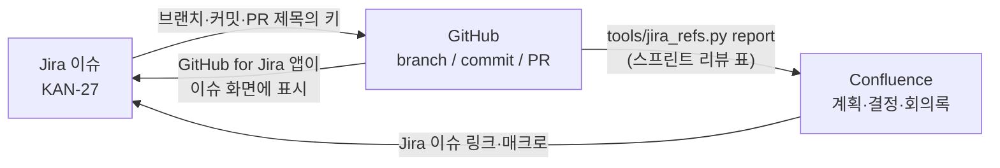

# Jira · Confluence 연결 안내

- **대상:** 이 저장소에서 일하면서 Jira로 할 일을, Confluence로 계획·결정을 관리하는 팀원
- **갱신:** 2026-10-17
- **규칙 원본:** 이 문서는 팀 관례 안내다. 브랜치·커밋·시험 규칙의 원본은 루트 `AGENTS.md`, [팀 가이드](team-guide.md), ADR이다. Jira 키는 저장소 규칙이 아니므로 키가 없다고 push·머지를 막지 않는다.

## 1. 연결 구조

세 도구는 **이슈 키 하나**(예: `KAN-27`)로만 이어진다. 저장소는 키를 적는 자리만 정하고, 이어 붙이는 일은 Atlassian 쪽 기능이 한다.



| 무엇을 | 어디에 | 정본 |
|---|---|---|
| 할 일, 담당, 기한, 상태 | Jira 이슈 | Jira |
| 코드, API, ADR, 시험 결과 원문 | 이 저장소 | GitHub |
| 계획, 결정, 회의록, 결과 요약 | Confluence | Confluence |

같은 내용을 두 곳에 복사하지 않고 링크로 잇는다.

## 2. 키를 적는 자리

| 자리 | 형식 | 예 |
|---|---|---|
| 브랜치 | `<type>/kan-<번호>-<주제>` (D-372 `<type>/<topic>` 안에서 topic 앞에 키) | `feat/kan-27-pinky-waypoint-goal` |
| 커밋 메시지 | `type(범위): 요약 (KAN-<번호>)` | `feat(fleet): send waypoint goal (KAN-27)` |
| PR 제목 | 맨 앞에 `[KAN-<번호>]` | `[KAN-27] Pinky Waypoint 이동 지시` |
| PR 본문 | 템플릿의 `Jira:` 줄 | `Jira: KAN-27` |

- 키가 여럿이면 모두 적는다: `(KAN-27, KAN-28)`.
- Jira 이슈가 없는 저장소 정비 작업은 키 없이 해도 된다. 대신 PR 본문 `Jira:` 줄에 `없음`이라고 적는다.
- 확인: `python tools/jira_refs.py check` (현재 브랜치), `--message-file .git/COMMIT_EDITMSG` (커밋 메시지). 기본은 알려 주기만 하고, `--strict`일 때만 실패로 끝난다.

## 3. Jira에서 보기 — GitHub for Jira 앱

Atlassian의 **GitHub for Jira** 앱을 연결하면 키가 들어간 브랜치·커밋·PR·빌드가 Jira 이슈 화면의 개발 패널에 자동으로 나타난다. 저장소에는 설정 파일이 필요 없다.

1. Jira 사이트 관리자가 Jira **앱 → Atlassian Marketplace**에서 *GitHub for Jira*를 설치한다.
2. 앱 설정에서 GitHub 조직 `robotics-team-1213`을 연결하고, 저장소 접근을 `rosy-platform`으로 제한한다. GitHub 조직 소유자의 승인이 필요하다.
3. 연결 뒤 기존 기록을 가져오는 백필이 끝나면, 키가 있는 PR 하나를 열어 이슈 화면에 나타나는지 확인한다.

**스마트 커밋**(선택): 앱이 연결되어 있으면 커밋 메시지로 Jira에 댓글을 남길 수 있다. 커밋 작성자의 이메일이 Jira 계정 이메일과 같아야 동작한다.

```text
feat(fleet): send waypoint goal (KAN-27) KAN-27 #comment 실물 Pinky 5회 중 4회 도착
```

상태를 바꾸는 `#done`·`#in-progress` 같은 전환 명령은 쓰지 않는다. 완료는 사람이 Jira에서 완료 기준을 확인한 뒤 옮긴다.

## 4. Confluence에서 보기

- 계획·결정 페이지에서 Jira 이슈 키를 입력하면 이슈 링크(상태 포함)로 바뀐다. 이슈 목록이 필요하면 Jira 매크로에 JQL(예: `project = KAN AND sprint in openSprints()`)을 넣는다.
- 저장소 문서·PR은 링크로 건다. 검증 결과에는 당시 커밋 링크를 함께 둔다.
- 스프린트 리뷰 때 그 주의 커밋을 이슈별로 묶은 표를 만든다. 결과를 리뷰 페이지에 붙여 넣는다.

```bash
python tools/jira_refs.py report --range "origin/main@{2026-10-19}..origin/main"
python tools/jira_refs.py report --range origin/main..HEAD --format json   # 다른 스크립트용
```

표 끝의 `(없음)` 줄은 키가 없는 커밋이다. 개수가 많으면 회고에서 이유를 본다.

## 5. 저장소에 두지 않는 것

이 저장소는 공개다.

- Atlassian 사이트 주소, 페이지 ID, 이메일, API 토큰은 커밋·이슈·PR에 적지 않는다. Confluence 페이지는 제목으로 가리킨다(예: Confluence SP › 결정 로그).
- Jira·Confluence를 호출하는 GitHub Actions는 만들지 않는다. 저장소 워크플로는 `GITHUB_TOKEN` 외의 secret을 쓰지 않는다(D-437, `.github/workflows/AGENTS.md`). 자동 연결은 3장의 앱이 맡는다.
- `tools/jira_refs.py`는 git 기록만 읽는다. 네트워크를 쓰지 않고 토큰도 받지 않는다.

## 6. 처음 설정 체크리스트

- [ ] Jira 관리자: GitHub for Jira 앱 설치, `rosy-platform` 연결, 백필 확인
- [ ] 팀원: git `user.email`을 Jira 계정 이메일과 맞춤 (스마트 커밋을 쓸 때만)
- [ ] 팀원: 첫 브랜치를 `feat/kan-<번호>-<주제>`로 만들고 `python tools/jira_refs.py check` 확인
- [ ] PM: 스프린트 리뷰 페이지에 `report` 표 붙이는 순서를 리뷰 안건에 넣음
