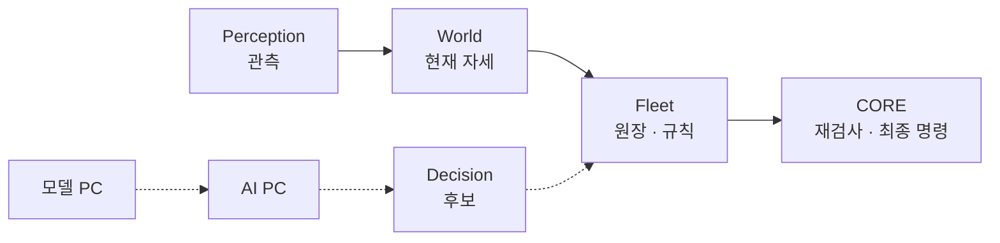
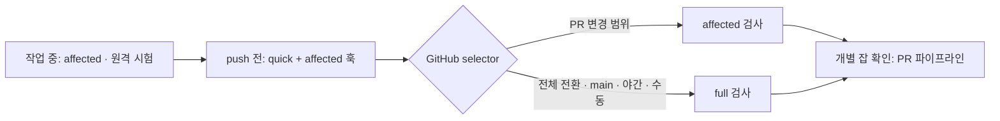

# ROSY 개발 가이드 — 빌드·시뮬·테스트·배포

빌드·시뮬레이션·시험 명령과 배포 시작점을 찾는 문서다. 처음 합류했다면 [팀 가이드](team-guide.md), 실험실에서 함께 작업한다면 [공유 체크아웃](shared-checkout.md)부터 읽는다. 계약은 [README 「핵심 계약」](../../README.md#핵심-계약)과 SRS·ADR이 우선한다.

실험실 노트북의 pytest는 원격 시험 PC로 보낸다. 개인 클론의 로컬 시험 조건은 [팀 가이드 §3.3](team-guide.md#33-시험-결과-읽기)을 따른다(D-584·D-762).

## 구조

폴더는 **소스 책임 분류**일 뿐이다. 디렉터리 경로만으로 최종 명령 writer, 설치 호스트, 이미지 묶음을 판단하지 않는다([D-315](../adr/D-315-source-folder-responsibility-and-runtime-authority.md)). 소스 루트와 소유 영역의 정본은 [`tools/harness/platform_parts.yaml`](../../tools/harness/platform_parts.yaml)이다 (D-427).

코드를 고칠 위치는 [폴더 책임표의 편집 집](platform-folder-responsibilities.md#편집-집)에서 찾는다. 현재 경로와 소유권은 manifest, 이동 당시의 설치·원격 검증은 [D-637 결과](../validation/d637-remaining-folders-2026-10-11/result.md)와 책임표의 후속 기록을 확인한다. 이 가이드에 별도 폴더 목록을 유지하지 않는다.

폴더 이름과 ROS 패키지 이름은 항상 같지 않다(예: `middleware/core/gateway`는 `core`, `middleware/perception`은 `control`). site 앱은 폴더 끝 이름이 `<word>`, 패키지가 `rosy_<word>`다(D-377). Pinky의 최종 `cmd_vel`은 CORE가 발행하고, 제품 adapter는 ROS/vendor 표현 변환만 한다 ([D-317](../adr/D-317-control-and-shared-contract-source-boundaries.md)).

## 인지와 판단

현재 구현과 제안을 구분한다. 점선은 목표 연결이며 운영 연결로 읽지 않는다.

World(`operations/world`, 배포 휠 `rosy-world`)는 별도 PC나 프로세스가 아니다. 현장의 Fleet이 `rosy.world.state.projections.map_pose`를 직접 읽어 현재 자세를 만들고, 그 자세를 미션·대형·차로에 쓴다. 행동 후보로 미래 상태를 예측하는 World model은 [D-782](../adr/D-782-omx-action-conditioned-world-model.md)의 OMX 실행 전 검사기로 기반(데이터·학습·평가·그림자)만 있고 실행 경로에는 연결하지 않았다.

시험은 개발 계약 검사(실험실은 원격 시험 PC·CI, 개인 클론은 팀 가이드 조건) → 모델 PC 독립 L0 → AI PC 고정 버전 스모크 → 현장 Fleet/CORE 수용으로 나눈다([D-527](../adr/D-527-decision-test-host-boundaries.md)). 모델 PC → AI PC → Fleet → CORE의 Decision 경계와 VLM/텍스트 후보의 분리는 [파이프라인 설계](../plans/2026-10-08-decision-model-pipeline-design.md)에 있다. 점선은 **목표 연결**이며 현재 운영 연결이 아니다([D-516](../adr/D-516-offline-decision-model-replay-boundary.md)).

관측 → 현재 자세 → 규칙 → CORE. `world`는 관측과 확정 사건을 대조하는 상태이며 현재 구현은 자세를 제공한다([v0.2 §3.1](../reference/ROSY_Platform_Architecture_Design_v0.2.md), [D-290](../adr/D-290-rosy-platform-naming-and-site-intent-boundaries.md)). 생성형 월드 모델은 구현되지 않았다. `age_s`는 그 자세가 얼마나 오래됐는지를 나타낸다.



| 층 | 자리 | 지금 |
|---|---|---|
| **Perception** | `middleware/perception` · `operations/overhead`; 학습은 `learning/{curation,registry,training,evaluation}/perception`, 운영 CLI는 `tools/perception` | 동작. 학습 차선은 섀도 ([D-356](../adr/D-356-perception-learning-loop-and-model-delivery.md) Proposed) |
| **World** | `operations/world` (`rosy.world.state.projections.map_pose`, `rosy.world.api`) | 받은 sighting·운영자 pin·odom의 현재 자세(`state`, `source`, `age_s`). Fleet이 직접 import. service·trip·swarm·admission은 Fleet ([D-752](../adr/D-752-canonical-world-map-pose-consumers.md), [D-630](../adr/D-630-remaining-platform-semantic-holders.md)). odom으로 잇는 `source=bridged`는 dead reckoning |
| **Decision** | `operations/decision/src/rosy/decision` (`rosy.decision`, Fleet 배포에 포함) | 기존 ER2/VLM·후보·도구 요청. 원장·admission·dispatch는 Fleet에 유지 ([D-637](../adr/D-637-remaining-decision-console-learning-folders.md)) |
| **Supervisor** | Fleet `stuck_resolver` | 막힘 규칙과 사람. 원장·admission은 Fleet |
| **모델** | 모델 PC 평가 → AI PC 승인 버전 | [D-516](../adr/D-516-offline-decision-model-replay-boundary.md) 경계. 점선은 목표. VLM은 [D-492](../adr/D-492-d438-vision-tier-local-qwen-ai-pc-gated.md) Proposed |
| **CORE** | `middleware/core/gateway` | 최종 `/cmd_vel` (D-2) |

`MapPose`는 현재 자세다. `ObservationSnapshot`은 관측 근거 참조이고, 원본 영상 경로나 Fleet 정책이 아니다. `road_region`은 카메라 구역 입력의 시각·프레임·보정·변환·근거를 검사한다. 화소 기하와 주행은 하지 않는다([D-665](../adr/D-665-observed-road-region-and-paired-fitness.md)). 그 타입과 순수 검사의 정본은 `core_common.observation`이고, World import는 같은 객체를 다시보낸다([D-667](../adr/D-667-shared-observation-contract-for-offline-fitness.md)). 여러 소비자를 위한 일반 World State 계약은 아직 없다.

정체(`wall` · `object` · `robot` · `person` · `unknown`)와 텍스트 후보는 별도 작업이다. Perception → World State → Supervisor → Skill → Planner/Control 다섯 층은 [D-503](../adr/D-503-autonomy-chain-facts-and-exception-queue.md)이 문서만으로 제안한다. 그 제안이 적은 World 경로 `fleet/localization/map_pose.py`는 지금 경로가 아니다. 절차는 [파이프라인 설계](../plans/2026-10-08-decision-model-pipeline-design.md).

## 빌드 및 시뮬레이션

```bash
source env.sh
colcon --log-base log build --symlink-install --base-paths $(python3 tools/harness/colcon_roots.py) --build-base build --install-base install

# 시뮬레이션 2대
ros2 launch gz_sim gz_multi.launch.py robots:=2

# core 게이트웨이
ros2 launch core rosy_core.launch.py

# 다로봇 시뮬과 Fleet 콘솔을 한 번에
bash tools/run_fleet_sim.sh
```

새 Python ament 패키지를 추가하거나 옮긴 뒤 resource marker가 빠졌다면
`bash tools/fix_ament_resource.sh`로 `resource/<package>` marker를 다시 만든다.
이 스크립트는 패키지 manifest나 colcon build를 대신하지 않는다. 로컬 수동주행
메모와 주행 세션은 소스나 설치물이 아니라 `data/teleop` 및 `data/drive`에 둔다.
세션 파일은 커밋하지 않으며, 예외는 `data/README.md`를 따른다.

### 로그 레벨과 디버거

core 로그를 자세히 보려면 `log_level`을 준다. core 로거에만 적용되고 rcl/DDS 로그는 그대로다.

```bash
ros2 launch core rosy_core.launch.py log_level:=debug
```

중단점이 필요하면 debugpy로 띄우고 VS Code에서 붙는다. debugpy는 개발 PC에만 설치하고 payload에는 넣지 않는다.

```bash
python3 -m pip install --user debugpy
# 클라이언트가 붙을 때까지 기다린다. 127.0.0.1에만 연다
ros2 run --prefix 'python3 -m debugpy --listen 127.0.0.1:5678 --wait-for-client' core core
```

다른 PC(시뮬 PC 등)에서 띄웠다면 포트를 밖으로 열지 말고 SSH 터널로 가져온다: `ssh -N -L 5678:127.0.0.1:5678 <host>`.

`.vscode/`는 gitignore 대상이라 설정은 각자 둔다. 개인 `.vscode/launch.json` 예:

```json
{
  "version": "0.2.0",
  "configurations": [
    {
      "name": "core attach (debugpy)",
      "type": "debugpy",
      "request": "attach",
      "connect": { "host": "127.0.0.1", "port": 5678 },
      "justMyCode": false,
      "pathMappings": [
        { "localRoot": "${workspaceFolder}", "remoteRoot": "<원격 PC의 rosy-platform 경로>" }
      ]
    }
  ]
}
```

같은 PC에서 `--symlink-install`로 빌드했다면 `pathMappings`는 필요 없다. 원격이면 `remoteRoot`를 그 PC의 checkout 경로로 바꾼다.

## 테스트와 CI

작업 중에는 변경 범위의 시험을 요청하고, push 전 훅과 GitHub CI에서 검증을 이어간다([D-436](../adr/D-436-change-scoped-test-tiers.md)). PR의 전체 검사 전환 여부는 selector가 정한다. main push·야간·수동 실행은 전체 검사를 수행한다.



| 단계 | 언제 | 명령 |
|---|---|---|
| affected | 작업하는 동안 | `python tools/harness/rosy_harness.py affected --base origin/main --print`로 선택을 확인하고 아래 원격 실행기로 요청 |
| quick + affected (pre-push) | push 직전, 훅이 자동 실행 | `bash tools/hooks/install.sh`로 설치한 `pre-push` |
| GitHub CI | PR은 selector 결과, main·야간·수동 실행은 full | `.github/workflows/ci.yml`. 릴리스 빌드는 별도 검증 관문을 따른다 |

실험실에서는 먼저 자기 변경을 커밋한 뒤 선택 결과를 원격 실행기에 보낸다. `affected --run`은 현재 PC에서 pytest를 직접 호출하므로 이 노트북에서는 쓰지 않는다. 결과는 기존 실패와 비교한다. `NEW`가 나오면 그 브랜치의 실패다.
로그·증거·빌드 산출물 같은 저장소 밖 파일은 `ROSY_SCRATCH`에 둔다. 설정하지 않으면 시스템 임시 폴더를 쓴다.

```bash
python tools/harness/rosy_harness.py affected --base origin/main --json | python tools/remote/remote_pytest.py --affected-json - --log-dir "${ROSY_SCRATCH:-${TMPDIR:-/tmp}}/<이름>"
python test/known_failures.py "${ROSY_SCRATCH:-${TMPDIR:-/tmp}}/<이름>/run-1.txt"
```

여러 시험 묶음이 선택되면 `run-2.txt`, `run-3.txt`도 생긴다. 실행기가 출력한 모든 `run-N.txt`를 위 비교 명령에 각각 넘기고, 각 로그의 실행·건너뜀 수와 `NEW`를 확인한다. 첫 로그만으로 전체 통과를 판단하지 않는다.

quick 시험 목록은 [`tools/hooks/pre-push`](../../tools/hooks/pre-push)가 관리한다. 실패한 묶음을 재현할 때는 훅에 출력된 명령을 원격 실행기로 요청한다. GitHub의 `ci-result`와 개별 잡, 건너뛴 검사는 [PR 파이프라인](pr-pipeline.md#ci와-병합)에 따라 확인한다.

```bash
python tools/harness/rosy_harness.py lint   # ADR 중복·mojibake·append-only·staleness
```

### 브라우저 시험 (Chromium)

실제 Chromium 시험은 옵트인이다. 정식 이름은 `ROSY_RUN_BROWSER_TESTS=1`이고, 예전 Fleet 이름 `ROSY_BROWSER_TESTS=1`도 받는다(`test/browser_harness.py`의 `browser_tests_enabled()`). 로컬 서버 포트는 `safe_listener()`/`free_port()`로 잡는다. Windows 동적 포트 범위가 1024부터면(`netsh int ipv4 show dynamicport tcp`) port 0이 Chromium 차단 포트(2049, 6000, 10080 등)를 주고 `net::ERR_UNSAFE_PORT`로 실패한다.

바꾼 경로에 걸린 브라우저 시험만 시험 PC에서 돌린다. 경로와 시험의 대응은 `test/browser_scope.py`의 `SCOPE`다. `tools/land.py --tests auto`는 고른 시험 묶음 뒤에 이 브라우저 시험을 `ROSY_RUN_BROWSER_TESTS=1` 묶음으로 더 돌린다. 손으로 돌릴 때는 `tools/remote/remote_pytest.py`의 `--` 뒤 맨 앞에 `ROSY_RUN_BROWSER_TESTS=1`을 둔다. 앞에 오는 `ROSY_*=값` 단어는 시험 PC 작업의 환경 변수가 되고 pytest 인자가 아니다. 그 작업은 먼저 venv의 playwright에 맞는 Chromium을 그 PC의 `~/.cache/ms-playwright`에 설치한다(있으면 그대로 둔다).

```bash
t=$(python test/browser_scope.py <바꾼 경로...>) && python tools/remote/remote_pytest.py --log-dir "${ROSY_SCRATCH:-${TMPDIR:-/tmp}}/<이름>" -- ROSY_RUN_BROWSER_TESTS=1 $t
python test/known_failures.py "${ROSY_SCRATCH:-${TMPDIR:-/tmp}}/<이름>/run-1.txt"
```

전체 브라우저 묶음은 개발 노트북에서 돌리지 않는다. 2026-10-07 이 노트북에서 34분–2시간 26분이 걸렸고 MemoryError와 `Page.goto` 타임아웃 플레이크가 났다. Gazebo처럼 현장 PC(robttt)나 모델 PC(OMEN)의 그 PC 체크아웃에서 돌린다.

```bash
# 현장 PC 또는 모델 PC에서. <checkout>은 그 PC의 rosy-platform 클론 또는 worktree, <ref>는 시험할 브랜치나 커밋.
cd <checkout> && git fetch && git checkout --detach <ref>
python -m playwright install chromium   # 처음 한 번
t=$(python test/browser_scope.py test/browser_harness.py) && ROSY_RUN_BROWSER_TESTS=1 python -m pytest $t -q -rfE -p no:cacheprovider > <scratch>/browser.txt
python test/known_failures.py <scratch>/browser.txt
```

`test/browser_harness.py`를 넘기면 모든 브라우저 시험이 골라진다. 고를 시험이 없으면 `browser_scope.py`가 exit 3으로 끝나 `&&` 뒤의 pytest가 돌지 않는다(빈 목록이 저장소 전체 pytest가 되지 않게). 일부만 필요하면 바꾼 경로를 넘긴다.

CI(`.github/workflows/ci.yml`)는 `ros:jazzy-ros-base` 이미지에서 colcon 빌드, pytest, 부트 스모크(slam_toolbox 없이 기동), SaveMap 타입 가드를 돌린다. 호스트 pytest가 통과해도 장치·ARM64 이미지·현장 수용 증거를 대신하지 않는다.

## 관제 배치

현장 Ubuntu PC가 Fleet·Vision·Caddy 서비스를 실행하고, 관제 PC는 HTTPS로 Fleet의
`/console`을 여는 브라우저 단말이다. 두 역할은 한 물리 PC에 함께 놓을 수도 있다.
Pinky의 화면과 최종 주행·정지 판단은 각 로봇의 CORE에 남는다. OMX-AI 작업대 제어는
별도 로컬 인스턴스의 수용 절차가 필요하다. 관제 화면의 현재 표시 이름은
`Rosy Fleet`이다(D-487). 현장 운영은 Fleet, 한 대 관리는 Robot, 직접 운전은
Pilot이 맡는다. [앱별 작업과 책임](app-responsibilities.md)에서 API·정본·실행 권한과
앱 간 이동 및 이행 조건을 확인한다. 자연어 명령과
OMX 원격 작업은 아직 수용된 기능이 아니다.

배치 결정은 [D-275](../adr/D-275-web-surface-and-video-runtime-ownership.md)와
[D-290](../adr/D-290-rosy-platform-naming-and-site-intent-boundaries.md),
현장 접속 절차는 [사이트 배포 설명](../../deploy/site/README.md)을 따른다.

## Raspberry Pi 5 런타임

**로봇은 네이티브로 돈다.** 제품 런타임은 Docker가 아니라 Ubuntu Server 24.04
arm64 위의 ROS 2 Jazzy + systemd다 (D-161). `rosy-runtime.target`이 CORE를 기본
기동하고, I/O와 navigation은 승인 후 명시적으로 켠다. Docker/Compose는 개발·CI
전용이며 제품 이미지에는 설치하지 않는다. 장치마다 컨테이너를 켜고 끄는 옵션은
없고, 유연성은 프로필/slice로만 표현한다 — 컨테이너는 안전 계획 밖 비전·AI 같은
선언된 사이드카 워크로드에만 허용된다 (D-197, D-246).

런타임 슬라이스는 단계별로 나뉜다. `rosy-core`는 FastAPI/rclpy만 소유하고,
`rosy-motor`는 LiDAR 없는 벤치 커미셔닝, `rosy-io`는 승인된 모터·LiDAR 통합
운용에 사용한다.

```bash
cd deploy/robot/pinky_pro
sudo ROSY_ROBOT_NUMBER=1 bash ./install-pi.sh
# 신원은 로봇 번호 하나에서 나온다 (ADR D-33). Device installer가 .env를
# 관리하고 두 값을 함께 유도하므로 수동으로 identity를 덮어쓰지 않는다.
# stationary core와 readback gate를 통과하기 전에는 motor/hardware mode를 켜지 않는다.
sudo ./runtime-mode.sh up
```

기동 후 같은 네트워크의 브라우저에서 `http://<raspberry-pi-ip>:8080/dashboard`
를 연다. Rosy API viewer/operator/administrator 토큰으로 로그인하면 로봇 상태,
비상정지, 기능 계약과 Raspberry Pi OS의 CPU·메모리·디스크·온도를 한 화면에서
확인할 수 있다. 화면은 FastAPI에 내장되어 별도 Node.js 서버가 필요 없다.

모터 명령은 ROS와 분리된 `MotorController` 함수 계층에서 유효성 검사,
차동구동 변환, 선속도·각속도·바퀴 RPM 제한을 거친다. 결과는
`APPLIED / LIMITED / REJECTED / DRIVER_ERROR`로 명확히 남으며, 잘못된 입력이나
UART 오류에는 즉시 zero-RPM 정지를 시도한다. DYNAMIXEL 드라이버도 동일한
RPM 상한을 독립적으로 검사하고 엔코더 32비트 롤오버를 안전하게 처리한다.

유선 LAN 없는 SD 카드 굽기, Wi-Fi·SSH 설정, Windows 배포 및 첫 접속은
[`docs/deployment/raspberry-pi-wifi-image.md`](../deployment/raspberry-pi-wifi-image.md)를
따른다. 장치 권한과 물리 인수시험은
[`docs/deployment/raspberry-pi-runtime.md`](../deployment/raspberry-pi-runtime.md)에
정리되어 있다. ARM64 빌드 경계와 컨테이너 포함 범위는
[`docs/deployment/arm64-build-notes.md`](../deployment/arm64-build-notes.md)를 따른다.

## 로드맵

현재 진행 상태와 남은 게이트는 생성된 [STATUS](../../STATUS.md)에서 해당 모듈의 `progress.md`로 이동해 확인한다. [2026-09-13 계획](../plans/2026-09-13-rosy-os-device-validation-implementation-plan.md)은 당시의 단계 구분을 보존한 기록이다.
