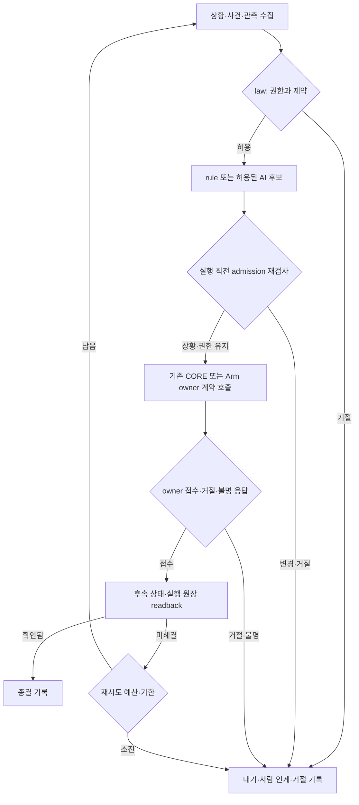

# Fleet 통합 규칙집

기준: 2026-10-12 · [D-674](../adr/D-674-fleet-rule-pipeline.md), [D-678](../adr/D-678-fleet-execution-pipeline-closure.md)

Fleet이 상황을 보고 규칙과 AI 후보를 판단해 실행하며 결과를 확인하는 공통 탐색 입구다. 이 문서의 `FL-*`는 실행 제약(law), `FR-*`는 상황별 대응(rule)의 탐색 식별자이며 새 API 필드가 아니다. 세부 계약은 [FLEET SRS](../spec/ROSY%20FLEET%20SRS.md), [CORE SRS](../spec/ROSY%20CORE%20SRS.md), [API reference](ROSY%20API%20%26%20Protocol%20Reference.md), 각 ADR과 아래 구현을 따른다. 코드의 값과 활성 현장 설정이 다르면 실제 설정을 확인하며 문서만으로 활성화를 주장하지 않는다.

## 1. 파이프라인과 책임

law는 후보의 우선순위보다 먼저 적용하며 실행 직전에도 적용한다. AI-first는 후보 선택 순서를 바꾸는 기능이다. E-stop, 실행 소유자, 사람 점유, 사건 바인딩, CORE의 최종 거절 권한을 바꾸지 않는다. 반면 D-577의 위치·횡단보도 등의 일부 후보 검사는 D-610 AI-first 설정에 따라 유지 여부가 달라진다. 모든 검사를 무조건 law라고 부르지 않는다.

| 단계 | 입력 → 출력 | 담당 구현 | 실패·변경 시 |
|---|---|---|---|
| Observe | 로봇 snapshot·사건·지도·AI 근거 → 현재 상황 | `SharedGather`, `StuckResolverLoop._row`, `LineStuckBoard`, Situation | offline/unknown을 정상·성공으로 추정하지 않음 |
| Law | 현재 상황·소유권 → 허용/거절 사유 | `pipeline.law_hold`, resolver의 사람 점유·기한 검사 | 자동 실행 중단, 기존 인계/감사 경로 |
| Candidate | 상황·예산·허용 선택지 → Answer/인계/대기 | `pipeline.candidate`, 기존 `_rule`, `ai_first`, `lane_lost`, `ProblemWatch` | AI 거절은 기본 규칙 또는 사람; AI 대기는 명령 미전송 |
| Admission | 원래 후보 + 최신 가용 snapshot·live trip·사람 점유·AI 허가 → 전송 허가 | `StuckResolverLoop._admission_row`/`_answer`, `pipeline.ai_hold`, `ProblemWatch._answer` | law 위반·AI 비활성·human class·제안 교체/만료·근거 부족은 미전송 |
| Dispatch | 허가된 후보 → owner 응답 | 기존 `RobotClient`; Task/Mission은 각 dispatcher | 오류 분류·취소·UNKNOWN 의미 보존 |
| Readback | 접수 이후 상태·실행 원장 → resolved/unresolved/refused/superseded | `Outcomes`, `closed_loop`, Task projection, Mission reconciliation | 접수만으로 완료하지 않음; offline은 resolved 근거가 아님 |
| Close | 결과·재시도 예산·사람 소유 → 종결/다음 회차/사람 | `ProblemLog`, resolver chain, 각 Task/Mission store | 불명 실행을 무조건 재발행하지 않음 |

자동 stuck와 stalled/pose_lost는 같은 `pipeline.law_hold`를 사용한다. Task/Mission·교통은 같은 책임 순서를 각 기존 트랜잭션/lease로 구현하며 새 stuck 파이프라인에 억지로 넣지 않는다. 사람의 직접 조작은 인증·사건 점유·CORE 거절 경로이며 자동 rule/AI 선택을 거치지 않는다. 정지 명령은 각 기존 정지 경로를 사용한다.

## 2. 우회할 수 없는 제약: law

| ID | 조건과 제약 | 집행 위치·근거 | 확인 시험 |
|---|---|---|---|
| FL-OWNER | Fleet은 계약 호출만 수행. Base 최종 출력은 CORE, Arm 실행은 해당 owner | README 핵심 계약, D-2/D-38/D-369; `swarm/transport.py`, Mission transport | `test_boundaries.py`, `test_mission_dispatcher.py` |
| FL-ESTOP | E-stop 중 자동 해결 후보를 실행하지 않음. 자동 해제 금지 | `pipeline.law_hold` → `estop`; CORE safety | `test_stuck_resolver_loop.py`, `test_ai_first.py` |
| FL-CALIBRATION | attended calibration/activity와 자동 해결을 겹치지 않음 | `pipeline.law_hold` → `calibration`; D-321 | 위 두 시험의 calibration 경합 |
| FL-HUMAN | 사람이 점유한 stuck에는 자동 후보를 보내지 않음. await 후에도 다시 확인 | resolver `_claims`, loop `_answer`, incidents handoff; D-438/D-661 | `test_stuck_resolver_loop.py`, `test_incident_handoff.py` |
| FL-CASE | 선택한 stuck와 전송 직전 stuck ID가 동일해야 함 | `pipeline.law_hold` → `stuck_changed`; CORE D-407 재검사 | `test_stuck_resolver_loop.py` 사건 변경 |
| FL-TRIP | trip owner 외 자동 해결기는 WAIT만. 다른 이동은 trip 취소/소유권 절차 필요 | `law_hold` → `trip`, `trip_guard`, trip lease; D-494/D-517/D-541 | `test_ai_first.py`, `test_trip_runner.py` |
| FL-ONLINE | offline/사라진 로봇에는 자동 후보를 전송하지 않음. offline readback은 resolved로 쓰지 않음 | `law_hold` → `offline`, `Outcomes._judge` | `test_stuck_resolver_loop.py`, `test_ai_first.py` |
| FL-RESOURCE | Task/Mission/직접 action이 같은 자원을 중복 소유하지 않음 | `dispatch_admission.reserve`, 각 store; D-336/D-657 | `test_dispatch_admission.py` |
| FL-FENCE | stop/취소 generation이 달라진 실행 허가는 폐기. policy Task는 별도 활성화 없으면 거절 | `cancel_all`, Task store, Mission dispatcher, `FleetTaskService.POLICY_DISPATCH_ENABLED=False` | `test_dispatch_stop_latch.py`, `test_task_service_policy_evidence.py` |
| FL-UNKNOWN | owner 응답 불명은 물리적 실패나 완료로 확정하지 않음. 불명 YIELD 자동 재발행 금지 | resolver `result`, loop 예외 처리, Mission reconciliation; D-610/D-369 | `test_stuck_resolver_loop.py`, `test_mission_dispatcher.py` |

자동 대응 law 검사 순서는 offline → E-stop → calibration → stuck ID → trip이다. 사람 점유를 전송 직전 우선 확인하고, 기한·예산은 resolver chain에서 검사한다. 이 순서는 표시할 첫 거절 사유를 고르는 순서이며 장치의 안전 우선순위를 재정의하지 않는다.

## 3. 상황별 규칙: rule

| ID / 코드 규칙 | 조건 | 처리·다음 단계 | 구현·계약 |
|---|---|---|---|
| FR-PEER / R1 | 신뢰할 수 있는 앞 로봇이 차로를 막음 | WAIT. 교행 지도와 geometry가 있으면 기존 meet 판단 적용 | `resolver._rule`, `_meet`; D-438/D-577 |
| FR-BACK / R2 | 장애물 막힘, 로컬 복구 허용, 시도 잔여 등 기존 조건 충족 | BACK_AND_RETRY → admission → CORE 후방 검사 → readback | `resolver._rule`; D-438/D-407 |
| FR-LANE / R3 | lane_lost이며 지도·차로·후방·예산 등 복구 조건 충족 | BACK_AND_RETRY. 부족하면 R5 | `lane_lost.lane_lost_hold`; D-577 |
| FR-NOMOTION / R6 | no_motion, R3 계열 조건 충족 | BACK_AND_RETRY. R6의 기존 peer 조건 예외는 유지 | `resolver._rule`, `lane_lost_hold`; D-577 개정 |
| FR-HOLD / R5 | 위치/상황 불명, 횡단보도 개입, 복구 조건 부족 등 | WAIT 후 사람 인계. 일반 복구 예산을 소비하지 않음 | `pipeline.candidate`, `resolver.sent/result`; D-577 |
| FR-MEET / meet | 활성 지도와 두 로봇의 교행 조건·양보 장소가 맞음 | 고정 geometry의 YIELD; 구간 완료 뒤 RESUME. 첫 후보의 RESUME는 WAIT | `resolver._meet/_next_segment`, `fleet.meet`; D-453/D-610 |
| FR-DEADLOCK | 교착이 3 주기 지속, 우회 가능한 구성원이 있음 | 한 대 replan, 나머지 wait. 기본은 운영자 확인 `replan_hold`; 검증된 AI 선택은 D-610 경로 사용 | `traffic.handover.decide`, `lane_traffic`; D-517/D-610 |
| FR-UNKNOWN-TRAFFIC | UNKNOWN 점유가 30 s 초과, 우회 불가 또는 같은 경로 재우회 | human | `traffic.handover`; D-517 |
| FR-STALL | AI-first 대상, 라인 모드 켜짐, stuck 없음, 20 s 동안 정지·이동 < 0.05 m | 허용 선택 WAIT/LINE_OFF/STOP. 최종 condition·law 검사 뒤 기존 CORE API. trip은 WAIT만 | `ProblemWatch`; D-610 |
| FR-POSE | AI-first 대상, 지도 자세 DEGRADED/UNKNOWN | WAIT/IDENTIFY/STOP. 현재 자세가 회복됐으면 `problem_changed`로 미전송 | `ProblemWatch`; D-395/D-610 |
| FR-NECESSITY | 동일 사건·revision·유효 근거의 정상/막힘/부족 상태 | DO_NOT_INTERVENE / INTERVENE / ABSTAIN. 실행 권한 아님 | Situation `assessment.py`, `snapshot_assessment.py`; D-652 |
| FR-DELIBERATION | 현재 CORE blocked 사건에서 유효한 INTERVENE | reobserve/human 후보 토론만. 항상 `action_admissible=False`; 공개 자동 호출 없음 | `server/incident_deliberation.py`, Decision supervisor; D-672 |

## 4. AI가 파이프라인에 들어오는 위치

- 일반 경로: `pipeline.candidate`가 D-577 AI 제안을 검사한다. 유효한 제안은 허용 범위에서 후보가 되고, 없거나 거절되면 기존 rule로 돌아간다. 반환값 `wait`는 AI 대기이며 명령을 보내지 않는다.
- AI-first 경로: `fleet.ai_first.robots` 대상과 Console 스위치가 활성일 때 D-610 후보 선택을 적용한다. 기본 대상 목록은 비어 있다. `keep_gates`의 현재 기본은 `trip_wait_only`; 위치·횡단보도·복구 조건 등의 후보 검사를 전부 기본 활성이라고 가정하지 않는다. 공통 law는 이 설정으로 해제할 수 없다.
- AI 관측 fact는 근거다. D-577의 acting fact는 후퇴 후보를 WAIT+사람으로 제한할 수 있다. 명령 권한을 얻지 않는다.
- Decision의 모델 출력은 신뢰되지 않은 후보다. 허용 도구/선택지, 같은 frame/case/revision의 근거 바인딩과 유효 시간을 통과해야 한다. 새 모델 도구는 catalog·effect·dispatch allowlist를 함께 검토한다.
- advisory deliberation과 실제 stuck AI 제안 경로는 별개다. 토론 결과를 이동 명령으로 자동 변환하지 않는다.
- 자동 전송 전 원래 선택한 제안이 아직 동일한지 확인한다. stuck 비-WAIT AI 후보는 현재 AI 허가·human class·근거·기존 후보 검사를 다시 통과해야 하며 YIELD geometry까지 같아야 한다. 이미 선택 단계에서 계산한 예산은 다시 소비하지 않는다. 여러 로봇을 순차 처리해도 최초 후보를 다른 로봇의 새 제안으로 바꾸지 않는다. WAIT의 기존 정지·사람 인계는 유지한다.

## 5. 설정과 제한 시간

| 소유 위치 | 현재 기본값·의미 |
|---|---|
| `ResolverConfig` | `poll_s=1`, `restuck_s=30`, `rule_budget=2`, `escalate_after_s=60`, `pose_max_age_s=2`, `ai_wait_s=12` |
| `AiFirst` | 대상 robots 기본 빈 목록. 문제당 3회, 시간당 6회; 영상 근거 rosy_cam 2 s / front 3 s, VLM 대기 12 s |
| `Outcomes` | stuck/stalled 20 s, pose_lost/deadlock 30 s. stuck 전후 신뢰 위치가 모두 있으면 진행 방향 순이동 0.10 m 검사 |
| `traffic.handover` | UNKNOWN 30 s, 교착 지속 3 주기 |
| Situation `POLICY` | `line-follow-shadow-v1`, 근거 최대 나이 3 s, confirm 0 s, 판단 TTL 3 s |
| `FleetTaskService` | `POLICY_DISPATCH_ENABLED=False`. 정책 증거 수락 조건을 만족해도 이 gate가 꺼져 있으면 자동 Task 거절 |
| `SharedGather` | 기본 최대 1 s 캐시. 전송 전 최신 가용 snapshot을 공유하며 강제 새 장치 관측을 보장하지 않음 |

값은 코드 기본값이다. 실제 현장 overlay·Console 상태·설치 revision의 readback으로 활성 정책을 확인한다. live 주소·토큰·채워진 설정은 공개 규칙집에 기록하지 않는다.

## 6. 기록과 종결

1. stuck 답에는 사건·로봇·결정·principal·tier·rule·CORE 응답·인계 사유를 기존 `LineStuckAnswerLog`에 남긴다. 전송 직전 law 거절은 후보를 보내지 않고 기존 ESCALATE 기록을 남긴다. 사람 점유 뒤에는 자동 답을 기록해 사람 판단을 덮지 않는다.
2. 기타 문제의 제안은 기존 AI verdict와 `ProblemLog`에 거절 사유 또는 전송 사실을 기록한다. `forwarded`는 물리 성공이 아니다.
3. CORE 접수 뒤 기존 Outcomes가 관측 창에서 사건·자세·이동/교착 해소를 확인한다. `resolved`는 이 관측 규칙의 결과이며 독립 물리 수용이 아니다. offline은 창 종료 시 unresolved다.
4. unresolved를 재질문할 수 있어도 문제당/시간당 cap과 전체 기한을 지킨다. E-stop·사람 점유는 기존 창을 superseded로 종결한다.
5. Mission은 owner 원장을 재조회해 terminal action과 목표 근거를 확인한다. Task는 로봇 이벤트/projection으로 결과를 읽는다. 수락 응답·명령 전송·목표 확인을 하나의 성공으로 합치지 않는다.

## 7. 실제 연결 범위와 검증

| 경로 | 실제 처리 연결 | 이번 변경 |
|---|---|---|
| 자동 stuck | gather → lifecycle/law → `pipeline.candidate` → law/사람 재검사 → CORE → closed_loop/Outcomes → 기록/인계 | 공통 law·후보를 모으고 전송 직전 admission을 추가 |
| stalled/pose_lost | watch → law → AI evidence/caps/허용어 → 현재 law/condition 재검사 → 기존 CORE 명령 → Outcomes/ProblemLog | 같은 law 재사용, 전송 전 condition과 AI 근거 재검사 |
| 사람 stuck 답 | 인증/소유자 → 자동 resolver claim → 기존 CORE 계약 → 응답 기록 | 기존 경로 보존. 사람이 law를 지울 권한이 있다는 뜻은 아님 |
| 교통/trip | block 점유 → 교착 후보 → trip 계획 검사·lease → CORE → 상태 확인 | D-678: goal 승인부터 교통 후처리까지 stop token 유지; trip 시작 중 stop/소유권 재검사 |
| navigation Task | 요청·정책 증거 → resource/stop admission → dispatch → 이벤트 projection | D-678: 실제 owner 호출 직전에 attempt/generation/policy 재검사, known-unsent는 HOLD |
| Arm Mission | 후보·승인·resource/fence → owner action grant → submit → GetAction/목표 근거 → 종결 | D-678: 모든 RUNNING/불명 원장을 순환 대조; UNKNOWN 자동 submit 금지 |
| advisory 토론 | Situation → 같은 사건/근거 검사 → bounded Decision → 기존 원장 | 후보 전용; 실행 자동 활성화 없음 |

관련 시험은 [Fleet test 폴더](../../operations/fleet/test/)에 있다. D-674 회귀 시험은 후보 생성 후 E-stop/calibration/trip/사건/offline/사람 점유 변경, 기타 문제의 전송 전 조건 변경과 offline readback을 확인한다. 기존 stuck·AI-first·UNKNOWN YIELD·인계·Task/Mission 회귀를 함께 실행한다. 이 노트북에서는 pytest를 실행하지 않고 `tools/remote/remote_pytest.py`로 커밋된 HEAD만 검증한다.

### D-678 실행 경로별 완료 계약

완료 목표는 **모든 실행 진입점에 law → rule/허용 후보 → 최종 승인 → 기존 owner → receipt/readback → 종결 또는 이유 있는 미해결**을 연결하고, 변경된 조건·정지·불명 응답이 이 연결을 우회하지 못하도록 검증한 뒤 로컬 main에 머지하는 것이다. 모든 장치를 새 엔진으로 옮기거나 AI를 일괄 활성화하는 목표는 아니다.

| 실행 진입점 | 최종 승인·실행 owner | 결과 확인·종결 | 소스 회귀 근거 |
|---|---|---|---|
| 자동 복구·기타 문제 | D-674 law/사람/사건/AI 근거 재검사 → CORE | Outcomes/closed_loop/ProblemLog; offline 미해결, 인계 | `test_stuck_resolver_loop.py`, `test_ai_first.py`, `test_incident_handoff.py` |
| operator/policy Task | Task source/attempt/generation/policy와 자원 점유 → Console → CORE | 정확한 CORE event projection; 불명 UNKNOWN, known-unsent HOLD | `test_task_service_policy_evidence.py`, `test_task_service.py`, `test_dispatch_stop_latch.py` |
| console/intent/lane goal | 로봇별 단일 goal pipeline, 최신 trip/formation/stop → CORE | boolean 접수 후 기록; 교통 queue는 미완료; lease는 완료 증거 아님 | `test_goal_lease.py`, `test_server_console.py`, `test_server_traffic.py` |
| 교통 bay | 대상 trip/formation/stop와 mover stop → CORE | 명시적 접수 뒤 yielding; mover stop과 겹친 늦은/불명 전송은 보상 cancel, 불명 유지 | `test_goal_lease.py`, `test_server_bays.py` |
| Mission/OMX | resource/fence/instance → 기존 Action owner | 같은 attempt GetAction 순환 대조; 목표 증거 필요, UNKNOWN 재submit 금지 | `test_mission_dispatcher.py`, `test_mission_goal_provenance.py`, `test_goal_evidence.py` |
| Cell Job | 현재 READY step/checkpoint/fence/instance → 기존 Action owner | submit 한 번, GetAction/goal evidence 뒤 다음 step; HOLD/UNKNOWN 점유 유지 | `test_step_dispatcher.py`, `test_cell_goal_evidence_service.py` |
| trip/교차로 | 시작 token/소유권/map/traffic authority/lease → CORE | `_after_send` 접수·도착 구분; 취소/실패/불명은 기존 terminal reason | `test_trip_runner.py`, `test_traffic_signals.py`, `test_lane_traffic.py` |
| formation/relay | follower goal 경합 검사 → FormationSession → CORE follow | 각 무장 뒤 STOPPED 검사·rollback; relay/watch의 HOLD와 stop 사유 유지 | `test_goal_lease.py`, `test_session.py` |
| signals | 인증/허용 verb/phase/점유·관측 → SignalConsole/traffic signal owner | 의도·장치 상태·관측 대조, 유실/오류 표시; 물리 안전 인터록 증거와 별개 | `test_server_signals.py`, `test_traffic_signals.py` |
| cancel/E-stop/line OFF | 기존 stop fence/fanout → 각 owner | 부분 실패/불명 응답 보존, HTTP 응답만으로 물리 정지 확정 금지 | `test_cancel_all.py`, `test_dispatch_stop_latch.py`, `test_goal_lease.py` |

navigation은 capability/state 대기 뒤 queue를 만들기 전부터 route/observe/map/bay 계산과 내부 cancel 뒤까지 같은 stop token을 검사한다. 내부 traffic cancel 한 번만 예상한 다음 generation으로 인정한다. 외부 정지로 바뀐 token은 대기열·claim·lease를 되살릴 수 없다. 전송 전 거절과 전송 후 불명을 구분하며, 불명은 성공 또는 안전한 재전송으로 승격하지 않는다.

기존 Cell Job·signal·advisory 경로는 계약과 회귀를 재사용한다. dispatch action 종류, 배포 profile, policy gate와 AI 대상의 opt-in은 기존 설정을 따른다. 구현·원격 회귀·리뷰·로컬 머지는 현장 활성화 증거가 아니다. 현장 완료에는 설치 revision/overlay readback, 실제 operator 요청과 owner 원장 대조, 두 로봇의 정지·양보·재시작, 센서/지도 신뢰와 물리 도착·HOLD 수용 증거가 필요하다.

## 8. 규칙 변경 절차

새 상황은 기존 rule의 조건·거절·인계·종결에서 먼저 표현한다. 소유권·외부 API·안전 경계가 바뀌면 ADR/SRS/API 계약을 먼저 갱신한다. 변경할 rule과 law의 연결, caller, 설정, 로그 및 readback 시험을 함께 수정한다. 번호를 가진 항목을 문서에서 추가하는 것만으로 runtime 규칙을 발효시키지 않는다. main 통합·CI·배포·현장 overlay 활성화·물리 수용은 각각 별도 증거다.

## 구현 입구

- [공통 law와 후보 선택](../../operations/fleet/fleet/stuck/pipeline.py), [resolver lifecycle와 rule](../../operations/fleet/fleet/stuck/resolver.py), [전송 admission](../../operations/fleet/fleet/stuck/loop.py)
- [기타 문제](../../operations/fleet/fleet/stuck/problems.py), [결과 판단](../../operations/fleet/fleet/stuck/outcome.py), [원장 연결](../../operations/fleet/fleet/stuck/closed_loop.py)
- [AI-first](../../operations/fleet/fleet/stuck/ai_first.py), [D-577 후보 검사](../../operations/fleet/fleet/stuck/lane_lost.py), [Decision](../../operations/decision/src/rosy/decision/)
- [교통](../../operations/fleet/fleet/traffic/handover.py), [trip guard](../../operations/fleet/fleet/server/trip_guard.py), [자원 admission](../../operations/fleet/fleet/server/dispatch_admission.py)
- [Task](../../operations/fleet/fleet/server/task_service.py), [Mission](../../operations/fleet/fleet/server/mission_dispatcher.py), [Situation](../../operations/situation/rosy_situation/assessment.py)
