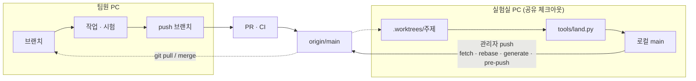

# 우리가 git으로 일하는 법

- **대상:** 이 저장소에 변경을 넣는 모든 사람과 에이전트 세션. 처음이면 이 문서 → [팀 가이드](team-guide.md) §1(첫날 설정) 순서로 읽는다.
- **갱신:** 2026-10-16
- **규칙 원본:** 이 문서는 흩어진 git 규칙을 한 장에 모은 안내다. 다르면 ADR이 이긴다 — [D-372](../adr/D-372-topic-branch-names-and-shared-checkout-wip.md)(브랜치 이름, 남의 미커밋), [D-427](../adr/D-427-platform-three-parts-middleware-operations-learning.md) 4항(push 순서), [D-510](../adr/D-510-union-merge-and-adr-number-reservation.md)(ADR 번호), [D-584](../adr/D-584-tests-never-run-on-operator-laptop.md)(시험 위치), [D-761](../adr/D-761-worktree-gateway-and-prune.md)(워크트리, Proposed), [D-762](../adr/D-762-main-gateway-pull-request-merge-queue.md)(main으로 가는 길).

## 1. 한 장 요약

| | 팀원 (자기 PC) | 실험실 PC의 에이전트 세션 |
|---|---|---|
| 작업 위치 | 자기 clone의 주제 브랜치 | 공유 체크아웃의 `.worktrees/<짧은이름>` |
| 브랜치 이름 | `<type>/<topic>` — `feat` `fix` `refactor` `docs` `uiux` | 같다 |
| `main`에 넣는 법 | PR → CI 녹색 확인 → **Create a merge commit**(squash 금지, D-868) | `tools/land.py`로 로컬 `main`에 `--ff-only` 착지 |
| `origin`에 올리는 사람 | 본인(브랜치만. `main`은 PR로만) | 관리자 계정이 로컬 `main`을 push |
| 시험 | 자기 PC에서 돌려도 된다(D-584 개정) | 실험실 시험 PC로 보낸다. 노트북에서 pytest 금지 |
| 절차 전문 | [CONTRIBUTING](../../.github/CONTRIBUTING.md) | [같이 하는 깃](shared-checkout.md) · 루트 [AGENTS.md](../../AGENTS.md) |

두 길은 **이행 기간의 모습**이다. 정해진 끝 상태는 모든 변경이 PR과 merge queue로 들어가고 공유 로컬 `main`이 없어지는 것이다(§7).



## 2. 저장소에 있는 것과 없는 것

| 무엇 | 어디 | 공개? |
|---|---|---|
| `main`, 주제 브랜치 | `origin` (`github.com/robotics-team-1213/rosy-platform`) | **전 세계 공개** |
| 진행 중 작업 공간 | `.worktrees/` (gitignore) | 로컬 |
| 보관 태그 `archive/*`, 미커밋 스냅샷 `refs/wip/*`, ADR 번호 선점 `refs/adr/D-*` | 실험실 clone에만 | **push 금지** |
| 실제 주소·계정·채운 장치 설정 | gitignored `private/` (예: `private/lab-hosts.json`) | 금지 |
| 서명 키·SSH 키·토큰 | 어디에도 커밋하지 않는다 | 금지 |

- `git push --tags`, `git push origin 'refs/tags/*'`, `refs/wip` push는 쓰지 않는다. 보관 태그와 wip 스냅샷은 공개 기준(D-226)으로 검토된 적이 없다. 목록과 되살리기는 [held-branches.md](held-branches.md).
- 문서에는 실제 IP 대신 `<robot-ip>`처럼 쓴다. GitHub push protection은 알려진 형식의 토큰만 막으니 push 전에 `git diff`를 직접 본다.

## 3. 팀원의 길 — 브랜치에서 PR까지

```bash
# 1) 최신 main에서 주제 브랜치
git switch main && git pull
git switch -c fix/<짧은-주제>

# 2) 고칠 경로의 AGENTS.md와 관련 ADR을 먼저 읽고 작업한다

# 3) 검사 (venv 켠 상태)
python tools/harness/rosy_harness.py lint                          # 0 error(s)
python tools/harness/rosy_harness.py affected --base origin/main --run

# 4) 내가 바꾼 파일만 커밋
git status --short
git add <파일> <파일>
git commit -m "fix(fleet): 한 줄 요약"

# 5) push → PR
git push -u origin fix/<짧은-주제>
```

**pre-push 훅과 `--no-verify`.** 훅(`bash tools/hooks/install.sh`)은 lint 뒤 시험을 실험실 시험 PC로 보낸다(`tools/remote/remote_pytest.py`).

| 내 clone | push 방법 |
|---|---|
| `private/lab-hosts.json`이 있고 Tailscale로 시험 PC에 닿는다 | 훅을 그대로 통과시킨다. 실패하면 고친다. `--no-verify` 금지 |
| 시험 PC에 닿지 못한다(외부 기여자, 실험실 밖) | 위 3)을 손으로 돌려 통과한 뒤 `git push --no-verify`. PR 본문 「증거」에 돌린 명령과 결과를 적는다. 변경을 들이는 증거는 PR CI다 |

훅을 정적 부분과 시험 부분으로 나누면 이 구분은 없어진다(D-762 단계 4, 아직 안 됨).

**PR.** 템플릿(`.github/pull_request_template.md`) 체크리스트를 채운다. 서버는 아직 CI 통과를 **요구하지 않는다** — 적색 PR도 머지 버튼이 눌린다. 녹색 확인은 머지하는 사람의 일이다. 머지는 **Squash and merge**(저장소 설정이 squash만 허용), 브랜치는 자동 삭제된다.

**main이 앞서 나갔을 때.** 팀원 브랜치는 `git fetch origin && git merge origin/main`으로 따라간다(이미 push한 브랜치를 rebase하면 force-push가 필요해진다). 실험실의 로컬 `main`을 push할 때만 `origin/main` 위로 rebase한다(§5).

## 4. 실험실 공유 체크아웃의 길 — 요약

실험실 PC 한 대의 체크아웃 하나와 git 인덱스 하나를 여러 세션이 같이 쓴다. 전문은 [같이 하는 깃](shared-checkout.md)과 루트 [AGENTS.md](../../AGENTS.md) 「같이 하는 깃」, 명령 카드는 `.claude/skills/rosy-land-on-main/SKILL.md`다. 줄이면:

1. **`main` 체크아웃에서 작업하지 않는다.** `python tools/worktrees.py new <짧은이름> <type>/<topic>`으로 `.worktrees/` 아래에 만든다. 상한은 main 포함 15개(D-886), 착지 뒤 `python tools/worktrees.py prune --apply`가 워크트리와 착지한 브랜치를 지운다. 브랜치 종류는 [「브랜치 이름과 수명」](shared-checkout.md#브랜치-이름과-수명).
2. **자기 경로만 `git add`.** `git add -A`·`.`·디렉터리 add 금지. 공유 체크아웃에서 `--amend`, `rebase`, `reset --hard`, `stash` 금지. 남의 미커밋은 지우지도 치우지도 않는다.
3. **ADR·API 버전 번호는 도구로 선점한다** — `python tools/harness/adr_reserve.py next "<주제>"`, `python tools/harness/api_reserve.py next "<주제>"`.
4. **시험은 기존 실패와 비교한다** — `tools/remote/remote_pytest.py` → `python test/known_failures.py <run.txt>`. `NEW`는 그 브랜치의 실패다.
5. **착지는 사용자가 말한 뒤** `python tools/land.py --tests auto`. 15파일 초과 또는 FULL이면 먼저 분할 가능성을 검토한다. 세부 절차와 `MAIN-RED` 처리는 최신 [공유 체크아웃 절차](shared-checkout.md)를 따른다.
6. **push는 사용자가 말한 뒤** §5 순서대로.

## 5. push와 `origin` 동기화

**로컬 `main`이 `origin/main`보다 앞서 있으면 그 커밋들에는 CI 증거가 없다.** 새 팀원은 `origin`만 본다. 착지한 일은 미루지 않고 push한다.

로컬 `main`을 올리는 순서는 [D-868](../adr/D-868-local-main-first-merge-commit-publish.md)이다. 로컬 `main`의 끝을 `publish/main-<YYYYMMDD>`로 push해 PR을 열고, `ci-result`가 녹색이면 merge commit으로 병합하고, 워크트리에서 `git merge origin/main`을 `tools/land.py`로 착지한다(역동기화, `--ff-only` 아님). 전문은 `AGENTS.md` 「같이 하는 깃」 6번이다. 공유 에이전트 clone은 `git config rosy.publishOnly true`로 두어 pre-push가 `publish/main-*` 밖의 push를 거절한다(사고 대응만 `ROSY_PUSH_REASON="<이유>"`). 팀원의 clone은 이 설정을 두지 않는다.

push 뒤 CI 확인:

```bash
gh run list --branch main -L 3
gh run watch <run-id> --exit-status
gh run view <run-id> --log-failed
```

## 6. 커밋과 기록 규칙

| 규칙 | 이유 · 근거 |
|---|---|
| 한 브랜치 = 한 주제 | 리뷰·되돌리기 단위. D-372 |
| 메시지는 `type(scope): 요약` — 예: `fix(fleet): …`, `docs(adr): …`, `test(harness): …` | 이력에서 영역별로 찾는다 |
| `concern: safety` 경로(`tools/harness/platform_parts.yaml`)를 바꾸는 커밋에 `Safety-Review: <리뷰어> <근거>` trailer | `tools/land.py`, pre-push, CI `scope` 잡이 검사. D-430 §5 |
| force-push 금지 | 다른 사람의 작업이 사라진다 |
| `STATUS.md`, 모듈 `index.md`는 손으로 고치지 않는다 | 생성물. 모듈 `progress.md`·`logs.md`를 고치고 `generate` |
| ADR은 append-only. 대체할 때는 `Superseded`로 표시하고 새 번호 | ADR 파일과 ADR Log 행은 한 커밋. Log는 UTF-8 BOM + CRLF |
| 이어 쓰는 파일(`docs/logs.md`, ADR Log)은 자기 행만 스테이징 | 동료의 미커밋 행이 섞인다 |
| 날짜 증거는 `docs/validation/<topic>-<YYYY-MM-DD>/` | D-226 문서 배치 |
| 실물 로봇을 움직이기 전에 먼저 묻는다 | 로봇은 팀이 같이 쓴다. 기본은 Gazebo |

## 7. 앞으로 바뀌는 것 — D-762 단계 (2026-10-16 기준)

| 단계 | 내용 | 상태 |
|---|---|---|
| 0 | Safety-Review 누락을 착지·push에서 거절, FULL 착지는 실험실 전체 등급 | 도구는 `main`에 있음. (나) "`main` 녹색 + 밀린 커밋 push"는 남음 |
| 1 | CI `merge_group` 트리거, 불안정 시험 격리(`test/flaky_quarantine.txt`, 재시도 1회) | `main`에 있음. `modules` 러너는 2026-10-27부터 판정에 들어간다(10-25부터 main 연속 녹색) |
| 2 | `ship.py`가 `main` CI 녹색이 아닌 revision을 거절 | 안 됨 |
| 3 | merge queue, 필수 검사 `ci-result`, 관리자 우회 축소, CODEOWNERS, 관리자가 아닌 에이전트 신원 | **막힘 — 두 번째 관리자 미지정** |
| 4 | pre-push를 정적/시험으로 분리, 로그를 항목당 파일로 | 안 됨 |
| 5 | `land.py`가 "브랜치 push → PR → auto-merge"가 되고 로컬 `main`이 없어짐 | 안 됨 |

단계 2 이후는 단계마다, GitHub 설정 변경마다 사용자가 그 자리에서 승인한다. ADR이 Accepted인 것은 그 승인이 아니다.

## 8. 사용자가 정해야 하는 것

1. **두 번째 관리자(owner·admin)** — 관문 경로(`.github/workflows/**`, `tools/harness/**`, `test/known_failures.txt`, `.github/CODEOWNERS`)를 읽고 거절할 수 있는 팀원. 단계 3을 막는다. 지금 `CODEOWNERS`는 `* @livsbittt` 하나다.
2. **로컬 `main`이 `origin`에서 떨어질 수 있는 상한** — 제안값 50커밋 또는 12시간(D-762 열린 항목 4).
3. **보관 태그·wip 스냅샷의 자리** — 권장은 비공개 미러(열린 항목 2).
4. **모듈 담당자** — [팀 가이드](team-guide.md) §5.1 표가 비어 있다. 정해지면 `CODEOWNERS`에도 적는다.

## 9. 막혔을 때

| 증상 | 원인 → 해결 |
|---|---|
| `main`에 push 거절 | 팀원은 정상 — PR로 |
| pre-push가 `no python interpreter with PyYAML` | venv 꺼진 터미널 → venv 켜고 다시. Python이 없으면 [팀 가이드](team-guide.md) §1.4 |
| pre-push가 시험 PC에 닿지 못해 10분 뒤 실패 | Tailscale 로그인·프로필 확인. 실험실 밖이면 §3 표의 둘째 줄 |
| `generated records are regenerated but uncommitted` | `rosy_harness.py generate`가 바꾼 파일을 커밋 |
| 내가 안 건드린 시험이 실패 | `python test/known_failures.py`. `NEW`는 main에서 별도로 재현하기 전까지 브랜치 실패로 다룬다. main에서도 재현되면 `MAIN-RED`로 기록하고 별도 수정한다 |
| `--ff-only` 착지가 동료의 미커밋 파일 때문에 거절 | 그 파일을 그대로 두고 거절 문구를 사용자에게 알린다. stash·삭제로 치우지 않는다 |
| ADR 번호 충돌 | 손으로 고른 번호. `adr_reserve.py next`로 다시 받고, 버린 번호는 `tools/harness/adr_gaps.txt`에 |
| `user.email ... is not yours` | `git config user.email`을 내 GitHub 계정 이메일로 |

관련 교훈: [규칙은 모두가 따를 때만 관문이다](../solutions/workflow-issues/a-rule-that-only-works-if-everyone-follows-it-is-not-a-gate-2026-10-14.md) · [오래된 브랜치 충돌을 풀기 전에 대체 여부 확인](../solutions/workflow-issues/check-supersession-before-resolving-stale-branch-conflicts-2026-10-13.md) · [ADR 번호가 세션끼리 충돌한다](../solutions/workflow-issues/adr-numbers-collide-between-concurrent-sessions-2026-09-25.md)
