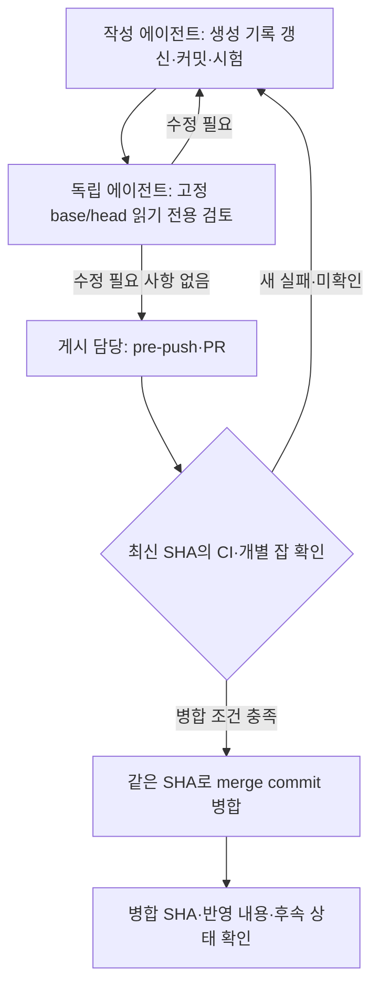
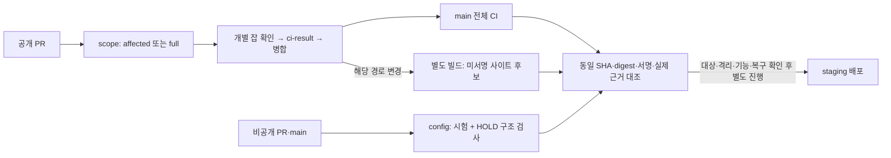

# PR 게시·검토 파이프라인

에이전트 작업은 작성자와 독립 검토자가 최종 커밋을 확인한다. 게시 담당 한 명이 PR을 올려 CI 확인 후 병합하며, 게시·병합은 사용자가 허용한 범위에서 수행한다. `tools/land.py`의 로컬 착지 절차는 [공유 체크아웃](shared-checkout.md)을 따른다.



## 역할과 완료 조건

| 담당 | 행동 | 다음 단계로 가는 조건 |
|---|---|---|
| 작성자 | 이슈·담당 경로·계약 확인, 생성 기록 갱신, 자기 파일 커밋, 해당 SHA 시험 | base/head SHA와 실행 위치·명령·결과·미실행 검사·기존 실패 비교가 준비됨 |
| 독립 검토자 | 목적·변경 경로·계약·검증 근거를 받아 실제 변경과 실패 경로를 읽기 전용으로 확인 | 발견 사항에 위치·영향·근거를 적고, 수정 후 변경 범위를 재검토하여 `수정 필요 사항 없음` 기록 |
| 게시 담당 | 검토한 head와 실제 head 비교, pre-push 통과 또는 [개인 클론의 접속 불가 예외](team-guide.md#31-순서) 조건 충족 후 PR 게시 | 최신 SHA의 필수 `ci-result` 성공, 아래 CI·병합 조건 충족 |
| 게시 담당 | `--match-head-commit`으로 병합하고 실제 병합 SHA·반영 내용을 확인 | 병합 후 CI 상태와 후속 작업 기록. CI 확인까지 요청받았으면 결과 확인 후 종료 |

작성자가 게시 담당을 겸할 수 있다. 독립 검토자는 파일을 수정하거나 GitHub에 별도 승인·댓글을 쓰지 않는다. 검토자를 확보하지 못하면 그 상태를 보고하고 게시 전에 독립 검토를 확보한다. 두 명이 확인했다고 기록하지 않는다. 안전 경로는 D-430의 독립 리뷰와 `Safety-Review:` trailer도 필요하다.

## 커밋이 바뀌면 다시 확인

- 개인 클론은 [팀 가이드](team-guide.md), 실험실은 [공유 체크아웃](shared-checkout.md)에서 시작한다. 실험실 pytest는 커밋한 SHA를 원격 시험 PC에서 검증한다.
- `git log --oneline origin/main..HEAD`와 `git diff --stat origin/main...HEAD`로 공개 범위를 확인한다. 로컬 `main`의 미게시 작업이 섞였으면 자신의 변경만 원격 기준으로 분리한다.
- 미게시 브랜치는 최신 `origin/main` 위로 rebase할 수 있다. 이미 게시한 브랜치는 merge로 갱신하고 force-push하지 않는다.
- 코드·문서·생성물·merge 해결로 head가 바뀌면 변경 범위를 독립 재검토하고 새 SHA를 검증한다. 게시 head는 검토 head와 같아야 한다.

PR에는 다음 근거를 남긴다. 인수인계 내용은 [팀 가이드 §3.6](team-guide.md#36-동시-작업과-인수인계), 입력란은 PR 템플릿을 사용한다.

```text
작성자 / 게시 담당 / 독립 검토자:
검토 base SHA / head SHA:
발견 사항과 처리 결과:
시험 SHA / 실행 위치 / 명령 / 결과:
건너뛴 검사와 이유:
```

## CI와 병합

### 로컬 FULL 근거와 게시 SHA

게시할 마지막 기능이 있는 작업 worktree에서, 변경 범위가 작아도 정본 FULL 검증이 필요하면 다음 모드를 쓴다. 이 명령은 기존 착지 대기열·검토·크기·원격 시험 관문을 거쳐 로컬 main에 착지하며 push하지 않는다.

```bash
python tools/land.py --tests full --no-cache
```

`full`은 현재 후보의 CI·모듈·전체 root 시험과 등록된 모든 opt-in 브라우저의 chunk·ALONE 계획을 고른다. 매 프로세스 실행마다 정상 준비를 거치고 guard·isolation은 현재 실행에서 cache 없이 확인한다. 본시험은 같은 tree·시험 환경의 clean cache를 재사용할 수 있으며, `--no-cache`는 이 본시험 재사용을 끈다. 한 실행에서 확인한 준비 근거로 main 변경분을 검증하는 흐름은 유지하므로, 이 옵션을 모든 후속 호출의 무조건 재실행으로 설명하지 않는다. main·registry·packing·환경이 달라져 근거가 부족하면 다시 준비한다. `full --no-queue`는 지원하지 않는다.

LOAD-FLAKY·다른 tree의 좁은 재사용·불완전 본시험·빈 브라우저 통과는 explicit FULL의 저장·착지를 막는다. isolation의 기존 정책은 유지한다. Safety 미도달·새 실패·죽거나 report가 없는 job은 중단하고, 허용된 nonSafety 예산 초과는 미완료로 기록·보고한다. auto의 착지 허용은 그대로지만 부적격 준비·차례 결과는 재사용 가능한 게시 기록이 되지 않는다. 준비 기록의 `tier=full` 문자열만으로 이전 실행을 신뢰하지 않는다.

게시 담당은 `tools/publish_main.py`가 선택한 **실제 SHA**에 요청된 모든 착지가 포함되는지 각각 `git merge-base --is-ancestor <착지-SHA> <선택-SHA>`로 확인한다. 도구가 고른 가장 최근 FULL 조상에 마지막 기능이 없으면 게시하지 않는다. 해당 SHA의 적격 FULL 기록, 같은 PR head의 녹색 `ci-result`, merge commit 병합과 origin 역동기화를 함께 확인한다(D-868). `--force-blocked`는 FULL 근거나 기능 포함 확인을 대신하지 않는다. 실제 FULL·공개 CI·산출물·현장 수용은 별도 근거다.

`ci-result` 성공이 모든 개별 잡의 통과를 뜻하지는 않는다. 보고용 비게이팅 잡도 읽고 실패·수집 오류·미실행을 별도로 기록한다. 새로 드러난 실패는 원인을 확인하고 해결한다. 기존 실패로 판단하려면 변경 전 기준선의 같은 실패 근거를 남긴다. 시험을 숨기거나 freshness·안전 기준을 느슨하게 바꾸지 않는다. 관리자 예외로 적색 CI를 넘기지 않는다.

```bash
gh pr checks <PR번호> --required --watch
gh pr view <PR번호> --json headRefOid,statusCheckRollup,mergeable
gh pr merge <PR번호> --merge --match-head-commit <확인한-head-SHA>
```

merge commit 병합은 브랜치의 원래 커밋과 그 `Safety-Review:` trailer를 그대로 `main`에 남긴다(D-868). 예전 squash 병합은 trailer를 지워 `tools/harness/safety_review_exempt.json`에 squash SHA를 원본 head와 이어 주는 항목이 필요했다(#81→#82, #78). 그 항목은 지우지 않는다.

병합 상태·SHA와 기본 브랜치에 반영된 파일을 확인한다. 파일 존재와 실제 화면 확인은 구분하고, 로그인 등으로 화면을 확인하지 못했으면 그 한계를 남긴다. 공유 로컬 `main`은 임의로 reset·stash·clean하지 않는다. 다른 세션의 변경과 현재의 손실 없는 정리 규칙을 지킨다.

## 검사·산출물·staging

주 CI, 사이트 후보 빌드, 비공개 설정 검사는 별도 워크플로다. 성공 표시를 연결해 자동 배포가 된다고 판단하지 않는다.



| 경로 | 실행과 확인 범위 |
|---|---|
| 공개 `ci.yml` | PR은 selector 결과, main·야간·수동·merge group은 full. `modules`는 보고용이므로 개별 결과를 확인한다 |
| `build-site-candidate.yml` | 해당 main 경로 변경 또는 수동 실행. 주 CI와 독립적으로 미서명 prerelease를 만들므로 빌드 성공만으로 배포하지 않는다 |
| Pinky 산출물·릴리스 | [산출물 선택](../deployment/pinky-release-artifact-selection.md)에서 시작한다. ARM64 빌드·호스트 부팅 관찰·오프라인 서명·게시·장치 수용은 각각 확인한다 |
| 비공개 `check.yml` | PR·main push·수동 실행에서 `config` 확인. 일반 검사는 HOLD를 허용하고 `--require-ready`는 초기 HOLD에서 실패하는 것이 정상이다 |

Fleet와 명시된 계정 SSO 여정 외의 CORE 브라우저 시험은 기본 활성화 범위가 아니다. Gazebo 잡에도 건너뛴 시험이 있을 수 있다. 잡 성공과 실제 화면·시뮬 실행을 구분하고 로그의 수집·실행·skip 수를 남긴다. 설정 CI는 산출물 내용·호스트 격리·기능·복구를 확인하지 않는다.

[2026-10-17 점검 기록](../validation/pipeline-audit-2026-10-17.md)에 실제 설정·CI 근거와 후속 조건을 남겼다. 당시 staging은 `HOLD`였고, 릴리스 게시의 `release` 환경과 필수 변수는 미구성이었다. 릴리스 실행 전에는 현재 설정을 다시 확인한다.

병합 후 `modules` 잡의 OMX ROS 시험에서 새 실패를 관찰했다. [실패 기록과 후속 조건](../validation/pipeline-modules-2026-10-17.md)을 확인하며, 기존 실패나 해결 완료로 분류하지 않는다.

## GitHub 설정

아래 표는 공개 `rosy-platform`의 설정이다. 2026-10-17 GitHub API로 확인했다. 설정을 바꾸는 담당자는 이 표를 같은 PR에서 갱신한다. 운영 결정과 후속 전환 조건은 [D-762](../adr/D-762-main-gateway-pull-request-merge-queue.md)에 있다.

| 항목 | 현재 설정 |
|---|---|
| 공개 범위·기본 브랜치 | public · `main`, Issues 사용 |
| main 보호 | PR 필요, 삭제·force-push 제한, 관리자 우회도 PR 경로로 제한 |
| 필수 검사 | `ci-result` |
| 사람 승인 | 0명, code owner 승인 강제 꺼짐. `CODEOWNERS`의 리뷰 요청과 서버의 승인 강제는 구분 |
| 병합 | merge commit만 허용(D-868, 2026-10-25), 병합 후 원격 브랜치 자동 삭제 |
| auto-merge·merge queue | auto-merge 꺼짐, ruleset에 queue 없음 |

```bash
gh api repos/robotics-team-1213/rosy-platform
gh api repos/robotics-team-1213/rosy-platform/rulesets
gh api repos/robotics-team-1213/rosy-platform/rulesets/<ruleset-id>
```

일반 branch protection 조회의 404만으로 보호 규칙이 없다고 판단하지 않는다. ruleset 상세 규칙도 확인한다. merge queue·auto-merge, 관문 code owner·에이전트 신원 분리, 훅 분리·공유 Log 개선·로컬 착지 도구의 PR 전환은 D-762의 선행 조건에 따라 별도 적용한다.

비공개 [`rosy-ops`](https://github.com/robotics-team-1213/rosy-ops)는 해당 저장소의 `AGENTS.md`를 따른다. 게시 담당은 독립 검토한 head와 `config` 잡의 성공을 확인해 같은 SHA를 squash 병합한다. 이 확인은 팀의 수동 절차이며 서버의 승인 강제와 구분한다. 설정 CI는 배포·호스트 격리·기능 수용을 증명하지 않는다.
