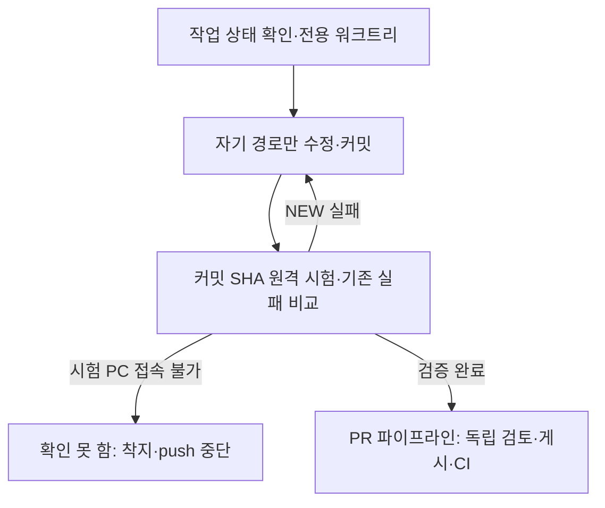

# 같이 하는 깃: 실험실 공유 체크아웃

- **대상:** 실험실 PC에서 `main` 체크아웃 하나를 여러 AI 세션과 같이 쓰는 사람·에이전트
- **팀원 개인 클론이라면** 이 문서 대신 [git으로 일하는 법](git-workflow.md)과 [팀 가이드](team-guide.md)를 따른다. 두 길의 비교도 [git으로 일하는 법](git-workflow.md) §1에 있다.
- **GitHub 게시·병합:** 로컬 착지와 별도로 [PR 파이프라인](pr-pipeline.md)을 따른다. 작성·독립 검토 두 에이전트가 확인하고 게시 담당 한 명이 올린다.
- **갱신:** 2026-10-30 — 명령 전문을 이 문서로 모으고 [AGENTS.md](../../AGENTS.md) 「같이 하는 깃」은 안전 요약과 포인터로 줄임. 2026-10-26 — 도구 차단값을 15개 예산과 일치(D-886), 「브랜치 이름과 수명」 추가, 착지한 브랜치 자동 정리. 2026-10-21 — 사용자 지시로 main 포함 운영 상한을 10개에서 15개로 변경. 2026-10-18 착지 단위로 나누기, `MAIN-RED`. 2026-10-14 워크트리 관문 도구(D-761).

## 워크트리 한도와 슬롯 운영

2026-10-21 사용자 지시에 따른 운영 기준은 **main 포함 최대 15개**다.
이 절이 운영 예산의 정본이며, 아래 기존 절차의 도구 상한보다 먼저 적용한다.
`tools/worktrees.py`의 자동 차단값은 이 예산과 같은 `.worktrees/` 14개(main을 더해 15개, D-886)다.
문서 예산과 도구 차단값이 달라 22개까지 늘었던 일(2026-10-26)을 다시 만들지 않도록 둘을 한 값으로 묶는다.

1. **만들기 전에 센다.** main에서 `git worktree list`와 `python tools/worktrees.py status`를 확인한다.
   main 1개와 작업 디렉터리 최대 14개를 합산한다. 잠금·머지 대기·검토 대기·장기 보류·고아 디렉터리도 슬롯을 차지한다.
   평소에는 main 포함 13개 이하로 유지하고 나머지 두 자리는 착지·정리·장애 수습에 남긴다.
   같은 작업의 독립 검토자는 기존 워크트리를 읽기 전용으로 검토하며, 검토자 수만큼 워크트리를 만들지 않는다.
   병렬 세션의 생성 슬롯은 사용자나 지정된 한 디스패처가 순서대로 배정한다. 각 세션이 동시에 빈자리를 확인해 중복 배정하지 않는다.
   공통 배정 담당자가 정해지지 않았다면 각자 새 슬롯을 만들지 말고 현재 점유와 대기 작업을 먼저 보고한다.
2. **15개이면 신규 착수를 멈춘다.** 우회 경로나 다른 저장소 복사본으로 새 작업 공간을 만들지 않는다.
   먼저 아래 표의 순서로 한 슬롯을 확보한다. 할 수 있는 정리가 없으면 현재 개수·소유자·해제 조건을 알리고 새 작업은 대기시킨다.
   기존에 15개를 넘긴 경우에도 진행 중인 작업을 지워 숫자를 맞추지 않고, 신규 생성을 중단한 상태에서 같은 순서로 줄인다.
3. **작업마다 소유자와 다음 행동을 남긴다.** gateway가 기록한 소유자·세션과 브랜치에 작업 목적을 대응시킨다.
   인계에는 HEAD, 미커밋 유무, 마지막 검증 SHA·로그, 다음 행동과 재개 조건을 적는다.
   40분 동안 커밋이 없으면 기존 디스패처 규칙에 따라 상태를 확인한다. 유휴 시간만으로 삭제하지 않는다.
4. **완료 시 슬롯을 돌려준다.** 필요한 변경을 명시적 경로로 커밋하고 공식 원격 검증·검토 후, 이미 받은 착지 승인 범위에서 `python tools/land_async.py --tests auto`로 대기열에 넣는다(아래 6번). 착지는 숨은 스냅샷 워크트리에서 돌고 이 워크트리는 넣는 즉시 비므로 바로 지우거나 다음 일에 쓴다.
   NEW 실패나 시험 PC 연결 실패는 머지를 막는다. 통과하지 않은 변경을 숫자 정리 목적으로 머지하지 않는다.
   완료 후 main에서 ancestry·깨끗한 상태를 확인하고 `python tools/worktrees.py prune --apply`로 정리한다.
   도구가 유휴·소유자 사유로 보존하면 그 사유를 남기고, 이미 승인된 정리 범위에서 소유자·디스패처가 해당 대상만 재검증한다.
5. **장기 대기는 브랜치와 증거로 보존한다.** 장비·키·사람 검토를 기다리며 당일 재개할 수 없는 작업은 물리 워크트리를 계속 점유할 필요가 있는지 확인한다.
   보존 후 제거할 때는 브랜치·HEAD, 서로 다를 수 있는 index와 작업 파일, 무시 파일 중 사용자 데이터, 복구 위치를 함께 기록하고 복원 가능성을 검증한다.
   장기 보존 백업은 `<우산>/artifacts/worktree-backups/`에 둔다. Git 밖 저장 위치는 상위 AGENTS.md를 따른다.
   `prune --snapshot`은 기존 규칙대로 사람·디스패처만 사용하며, 기존 승인 범위를 확인한다. 도구가 잠금·무시 파일·이전 이력 때문에 거절하면 강제 삭제하지 않는다.

| 슬롯 회수 순서 | 처리 |
|---|---|
| 1. main에 반영됐고 깨끗한 작업 | 소유자·잠금·유휴 조건을 확인하고 기존 prune으로 제거한다. |
| 2. 완료 가능한 미커밋 또는 미머지 작업 | 실제 diff를 현재 main과 대조한다. 이미 반영된 변경은 중복 커밋하지 않고, 필요한 변경만 커밋·검증·착지한 뒤 제거한다. |
| 3. 재개 조건을 기다리는 작업 | 검증된 보존본과 인계 기록을 남긴 뒤 승인 범위에서 워크트리만 제거한다. 미머지 브랜치·복구 ref는 유지한다. |
| 4. 진행 중이거나 잠긴 작업 | 소유자의 현재 작업과 잠금 해제 조건을 확인한다. 동료의 미커밋·진행 중 Git 작업을 정리 대상으로 삼지 않는다. |

잠금은 슬롯 예외가 아니다. 잠금 이유에는 소유자·대기 사유·해제 조건을 남기고, 디스패처는 새 슬롯을 배정할 때 다시 확인한다.
`stale-history`는 직접 머지하지 않고 필요한 변경만 현행 main에서 복구한다.
스냅샷은 복구 수단이며 정식 커밋·원격 검증·머지 완료로 계산하지 않는다.
개수만 줄이기 위한 `reset`, `clean`, 무조건적인 `--force` 삭제는 사용하지 않는다.
한도 초과는 사람의 명시적 사고 대응·일회성 전환 승인에 한하며 사유·담당·회수 조건을 기록한다.
`--force-over-cap`은 도구의 15개 장벽을 우회하는 사고 대응·사용자 승인 옵션이지 일상 작업의 예외가 아니다.

## 브랜치 이름과 수명

브랜치·커밋·착지 전에 기준 브랜치(보통 `main`), 작업 브랜치 이름, 착지 대상(로컬 `main`, `tools/land.py`)을 먼저 정한다.
이 저장소는 trunk 하나(`main`)에 주제 브랜치를 착지하는 방식이다(D-868). develop·release·task 같은 통합 브랜치나
작업자 이름이 든 브랜치는 만들지 않는다. 작업자는 이름 대신 `new`가 남기는 소유자 기록(`branch.<b>.description`)으로 구분한다.

| 종류 | 이름 | 누가 만드나 | 언제 사라지나 |
|---|---|---|---|
| trunk | `main` | — | 사라지지 않는다 |
| 작업 | `<type>/<topic>`: type은 `feat`·`fix`·`refactor`·`docs`·`uiux`, topic은 영문 소문자·숫자를 `-`로 이은 48자 이내(ADR 번호가 있으면 `d886-...`처럼 앞에) | `python tools/worktrees.py new`만 | `main`에 착지하면 `prune --apply`가 워크트리와 함께 지운다 |
| 보관 | `archive/<...>` | 사람(`stale-history` 정리 등) | 사람이 지운다. 도구는 건드리지 않는다 |
| 미커밋 보존 | `refs/wip/<날짜>/<이름>`(브랜치 아님) | `prune --snapshot`, D-372 보존 | 복구 뒤 사람이 지운다 |

- 위 표에 없는 종류(`wip/`, `tmp/`, `test/`, `land/`, `backup/`, `codex/*`, 날짜만 있는 이름)는 만들지 않는다. 맨손 `git branch`·`git worktree add`도 쓰지 않는다.
- 한 브랜치는 한 주제다. 이어지는 작업은 착지한 뒤 새 브랜치로 시작한다. 착지한 브랜치에 계속 커밋하지 않는다(`landed-dirty`).
- `prune`(드라이런 포함)은 `main`에 들어갔고, 어느 워크트리에도 체크아웃되지 않았고, reflog가 1시간 넘게 그대로인 로컬 브랜치를 정확한 sha로만 지운다.
  `main`과 `archive/*`는 지우지 않는다. 내용은 모두 `main`에 있어 잃는 것이 없다(D-372 결정 2, D-886).
  `main`에 없는 브랜치는 지우지 않는다. 원격(`origin`) 브랜치는 이 도구가 다루지 않는다.

## 같이 하는 깃

여러 세션이 이 저장소의 `main` 체크아웃 하나와 git 인덱스 하나를 같이 쓴다.
GitHub에 보이는 이 절이 착수 순서의 공개 기준이자 명령 전문이다. `AGENTS.md`의 「같이 하는 깃」은
모든 세션이 늘 지킬 안전 요약만 적고 이 절을 가리킨다. 규칙을 바꿀 때는 이 절을 고치고, 요약의 문장이
달라지면 같은 커밋에서 `AGENTS.md`도 고친다. 명령 카드는
[`.claude/skills/rosy-land-on-main/SKILL.md`](../../.claude/skills/rosy-land-on-main/SKILL.md)다.
사람용 요약과 팀원의 PR 길은 [git으로 일하는 법](git-workflow.md)이다.
브랜치 이름과, 남의 미커밋을 지우지 않는 이유는
[D-372](../adr/D-372-topic-branch-names-and-shared-checkout-wip.md)다.
배경은 `docs/solutions/workflow-issues/adr-numbers-collide-between-concurrent-sessions-2026-09-25.md`다.

작업 위치를 분리하고 자기 파일만 커밋한 뒤, 원격 시험과 검토를 거쳐 게시한다.



제품 파일을 고치기 전에 1번과 2번이 끝나 있어야 한다. 끝난 기준은 `git worktree list`에
자신의 `.worktrees/<짧은이름>`이 있고, 그 디렉터리의 브랜치가 `main`이 아닌 것이다.

1. **작업 위치를 만든다.** 저장소 루트에서 `git status --short --branch`와
   `git worktree list`를 본 다음
   `python tools/worktrees.py new <짧은이름> <type>/<topic>`
   을 실행한다. 맨손 `git worktree add`는 쓰지 않는다. `<type>`은 내용과 맞는
   `feat`, `fix`, `refactor`, `docs`, `uiux` 가운데 하나다(D-372). `<topic>`은 영문 소문자·숫자를 `-`로 이은 48자 이내다(D-886). 한 브랜치에는 한 주제만 둔다.
   착지 단위로 나눈다: 한 브랜치는 따로 착지할 수 있는 관심사 하나와 한 모듈 계열이고, 바뀐 파일이 15개를 넘거나 `tools/land.py --dry-run`이 FULL을 찍으면 먼저 나눌 수 있는지 본다(FULL 한 라운드는 시험 PC에서 30~90분이다). FULL 트리거(`tools/harness/**`, `contracts/foundation/**`)나 공유 자산(`shared/web`)을 바꾸는 부분은 제품 변경과 다른 브랜치로 먼저 착지한다. D-766 한도의 95% 이상인 파일·단위에 더할 일은 그 나누기 브랜치를 먼저 착지한다. 배경은 `docs/solutions/workflow-issues/landing-blockers-cost-hours-2026-10-18.md`다.
   - **청소.** 이 도구는 아무것도 지우지 않는다. 치울 수 있는 끝난 워크트리가 있으면 개수와 명령 `python tools/worktrees.py prune --apply`를 한 줄로 알린다(D-761, Proposed). 그 명령은 누가 만들었든 깨끗하고, `main`에 들어갔고, 잠기지 않았고, 캐시가 아닌 gitignore 파일이 없고, 충분히 쉰 워크트리만 지운다. 그런 워크트리는 잃을 것이 없다. 충분히는 브랜치에 자기 커밋이 있고 `main`에 들어간(착지한) 것이면 1시간, 그 밖의 것(방금 만들어 아직 커밋이 없는 워크트리 포함)은 72시간이다(D-790, Proposed). 자신이 만든 워크트리(소유자 기록이 호출한 쪽의 신원과 같고, 세션 id가 적혀 있으면 그것까지 같은 것)는 착지했고 깨끗하면 기다리지 않고 바로 지운다. git이 더는 모르는 `.worktrees/` 아래 디렉터리(orphan)도 1시간 쉬면 지운다. 캐시와 `.omc/state` 밖의 파일이 있으면 먼저 `$ROSY_SCRATCH/worktree-orphans/<이름>-<날짜>.zip`에 보관하고 그 보관 파일을 다시 열어 확인한 뒤에만 지운다. `new --prune`은 만들기 전에 그 청소를 한다.
   - **상한과 소유자.** `.worktrees/` 아래가 14개(main 포함 15개) 이상이면 만들지 않고, 지금 누구나 치울 수 있는 워크트리와 소유자만 치울 수 있는 워크트리를 이름과 소유자로 보여 준다. 그때 볼 것은 `python tools/worktrees.py status`다. 이 표는 행마다 소유자와 자신이 지울 수 있는지를 보여 준다. `new`는 소유자로 git 신원과 세션 id를 적고, `--owner "<누구>"`가 있으면 그것을 적는다. 소유자 기록이 없는 워크트리는 `status`에 `unknown`으로 나온다. 사고 대응 중이거나 사용자가 허락한 경우에만 `--force-over-cap "<이유>"`로 상한을 넘겨 만든다.
   - **사람이 볼 두 상태.** `status`의 `landed-dirty`는 이미 `main`에 들어간 브랜치의 워크트리에 미커밋 파일이 있다는 뜻이다. 그 워크트리에서 계속 일하지 말고 새 워크트리를 만들어 옮긴다. `stale-history`는 이력 재작성 이전 줄기의 브랜치다(`main`에 없는 커밋이 2,000개 넘음, 또는 `ad86fca808` 이전에서 갈라짐). 병합·착지하지 않고 필요한 것만 `main`에서 새 브랜치로 다시 만든다(D-172). `new --from <ref>`는 그런 ref에서 만들지 않는다.
   - **스냅샷.** `prune --snapshot`은 커밋 안 된 내용을 `refs/wip/<날짜>/<이름>`에 남기고 더럽거나 `main`에 안 들어간 워크트리까지 지우므로 사람이나 디스패처만 돌린다. 세션이 알아서 돌리지 않는다. `--snapshot`은 호출한 쪽이 `new`로 만든 워크트리만 다루고, 다른 세션 것과 소유자 기록이 없는 것은 `--all`을 줘야 다룬다.
   - **위치.** 오래 둘 워크트리는 `git worktree lock`으로 잠근다. worktree는 이 저장소의 `.worktrees/`에만 둔다. `.worktrees/`는 gitignore다. 공유 `main` 체크아웃은 `git merge --ff-only`로 착지할 때만 쓴다. 거기에 커밋되지 않은 변경을 남기면 다른 세션의 fast-forward가 거절된다. 스크래치, 로그, pytest 출력은 저장소 밖 `$ROSY_SCRATCH`에 둔다(없으면 시스템 임시 폴더. 실험실 PC는 `ROSY_SCRATCH=X:\DevTemp`).
   - **동료.** `ListAgents`가 있으면 동료와 그 소유 경로를 본다. 백그라운드 실행기는 단계마다 자기 브랜치에 커밋한다. 그 브랜치에 40분 동안 새 커밋이 없으면 디스패처가 실행기를 확인한다.
2. **자기 경로만 스테이징한다.** `git status --short`에서 이번 작업으로 만들거나 고친 경로만 `git add <path> ...`에 적는다. `git add -A`, `git add .`, 디렉터리 단위 add는 쓰지 않는다. 인덱스 하나가 모든 세션의 것이라 넓은 add 한 번이 다른 세션의 파일을 커밋에 넣는다. 잘못된 경로 하나가 `git add` 전체를 실패시키므로, 커밋 전에 exit code를 본다. 경로 없는 커밋 전에는 `git diff --cached --name-only`가 자신의 목록과 같아야 한다.
   - 공유 인덱스에 동료가 이미 올려 둔 경로가 있으면, 파일이 전부 자신 것일 때만 `git commit --only <자신의 경로>`를 쓴다. `--only`는 작업 트리 내용을 기록하기 때문이다. 공유 체크아웃에서 `--amend`, `rebase`, `reset --hard`, `stash`는 쓰지 않는다. 그 사이 HEAD가 동료의 커밋이 될 수 있다. `git commit -- <공유 파일>`도 쓰지 않는다. 작업 트리 전체를 가져가 동료의 행이 들어간다.
   - 이어 쓰는 파일 `docs/reference/ROSY ADR Log.md`와 `docs/logs.md`에 동료의 미커밋 행이 있을 수 있다. 자신의 행만 `git apply --cached --unidiff-zero my-row.patch`로 올리고, `git diff --cached -- <file>`이 자신의 행만 보여 주면 끝이다. 브랜치 이름을 적는 문서는 `git branch`가 출력한 이름을 그대로 쓴다.
   - 자신이 쓰지 않은 경로는 그대로 둔다. stash, revert, checkout, restore, reset, clean, amend, 삭제로 치우지 않는다. 루트의 추적되지 않은 `list.txt`는 로컬 메모라 커밋하지 않는다. 머지나 체크아웃이 그 파일 때문에 거절되면 파일을 그대로 두고 거절 문구를 사용자에게 알린다.
3. **계약을 읽고 고친다.** 제품 파일을 고치기 전에 [README 「핵심 계약」](../../README.md#핵심-계약)과
   `AGENTS.md`의 Working In This Directory를 읽는다. 외부 API, 모드, 프로토콜
   필드는 그 문서가 가리키는 SRS, API reference, ADR에 있는 것만 쓴다. 읽기가
   끝난 기준은 바꾸려는 경로의 모듈 `AGENTS.md` 또는 해당 ADR을 연 것이다.
4. **ADR 번호는 파일을 만들기 직전에 도구로 선점한다.** 다른 세션이 몇 분 사이에 같은 번호를 가져간다. `python tools/harness/adr_reserve.py next "<주제>"`를 돌리고 찍힌 번호를 쓴다. 도구는 모든 브랜치와 워크트리의 `docs/adr`, Log 행, gap, `refs/adr/D-*`를 보고 그 다음 번호로 `refs/adr/D-nnn`을 만든다. 같은 ref는 한 세션만 만들 수 있다(D-510). 이 ref는 로컬에만 있어 CI는 모른다.
   - 선점한 ADR이 이 브랜치와 같이 착지하지 않으면 push 전에 `tools/harness/adr_gaps.txt`에 `D-nnn 이유` 한 줄을 넣는다. 쓰지 않을 번호는 `python tools/harness/adr_reserve.py release D-nnn --reason "<주제>"`로 푼다. 충돌로 못 쓰게 된 번호도 이유와 함께 `tools/harness/adr_gaps.txt`에 넣는다.
   - ADR 파일과 Log 행은 한 커밋이다. Log는 UTF-8 BOM과 CRLF를 유지한다. 그 다음 `python tools/harness/rosy_harness.py lint`를 돌린다.
   - API reference 버전(`**Version:** v1.NNN`)도 같은 방식으로 `python tools/harness/api_reserve.py next "<주제>"`가 `refs/api/v1.NNN`을 선점하고, 번호를 바꿀 때는 `python tools/harness/api_reserve.py bump v1.NNN` 한 번이 헤더·테스트·`app.py`의 고정값만 옮긴다(자신의 changelog 행 제목은 손으로 고친다).
5. **테스트는 기존 실패와 비교한다.** 워크트리에서 관련 pytest 결과를 저장소
   밖의 `run-1.txt`에 남기고 `python test/known_failures.py`에 그 파일을 넘긴다.
   pytest는 이 노트북에서 돌리지 않는다. `tools/remote/remote_pytest.py`가 모델 PC(OMEN),
   AI PC, 현장 PC 가운데 여유가 있는 곳(현장 PC는 맨 뒤, D-568)에서 돌리고 로그를 `$ROSY_SCRATCH\<이름>\`로 가져온다. pre-push와
   `tools/land.py`가 이를 쓴다. 시험 PC가 하나도 닿지 않으면 노트북으로 넘어가지 않고 10분 동안 30초마다 다시 시도한 뒤 실패로 끝낸다(D-584). 그 시험은 "확인 못 함"이고 착지와 푸시는 하지 않는다. `--local`과 `ROSY_TEST_LOCAL`은 오류로 거절한다. 커밋된
   HEAD만 보내므로 먼저 커밋한다. Gazebo는 노트북에서 돌리지 않고
   `python tools/remote/remote_pytest.py --pick sim`이 고른 PC에서 돌린다.
   로그 경로는 `$ROSY_SCRATCH\<이름>\run-1.txt`다. 실험실 PC 명령은 아래다.

   ```bash
   python tools/remote/remote_pytest.py --log-dir $ROSY_SCRATCH/<name> -- <paths>
   python test/known_failures.py $ROSY_SCRATCH/<name>/run-1.txt
   ```

   exit 1의 `NEW`는 깨끗한 `main` 워크트리에서 달리 확인되기 전에는 그 브랜치의 실패다. 고친 실패의 줄은 같은 커밋에서 `test/known_failures.txt`에서
   뺀다. 그 브랜치가 만든 실패를 그 파일에 넣지 않는다. 호스트 pytest 통과는
   장치, ARM64 이미지, 현장 수용을 대신하지 않는다. 시험 티어와 CI는 [개발자 가이드](developer-guide.md)의 「테스트와 CI」다.
6. **착지와 푸시는 사용자가 말한 뒤에만 한다.** 기본 방법은 워크트리에서
   `python tools/land_async.py --tests auto`다(2026-10-28부터, D-889 추가 5). 커밋된 HEAD를
   `land/<브랜치>-<UTC 시각>` 브랜치로 떼어 `<git-common-dir>/rosy-land-wt/`의 숨은 워크트리(슬롯이 아니다)에서
   `land.py`를 돌린다. 명령은 바로 돌아오고 워크트리는 그때부터 비어 있다. 이어 쓰면 그 뒤 커밋은 다음 착지에
   들어가고, 미커밋 변경이 있으면 거절한다. 기록은 `<git-common-dir>/rosy-land-wt/<이름>.log`이다. 착지하면
   숨은 워크트리와 스냅샷 브랜치를 지우고, 멈추면 둘을 남기고 `<이름>.stopped`를 쓴다. 멈춘 까닭은 `.log`와
   `<git-common-dir>/rosy-land-events.jsonl`의 `stop` 사건에 있다. 브랜치에서 고친 뒤 다시 넣는다(합병 충돌이면
   브랜치에서 `git merge main`). 대기열은 차례 하나를 10분 마감으로 끊고, 차례에서 다시 준비로 돌아가면
   앞 표들의 후보 위에 미리 시험한 트리(speculative prepare)와 같으면 ff만 하며, 준비된 표가 여럿이면 최근
   새 실패율에 맞춘 크기로 묶어 한 차례에 착지한다(D-889 추가 3·4). 진전 없이 30분이면 감시자가 스택을 남기고
   멈춘다. 사용자가 급하다고 한 착지만 `--urgent "<사용자 말>"`을 붙인다. 그 표는 기다리는 일반 표를 앞지르고
   (진행 중인 차례는 끊지 않는다), 한 번에 하나만 허용되며 `urgent` 사건으로 남는다. 남의 `land.py`를 멈춰
   순서를 바꾸지 않는다. 결과를 바로 지켜보며 착지할 때만 아래 `land.py`를 직접 쓴다.
   - **`land.py` 대기열과 재시험.** `python tools/land.py --tests auto`는 시험 회차 전에 착지 대기열(`<git-common-dir>/rosy-land-queue/`, D-803)에서 표를 받고, 앞선 착지가 끝날 때까지 순번과 앞선 브랜치를 찍으며 기다린다. `--queue-timeout` 분(기본 180)을 넘으면 아무것도 병합·시험하지 않고 멈춘다. 맨 앞이 되면 `main`을 한 번 병합하고 시험한다. 표는 끝날 때(오류와 Ctrl-C 포함) 풀리고, 죽은 프로세스의 표(같은 호스트에서 pid 없음, 또는 3시간 동안 새로 고쳐지지 않음)는 다음 세션이 지운다. `--no-queue`는 사고 대응 때만 쓴다. FULL 티어가 통과한 뒤 `main`이 움직이면 다음 회차는 그 뒤 `main` 변경분의 선택만 돈다. 실행이 끊겨(시험 PC 끊김, Ctrl-C, 회차 상한) `land.py`를 다시 돌려도, 브랜치가 그때 시험한 변경과 `main` 병합만 가지고 있으면 같은 규칙을 쓴다(`<git-common-dir>/rosy-land-full/`, D-803 6). 브랜치에 자기 커밋이 더해졌으면 FULL을 다시 돈다. 같은 git 트리·명령·시험 환경(`remote_pytest.deps`)에서 이미 통과한 pytest 호출은 다시 돌리지 않고, 셀렉터가 차이에 고르지 않은 호출도 조상 커밋의 통과를 쓴다(`tools/land_cache.py`, 공통 git 디렉터리의 `rosy-land-cache.jsonl`). 모두 다시 돌리려면 `--no-cache`.
   - **두 단계.** 이 도구는 아래 두 단계를 main이 멈출 때까지 되풀이하고, 테스트나 lint가 실패하면 착지하지 않으며, 푸시하지 않는다. (1) 워크트리에서 `git merge main`을 하고 관련 테스트를 다시 돌린 다음 `known_failures`와 비교한다. `NEW`가 있으면 브랜치에서 고치고 이 단계를 반복한다. (2) `main` 체크아웃에서 `git merge --ff-only <브랜치>`를 한다. 그 사이에 main에 새 커밋이 있으면 (1)부터 다시 한다. 착지는 `--ff-only`만 한다. `--ff-only`가 동료의 미커밋 파일을 덮어써서 거절되면 그 파일을 그대로 두고 거절 문구를 알린다. stash, checkout, 삭제로 치운 뒤 다시 시도하지 않는다.
   - **크기와 이력.** `tools/land.py`는 옛 이력 브랜치(`stale-history`)를 착지하지 않고, 원격 시험 전에 `tools/harness/size_range.py`로 D-766 크기를 본다. 착지 전에 `python tools/harness/size_range.py main HEAD`로 직접 볼 수 있다.
   - **NEW 실패 처리.** NEW 실패가 1~5개이고 안전 루트 밖이면 각 id를 따로 한 번 다시 돌리고, 모두 통과하면 `LOAD-FLAKY`로 알리고 착지를 계속하며 공통 git 디렉터리의 `rosy-flaky-candidates.txt`에 적는다. 그 목록은 사람이 보고 증거가 맞을 때만 `test/flaky_quarantine.txt`로 옮긴다. 다시 실패하면 지금처럼 멈춘다(D-790). 멈춘 라운드의 NEW id는 `main`에서 한 번 더 돌린다. 거기서도 실패하는 id는 `MAIN-RED`로 찍히고 멈춤 문구가 main이 깨졌다고 적는다. 그때는 자기 브랜치를 고치지 말고, 동료가 이미 고치는지 본 다음 main만 고치는 작은 `fix/` 브랜치를 먼저 착지한다.
   - **착지 뒤 정리.** `tools/land.py`는 시작할 때 치울 수 있는 끝난 워크트리 개수를 알리기만 한다. `--prune`을 주면 1번의 손실 없는 청소를 하고, `--no-prune`을 주면 알리지도 않는다. 착지한 자신의 워크트리는 그 워크트리에서 나온 뒤 `main` 체크아웃에서 명령 하나 `python tools/worktrees.py prune --apply`로 치운다(남의 착지한 워크트리는 1시간, 착지 증거가 없는 것은 72시간 뒤에 지운다). 착지한 워크트리에서 다음 일을 이어 하지 않는다. 착지하지 않고 보류하는 브랜치는 커밋해 두면 브랜치가 남는다. 워크트리까지 남기려면 `git worktree lock`으로 잠근다.
   - **푸시.** 푸시는 사용자가 푸시를 말한 뒤에만 하고, 순서는
   [D-868](../adr/D-868-local-main-first-merge-commit-publish.md)이다. 동기화·게시는 한 세션만 맡는다. 모든 변경은 로컬 `main`에 먼저
   착지한다. `git fetch` 하고, `origin/main`이 로컬 `main`의 조상이 아니면 워크트리에서 `git merge origin/main`으로 합쳐
   착지한다. `python tools/harness/rosy_harness.py generate`로 생성 문서를 맞춘다. 게시는 `python tools/publish_main.py`(dry run) 뒤 `--apply`로만 한다. 녹색 FULL 착지 기록이
   있는 가장 새 커밋을 고르고, 범위 전체 커밋별 비밀 검사·Safety-Review를 돌린 뒤 그 커밋 자체의 pre-push
   사본으로 `publish/main-<YYYYMMDD-HH>`에 push해 PR을 연다. 그 push는 방금 끝낸 두 검사와 크기 규칙을 다시
   돌리지 않고(착지마다 돌았고 PR CI가 범위 전체를 다시 본다), 그 커밋 자신의 녹색 착지 기록을 재사용한다.
   `ci-result`가 녹색이면 `python tools/publish_main.py --merge-when-green <PR> --apply`가 merge commit으로 병합한다.
   병합 뒤에는 로컬 `main`에서 만든 워크트리에서 `git merge origin/main`을 하고 `tools/land.py`로 착지한다(역동기화). 그 사이 착지가 있으면 fast-forward가 되지 않으므로 `--ff-only`로 맞추지 않는다. squash·rebase 병합과 force-push는 하지 않는다.
   로컬 `main`이 `origin/main`보다 앞에 있으면 그 커밋의 CI 증거는 아직 없다.

주제 브랜치는 `origin/main`이 아니라 로컬 `main`에서 만든다. 이미 게시한 브랜치는 `git merge`로 갱신하고 force-push하지 않는다. 공개 GitHub 게시·검토·병합은 [PR 파이프라인](pr-pipeline.md)을 따른다.

착수 다음에 손댈 제품 규칙은 [README 「핵심 계약」](../../README.md#핵심-계약)이다.
