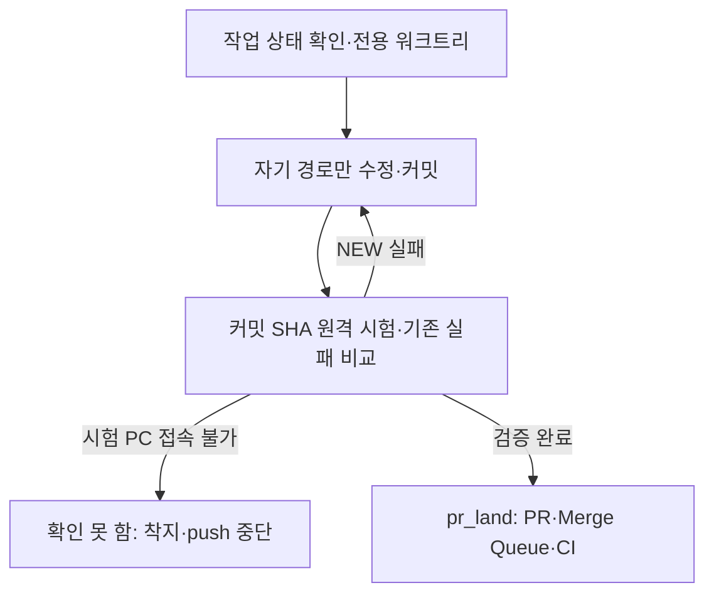

# 같이 하는 깃: 실험실 공유 체크아웃

- **대상:** 실험실 PC에서 `main` 체크아웃 하나를 여러 AI 세션과 같이 쓰는 사람·에이전트
- **팀원 개인 클론이라면** 이 문서 대신 [git으로 일하는 법](git-workflow.md)과 [팀 가이드](team-guide.md)를 따른다. 두 길의 비교도 [git으로 일하는 법](git-workflow.md) §1에 있다.
- **GitHub 게시·병합:** 주제 PR 하나가 Merge Queue로 들어간다(D-1055, 아래 「같이 하는 깃」 6번). 검토·CI 조건은 [PR 파이프라인](pr-pipeline.md)이다.
- **갱신:** 2026-11-21 — 제출·병합을 D-1055 PR 경로로(「같이 하는 깃」 6번), land.py·D-868 게시 절 폐기. 2026-10-30(늦음) — 착지 대기 동시 4개 원칙(2026-10-30 협업 방안). 2026-10-30 — 명령 전문을 이 문서로 모으고 [AGENTS.md](../../AGENTS.md) 「같이 하는 깃」은 안전 요약과 포인터로 줄임. 2026-10-26 — 도구 차단값을 15개 예산과 일치(D-886), 「브랜치 이름과 수명」 추가, 착지한 브랜치 자동 정리. 2026-10-21 — 사용자 지시로 main 포함 운영 상한을 10개에서 15개로 변경. 2026-10-18 착지 단위로 나누기, `MAIN-RED`. 2026-10-14 워크트리 관문 도구(D-761).

## 워크트리 한도와 슬롯 운영

2026-10-21 사용자 지시에 따른 운영 기준은 **main 포함 최대 15개**다.
이 절이 운영 예산의 정본이며, 아래 기존 절차의 도구 상한보다 먼저 적용한다.
`tools/worktrees.py`의 자동 차단값은 이 예산과 같은 `.worktrees/` 14개(main을 더해 15개, D-886)다.
문서 예산과 도구 차단값이 달라 22개까지 늘었던 일(2026-10-26)을 다시 만들지 않도록 둘을 한 값으로 묶는다.

1. **만들기 전에 센다.** main에서 `git worktree list`와 `python tools/worktrees.py status`를 확인한다.
   main 1개와 작업 디렉터리 최대 14개를 합산한다. 잠금·머지 대기·검토 대기·장기 보류·고아 디렉터리도 슬롯을 차지한다.
   평소에는 main 포함 13개 이하로 유지하고 나머지 두 자리는 착지·정리·장애 수습에 남긴다.
   시험을 통과해 착지 대기·검토 대기인 브랜치는 동시에 4개 이하로 유지한다(2026-10-30 협업 방안). 대기열·시험 PC·검토가 흡수할 수 있는 양이 실제 상한이다. 착지 대기가 4개를 넘으면 새로 만들지 않고 먼저 착지한다.
   같은 작업의 독립 검토자는 기존 워크트리를 읽기 전용으로 검토하며, 검토자 수만큼 워크트리를 만들지 않는다.
   병렬 세션의 생성 슬롯은 사용자나 지정된 한 디스패처가 순서대로 배정한다. 각 세션이 동시에 빈자리를 확인해 중복 배정하지 않는다.
   공통 배정 담당자가 정해지지 않았다면 각자 새 슬롯을 만들지 말고 현재 점유와 대기 작업을 먼저 보고한다.
2. **15개이면 신규 착수를 멈춘다.** 우회 경로나 다른 저장소 복사본으로 새 작업 공간을 만들지 않는다.
   먼저 아래 표의 순서로 한 슬롯을 확보한다. 할 수 있는 정리가 없으면 현재 개수·소유자·해제 조건을 알리고 새 작업은 대기시킨다.
   기존에 15개를 넘긴 경우에도 진행 중인 작업을 지워 숫자를 맞추지 않고, 신규 생성을 중단한 상태에서 같은 순서로 줄인다.
3. **작업마다 소유자와 다음 행동을 남긴다.** gateway가 기록한 소유자·세션과 브랜치에 작업 목적을 대응시킨다.
   인계에는 HEAD, 미커밋 유무, 마지막 검증 SHA·로그, 다음 행동과 재개 조건을 적는다.
   40분 동안 커밋이 없으면 기존 디스패처 규칙에 따라 상태를 확인한다. 유휴 시간만으로 삭제하지 않는다.
4. **완료 시 슬롯을 돌려준다.** 필요한 변경을 명시적 경로로 커밋하고 공식 원격 검증·검토 후, 이미 받은 승인 범위에서 `python tools/pr_land.py --evidence`로 제출한다(아래 「같이 하는 깃」 6번). PR이 병합될 때까지 DIRTY·큐 탈락·CI 실패에 대응할 때 이 워크트리를 쓰므로 커밋해 깨끗하게 둔다.
   NEW 실패나 시험 PC 연결 실패는 머지를 막는다. 통과하지 않은 변경을 숫자 정리 목적으로 머지하지 않는다.
   병합 후 공유 main 체크아웃에서 `origin/main` ancestry·깨끗한 상태를 확인하고 `python tools/worktrees.py prune --apply`로 정리한다.
   **깨끗한 워크트리는 6시간 뒤 누구나 지운다(D-1070).** 추적 파일 변경·스테이징·추적 안 된 파일이 없고, 캐시가 아닌 무시 파일이 없고, 잠기지 않았고, 브랜치에 있는 워크트리는 6시간(`CLEAN_IDLE_HOURS`, `--idle-hours`가 더 작으면 그 값) 쉬면 `prune --apply`가 지운다. 병합 여부와 소유자는 보지 않는다. 브랜치에 모든 것이 있기 때문이다. `main`이나 `origin/main`에 없는 브랜치는 남기고, 다시 쓸 때는 `python tools/worktrees.py adopt <짧은 이름> <type>/<topic>`으로 붙인다. `adopt`는 `new`와 같은 이름 형식·한도 검사를 하고 `stale-history` 브랜치는 거절한다. `adopt`가 붙일 수 없는 브랜치(`<type>/<topic>` 형식 밖, `stale-history`)의 워크트리는 이 6시간 규칙에서 빠지고 기존 규칙을 따른다. 쉰 시간의 정의(팁 커밋·reflog·`.git` 파일·index·파일 mtime 중 최신)는 그대로다. 미커밋 파일이 있는 것은 72시간, 잠긴 것은 계속, 소유자 기록(`new`의 `at`)이 72시간 안인 것은 그동안 남는다.
   도구가 유휴·소유자 사유로 보존하면 그 사유를 남기고, 이미 승인된 정리 범위에서 소유자·디스패처가 해당 대상만 재검증한다.
5. **장기 대기는 브랜치와 증거로 보존한다.** 장비·키·사람 검토를 기다리며 당일 재개할 수 없는 작업은 물리 워크트리를 계속 점유할 필요가 있는지 확인한다.
   보존 후 제거할 때는 브랜치·HEAD, 서로 다를 수 있는 index와 작업 파일, 무시 파일 중 사용자 데이터, 복구 위치를 함께 기록하고 복원 가능성을 검증한다.
   장기 보존 백업은 `<우산>/artifacts/worktree-backups/`에 둔다. Git 밖 저장 위치는 상위 AGENTS.md를 따른다.
   `prune --snapshot`은 기존 규칙대로 사람·디스패처만 사용하며, 기존 승인 범위를 확인한다. 도구가 잠금·무시 파일·이전 이력 때문에 거절하면 강제 삭제하지 않는다.

| 슬롯 회수 순서 | 처리 |
|---|---|
| 1. main에 반영됐고 깨끗한 작업 | 소유자·잠금·유휴 조건을 확인하고 기존 prune으로 제거한다. |
| 2. 완료 가능한 미커밋 또는 미머지 작업 | 실제 diff를 현재 main과 대조한다. 이미 반영된 변경은 중복 커밋하지 않고, 필요한 변경만 커밋·검증·착지한 뒤 제거한다. |
| 3. 재개 조건을 기다리는 작업 | 검증된 보존본과 인계 기록을 남긴 뒤 승인 범위에서 워크트리만 제거한다. 미머지 브랜치·복구 ref는 유지한다. |
| 4. 진행 중이거나 잠긴 작업 | 소유자의 현재 작업과 잠금 해제 조건을 확인한다. 동료의 미커밋·진행 중 Git 작업을 정리 대상으로 삼지 않는다. |

잠금은 슬롯 예외가 아니다. 잠금 이유에는 소유자·대기 사유·해제 조건을 남기고, 디스패처는 새 슬롯을 배정할 때 다시 확인한다.
`stale-history`는 직접 머지하지 않고 필요한 변경만 현행 main에서 복구한다.
스냅샷은 복구 수단이며 정식 커밋·원격 검증·머지 완료로 계산하지 않는다.
개수만 줄이기 위한 `reset`, `clean`, 무조건적인 `--force` 삭제는 사용하지 않는다.
한도 초과는 사람의 명시적 사고 대응·일회성 전환 승인에 한하며 사유·담당·회수 조건을 기록한다.
`--force-over-cap`은 도구의 15개 장벽을 우회하는 사고 대응·사용자 승인 옵션이지 일상 작업의 예외가 아니다.

## 브랜치 이름과 수명

브랜치·커밋·착지 전에 기준 브랜치(보통 `main`), 작업 브랜치 이름, 병합 경로(주제 PR과 Merge Queue, D-1055)를 먼저 정한다.
이 저장소는 trunk 하나(`main`)에 주제 PR을 병합하는 방식이다(D-1055). develop·release·task 같은 통합 브랜치나
작업자 이름이 든 브랜치는 만들지 않는다. 작업자는 이름 대신 `new`가 남기는 소유자 기록(`branch.<b>.description`)으로 구분한다.

| 종류 | 이름 | 누가 만드나 | 언제 사라지나 |
|---|---|---|---|
| trunk | `main` | — | 사라지지 않는다 |
| 작업 | `<type>/<topic>`: type은 `feat`·`fix`·`refactor`·`docs`·`uiux`, topic은 영문 소문자·숫자를 `-`로 이은 48자 이내(ADR 번호가 있으면 `d886-...`처럼 앞에) | `python tools/worktrees.py new`만 | `main`에 착지하면 `prune --apply`가 워크트리와 함께 지운다 |
| 보관 | `archive/<...>` | 사람(`stale-history` 정리 등) | 사람이 지운다. 도구는 건드리지 않는다 |
| 미커밋 보존 | `refs/wip/<날짜>/<이름>`(브랜치 아님) | `prune --snapshot`, D-372 보존 | 복구 뒤 사람이 지운다 |

- 위 표에 없는 종류(`wip/`, `tmp/`, `test/`, `land/`, `backup/`, `codex/*`, 날짜만 있는 이름)는 만들지 않는다. 맨손 `git branch`·`git worktree add`도 쓰지 않는다.
- 한 브랜치는 한 주제다. 이어지는 작업은 착지한 뒤 새 브랜치로 시작한다. 착지한 브랜치에 계속 커밋하지 않는다(`landed-dirty`).
- `prune`(드라이런 포함)은 `main`에 들어갔고, 어느 워크트리에도 체크아웃되지 않았고, reflog가 1시간 넘게 그대로인 로컬 브랜치를 정확한 sha로만 지운다.
  `main`과 `archive/*`는 지우지 않는다. 내용은 모두 `main`에 있어 잃는 것이 없다(D-372 결정 2, D-886).
  `main`에 없는 브랜치는 지우지 않는다. 원격(`origin`) 브랜치는 이 도구가 다루지 않는다.

### 커밋·병합이 끝없이 늘지 않게 하는 규칙 (2026-11-14)

11-14 측정: `main`에 없는 브랜치 270개(워크트리 없는 것 219개, 7일 넘게 멈춘 것 95개), 한 브랜치 최대 269커밋(main 병합 39번), 미착지 브랜치 위에 쌓은 v2·v3 사슬 178~189커밋, 착지 보관 폴더 4.2 GB. 착지한 것은 중앙값 6커밋, 최대 37커밋이었다. 아래 규칙은 도구가 지킨다.

| 규칙 | 도구가 하는 일 |
|------|---------------|
| 새 브랜치는 `main`에 들어간 지점에서만 시작한다. 미착지 브랜치 위에 쌓지 않는다. 이어지는 일은 앞 브랜치를 착지한 뒤 시작한다 | `worktrees.py new --from`이 `main`에 없는 ref를 거절한다(`worktree_rules.unlanded`) |
| 한 PR은 센 바뀐 파일 30개, 자체 비병합 커밋 20개, 병합 기준 7일 이내다(D-1067 개정). 넘으면 끝난 앞부분을 `origin/main`에서 새 브랜치로 먼저 낸다. `main`을 병합한 커밋은 세지 않는다 | `pr_land.py`가 제출 전에 거절한다. 나눌 수 없는 이유가 있으면 PR 본문에 `Size-Exception: <이유>` |
| `origin/main` 병합은 PR이 `DIRTY`(충돌)일 때만 한다(「같이 하는 깃」 6번). `BEHIND`는 Merge Queue가 최신 main 위에서 다시 시험하므로 합치지 않는다. 병합이 단순히 가져온 `main`의 크기 문제는 브랜치 탓이 아니다 | `size_range.py`가 병합 커밋을 모든 부모와 다른 경로만으로 본다 |
| 워크트리가 없고 14일 동안 커밋이 없는 미착지 브랜치는 보관한다. 지우지 않고 `refs/archive/<브랜치>@<sha10>`에 둔다. 되살리기: `git branch <브랜치> refs/archive/<브랜치>@<sha10>` | `worktrees.py prune --apply`가 정확한 sha로만 옮긴다(`archive_abandoned`) |
| 폐기(D-1055): 착지 묶음(`land_prepare`·`land_rollup`), 10분 주기 `RosyLandTick`·`land_tick`·`land_gc`, MAIN-RED 재시험 | 묶음은 GitHub Merge Queue(`HEADGREEN`, 최대 4)가 한다 |

## 같이 하는 깃

여러 세션이 이 저장소의 `main` 체크아웃 하나와 git 인덱스 하나를 같이 쓴다.
GitHub에 보이는 이 절이 착수 순서의 공개 기준이자 명령 전문이다. `AGENTS.md`의 「같이 하는 깃」은
모든 세션이 늘 지킬 안전 요약만 적고 이 절을 가리킨다. 규칙을 바꿀 때는 이 절을 고치고, 요약의 문장이
달라지면 같은 커밋에서 `AGENTS.md`도 고친다. 명령 카드는
[`.claude/skills/rosy-land-on-main/SKILL.md`](../../.claude/skills/rosy-land-on-main/SKILL.md)다.
사람용 요약과 팀원의 PR 길은 [git으로 일하는 법](git-workflow.md)이다.
브랜치 이름과, 남의 미커밋을 지우지 않는 이유는
[D-372](../adr/D-372-topic-branch-names-and-shared-checkout-wip.md)다.
배경은 `docs/solutions/workflow-issues/adr-numbers-collide-between-concurrent-sessions-2026-09-25.md`다.

작업 위치를 분리하고 자기 파일만 커밋한 뒤, 원격 시험과 검토를 거쳐 게시한다.



제품 파일을 고치기 전에 1번과 2번이 끝나 있어야 한다. 끝난 기준은 `git worktree list`에
자신의 `.worktrees/<짧은이름>`이 있고, 그 디렉터리의 브랜치가 `main`이 아닌 것이다.

1. **작업 위치를 만든다.** 저장소 루트에서 `git status --short --branch`와
   `git worktree list`를 본 다음
   `python tools/worktrees.py new <짧은이름> <type>/<topic>`
   을 실행한다. 맨손 `git worktree add`는 쓰지 않는다. `<type>`은 내용과 맞는
   `feat`, `fix`, `refactor`, `docs`, `uiux` 가운데 하나다(D-372). `<topic>`은 영문 소문자·숫자를 `-`로 이은 48자 이내다(D-886). 한 브랜치에는 한 주제만 둔다.
   착지 단위로 나눈다: 한 브랜치는 따로 착지할 수 있는 관심사 하나와 한 모듈 계열이고, 바뀐 파일이 15개를 넘거나 FULL 트리거를 건드리면 먼저 나눌 수 있는지 본다(`pr_land`는 센 파일 30개에서 거절한다, D-1067). FULL 트리거(`tools/harness/**`, `contracts/foundation/**`)나 공유 자산(`shared/web`)을 바꾸는 부분은 제품 변경과 다른 브랜치로 먼저 착지한다. D-766 한도의 95% 이상인 파일·단위에 더할 일은 그 나누기 브랜치를 먼저 착지한다. 배경은 `docs/solutions/workflow-issues/landing-blockers-cost-hours-2026-10-18.md`다.
   - **청소.** 이 도구는 아무것도 지우지 않는다. 치울 수 있는 끝난 워크트리가 있으면 개수와 명령 `python tools/worktrees.py prune --apply`를 한 줄로 알린다(D-761, Proposed). 그 명령은 누가 만들었든 깨끗하고, `main`에 들어갔고, 잠기지 않았고, 캐시가 아닌 gitignore 파일이 없고, 충분히 쉰 워크트리만 지운다. 그런 워크트리는 잃을 것이 없다. 충분히는 브랜치에 자기 커밋이 있고 `main`에 들어간(착지한) 것이면 1시간, 그 밖의 것은 72시간이다(D-790, Proposed). 깨끗한 워크트리는 병합 여부와 관계없이 6시간이다(D-1070, 「워크트리 한도와 슬롯 운영」 4번). 자신이 만든 워크트리(소유자 기록이 호출한 쪽의 신원과 같고, 세션 id가 적혀 있으면 그것까지 같은 것)는 착지했고 깨끗하면 기다리지 않고 바로 지운다. git이 더는 모르는 `.worktrees/` 아래 디렉터리(orphan)도 1시간 쉬면 지운다. 캐시와 `.omc/state` 밖의 파일이 있으면 먼저 `$ROSY_SCRATCH/worktree-orphans/<이름>-<날짜>.zip`에 보관하고 그 보관 파일을 다시 열어 확인한 뒤에만 지운다. `new --prune`은 만들기 전에 그 청소를 한다.
   - **상한과 소유자.** `.worktrees/` 아래가 14개(main 포함 15개) 이상이면 만들지 않고, 지금 누구나 치울 수 있는 워크트리와 소유자만 치울 수 있는 워크트리를 이름과 소유자로 보여 준다. 그때 볼 것은 `python tools/worktrees.py status`다. 이 표는 행마다 소유자와 자신이 지울 수 있는지를 보여 준다. `new`는 소유자로 git 신원과 세션 id를 적고, `--owner "<누구>"`가 있으면 그것을 적는다. 소유자 기록이 없는 워크트리는 `status`에 `unknown`으로 나온다. 사고 대응 중이거나 사용자가 허락한 경우에만 `--force-over-cap "<이유>"`로 상한을 넘겨 만든다.
   - **사람이 볼 두 상태.** `status`의 `landed-dirty`는 이미 `main`에 들어간 브랜치의 워크트리에 미커밋 파일이 있다는 뜻이다. 그 워크트리에서 계속 일하지 말고 새 워크트리를 만들어 옮긴다. `stale-history`는 이력 재작성 이전 줄기의 브랜치다(`main`에 없는 커밋이 2,000개 넘음, 또는 `ad86fca808` 이전에서 갈라짐). 병합·착지하지 않고 필요한 것만 `main`에서 새 브랜치로 다시 만든다(D-172). `new --from <ref>`는 그런 ref에서 만들지 않는다.
   - **스냅샷.** `prune --snapshot`은 커밋 안 된 내용을 `refs/wip/<날짜>/<이름>`에 남기고 더럽거나 `main`에 안 들어간 워크트리까지 지우므로 사람이나 디스패처만 돌린다. 세션이 알아서 돌리지 않는다. `--snapshot`은 호출한 쪽이 `new`로 만든 워크트리만 다루고, 다른 세션 것과 소유자 기록이 없는 것은 `--all`을 줘야 다룬다.
   - **위치.** 오래 둘 워크트리는 `git worktree lock`으로 잠근다. worktree는 이 저장소의 `.worktrees/`에만 둔다. `.worktrees/`는 gitignore다. 공유 `main` 체크아웃에서는 브랜치를 바꾸거나(`checkout`, `switch`) 커밋하지 않는다. 그 HEAD는 늘 `main`이고, 커밋되지 않은 변경을 남기지 않는다. 스크래치, 로그, pytest 출력은 저장소 밖 `$ROSY_SCRATCH`에 둔다(없으면 시스템 임시 폴더. 실험실 PC는 `ROSY_SCRATCH=X:\DevTemp`).
   - **동료.** `ListAgents`가 있으면 동료와 그 소유 경로를 본다. 백그라운드 실행기는 단계마다 자기 브랜치에 커밋한다. 그 브랜치에 40분 동안 새 커밋이 없으면 디스패처가 실행기를 확인한다.
2. **자기 경로만 스테이징한다.** `git status --short`에서 이번 작업으로 만들거나 고친 경로만 `git add <path> ...`에 적는다. `git add -A`, `git add .`, 디렉터리 단위 add는 쓰지 않는다. 인덱스 하나가 모든 세션의 것이라 넓은 add 한 번이 다른 세션의 파일을 커밋에 넣는다. 잘못된 경로 하나가 `git add` 전체를 실패시키므로, 커밋 전에 exit code를 본다. 경로 없는 커밋 전에는 `git diff --cached --name-only`가 자신의 목록과 같아야 한다.
   - 공유 인덱스에 동료가 이미 올려 둔 경로가 있으면, 파일이 전부 자신 것일 때만 `git commit --only <자신의 경로>`를 쓴다. `--only`는 작업 트리 내용을 기록하기 때문이다. 공유 체크아웃에서 `--amend`, `rebase`, `reset --hard`, `stash`는 쓰지 않는다. 그 사이 HEAD가 동료의 커밋이 될 수 있다. `git commit -- <공유 파일>`도 쓰지 않는다. 작업 트리 전체를 가져가 동료의 행이 들어간다.
   - 이어 쓰는 파일 `docs/reference/ROSY ADR Log.md`와 `docs/logs.md`에 동료의 미커밋 행이 있을 수 있다. 자신의 행만 `git apply --cached --unidiff-zero my-row.patch`로 올리고, `git diff --cached -- <file>`이 자신의 행만 보여 주면 끝이다. 브랜치 이름을 적는 문서는 `git branch`가 출력한 이름을 그대로 쓴다.
   - 자신이 쓰지 않은 경로는 그대로 둔다. stash, revert, checkout, restore, reset, clean, amend, 삭제로 치우지 않는다. 루트의 추적되지 않은 `list.txt`는 로컬 메모라 커밋하지 않는다. 머지나 체크아웃이 그 파일 때문에 거절되면 파일을 그대로 두고 거절 문구를 사용자에게 알린다.
3. **계약을 읽고 고친다.** 제품 파일을 고치기 전에 [README 「핵심 계약」](../../README.md#핵심-계약)과
   `AGENTS.md`의 Working In This Directory를 읽는다. 외부 API, 모드, 프로토콜
   필드는 그 문서가 가리키는 SRS, API reference, ADR에 있는 것만 쓴다. 읽기가
   끝난 기준은 바꾸려는 경로의 모듈 `AGENTS.md` 또는 해당 ADR을 연 것이다.
4. **ADR 번호는 파일을 만들기 직전에 도구로 선점한다.** 다른 세션이 몇 분 사이에 같은 번호를 가져간다. `python tools/harness/adr_reserve.py next "<주제>"`를 돌리고 찍힌 번호를 쓴다. 도구는 모든 브랜치와 워크트리의 `docs/adr`, Log 행, gap, `refs/adr/D-*`를 보고 그 다음 번호로 `refs/adr/D-nnn`을 만든다. 같은 ref는 한 세션만 만들 수 있다(D-510). 이 ref는 로컬에만 있어 CI는 모른다.
   - 선점한 ADR이 이 브랜치와 같이 착지하지 않으면 push 전에 `tools/harness/adr_gaps.txt`에 `D-nnn 이유` 한 줄을 넣는다. 쓰지 않을 번호는 `python tools/harness/adr_reserve.py release D-nnn --reason "<주제>"`로 푼다. 충돌로 못 쓰게 된 번호도 이유와 함께 `tools/harness/adr_gaps.txt`에 넣는다.
   - ADR 파일과 Log 행은 한 커밋이다. Log는 UTF-8 BOM과 CRLF를 유지한다. 그 다음 `python tools/harness/rosy_harness.py lint`를 돌린다.
   - API reference 버전(`**Version:** v1.NNN`)도 같은 방식으로 `python tools/harness/api_reserve.py next "<주제>"`가 `refs/api/v1.NNN`을 선점하고, 번호를 바꿀 때는 `python tools/harness/api_reserve.py bump v1.NNN` 한 번이 헤더·테스트·`app.py`의 고정값만 옮긴다(자신의 changelog 행 제목은 손으로 고친다).
5. **테스트는 기존 실패와 비교한다.** 워크트리에서 관련 pytest 결과를 저장소
   밖의 `run-1.txt`에 남기고 `python test/known_failures.py`에 그 파일을 넘긴다.
   pytest는 이 노트북에서 돌리지 않는다. `tools/remote/remote_pytest.py`가 모델 PC(OMEN),
   AI PC, 현장 PC 가운데 여유가 있는 곳(현장 PC는 맨 뒤, D-568)에서 돌리고 로그를 `$ROSY_SCRATCH\<이름>\`로 가져온다. pre-push와
   `pr_evidence.py`가 이를 쓴다. 시험 PC가 하나도 닿지 않으면 노트북으로 넘어가지 않고 10분 동안 30초마다 다시 시도한 뒤 실패로 끝낸다(D-584). 그 시험은 "확인 못 함"이고 착지와 푸시는 하지 않는다. `--local`과 `ROSY_TEST_LOCAL`은 오류로 거절한다. 커밋된
   HEAD만 보내므로 먼저 커밋한다. Gazebo는 노트북에서 돌리지 않고
   `python tools/remote/remote_pytest.py --pick sim`이 고른 PC에서 돌린다.
   로그 경로는 `$ROSY_SCRATCH\<이름>\run-1.txt`다. 실험실 PC 명령은 아래다.

   ```bash
   python tools/remote/remote_pytest.py --log-dir $ROSY_SCRATCH/<name> -- <paths>
   python test/known_failures.py $ROSY_SCRATCH/<name>/run-1.txt
   ```

   exit 1의 `NEW`는 깨끗한 `main` 워크트리에서 달리 확인되기 전에는 그 브랜치의 실패다. 고친 실패의 줄은 같은 커밋에서 `test/known_failures.txt`에서
   뺀다. 그 브랜치가 만든 실패를 그 파일에 넣지 않는다. 호스트 pytest 통과는
   장치, ARM64 이미지, 현장 수용을 대신하지 않는다. 시험 티어와 CI는 [개발자 가이드](developer-guide.md)의 「테스트와 CI」다.
6. **제출·병합은 주제 PR 하나와 GitHub Merge Queue로만 한다(D-1055).** 제출과 push는 사용자가 말한 뒤에만 한다.
   - **제출.** 커밋을 끝낸 깨끗한 브랜치 워크트리에서 `python tools/pr_land.py --dry-run`으로 계획을 본 뒤 `python tools/pr_land.py --evidence`로 낸다(PR 본문 줄은 `--body "..."`). `pr_land`는 Safety-Review·크기·step-back 사전 검사(아래 「다른 PR의 최근 작업을 되돌리지 않는다」), 같은 SHA의 실험실 증거(`--evidence`가 `pr_evidence.py HEAD`로 `remote_pytest`를 돌린다), push, PR 생성, `gh pr merge --auto --merge --match-head-commit <SHA>`를 하고 곧 끝난다. 기다리는 상주 프로세스는 없다. 증거가 부하로 실패하면 `python tools/pr_evidence.py HEAD --solo`로 다시 만든다. 공유 `main` 체크아웃에서는 실행하지 않는다.
   - **큐.** 병합은 ruleset `main-protection`의 Merge Queue가 한다(`HEADGREEN`, 한 묶음 최대 4개, merge commit). 필수 검사는 `ci-result`와 `review-gate`다. 큐는 `python tools/merge_queue.py list`로 본다. 큐에 든 PR은 `python tools/merge_queue.py dequeue <PR> --reason "<왜>"`로만 뺀다(`gh pr merge --disable-auto`로는 빠지지 않는다).
   - **main 따라가기.** PR의 `mergeStateStatus`가 `DIRTY`이거나 `mergeable`이 `CONFLICTING`일 때만 브랜치 워크트리에서 `git fetch origin && git merge origin/main`을 한다. `BEHIND`는 손대지 않는다. 큐가 최신 main 위에서 다시 시험한다. 병합하면 트리가 바뀌므로 실험실 증거가 다시 돈다(`pr_land.py --evidence`를 다시 실행). 충돌은 사용자 스킬 `resolve-merge-conflicts`로 덩어리마다 풀고 아래 「다른 PR의 최근 작업을 되돌리지 않는다」(D-1067)를 지킨다. 생성 문서 충돌은 `python tools/harness/rosy_harness.py generate`로 다시 만든다.
   - **워크트리.** PR이 병합될 때까지 브랜치 워크트리가 필요할 수 있다. 깨끗하면 6시간 뒤 `prune --apply`가 지우고 브랜치는 남는다. 다시 손댈 때는 `python tools/worktrees.py adopt <짧은이름> <type>/<topic>`으로 붙인다(D-1070, 위 「워크트리 한도와 슬롯 운영」 4번). 병합 뒤에는 그 워크트리에서 나와 공유 `main` 체크아웃에서 명령 하나 `python tools/worktrees.py prune --apply`로 치운다.
   - **이력.** 주제 PR도 merge commit으로 병합하고 원래 커밋과 `Safety-Review:` trailer를 남긴다. squash·rebase 병합과 force-push는 하지 않는다(D-868 3·4항, D-1055가 유지). 이미 push한 브랜치는 `git merge`로 갱신한다.
   - **폐기(D-1055).** `tools/land.py`·`land_async.py` 착지와 착지 대기열, 로컬 `main` 먼저 착지, `publish/main-*` 게시와 역동기화(D-868 1·2항)는 쓰지 않는다. 공용 클론은 `rosy.publishOnly`와 컷오버 상태로 이 레인을 거부한다.

주제 브랜치는 `origin/main`에서 만든다(D-1055의 D-868 개정): `git fetch origin` 뒤 `python tools/worktrees.py new <짧은이름> <type>/<topic> --from origin/main`. 검토·CI 조건은 [PR 파이프라인](pr-pipeline.md)이다.

착수 다음에 손댈 제품 규칙은 [README 「핵심 계약」](../../README.md#핵심-계약)이다.

## 다른 PR의 최근 작업을 되돌리지 않는다

**근거:** [D-1067](../adr/D-1067-step-back-check-on-pull-requests.md). 검사 도구는 `tools/harness/step_back.py`이고 `pr_land.py`가 제출 전에 돌린다.

1. **최근 줄을 지우거나 고치는 PR은 본문에 밝힌다.** 최근 7일 안에 다른 PR이 main에 넣은 줄을 지우거나 고쳐 쓰면 본문에 `Replaces: #N (이유)` 줄을 적는다. 번호는 한 줄에 여럿을 적을 수 있고 이유는 비워 둘 수 없다. 다음 셋은 이 줄이 없으면 `pr_land`가 제출을 거절한다: 브랜치 안의 main 병합이 main 쪽 줄을 버리고 브랜치가 끝내 되살리지 않은 경우, 파일이 줄어드는데 그 경로에서 이 브랜치의 자체 커밋이 지우지 않은 줄인 경우, 검사하기에 너무 큰 경우(삭제 3000줄, 바뀐 파일 150개, 브랜치 안 병합 40개 초과). 나머지 다시 쓰기는 PR 번호별로 보여 주기만 한다. `Step-Back: none (이유)` 한 줄은 이름 있는 PR과 크기를 포함한 모든 차단을 한꺼번에 덮는다. `Replaces:`는 적은 번호만 덮고 크기 차단은 덮지 못하므로 크기는 `Step-Back: none`이나 PR 분할로 푼다. git 호출이 실패하면(잘못된 ref, 병합 기준 없음, 얕은 클론) `scan incomplete`와 명령을 보이고 멈춘다. 얕은 클론이면 전체 이력을 받는다.
   **이 검사가 못 잡는 것:** squash 병합, 리베이스, 옛 파일을 보통 커밋으로 복사해 넣은 경우는 자체 커밋이 지운 것으로 기록되어 정보(INFO)로만 나온다. 줄이 7일보다 오래된 PR의 것이거나 PR 병합으로 들어오지 않았으면 대응하지 못한다. API 참조는 버전 번호 줄만 건너뛴다.
2. **main을 브랜치에 병합하다 충돌이 나면 덩어리마다 푼다.** 파일 전체를 브랜치 쪽으로 잡는 일(`ours`, `checkout --ours`, 브랜치의 파일 복사)은 하지 않는다. 의도해서 버린 main 쪽 덩어리는 `Replaces`에 번호로 밝힌다.
3. **"복원"·"되살림" 변경은 현재 main 위의 패치로 만든다.** 옛 트리나 옛 이미지에서 파일을 복사하지 않는다. 본문에 잃어버린 커밋과 되살리는 커밋을 적는다.
4. **브랜치는 제출 전에 나눈다.** 센 바뀐 파일이 30개를 넘거나, 자체 비병합 커밋이 20개를 넘거나, 병합 기준이 7일보다 오래됐으면 `pr_land`가 제출을 거절한다(2026-11-21부터 차단, D-1067 개정). 생성·기록 파일(step-back의 건너뛰기 목록)과 순수 이름 변경(R100)은 파일 수에 세지 않는다. 브랜치 이름으로 면제되는 것은 없다(`publish/*`·`bot/records-*`도 같다). 이 한도는 step-back 스캔의 150파일 상한과 별개다. 불가피하면 PR 본문에 `Size-Exception: <이유>` 한 줄을 적고(이유는 비워 둘 수 없다) `--body`로 넘긴다. `ROSY_STEP_BACK=off`는 크기 검사도 건너뛴다.
5. **한 번 사라진 화면 요소는 되살리는 PR에서 UI 목록 시험에 고정한다.** 사용자에게 보이는 요소는 같은 PR에서 UI 목록 시험에 한 줄을 더한다.

끄기: `ROSY_STEP_BACK=off`는 `pr_land`의 이 검사를 건너뛰고 한 줄로 알린다(git 실패로 멈췄을 때도 이것이 빠져나갈 길이다). 필요한 PR 본문 줄은 위 1항이 정본이다.
