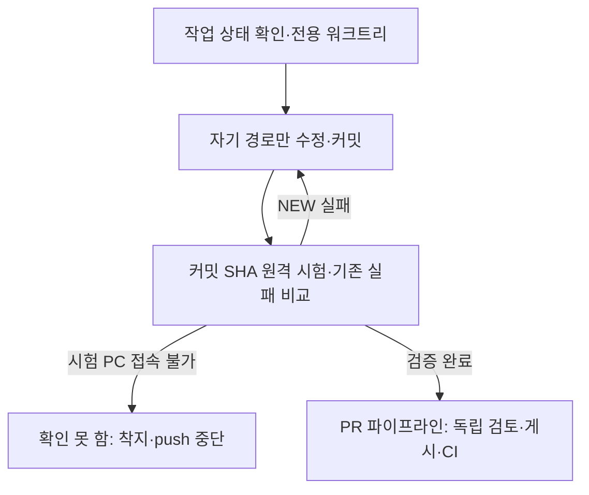

# 같이 하는 깃: 실험실 공유 체크아웃

- **대상:** 실험실 PC에서 `main` 체크아웃 하나를 여러 AI 세션과 같이 쓰는 사람·에이전트
- **팀원 개인 클론이라면** 이 문서 대신 [git으로 일하는 법](git-workflow.md)과 [팀 가이드](team-guide.md)를 따른다. 두 길의 비교도 [git으로 일하는 법](git-workflow.md) §1에 있다.
- **GitHub 게시·병합:** 로컬 착지와 별도로 [PR 파이프라인](pr-pipeline.md)을 따른다. 작성·독립 검토 두 에이전트가 확인하고 게시 담당 한 명이 올린다.
- **갱신:** 2026-10-21 — 사용자 지시로 main 포함 운영 상한을 10개에서 15개로 변경. 2026-10-18 착지 단위로 나누기, `MAIN-RED`. 2026-10-14 워크트리 관문 도구(D-761). 명령 전문은 [AGENTS.md](../../AGENTS.md) 「같이 하는 깃」.

## 워크트리 한도와 슬롯 운영

2026-10-21 사용자 지시에 따른 운영 기준은 **main 포함 최대 15개**다.
이 절이 운영 예산의 정본이며, 아래 기존 절차의 도구 상한보다 먼저 적용한다.
`tools/worktrees.py`의 자동 차단값은 현재 `.worktrees/` 50개(D-824)다.
그 값은 남아 있는 기계적 안전장치이며 15개를 넘겨 일상 작업을 시작해도 된다는 뜻이 아니다.
이번 규칙 기록은 도구의 상수·자동 차단 동작을 변경하지 않는다.

1. **만들기 전에 센다.** main에서 `git worktree list`와 `python tools/worktrees.py status`를 확인한다.
   main 1개와 작업 디렉터리 최대 14개를 합산한다. 잠금·머지 대기·검토 대기·장기 보류·고아 디렉터리도 슬롯을 차지한다.
   평소에는 main 포함 13개 이하로 유지하고 나머지 두 자리는 착지·정리·장애 수습에 남긴다.
   같은 작업의 독립 검토자는 기존 워크트리를 읽기 전용으로 검토하며, 검토자 수만큼 워크트리를 만들지 않는다.
   병렬 세션의 생성 슬롯은 사용자나 지정된 한 디스패처가 순서대로 배정한다. 각 세션이 동시에 빈자리를 확인해 중복 배정하지 않는다.
   공통 배정 담당자가 정해지지 않았다면 각자 새 슬롯을 만들지 말고 현재 점유와 대기 작업을 먼저 보고한다.
2. **15개이면 신규 착수를 멈춘다.** 우회 경로나 다른 저장소 복사본으로 새 작업 공간을 만들지 않는다.
   먼저 아래 표의 순서로 한 슬롯을 확보한다. 할 수 있는 정리가 없으면 현재 개수·소유자·해제 조건을 알리고 새 작업은 대기시킨다.
   기존에 15개를 넘긴 경우에도 진행 중인 작업을 지워 숫자를 맞추지 않고, 신규 생성을 중단한 상태에서 같은 순서로 줄인다.
3. **작업마다 소유자와 다음 행동을 남긴다.** gateway가 기록한 소유자·세션과 브랜치에 작업 목적을 대응시킨다.
   인계에는 HEAD, 미커밋 유무, 마지막 검증 SHA·로그, 다음 행동과 재개 조건을 적는다.
   40분 동안 커밋이 없으면 기존 디스패처 규칙에 따라 상태를 확인한다. 유휴 시간만으로 삭제하지 않는다.
4. **완료 시 슬롯을 돌려준다.** 필요한 변경을 명시적 경로로 커밋하고 공식 원격 검증·검토 후, 이미 받은 착지 승인 범위에서 `tools/land.py --tests auto`로 main에 반영한다.
   NEW 실패나 시험 PC 연결 실패는 머지를 막는다. 통과하지 않은 변경을 숫자 정리 목적으로 머지하지 않는다.
   완료 후 main에서 ancestry·깨끗한 상태를 확인하고 `python tools/worktrees.py prune --apply`로 정리한다.
   도구가 유휴·소유자 사유로 보존하면 그 사유를 남기고, 이미 승인된 정리 범위에서 소유자·디스패처가 해당 대상만 재검증한다.
5. **장기 대기는 브랜치와 증거로 보존한다.** 장비·키·사람 검토를 기다리며 당일 재개할 수 없는 작업은 물리 워크트리를 계속 점유할 필요가 있는지 확인한다.
   보존 후 제거할 때는 브랜치·HEAD, 서로 다를 수 있는 index와 작업 파일, 무시 파일 중 사용자 데이터, 복구 위치를 함께 기록하고 복원 가능성을 검증한다.
   장기 보존 백업은 `<우산>/artifacts/worktree-backups/`에 둔다. Git 밖 저장 위치는 상위 AGENTS.md를 따른다.
   `prune --snapshot`은 기존 규칙대로 사람·디스패처만 사용하며, 기존 승인 범위를 확인한다. 도구가 잠금·무시 파일·이전 이력 때문에 거절하면 강제 삭제하지 않는다.

| 슬롯 회수 순서 | 처리 |
|---|---|
| 1. main에 반영됐고 깨끗한 작업 | 소유자·잠금·유휴 조건을 확인하고 기존 prune으로 제거한다. |
| 2. 완료 가능한 미커밋 또는 미머지 작업 | 실제 diff를 현재 main과 대조한다. 이미 반영된 변경은 중복 커밋하지 않고, 필요한 변경만 커밋·검증·착지한 뒤 제거한다. |
| 3. 재개 조건을 기다리는 작업 | 검증된 보존본과 인계 기록을 남긴 뒤 승인 범위에서 워크트리만 제거한다. 미머지 브랜치·복구 ref는 유지한다. |
| 4. 진행 중이거나 잠긴 작업 | 소유자의 현재 작업과 잠금 해제 조건을 확인한다. 동료의 미커밋·진행 중 Git 작업을 정리 대상으로 삼지 않는다. |

잠금은 슬롯 예외가 아니다. 잠금 이유에는 소유자·대기 사유·해제 조건을 남기고, 디스패처는 새 슬롯을 배정할 때 다시 확인한다.
`stale-history`는 직접 머지하지 않고 필요한 변경만 현행 main에서 복구한다.
스냅샷은 복구 수단이며 정식 커밋·원격 검증·머지 완료로 계산하지 않는다.
개수만 줄이기 위한 `reset`, `clean`, 무조건적인 `--force` 삭제는 사용하지 않는다.
한도 초과는 사람의 명시적 사고 대응·일회성 전환 승인에 한하며 사유·담당·회수 조건을 기록한다.
`--force-over-cap`은 도구의 50개 장벽을 우회하는 사고 대응 옵션이지 운영 한도 15개의 일반 예외가 아니다.

## 같이 하는 깃

여러 세션이 이 저장소의 `main` 체크아웃 하나와 git 인덱스 하나를 같이 쓴다.
GitHub에 보이는 이 절이 착수 순서의 공개 기준이다. 같은 규칙의 명령 전문은
`AGENTS.md`의 「같이 하는 깃」에 적는다. 문구를 바꿀 때는 두 절을 한 커밋에서
같이 고친다. 실험실 PC에서 이 저장소의 상위 폴더에 있는 우산 문서 `..\AGENTS.md`(git 밖)도
같은 절차를 적는다. 명령 카드는
[`.claude/skills/rosy-land-on-main/SKILL.md`](../../.claude/skills/rosy-land-on-main/SKILL.md)다.
브랜치 이름과, 남의 미커밋을 지우지 않는 이유는
[D-372](../adr/D-372-topic-branch-names-and-shared-checkout-wip.md)다.

작업 위치를 분리하고 자기 파일만 커밋한 뒤, 원격 시험과 검토를 거쳐 게시한다.

제품 파일을 고치기 전에 1번과 2번이 끝나 있어야 한다. 끝난 기준은 `git worktree list`에
자신의 `.worktrees/<짧은이름>`이 있고, 그 디렉터리의 브랜치가 `main`이 아닌 것이다.

1. **작업 위치를 만든다.** 저장소 루트에서 `git status --short --branch`와
   `git worktree list`를 본 다음
   `python tools/worktrees.py new <짧은이름> <type>/<topic>`
   을 실행한다. 맨손 `git worktree add`는 쓰지 않는다. `<type>`은 내용과 맞는
   `feat`, `fix`, `refactor`, `docs`, `uiux` 가운데 하나다(D-372). 한 브랜치에는 한 주제만 둔다.
   착지 단위로 나눈다: 한 브랜치는 따로 착지할 수 있는 관심사 하나와 한 모듈 계열이고, 바뀐 파일이 15개를 넘거나 `tools/land.py --dry-run`이 FULL을 찍으면 먼저 나눌 수 있는지 본다(FULL 한 라운드는 시험 PC에서 30~90분이다). FULL 트리거(`tools/harness/**`, `contracts/foundation/**`)나 공유 자산(`shared/web`)을 바꾸는 부분은 제품 변경과 다른 브랜치로 먼저 착지한다. D-766 한도의 95% 이상인 파일·단위에 더할 일은 그 나누기 브랜치를 먼저 착지한다. 배경은 `docs/solutions/workflow-issues/landing-blockers-cost-hours-2026-10-18.md`다.
   이 도구는
   아무것도 지우지 않고, 치울 수 있는 끝난 워크트리 개수와
   `python tools/worktrees.py prune --apply`를 알린다(D-761, Proposed). 그 명령은
   누가 만들었든 깨끗하고, `main`에 들어갔고, 잠기지 않았고, 충분히 쉰 것만
   지운다. 충분히는 브랜치에 자기 커밋이 있고 `main`에 들어간(착지한) 것이면 1시간, 그 밖의 것은 72시간이다(D-790, Proposed).
   git이 더는 모르는 `.worktrees/` 아래 디렉터리(orphan)도 1시간 쉬면 지운다. 캐시와 `.omc/state` 밖의 파일이 있으면
   먼저 `$ROSY_SCRATCH/worktree-orphans/<이름>-<날짜>.zip`에 보관하고 그 보관 파일을 다시 열어 확인한 뒤에만 지운다.
   `status`의 `landed-dirty`(착지한 브랜치의 워크트리에 미커밋 파일)는 새 워크트리로 옮기고, `stale-history`(이력 재작성 이전 줄기)는
   병합·착지하지 않는다. 자신이 만든 것(소유자 기록이 같고 세션 id까지 같은 것)은 깨끗하고 `main`에 들어갔고 그 브랜치에 자기 커밋이 있으면 바로 지운다. 더럽거나 `main`에 안 들어간 것은 `--snapshot`의 몫이고 소유자를 가린다.
   `.worktrees/` 아래가 50개 이상이면 만들지 않는다. `prune --snapshot`은 사람이나
   디스패처만 돌린다. 오래 둘 워크트리는 `git worktree lock`으로 잠근다. worktree는 이 저장소의 `.worktrees/`에만 둔다. 공유
   `main` 체크아웃은 `git merge --ff-only`로 착지할 때만 쓴다. 거기에 커밋되지
   않은 변경을 남기면 다른 세션의 fast-forward가 거절된다. 스크래치, 로그,
   pytest 출력은 저장소 밖 `$ROSY_SCRATCH`에 둔다(없으면 시스템 임시 폴더. 실험실 PC는 `ROSY_SCRATCH=X:\DevTemp`).
2. **자기 경로만 스테이징한다.** `git add`에는 이번 작업에서 자신이 만든 경로만
   적는다. `git add -A`, `git add .`, 디렉터리 단위 add는 쓰지 않는다. 인덱스
   하나가 모든 세션의 것이라 넓은 add 한 번이 다른 세션의 파일을 커밋에 넣는다.
   자신이 쓰지 않은 경로는 그대로 둔다. stash, revert, checkout, restore, reset,
   clean, amend, 삭제로 치우지 않는다. 루트의 추적되지 않은 `list.txt`는 로컬
   메모라 커밋하지 않는다. 머지나 체크아웃이 그 파일 때문에 거절되면 파일을
   그대로 두고 거절 문구를 사용자에게 알린다.
3. **계약을 읽고 고친다.** 제품 파일을 고치기 전에 [README 「핵심 계약」](../../README.md#핵심-계약)과
   `AGENTS.md`의 Working In This Directory를 읽는다. 외부 API, 모드, 프로토콜
   필드는 그 문서가 가리키는 SRS, API reference, ADR에 있는 것만 쓴다. 읽기가
   끝난 기준은 바꾸려는 경로의 모듈 `AGENTS.md` 또는 해당 ADR을 연 것이다.
4. **ADR 번호는 파일을 만들기 직전에 도구로 선점한다.** 다른 세션이 몇 분 사이에
   같은 번호를 가져간다. `python tools/harness/adr_reserve.py next "<주제>"`를
   돌리고 찍힌 번호를 쓴다. 도구가 로컬 ref `refs/adr/D-nnn`을 만들고, 같은 ref는
   한 세션만 만들 수 있다(D-510). 그 ADR이 브랜치와 같이 착지하지 않거나 충돌로
   못 쓰게 되면 `tools/harness/adr_gaps.txt`에 `D-nnn 이유` 한 줄을 넣는다.
   ADR 파일과 Log 행은 한 커밋이다. 자세한 내용은 `AGENTS.md`의 「같이 하는 깃」
   4번에 적혀 있다. API reference 버전(`**Version:** v1.NNN`)도 같은 방식으로 `python tools/harness/api_reserve.py next "<주제>"`가 `refs/api/v1.NNN`을 선점하고, 번호를 바꿀 때는 `python tools/harness/api_reserve.py bump v1.NNN` 한 번이 헤더·테스트·`app.py`의 고정값만 옮긴다(자신의 changelog 행 제목은 손으로 고친다).
5. **테스트는 기존 실패와 비교한다.** 워크트리에서 관련 pytest 결과를 저장소
   밖의 `run-1.txt`에 남기고 `python test/known_failures.py`에 그 파일을 넘긴다.
   pytest는 이 노트북에서 돌리지 않는다. `tools/remote/remote_pytest.py`가 모델 PC(OMEN),
   AI PC, 현장 PC 가운데 여유가 있는 곳(현장 PC는 맨 뒤, D-568)에서 돌리고 로그를 `$ROSY_SCRATCH\<이름>\`로 가져온다. pre-push와
   `tools/land.py`가 이를 쓴다. 시험 PC가 하나도 닿지 않으면 노트북으로 넘어가지 않고 10분 동안 30초마다 다시 시도한 뒤 실패로 끝낸다(D-584). 그 시험은 "확인 못 함"이고 착지와 푸시는 하지 않는다. `--local`과 `ROSY_TEST_LOCAL`은 오류로 거절한다. 커밋된
   HEAD만 보내므로 먼저 커밋한다. Gazebo는 노트북에서 돌리지 않고
   `python tools/remote/remote_pytest.py --pick sim`이 고른 PC에서 돌린다.
   로그 경로는 `$ROSY_SCRATCH\<이름>\run-1.txt`다. exit 1의 `NEW`는 그
   브랜치의 실패다. 고친 실패의 줄은 같은 커밋에서 `test/known_failures.txt`에서
   뺀다. 그 브랜치가 만든 실패를 그 파일에 넣지 않는다. 호스트 pytest 통과는
   장치, ARM64 이미지, 현장 수용을 대신하지 않는다.
6. **착지와 푸시는 사용자가 말한 뒤에만 한다.** 기본 방법은 워크트리에서
   `python tools/land.py --tests auto`다. 이 도구는 시험 회차 전에 착지 대기열(`<git-common-dir>/rosy-land-queue/`, D-803)에서 표를 받고, 앞선 착지가 끝날 때까지 순번과 앞선 브랜치를 찍으며 기다린다. `--queue-timeout` 분(기본 180)을 넘으면 아무것도 병합·시험하지 않고 멈춘다. 맨 앞이 되면 `main`을 한 번 병합하고 시험한다. 표는 끝날 때(오류와 Ctrl-C 포함) 풀리고, 죽은 프로세스의 표(같은 호스트에서 pid 없음, 또는 3시간 동안 새로 고쳐지지 않음)는 다음 세션이 지운다. `--no-queue`는 사고 대응 때만 쓴다. FULL 티어가 통과한 뒤 `main`이 움직이면 다음 회차는 그 뒤 `main` 변경분의 선택만 돈다. 실행이 끊겨(시험 PC 끊김, Ctrl-C, 회차 상한) `land.py`를 다시 돌려도, 브랜치가 그때 시험한 변경과 `main` 병합만 가지고 있으면 같은 규칙을 쓴다(`<git-common-dir>/rosy-land-full/`, D-803 6). 브랜치에 자기 커밋이 더해졌으면 FULL을 다시 돈다. 손으로 할 때 착지는 워크트리에서 `git merge main`을
   하고 관련 테스트를 다시 돌린 다음, `main` 체크아웃에서
   `git merge --ff-only <브랜치>`를 한다. `--ff-only`가 거절되면 그 문구를
   알리고, 다른 세션 파일을 치운 뒤 다시 시도하지 않는다. 멈춘 라운드의 NEW id는 `main`에서 한 번 더 돌린다. 거기서도 실패하는 id는 `MAIN-RED`로 찍히고 멈춤 문구가 main이 깨졌다고 적는다. 그때는 자기 브랜치를 고치지 말고, 동료가 이미 고치는지 본 다음 main만 고치는 작은 `fix/` 브랜치를 먼저 착지한다. `tools/land.py`는 치울 수 있는
   끝난 워크트리 개수를 알리기만 한다(`--prune`을 주면 치운다). 착지한 자신의 워크트리는
   `main` 체크아웃에서 명령 하나 `python tools/worktrees.py prune --apply`로 치운다. 보류하는 브랜치는 커밋해 두면 남고, 워크트리까지 남기려면
   `git worktree lock`으로 잠근다. 푸시는 사용자가 말한 뒤에만 하고, 순서는
   [D-868](../adr/D-868-local-main-first-merge-commit-publish.md)이다. 모든 변경은 로컬 `main`에 먼저
   착지한다. `origin/main`이 로컬 `main`의 조상이 아니면 워크트리에서 `git merge origin/main`으로 합쳐
   착지한다. `generate` 뒤 로컬 `main`의 끝을 `publish/main-<YYYYMMDD>` 브랜치로 push해 PR을 열고,
   `ci-result`가 녹색이면 `gh pr merge <PR> --merge --match-head-commit <SHA>`로 merge commit 병합한다.
   병합 뒤에는 로컬 `main`에서 만든 워크트리에서 `git merge origin/main`을 하고 `tools/land.py`로 착지한다(역동기화). 그 사이 착지가 있으면 fast-forward가 되지 않으므로 `--ff-only`로 맞추지 않는다. squash·rebase 병합과 force-push는 하지 않는다.
   로컬 `main`이 `origin/main`보다 앞에 있으면 그 커밋의 CI 증거는 아직 없다.

주제 브랜치는 `origin/main`이 아니라 로컬 `main`에서 만든다. 이미 게시한 브랜치는 `git merge`로 갱신하고 force-push하지 않는다. 공개 GitHub 게시·검토·병합은 [PR 파이프라인](pr-pipeline.md)을 따른다.

착수 다음에 손댈 제품 규칙은 [README 「핵심 계약」](../../README.md#핵심-계약)이다.
