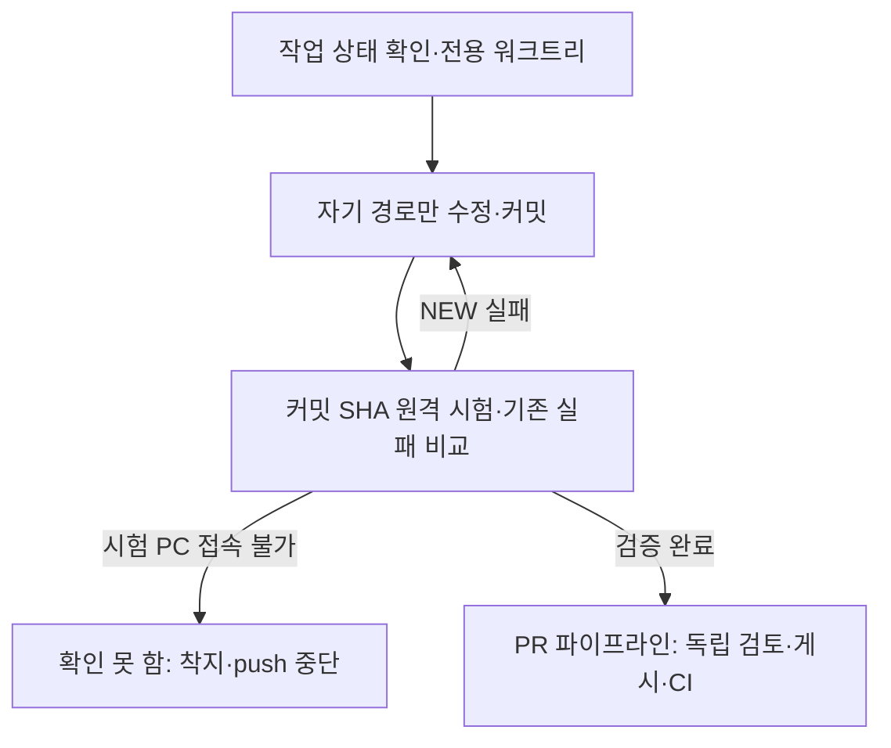

# 같이 하는 깃: 실험실 공유 체크아웃

실험실 체크아웃을 함께 쓰는 사람·에이전트의 착수 순서다. 개인 클론은 [팀 가이드](team-guide.md)를 따른다. 명령·예외 전문은 [AGENTS.md](../../AGENTS.md#같이-하는-깃), 공개 게시·검토·병합은 [PR 파이프라인](pr-pipeline.md)이 맡는다.

## 같이 하는 깃

이 절은 착수 순서의 공개 기준이다. 루트 `AGENTS.md`는 같은 순서의 전문을 소유한다. 절차를 바꾸면 두 문서와 실험실의 우산 `AGENTS.md`를 함께 맞춘다. 명령 카드는 [rosy-land-on-main/SKILL.md](../../.claude/skills/rosy-land-on-main/SKILL.md), 주제 브랜치와 공유 작업 보존의 이유는 [D-372](../adr/D-372-topic-branch-names-and-shared-checkout-wip.md)를 본다.

작업 위치를 분리하고 자기 파일만 커밋한 뒤, 원격 시험과 검토를 거쳐 게시한다.



### 착수 순서

1. `git status --short --branch`와 `git worktree list`로 현재 작업을 확인한다. 전용 위치는 아래 관문으로 만든다. 완료 기준은 worktree 목록에 `.worktrees/<짧은이름>`이 있고 브랜치가 `main`이 아닌 것이다. 제품 파일은 그 안에서만 고친다.

   ```bash
   python tools/worktrees.py new <짧은이름> <type>/<topic>
   ```

   type은 `feat`, `fix`, `refactor`, `docs`, `uiux` 중 하나다. main 체크아웃에 미커밋 변경을 남기지 않는다. 다른 세션의 파일은 지우거나 stash하지 않는다.

2. 자신의 파일만 `git add <파일> ...`로 올리고 `git diff --cached --name-only`로 확인한다. `git add -A`와 `git add .`는 쓰지 않는다. 공유 Log에 동료의 행이 있으면 자신의 hunk만 스테이징한다. 루트의 미추적 `list.txt`는 개인 메모로 보존한다. 다른 파일 때문에 명령이 거절되면 그 파일을 치우지 않고 거절 내용을 보고한다.

3. 수정 전 바꿀 경로의 `AGENTS.md`와 [핵심 계약](../../README.md#핵심-계약)을 읽는다. 외부 API·모드·프로토콜 필드는 SRS·API reference·ADR에 있는 것만 쓴다.

4. ADR·API 버전이 필요할 때는 쓰기 직전에 예약 도구를 사용한다(D-510). ADR 본문과 Log 행은 한 커밋에 넣고 Log의 UTF-8 BOM·CRLF를 유지한다. 다른 클론과 예약 ref는 공유되지 않는다. 사용하지 않거나 이번 브랜치에 포함하지 못한 번호는 gap 사유를 기록한다. 상세 명령은 `AGENTS.md`를 따른다.

5. 생성 기록을 갱신하고 자기 변경을 커밋한 뒤 그 SHA를 검증한다. pytest는 이 노트북에서 돌리지 않는다. 관련 시험을 아래 실행기로 요청하고 모든 결과를 기존 실패와 비교한다.

   ```bash
   python tools/remote/remote_pytest.py --log-dir <저장소-밖-로그폴더> -- <시험경로>
   python test/known_failures.py <저장소-밖-로그폴더>/run-1.txt
   ```

   실험실 로그 표기는 `X:\DevTemp\<이름>\run-1.txt`다. `X:`가 없으면 현재 실행기의 임시 폴더 기본값이나 명시한 외부 로그 폴더를 쓴다. `NEW`는 깨끗한 main 기준선에서 달리 확인되기 전까지 내 브랜치 실패다. 고친 항목은 같은 커밋에서 `test/known_failures.txt`에서 빼고, 자기 실패를 추가하지 않는다. 호스트 시험 통과는 장치·ARM64 이미지·현장 수용을 대신하지 않는다.

   시험 PC에 닿지 못하면 로컬 pytest로 바꾸지 않는다. 실행기의 제한된 재시도 후 확인 못 함으로 보고하며 착지·push하지 않는다.

6. 로컬 착지는 사용자 승인 후 `python tools/land.py --tests auto`를 쓴다. 수동 착지는 워크트리에서 `git merge main` 후 시험하고, main에서 `git merge --ff-only <브랜치>`한다. 거절되면 다른 세션의 파일을 보존하고 이유를 보고한다. GitHub 게시 권한이 있으면 [PR 파이프라인](pr-pipeline.md)으로 이어 간다. 미게시 브랜치는 최신 `origin/main` 위로 rebase하고, 게시한 브랜치는 merge로 갱신한다. 생성 기록과 pre-push 검사를 통과한 head를 독립 검토 기록과 맞춘다. force-push는 하지 않는다.

### 정리할 때

`python tools/worktrees.py status`로 소유자와 정리 가능 여부를 확인한다. 손실 없는 정리는 `python tools/worktrees.py prune --apply`를 사용하며 `main` 반영·청결·소유권 조건은 `AGENTS.md`를 따른다. `prune --snapshot`은 미병합·미커밋 작업도 정리하므로 사람이나 디스패처만 실행한다. 보류 작업은 커밋하고, 워크트리도 유지해야 하면 `git worktree lock`으로 잠근다.
