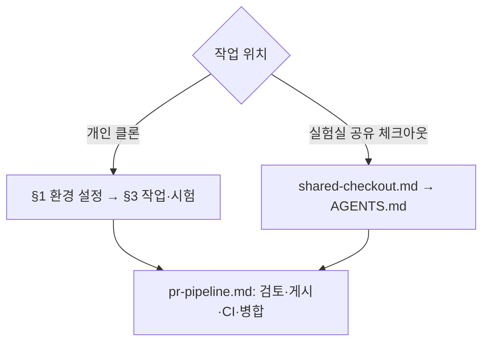

# ROSY 팀 가이드

- **대상:** `robotics-team-1213` org에 새로 합류한 팀원
- **갱신:** 2026-10-30 — §3.4 번호 선점 알림 강화, §3.6 인계 검증 문장(2026-10-30 협업 방안). 2026-10-17. 문서 구조는 D-777을 적용했다. 환경 설치 명령의 새 클론 확인일은 2026-10-05다.
- **규칙 원본:** 이 문서는 안내다. 계약과 다르면 [README 「핵심 계약」](../../README.md#핵심-계약), SRS, ADR이 이긴다. git 규칙 전체는 [git으로 일하는 법](git-workflow.md), 날짜별 작업 현황은 [인수인계](handoff.md)다.

**먼저 작업 위치를 고른다.** 이 문서의 브랜치·시험·push 명령은 팀원 **개인 클론**용이다. 실험실 공유 체크아웃에서 일하는 사람·AI 세션은 [같이 하는 깃](shared-checkout.md)과 루트 [AGENTS.md](../../AGENTS.md)를 따른다. 실험실 노트북에서 pytest를 돌리지 않는 규칙은 그대로다(D-762 Decision 4). 개인 클론의 설정·훅 예외는 이 문서, 게시·검토·CI 기준은 [PR 파이프라인](pr-pipeline.md)이 맡는다.



## 1. 첫날 설정

### 1.1 준비물

| 무엇 | 확인 명령 | 없으면 |
|---|---|---|
| GitHub 계정 | — | github.com 가입 |
| Git (Windows는 **Git for Windows** — Git Bash 포함) | `git --version` | git-scm.com |
| **Python 3.12** (기준 버전) | `py -3.12 --version` (Windows) / `python3.12 --version` | python.org 3.12 설치 |

### 1.2 org 초대 수락

메일의 초대 링크, 또는 https://github.com/orgs/robotics-team-1213/invitation 에서 **Join**.
수락 후 `rosy-platform`의 주제 브랜치에 push할 권한을 확인한다. 권한이 없으면 리드에게 팀 소속과 **write** 권한을 확인받는다. `main`은 PR로 반영한다.

### 1.3 클론과 작성자 설정

```bash
git clone https://github.com/robotics-team-1213/rosy-platform.git
cd rosy-platform
git config user.name  "<내 GitHub 아이디>"
git config user.email "<내 GitHub 이메일>"
```

`<내 GitHub 이메일>`은 GitHub → Settings → **Emails**에 있는 주소 중 하나다. 메일 주소를 공개하고 싶지 않으면 같은 화면의 `숫자+아이디@users.noreply.github.com` 주소를 쓴다.

> 이 이메일이 **내 계정에 등록된 것**이어야 GitHub이 커밋을 내 이름으로 보여 준다. 다른 사람 이메일을 쓰면 커밋이 그 사람 것으로 표시된다. 확인: `git config user.email`

### 1.4 Python 환경

저장소 루트에서 실행한다. `.venv/`는 gitignore되어 있다.

**Windows (PowerShell)**

```powershell
py -3.12 -m venv .venv
.\.venv\Scripts\Activate.ps1
```

`Activate.ps1`이 실행 정책 때문에 막히면 활성화 대신 `.\.venv\Scripts\python.exe`로 아래 Python 명령을 실행해도 된다. 조직에서 정한 실행 정책을 먼저 확인한다.

**Linux / WSL / macOS**

```bash
python3.12 -m venv .venv
source .venv/bin/activate
```

**공통 — 의존성 설치.** 로봇 이미지와 같은 버전으로 맞춘다 (D-189).

아래는 공통 개발 도구다. 작업할 모듈의 추가 의존성은 해당 `AGENTS.md`와 패키지 설정을 확인한다.

```bash
python -m pip install --upgrade pip
python -c "import re; src=open('deploy/robot/pinky_pro/image/device-python-requirements.txt'); open('.venv/constraints.txt','w').write(''.join(l.split()[0]+'\n' for l in src if re.match(r'[A-Za-z0-9._-]+==', l)))"
python -m pip install -c .venv/constraints.txt fastapi uvicorn pydantic starlette websockets pyyaml httpx jsonschema pytest
```

### 1.5 시험 PC 접속과 pre-push 훅

현재 훅은 lint·생성 기록·안전 리뷰·공개 범위를 검사하고, **시험은 실험실 시험 PC로 보낸다**. 인터넷만 연결된 개인 클론에서는 시험 단계가 실패할 수 있다. 훅 분리는 D-762 단계 4의 후속 작업이다.

실험실 시험 PC가 설정되어 있고 접속할 수 있다면 훅을 설치한다.

Windows는 **Git Bash**에서, 나머지는 터미널에서:

```bash
bash tools/hooks/install.sh
```

`installed .../pre-push`가 나오면 설치가 끝난다. 이후 `git push`마다 검사하고, 시험 PC가 없으면 기본적으로 최대 10분 기다린 뒤 실패한다. **push할 때도 venv를 켠 터미널**에서 한다. 장비 설정은 추적되는 [예제](../../tools/remote/hosts.example.json)를 참고해 gitignored `private/lab-hosts.json`에 두며 실제 값은 리드에게 비공개로 받는다.

시험 PC에 닿지 못하는 **개인 클론**은 §3.1의 수동 검사 후 주제 브랜치에만 훅 예외를 쓴다. 이미 훅이 설치되어 있어도 삭제할 필요는 없다. 실험실 공유 체크아웃에는 이 예외를 적용하지 않는다.

Windows에서 로그 위치를 직접 정하려면 push할 PowerShell에서 `$env:ROSY_TEST_LOGS = Join-Path $env:TEMP 'rosy-tests'`를 설정한다. 현재 실행기는 `X:`가 없으면 시스템 임시 폴더를 기본값으로 사용하며, 시험 로그는 저장소 밖에 둔다.

### 1.6 설정 확인

```bash
python tools/harness/rosy_harness.py lint
```

마지막 줄이 `0 error(s)`면 오류 검사를 통과했다. 경고는 내용을 확인하고, 이번 변경에서 새로 생긴 것은 해결하거나 PR에 이유를 적는다.

### 1.7 실물 장비 접속 — Tailscale

로봇, 관제 PC, 모델 PC는 실험실 LAN에 있다. 장비를 사용할 팀원은 **Tailscale** 초대와 접근 권한을 리드에게 받는다. 계정 정원과 이용 조건은 초대 시 현재 팀 설정을 확인한다. 코드·문서만 기여한다면 장비 접속은 첫 PR의 필수 조건이 아니다.

1. 리드가 보낸 **Tailscale 초대 메일**을 수락한다.
2. https://tailscale.com/download 에서 앱을 설치하고 그 계정으로 로그인한다.
3. **Linux만:** `sudo tailscale up --accept-routes` — 로봇 LAN 경로를 받는다. Windows·macOS는 기본으로 켜져 있다.

| 대상 | 접속 | 키 |
|---|---|---|
| 관제 PC, 모델 PC | `ssh <계정>@<Tailscale 장비 이름>` | 필요 없음 — Tailscale 로그인이 인증 (Tailscale SSH) |
| 로봇 | `ssh <로봇 별칭>` | 리드가 주는 **팀 키 묶음**(zip) — 압축을 풀고 안의 `README.md`대로. passphrase는 다른 경로(메신저)로 받는다 (D-418) |
| Fleet 콘솔 | 브라우저 `https://<관제 PC>:<콘솔 포트>` | 콘솔 로그인 |

실제 주소·장비 이름·포트는 **Notion 비공개 페이지**에 있다. 이 저장소에는 적지 않는다 (D-226).

> 로봇 LAN에서 팀원에게 열리는 것은 **팀 장비 고정 IP 구간(.200 이상)** 과 관제 PC, 모델 PC뿐이다. 개인 노트북·휴대폰은 닿지 않는다. 새 팀 장비를 들이면 리드가 공유기에서 .200 이상 고정 IP를 준다.

### 1.8 첫날 체크리스트

- [ ] org 초대 수락, People에 내 아이디가 보인다
- [ ] `git config user.email`이 내 GitHub 이메일
- [ ] venv를 켜면 `python --version`이 3.12.x
- [ ] 시험 PC 접속 여부에 따라 §1.5의 훅 사용 경로를 정했다
- [ ] `rosy_harness.py lint`가 `0 error(s)`
- [ ] 실물 장비를 사용할 경우 Tailscale·SSH 접속 권한을 확인했다
- [ ] §4 읽기 순서의 1–3번을 읽었다

## 2. 공유하는 것 / 공유하지 않는 것

| 무엇 | 어디 | 누가 보나 |
|---|---|---|
| 코드, ADR, SRS, API reference, 계획·검증 문서 | GitHub `robotics-team-1213/rosy-platform` | **전 세계 공개** |
| 환경 설정, 내부 운영 절차, 고정 버전·배포·복구 기록 | [비공개 `rosy-ops`](https://github.com/robotics-team-1213/rosy-ops) | 저장소 접근 권한이 있는 팀원 |
| 원본 영상·MCAP·운영 DB | 접근 제한 자료 저장소 | 자료별 허용 대상 |
| 버그, 할 일, 진행 상황 | GitHub Issues, 저장소 문서. Projects는 접근 가능한 보드가 있을 때 연결 | 공개 |
| 회의록, 일정 — **사람이 쓰는 것** | Notion 팀 페이지 (리드가 게스트로 초대) | 팀 |
| 현장 주소, 로봇 IP, 장비 이름, 접속 정보 | Notion 비공개 페이지 | 팀 |
| Notion MCP 연동 키 | 리드가 사람마다 따로 만들어(`rosy-<이름>`) 메신저로 전달. Claude로 Notion을 고칠 사람만 | 본인 |
| 로봇 SSH 팀 키 묶음 + passphrase | 리드가 zip과 passphrase를 **서로 다른 경로**로 전달. 만료 90일 | 팀 |

Notion 연동 키는 팀 페이지에만 연결된다. 비공개 페이지(주소·접속 정보)에는 어떤 연동도 연결하지 않는다. 팀원이 빠지면 그 사람의 연동 키와 Tailscale 계정을 지운다.

`rosy-ops`의 첫 범위는 Fleet·웹·시뮬레이션 staging 설정과 검사 CI다([D-784](../adr/D-784-public-source-private-ops-staging.md)). 현재 설정은 `HOLD`이며 실제 호스트는 배포하지 않았다. 후속 담당자는 비공개 저장소의 `docs/staging.md`에서 대상·담당자·접속 범위·격리 근거를 확인한다. 제품 코드는 공개 저장소에서만 관리하고 토큰·비밀번호·개인키는 두 Git 저장소 모두에 넣지 않는다.

**저장소에 절대 올리지 않는 것.** 공개 저장소라 한 번 push하면 회수할 수 없다.

| 금지 | 대신 |
|---|---|
| 릴리스 서명 키 | 서명은 리드가 오프라인 로컬에서만 한다 (D-437) |
| 로봇 SSH 비밀번호·개인 키 | 접속 등록 절차 [robot-ssh-access.md](../deployment/robot-ssh-access.md) (D-418) |
| 실제 로봇 IP·현장 주소·계정 | 문서에는 `<robot-ip>`처럼 쓴다 (D-226) |
| API 토큰 (W&B, Notion, Bearer …) | 환경변수로 읽는다 |

GitHub push protection이 알려진 형식의 토큰은 push 단계에서 막는다. 형식이 없는 값은 못 막으니 `git diff`로 직접 확인한다.

## 3. 일하는 방법 — 이슈에서 머지까지

### 3.1 순서

작업·시험 후 [PR 파이프라인](pr-pipeline.md)에서 최종 커밋 검토와 게시를 진행한다.

```bash
# 1) 개인 클론: 미커밋 변경을 확인한 뒤 최신 origin/main에서 브랜치
git status --short --branch
git fetch origin
git switch -c feat/<짧은-주제> origin/main  # type: feat | fix | refactor | docs | uiux

# 2) 작업 — 고칠 경로의 AGENTS.md와 관련 ADR을 먼저 연다

# 3) 개인 PC의 정적 검사와 바꾼 범위의 시험 (venv 켠 상태)
python tools/harness/rosy_harness.py lint
python tools/harness/rosy_harness.py affected --base origin/main --run

# 4) 커밋 — 내가 바꾼 파일만
git status --short
git add <파일> <파일>
git commit -m "feat(fleet): 한 줄 요약"

# 5) 에이전트 작업은 최종 SHA 독립 검토 후 실행한다 (pr-pipeline.md).
# 실험실 시험 PC에 접속할 수 있는 clone: 훅 검사 후 push
git push -u origin feat/<짧은-주제>
```

작업 전에 [작업 이슈 양식](https://github.com/robotics-team-1213/rosy-platform/issues/new/choose)으로 담당 경로와 완료 조건을 남긴다(§3.6). 미커밋 변경이 있으면 먼저 그 작업의 담당과 내용을 확인하고, 정리하려고 지우거나 stash하지 않는다.

시험 PC에 닿지 못하는 개인 클론은 3번의 결과를 보관하고, 생성 기록(`python tools/harness/rosy_harness.py generate`), 변경 diff의 공개 범위, 안전 경로의 독립 리뷰·trailer를 확인해 필요한 변경을 커밋한다. 에이전트 작업은 [PR 파이프라인](pr-pipeline.md)의 최종 SHA 독립 검토까지 마친 뒤 다음 push를 실행한다. 예외는 시험 PC에 닿지 못하는 개인 클론의 주제 브랜치 push에만 적용한다. lint·시험 실패에는 적용하지 않는다.

```bash
git push --no-verify -u origin feat/<짧은-주제>
```

6. PR에 이슈·담당 경로·의존 PR·검증 SHA·결과·훅 예외를 적는다. 작업 중이면 Draft로 공유한다.
7. [PR 파이프라인](pr-pipeline.md)에 따라 독립 검토와 최신 SHA의 CI를 확인한 뒤 병합한다. 원격 브랜치는 자동 삭제된다. 남은 후속 작업을 확인하고 끝난 이슈만 닫는다.

### 3.2 규칙

| 규칙 | 이유 |
|---|---|
| 한 브랜치 = 한 주제, 이름은 `<type>/<topic>` (D-372) | 리뷰와 되돌리기가 쉽다 |
| Jira 이슈가 있으면 브랜치·커밋·PR 제목에 키(`kan-27`, `(KAN-27)`, `[KAN-27]`)를 넣는다. 권장이며 막지 않는다 | Jira 이슈 화면과 스프린트 리뷰 표가 이 키로 이어진다 ([Jira · Confluence 연결 안내](atlassian-integration.md)) |
| `git add -A` / `git add .` 대신 파일을 지정 | 의도하지 않은 파일·비밀값이 섞이지 않게 |
| 외부 API·모드·프로토콜 필드는 SRS·API reference·ADR에 있는 것만 | 로봇·Fleet·앱이 같은 계약을 본다 |
| 계약·구조를 바꾸는 결정은 ADR (§3.4) | 말로 정한 것은 남지 않는다 |
| `concern: safety` 경로를 바꾸는 커밋은 메시지에 `Safety-Review: <리뷰어> <근거>` 줄 (D-430 §5) | CI가 검사한다. 경로는 `tools/harness/platform_parts.yaml` |
| force-push 하지 않는다 | 다른 사람의 작업이 사라진다 |
| **실물 로봇을 움직이기 전에 반드시 먼저 묻는다** | 로봇은 팀이 같이 쓴다. 기본은 Gazebo 시뮬 |

### 3.3 시험 결과 읽기

```bash
python -m pytest <경로> -q -rfE -p no:cacheprovider > ../run.txt
python test/known_failures.py ../run.txt
```

`NEW`는 깨끗한 main 기준선에서 별도로 확인되기 전까지 내 브랜치 실패로 다룬다. `known`은 등록된 기존 실패와 일치한다는 뜻이다. 수집 오류·미실행 검사를 통과로 쓰지 않는다. 호스트 pytest 통과는 장치·ARM64 이미지·현장 수용이 아니다.

이 명령도 개인 PC용이다. 실험실 공유 체크아웃은 먼저 커밋하고 원격 시험 절차를 쓴다. 로그에는 시험한 SHA·명령·환경을 같이 남긴다. `affected`가 FULL을 선택해도 기본 `--run`은 관련 묶음만 실행하므로 전체 통과로 기록하지 않는다. PR의 CI가 전체 범위를 확인한다. 이번 변경에서 생긴 실패를 `known_failures.txt`에 추가해 넘기지 않는다.

### 3.4 ADR 쓰기

1. 번호는 파일을 만들기 **직전에** `python tools/harness/adr_reserve.py next "<주제>"`로 선점하고 찍힌 번호를 쓴다(D-510). 선점 ref는 로컬에만 있다. ADR이 브랜치와 같이 착지하지 않거나 버린 번호는 `tools/harness/adr_gaps.txt`에 `D-nnn 이유` 한 줄로 넣는다.
2. `docs/adr/D-<번호>-<slug>.md`와 ADR Log 행을 **한 커밋**에.
3. `python tools/harness/rosy_harness.py lint`

**다른 PC의 클론끼리는 번호 선점이 공유되지 않는다.** 번호를 선점하면 즉시 그 이슈의 기록용 코멘트에 알린다(개인 클론에서 에이전트를 돌릴 때도 같다, 2026-10-30 협업 방안). 열린 ADR PR과 중복을 확인한다. 같은 번호가 생기면 담당자끼리 하나를 다시 선점해 파일·Log 행·참조를 함께 고친다. 로컬 선점 성공을 전역 예약으로 취급하지 않으며, CI의 중복 검사를 확인한다(D-762).

### 3.5 main이 앞서 나갔을 때

아래는 이미 공유한 개인 주제 브랜치를 갱신하는 방법이다. 실험실 착지·push는 [같이 하는 깃](shared-checkout.md)의 별도 순서를 따른다.

```bash
git fetch origin
git merge origin/main      # 충돌을 고치고 커밋
git push
```

충돌은 파일을 맡은 사람과 두 변경의 의도를 확인해 해결한다. API·안전·이어 쓰는 Log의 상대 변경을 통째로 덮지 않는다. 갱신 뒤 관련 시험과 PR 최신 커밋의 CI를 다시 확인한다.

### 3.6 동시 작업과 인수인계

1. **시작 전에 이슈를 맡는다.** [작업 양식](https://github.com/robotics-team-1213/rosy-platform/issues/new/choose)에 담당 GitHub 아이디, 고칠 경로, 완료 조건, 선행 이슈·PR을 적는다. 할당 권한이 없으면 댓글로 담당 의사를 밝힌다. 같은 경로의 열린 이슈·PR과 실험실 워크트리 작업을 확인한다. 각 담당자는 GitHub에 아직 없는 실험실 작업도 요약해 겹침을 알린다.
2. **경로가 겹치면 순서를 정한다.** 서로 다른 모듈은 각 브랜치에서 진행한다. 같은 파일은 통합 담당자 한 명과 먼저 머지할 PR을 이슈에 적고, 후속 담당자는 그 변경을 받아 시작한다. API reference·ADR Log·공용 계약처럼 소비자가 많은 파일은 계약 변경과 소비자 변경의 순서도 적는다. 로컬 번호 선점은 다른 클론의 충돌을 막지 못한다(§3.4).
3. **진행 상황은 이슈와 Draft PR에 남긴다.** 상태는 준비 / 진행 / 막힘 / 리뷰 / 완료 중 하나로 제목 아래나 댓글에 적는다. 막힘에는 이유와 풀리는 조건을 적고, Projects 보드가 있으면 같은 상태로 맞춘다. 보드가 없어도 이슈·PR만으로 진행할 수 있다.
4. **중단·교대할 때 아래 기록을 남긴다.** 공개 범위만 넣고, 비공개 접속 값은 §2의 경로로 전달한다. 에이전트는 사용자가 외부 게시를 요청한 경우에만 GitHub 댓글·이슈·PR을 작성한다. 그렇지 않으면 커밋된 브랜치와 기록을 전달해 사람이 게시할 수 있게 한다.
5. **끝났는지 결과로 확인한다.** 이슈의 완료 조건, 필요한 리뷰, PR 최신 SHA의 CI를 확인하고 머지한다. 인계받은 검증 기록은 수용자가 다시 확인한다 — 동료·에이전트의 주장은 입력이지 사실이 아니다(2026-10-30 협업 방안). 머지된 PR 링크와 남은 후속 이슈를 이슈에 기록한다. 후속 작업까지 끝난 이슈만 닫고, 담당 경로를 해제한다.

```text
상태: 진행 / 막힘 / 리뷰 / 완료
이슈 / PR:
담당자 / 맡은 경로:
브랜치 / 마지막 커밋 SHA:
완료한 것:
검증: SHA, 실행 위치, 명령, 결과 또는 CI 링크
미실행 검사와 이유:
막힌 점 / 선행 PR:
다음 행동 / 다음 담당자:
```

## 4. 읽기 순서

| # | 문서 | 읽을 때 |
|---|---|---|
| 0 | [인수인계](handoff.md) — 목표, 지금 상태, 다음 할 일 · [git으로 일하는 법](git-workflow.md) | 10분, 필수 |
| 1 | [README](../../README.md) — 「핵심 계약」 | 5분, 필수 |
| 2 | [CONCEPTS.md](../../CONCEPTS.md) | 10분, 필수 |
| 3 | [STATUS.md](../../STATUS.md) — 모듈별 게이트 (SOURCE → LOCAL → ROS-SIM → ARTIFACT → DEVICE → FIELD) | 5분, 필수 |
| 4 | [개발 가이드](developer-guide.md) — 구조·빌드·시뮬·테스트 | 맡을 일을 정한 뒤 |
| 5 | 맡을 모듈의 `AGENTS.md`, `progress.md` | 작업 시작 전 |
| 6 | [CORE SRS](../spec/ROSY%20CORE%20SRS.md), [FLEET SRS](../spec/ROSY%20FLEET%20SRS.md), [API reference](ROSY%20API%20&%20Protocol%20Reference.md) | 필요할 때 |

## 5. 무엇을 작업하나

### 5.1 작업 영역

소스 경로와 책임은 [폴더 책임표](platform-folder-responsibilities.md), 소유 영역의 정본은 `tools/harness/platform_parts.yaml`을 본다. 경로별 GitHub 리뷰 담당은 [CODEOWNERS](../../.github/CODEOWNERS), 역할별 사람 담당은 아래 표에서 확인한다.

2026-10-27 기준 배정이다. 담당은 리드가 정한다. 각 root의 역할은 `platform_parts.yaml`의 `capability:`이고, 계정은 같은 파일의 `capabilities:`에 둔다. Epic 담당이 바뀌면 그 계정, `CODEOWNERS`, 이 표를 함께 고친다. `test/architecture/test_capability_owners.py`가 앞의 둘이 맞는지 확인한다. `platform`(공통 코드)은 기본 담당(`*`)이 리뷰한다.

| Epic | 역할 | 담당 |
|---|---|---|
| KAN-19 | 관제·충전·물류 (`fleet`) | 장원종 (@livsbittt) |
| KAN-20 | Pinky (`pinky`) | 노재용 (@PURPLE-SY) |
| KAN-21 | OMX (`omx`) | 김승용·서정민 공동 (@sajy0804, @ddaokki) |
| KAN-22 | 비전·AI (`vision_ai`) | 윤영민 (@now2466) |
| KAN-23 | 통합 시나리오·시연·일정 | 민주환 (@WINNAKEN, PM) 조율, 전원 참여 |

KAN-23은 특정 경로의 담당이 아니다. Epic의 역할을 GitHub 경로 소유권으로 확대하지 않는다. 실물 팔·로봇 장치·이미지 경로(`middleware/devices/`, `middleware/drivers/`, `deploy/robot/`, OMX 연동)는 역할 담당과 기본 담당이 함께 리뷰한다.

### 5.2 처음 잡기 좋은 일

장치 없이 할 수 있는 열린 이슈부터 고른다. CI 문제는 실패한 실행 링크와 SHA를 확인하고, 모듈 작업은 [STATUS.md](../../STATUS.md)의 검증 상태와 완료 조건을 읽는다. 같은 일이 이미 진행 중이면 §3.6에 따라 순서를 정한다.

## 6. 막혔을 때

| 증상 | 원인 → 해결 |
|---|---|
| `py -3.12`가 `No suitable Python runtime found` | 3.12가 없거나 py 런처에 등록되지 않았다 → python.org에서 3.12 설치 |
| push할 때 `[pre-push] no python interpreter with PyYAML` | venv가 꺼진 터미널에서 push → venv 켜고 다시 |
| push할 때 `user.email ... is not yours` | 작성자 이메일이 잘못됨 → §1.3 |
| push할 때 `generated records are regenerated but uncommitted` | `python tools/harness/rosy_harness.py generate`가 바꾼 파일(`STATUS.md`, `docs/index.md` 등)을 커밋 |
| `main`에 push가 거절됨 | 정상. `main`은 PR로만 → §3.1 |
| push가 `secret detected`로 거절됨 | 토큰이 커밋에 들어갔다 → 그 커밋에서 빼고 환경변수로 |
| pre-push가 **내가 건드리지 않은** 시험에서 실패 | `python test/known_failures.py`로 확인. `NEW`는 main 기준선에서 별도로 확인되기 전까지 내 브랜치 실패로 다룬다. 실패를 훅 예외로 넘기지 않는다 |
| 개인 클론에서 실험실 시험 PC를 찾지 못함 | §1.5와 §3.1의 접속 불가 예외를 따른다. 수동 검사 결과와 예외 이유를 PR에 기록한다. 실험실 세션에는 적용하지 않는다 |
| 로봇·관제 PC 주소에 닿지 않음 | Tailscale 앱이 켜져 있는지 → Linux는 `--accept-routes` (§1.7) → 그래도 안 되면 리드에게 (권한 정책) |
| 로봇 `ssh`가 `Permission denied (publickey)` | 팀 키 묶음 설정이 안 됨, 또는 만료(90일) → 리드에게 새 묶음 요청 |
| 줄 끝 경고 `LF will be replaced by CRLF` | 무시해도 된다 (`.gitattributes`가 정한다) |

## 7. 소통

| 용도 | 어디 |
|---|---|
| 버그, 할 일, 질문 | GitHub Issues (접근 가능한 Projects 보드가 있으면 같은 상태로 연결) |
| 코드 리뷰 | PR 코멘트 |
| 회의, 일정, 비공개 자료 | Notion |
| 결정 | ADR (`docs/adr/`) |

## 8. 협업 설정 확인과 문서 유지

현재 GitHub 설정과 조회 명령은 [PR 파이프라인의 GitHub 설정](pr-pipeline.md#github-설정)에서 관리한다. 관리자는 설정 변경과 표 갱신을 같은 PR에 담는다. 계획과 적용 조건은 [D-762](../adr/D-762-main-gateway-pull-request-merge-queue.md)를 따른다.

온보딩 명령이나 훅이 바뀌면 해당 PR에서 이 가이드도 고친다. 문서 표현과 기준 문서의 역할은 [D-777](../adr/D-777-concise-human-agent-documentation.md)을 따른다.

이슈 양식은 [GitHub issue forms 문법](https://docs.github.com/en/communities/using-templates-to-encourage-useful-issues-and-pull-requests/syntax-for-issue-forms)을 따른다. 기본 브랜치 반영 뒤 [새 이슈 화면](https://github.com/robotics-team-1213/rosy-platform/issues/new/choose)에서 작업·버그 양식을 확인한다. Projects는 접근 가능한 보드가 있을 때 같은 상태로 연결하며, 보드가 없어도 Issues로 작업을 추적한다.
