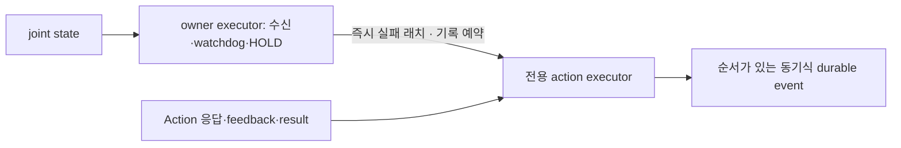

# OMX feedback 격리 · 2026-10-17

[기존 실패 기록](pipeline-modules-2026-10-17.md)과 [issue #68](https://github.com/robotics-team-1213/rosy-platform/issues/68)의 후속 조사다. GitHub-hosted ROS 2 Jazzy에서 실행하며 실제 장치·vendor Gazebo·staging 배포는 범위 밖이다.

## 실패 재현

| 소스 SHA · 실행 | 관측 |
|---|---|
| commit `f516f71c668d34e99f4d0d9ed75eeb8811286dcf` · [39010304643](https://github.com/robotics-team-1213/rosy-platform/actions/runs/39010304643) | native 2 failed / 7 passed. 외부 발행 간격 약 10ms에 owner 수신 나이는 1.51s·1.05s로 0.5s 기준 초과 |
| commit `7ada13f55a164923cbb7908a7116a4bf178a1b25` · [39011139939](https://github.com/robotics-team-1213/rosy-platform/actions/runs/39011139939) | 첫 executor 분리 뒤 native 3 failed / 10 passed. 4-worker timeout에서 수신은 fresh였지만 `last_terminal_decision` 게시가 지연됨 |

feedback sink와 timeout 기록이 같은 event-delivery lock을 사용했다. owner가 HOLD·cancel을 적용한 뒤 timeout 기록을 동기 호출하면 watchdog도 sink를 기다렸다. 실행 권한 우회는 관찰하지 않았다.

추가한 1-worker MTE에서는 freshness·초기 admission도 실패했다. 원인은 확정하지 않았고 해결로 분류하지 않는다. [공식 Jazzy 구현](https://github.com/ros2/rclpy/blob/jazzy/rclpy/rclpy/executors.py#L894-L897)의 권고에 따라 직렬 회귀는 SingleThreadedExecutor를 사용한다. 기존 4-worker MTE와 freshness 0.5s 기준은 유지한다.

## 수정과 검증 범위

액션 이름은 owner에서 먼저 해석해 namespace·relative/private 이름·remap을 보존한다. timeout과 cancel 호출 예외의 기록은 전용 executor에 예약한다. 예약 실패에 owner 스레드에서 sink를 호출하지 않으며, 늦은 결과도 owner HOLD를 풀지 않는다. action 전달은 `ros_trajectory_action.py`, owner 조립은 `ros_runtime.py`가 맡고 기존 import 경로를 유지한다.

회귀 시험은 직렬 ST·4-worker MTE 각각에서 정상 완료와 sink가 막힌 상태의 timeout을 확인한다. 막힘 해제 전에 수신·완료된 watchdog poll·HOLD 게시·새 명령 거절, 해제 후 늦은 SUCCEEDED와 순차 event 전달을 검사한다. 상대/private 이름·remap·반복 종료와 예약 실패도 포함한다.

구현·회귀 기준은 commit `2a214ec49430df824713428fba262d1ddef2d9d8`이다. 문서를 포함한 최종 검토 head·실행 SHA·개별 CI 결과는 [PR #83](https://github.com/robotics-team-1213/rosy-platform/pull/83)에 기록한다. PR 병합 전에는 해당 head, 병합 후에는 main 전체 CI를 확인한다. `ci-result`만으로 `modules` 통과를 판단하지 않는다.

원격 시험 PC는 사용자 지시로 생략했다. 노트북 pytest는 실행하지 않았다. 이 호스트 회귀가 실제 stop·복구·DEVICE/FIELD 수용을 대신하지 않으며 비공개 staging은 HOLD다.
